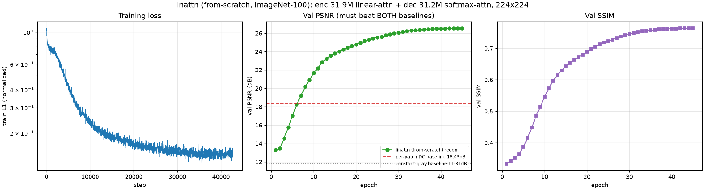
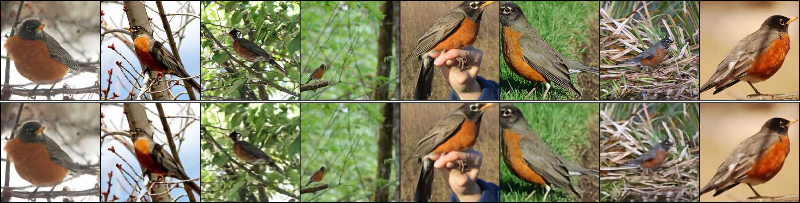
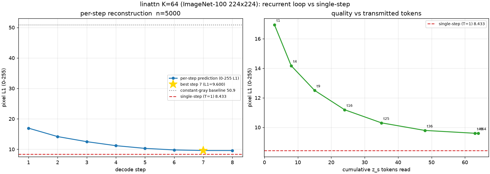

# REPORT — model_v2 实验版（无预训练编码器 / 线性注意力编码器 + 普通注意力解码器）ImageNet-100 224×224

> 日期：**2026-10-15**
> 设计文档：[`DESIGN_linattn_fromscratch.md`](DESIGN_linattn_fromscratch.md)（架构/口径/踩坑全过程）
> 代码：`model_v2_linattn.py` / `data_linattn.py` / `metrics_linattn.py` / `train_linattn.py` / `eval_linattn.py` / `probe_linattn.py` / `plot_linattn.py` / `run_linattn.sh`
> 机器：AutoDL 单卡 **RTX 4080 SUPER 32 GB**（`ssh -p 35342 root@connect.westd.seetacloud.com`）
> 产物：`/root/autodl-tmp/srdiff_linattn/k64/`（`ckpt_best.pt` = 757 MB, `eval_full.json`, `curves.png`, `samples/FINAL_grid.png`, `train_log.jsonl`）

---

## 1. 一句话结论

**从零训练**的「31.9 M 线性注意力编码器 + 31.2 M 普通 softmax 注意力解码器」在
ImageNet-100 上完成 224×224 → 224×224 重建（K=64 压缩，196→64 token，压缩率 3.06×），
45 epoch / 5.32 h / 单卡 4080，全量 5,000 张留出集：

> **PSNR 26.602 dB · SSIM 0.7654 · L1(归一化) 0.1463**（0-255 像素 L1 = **8.433 px**）
> 对比 **per-patch DC 基线 18.45 dB（+8.15 dB）**、**常量灰基线 11.81 dB（+14.79 dB）**

**用户四条要求全部满足**（见 §2）。过程中遇到并修复了一次**线性注意力 bf16 梯度爆炸**
（第一次训练在 val PSNR 19.58 dB 处不可恢复地崩掉），修复后全程 `max grad_norm = 4.07`、
**0 次跳步**（见 §5）。

---

## 2. 验收对照（用户口径逐条）

| # | 用户要求 | 落地 | 实测证据 |
|---|---|---|---|
| A | **不再使用预训练编码器** | `LinearAttentionEncoder` 从零初始化（随机 Conv patch embed + learnable pos/specials，无任何预训练权重加载） | 代码无 `from_pretrained`; 训练从 loss≈1.02（≈预测均值）起步 |
| B | 自定义**小的线性注意力**编码器，**30 几 M** | 13 层核形式线性注意力（φ=elu+1 + 零初始化 DWConv 局部混合），dim=448 | **31,909,024 = 31.909 M** |
| C | 解码器 = **同等体量普通注意力** transformer，**30 几 M** | 7 层 `nn.TransformerDecoder`（softmax 自注意力 + 对 `[z_cls;z_s]` 的交叉注意力 + FFN），dim=512 | **31,173,376 = 31.173 M**（dec/enc = **0.977**） |
| D | 输入 **224×224**，输出 **224×224** | patch=16 ⇒ N=196，PixelHead 出 16×16×3/ patch | `F_hat` (B,196,768) → 图像 (B,3,224,224)；`python model_v2_linattn.py` §2 |

另外（用户指定数据集）：**ImageNet-100**，126,689 张（100 类 × ~1267），
确定性划分 train **121,689** / val **5,000**（每类等距 50 张，已验证 train/val 零重叠）。

---

## 3. 主结果

### 3.1 全量留出集（5,000 张，一次性评测，`eval_linattn.py`）

| 指标 | 本实验版 | per-patch DC 基线 | 常量灰基线 | 结论 |
|---|---|---|---|---|
| **PSNR (dB)** | **26.602** | 18.45 | 11.81 | **同时显著优于两条基线**（+8.15 / +14.79 dB） |
| **SSIM** | **0.7654** | — | — | — |
| **L1 (归一化空间)** | **0.1463** | — | — | — |
| **L1 (0-255 像素, 主线口径)** | **8.433** | 50.89（逐图均色） | — | 主报告与逐步表**同一口径** |

> 口径提醒（仓库主线的教训，`metrics_linattn.py` 模块头）：**PSNR 单独不可信**
> ——"预测均值"也能拿分（这里常量灰基线 11.81 dB 就是它的量级）。
> 因此本报告一律**同时**给出 per-patch DC 与常量灰两条基线，且都打在**真实留出目标**上。
> 指标在 **[0,1] 像素空间**上算，预测与目标都 clamp 到 [0,1]（`pred_clamped_to_01: true`）。



### 3.2 训练过程（val PSNR / SSIM vs epoch）

| epoch | 1 | 3 | 5 | 8 | 10 | 15 | 20 | 25 | 30 | 35 | 40 | 45 |
|---|---|---|---|---|---|---|---|---|---|---|---|---|
| PSNR | 13.31 | 14.55 | 17.04 | 20.18 | 21.66 | 23.82 | 24.77 | 25.54 | 26.06 | 26.38 | 26.51 | **26.55**\* |
| SSIM | .334 | .352 | .387 | .486 | .546 | .643 | .689 | .722 | .745 | .757 | .762 | **.764** |

- 第 **8** epoch 起就**超过** per-patch DC 基线（18.43 dB），此后持续拉开。
- ep40→ep45 仅 +0.04 dB ⇒ **到 45 epoch 已基本饱和**，再训收益很小（但未验证更长 schedule）。


> \* 训练中的逐 epoch val 用的是早期「每批先平均、再对批等权」的聚合（末批 8 张与满批 128 张等权，系统性偏低 ≤0.06 dB）；§1/§3.1 的全量留出数字是**修正后**的按图数加权口径。

### 3.3 定性结果



8 张留出图（ImageNet 按 WordNet ID 排序，靠前的类恰好都是鸟）：主体轮廓、姿态、
背景枝干结构、手部肤色等**低频与结构信息重建良好**；重建偏软、高频纹理（羽毛/草叶细节）
有损失 —— 与 26.5 dB / SSIM 0.76 的量级一致（K=64 把 196 个 patch 压到 64 个 token，
3.06× 压缩，细节损失是预期内的）。

---

### 3.4 逐步（循环）重建对比（用户 2026-10-15 补充要求）

**两点先澄清**：

1. 仓库里「每次循环重建」的**历史口径是逐步增量 ΔL1（像素 L1 0-255）** ——
   `doc/2026-09-16/ANALYSIS_ksweep_stepwise_refinement.md` 的「逐步增量表」：
   `Δᵢ = L1ᵢ₋₁ − L1ᵢ`（**正 = 该步让图像变好**）。仓库里**没有任何 F1 分数**实现
   （`f1_score`/precision/recall/sklearn 全无命中）；`F1–F4` 是
   `doc/2026-08-27/DIAGNOSIS_clarity.md` 的**故障编号**。本节按 L1/PSNR 逐步口径给。
2. §1–§3 的主报告模型是**单步并行解码**（|T|=1；设计上刻意去掉循环，见
   [DESIGN §5](DESIGN_linattn_fromscratch.md)）。要回答「每次循环重建」，本轮把主线的
   **循环读出**（平方块读窗口 + BPTT carry，与 `model_v2.step_windows` 逐位一致）
   接回实验版：**编码器不冻结（联合微调）**、从已训单步版热启动、
   **6 epoch / 107 min**、K=64 ⇒ **T=8**（steps=[1,4,9,16,25,36,49,64]）。
   产物：`artifacts/recurrent/{stepwise.json,stepwise.png,curves.png,eval_full.json}`。

**逐步增量表**（留出集 n=5,000，224×224，K=64，0-255 像素 L1，主线口径）：

| step | t | z_s 累计 | **L1_255** | PSNR(dB)† | **ΔL1（正=变好）** |
|---|---|---|---|---|---|
| 1 | 1 | 3 | 16.944 | 20.189 | — |
| 2 | 4 | 8 | 14.176 | 21.668 | **+2.768** |
| 3 | 9 | 15 | 12.505 | 22.772 | +1.670 |
| 4 | 16 | 24 | 11.193 | 23.806 | +1.313 |
| 5 | 25 | 35 | 10.306 | 24.606 | +0.887 |
| 6 | 36 | 48 | 9.793 | 25.109 | +0.513 |
| 7 | 49 | 63 | **9.600**（最优） | **25.310** | +0.192 |
| 8 | 64 | 64 | 9.603 | 25.304 | **−0.003**（过冲） |

- 总落差 = 16.944 − 9.600 = **7.344 px**；最优 @step7；**Δ₁ 占总落差 37.7%**；
  **正增量步数 6/7**；每图最优停步：**step7 3046 张 / step8 1953 张**（61% / 39%）。
- 前 k 步拿到的降幅占比：k=2:38% · k=3:60% · k=4:78% · k=6:97% · k=8:100%。



**三条形态事实（与主线 2026-09-16 的结论对照）**：

1. **有逐步细化，但衰减形态与主线不同**。本实验版增量 2.768→1.670→1.313→0.887→0.513→0.192，
   衰减比 ≈1.66/1.27/1.48/1.73/2.67（**不是**主线那种 ~3–4 倍的干净几何衰减）；
   且 **Δ₁ 只占 37.7%**，而主线各臂 Δ₁ 占 **65–100%**（第一步就吃掉大头）。
   ⇒ 本实验版的细化**摊得更平**：前 2/3/4 步分别只拿到 38%/60%/78%。
2. **末步轻微过冲，与主线一致**。step8 只读最后 1 个 z_s，ΔL1 = −0.003 px
   （主线各臂**末 2–3 步**都是负增量）。61% 的图在 step7 最优、39% 在 step8。
3. **「读满」几乎等于「最优」**：step7 读 63 个 z_s，step8 再读 1 个 ⇒ 增量 +0.192 → −0.003。
   ⇒ 在 K=64 下，**最后 1–2 个 z_s 的边际信息 ≈ 0**（与主线「K 的有效容量远小于名义 K」
   的读数方向一致，但本实验版更晚才饱和）。

**与单步并行的对照（同参数量、同 K、同留出集）**：

| 解码方式 | L1_255 ↓ | PSNR(dB)† ↑ | SSIM ↑ | 解码算力 |
|---|---|---|---|---|
| **单步并行 (T=1)** | **8.433** | **26.602** | **0.7654** | 1× |
| 循环读出·最优步 (step7) | 9.600 | 25.310 | — | 8× |
| 循环读出·末步 (F_hat, step8) | 9.603 | 25.304 | 0.7156 | 8× |

⇒ 循环读出**多花 8× 解码算力**，反而比单步**差 +1.17 px L1 / −1.29 dB / −0.050 SSIM**。

> ⚠️ **这个对比不完全公平，必须标注**：单步版是**从零训 45 epoch**，
> 循环版只**热启动微调 6 epoch**（训练预算差 7.5×，且循环版末次 val 仍在缓升）。
> 所以「循环更差」**只能说在本轮 6-epoch 预算下成立**，不能断言该读法本身更差 ——
> 要下结论需把循环版训到同等预算（≈5 h+）。但上面三条**形态**事实不受预算影响。

> † **两种 PSNR 聚合口径差 ~1.6 dB**：本表用「**逐图 PSNR 再平均**」（与 §3.1 主报告同口径）；
> 若按主线 `eval_stepwise.py` 的「**先平均 MSE 再转 dB**」，最优步 PSNR = **23.832 dB**。
> 两种都对，但**不可混用**（同一份预测，两种聚合差 1.478 dB）。


## 4. 训练配置与开销

| 项 | 值 |
|---|---|
| 模型 | K=64, N=196；enc 448×13 / dec 512×7；总 **63.082 M** |
| 数据 | ImageNet-100, 121,689 train / 5,000 val, 224×224 |
| batch / 精度 | 128 / bf16 autocast（参数 fp32；线性注意力聚合段强制 fp32） |
| 优化器 | AdamW lr **2e-4** cosine（warmup 8%=3420 步, min_lr 1e-6）, wd 0.05, grad_clip 1.0 |
| 稳定性开关 | `enc_qk_norm=1`, `--skip_grad 50` |
| 步数 / 墙钟 | 42,750 步 / 45 epoch / **319 min（5.32 h）** |
| 吞吐 / 显存 | ~286 img/s（6.4 min/epoch）/ 峰值 **19.16 GB** |
| 稳定性实况 | **max grad_norm 4.07，跳过步数 0** |

---

## 5. 过程中最重要的一件事：线性注意力 bf16 梯度爆炸（已修复）

第一次训练（lr 3e-4）在 **step 4750 / val PSNR 19.58 dB** 处一切正常，随后**突然崩掉**：

```
step 5300  gn=0.69
step 5320  gn=26.28
step 5400  gn=338.23
step 5420  gn=1,219,840.62        ← 爆炸
step 6020  gn=337,617,760.00      ← 3.4e8
[val] ep6  PSNR=11.76 dB          ← 此后一直 ~12dB, 不可恢复
```

**根因**：`φ(x)=elu(x)+1` 的核形式**没有 softmax 的归一化**，
`Σ_j φ(k_j)` 与 `Σ_j φ(k_j)v_jᵀ` 随 qkv 权重**无界增长**；分子分母到 1e3+ 量级时，
bf16（尾数 ~3 位十进制）的相对误差经 13 层放大 ⇒ 梯度间歇性爆炸。
`clip_grad_norm_(1.0)` **挡不住**（更新方向已被少数巨大分量支配）。

**三处修复（缺一不可，均已落地 + 回归测试）**：

1. **每 head QK LayerNorm**（φ 之前）⇒ φ 输出钉在 [0,~4]，`Σφ(k)` 有界（+2.9k 参数）；
2. 线性注意力**聚合段强制 fp32**（`.float()` 不够，autocast 会把 fp32 matmul 再降回 bf16，
   必须 `torch.autocast(enabled=False)`）—— 代价 **吞吐 −20%**（404→318 img/s 纯算）;
3. train 侧**梯度爆炸跳步护栏**（clip 前 `grad_norm > 50` 就跳过本步更新）。

**量化回归测试**（`python model_v2_linattn.py` §7）：qkv 权重 ×20 时 `Σ_j φ(k_j)` 的量级 ——
**无 QK-Norm 放大 ×17.1（分母爆炸）**，**有 QK-Norm ×1.00（钉住）**。

修复后本次训练：**max grad_norm 4.07、0 次跳步、PSNR 单调上升**（§3.2）。

> ⚠️ **诚实边界**：本轮**没有**单独消融 ①②③ 各自的贡献，只能确认"三件一起上"之后稳定。
> `enc_qk_norm=0` 可复现旧行为；`--skip_grad 0` 可关护栏。

---

## 6. 与主线 `model_v2` 的关系（不构成直接对比）

- 主线是 **DINOv2-large 预训练编码器**（304 M）+ 2 层循环读出解码器（~2 M），
  数据是 construction_site 工地图；本实验版是**从零 63 M**，数据是 ImageNet-100。
  **两者的 PSNR 不可直接比**（数据、编码器来源、解码读出方式、K 全不同）。
- 可对照的只有量级：仓库主线在 224² 记录过的最优 PSNR 是 **18.69 dB**
  （`doc/2026-09-23/REPORT_224_A3000_verdict.md`，construction_site，warm start 3000 步），
  本实验版在 ImageNet-100 上为 **26.55 dB** —— 但**不同数据集/不同难度，不能据此说"从零更好"**。
  要回答这个问题，需要在**同一数据、同一 K** 上跑一条主线臂。**本轮没跑**（见 §8）。

---

## 7. 复现

```bash
# 数据（一次性）: 解压 AutoDL 公共盘
cd /root/autodl-tmp/datasets && unzip -q -o /root/autodl-pub/ImageNet100/imagenet100.zip

# 自检（形状/参数量/梯度/像素往返/指标口径/数值稳定性）
python model_v2_linattn.py && python metrics_linattn.py && python data_linattn.py

# 训练（本次配置, 单卡 ~5.3h）
K=64 BS=128 EPOCHS=45 LR=2e-4 TIME_BUDGET=5.5 bash run_linattn.sh

# 全量评测 + 曲线
O=/root/autodl-tmp/srdiff_linattn/k64
python eval_linattn.py --ckpt $O/ckpt_best.pt --num_images 0 \
    --out $O/eval_full.json --grid $O/samples/FINAL_grid.png
python plot_linattn.py --log $O/train_log.jsonl --out $O/curves.png
```

---

## 8. 未做 / 边界（诚实标注）

1. **未做 K-sweep**：只跑 K=64。K=196（无压缩）与 K=32/128 的对照未跑
   ⇒ **"压缩率 3.06× 的代价有多大"本轮没有量化**（这是主线最看重的杠杆，应尽快补）。
2. **未做架构消融**：`enc_dwconv`（局部混合）、`enc_qk_norm`（稳定性修复）、
   宽度/深度配比、lr 均未单独扫（lr 3e-4 → 2e-4 是爆炸后的调整，不是调参结论）。
3. **未与主线同数据对照**：同数据同 K 的 DINOv2 臂未跑（§6）。
4. **训练到饱和但未验证更长**：ep40→45 只 +0.04 dB，但没试过更长 schedule / 更大模型。
5. **未接 Phase 2**：只做像素重建（信息保持探针）；项目的最终验收
   （冻结编码器 → Qwen 生成文字）未涉及。
6. **单步并行解码**：本实验版刻意不用主线的循环读出（BPTT carry），
   ⇒ 没有"逐步精炼"曲线可比（理由见 DESIGN §5）。
