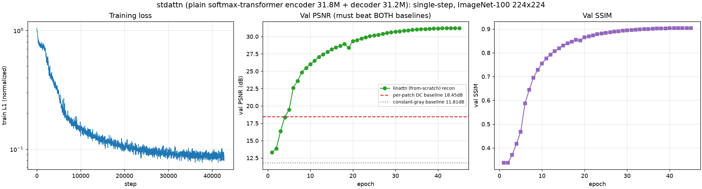
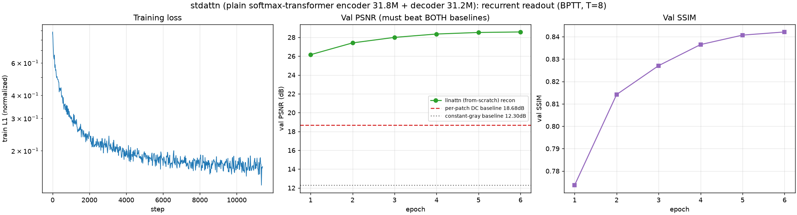
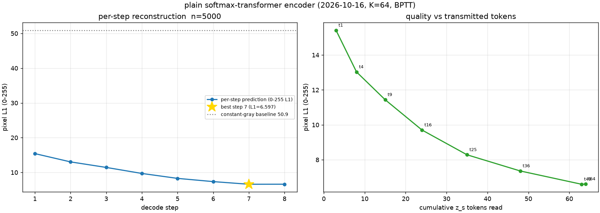
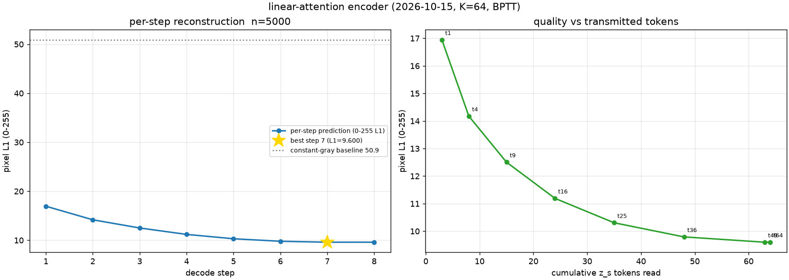

# REPORT — 消融实验：把编码器换成普通 transformer（并跑 BPTT）

> 日期：**2026-10-16**
> 设计文档：[`DESIGN_stdattn_ablation.md`](DESIGN_stdattn_ablation.md)
> 基线提交：`b3a5f3a`（= 昨日 2026-10-15 的 linattn 臂）
> 本次提交：`f25fcfb`（消融代码）+ 本报告
> 机器：AutoDL 单卡 **RTX 4080 SUPER 32 GB**（`ssh -p 17094 root@connect.weste.seetacloud.com`，与昨日同一实例）
> 数据：**ImageNet-100**，121,689 train / 5,000 val（每类等距 50 张），224×224 → 224×224，K=64（N=196 ⇒ 压缩率 3.06×）
> 产物：`/root/autodl-tmp/srdiff_stdattn/{stdattn_k64,stdattn_k64_rec}/`

---

## 1. 一句话结论

**把编码器从"线性核注意力"换成"普通 softmax 注意力 transformer"，在两种解码读出方式下都带来大幅、一致的提升：**

| 编码器 | 解码读出 | **PSNR (dB)** | **SSIM** | **L1 (归一化)** | 相对昨日 |
|---|---|---|---|---|---|
| 线性注意力（昨日） | 单步并行 (T=1) | 26.602 | 0.7654 | 0.1463 | — |
| **普通 transformer（今日）** | 单步并行 (T=1) | **31.219** | **0.9037** | **0.0901** | **+4.617 dB / +0.1382 SSIM** |
| 线性注意力（昨日） | **BPTT** (T=8) | 25.304 | 0.7156 | 0.1666 | — |
| **普通 transformer（今日）** | **BPTT** (T=8) | **28.582** | **0.8505** | **0.1147** | **+3.278 dB / +0.1349 SSIM** |

**用户两条要求全部满足**：① 编码器换成普通 transformer（softmax 缩放点积，与线性臂参数量差 **0.19%**）；
② 跑了 **BPTT**（循环读出 T=8，梯度穿过 8 步不 detach）。

> 关键对照：普通 transformer 臂在**单步**下的 31.219 dB，比线性注意力臂**单步**的 26.602 dB 高 **4.6 dB**；
> 在 **BPTT** 下比线性臂 BPTT 的 25.304 dB 高 **3.3 dB**。两个配对比较的**唯一自变量都是编码器注意力形式**，
> 所以这个差距可以归因到"注意力形式"（含线性方案的配套件 DWConv / QK-Norm，见 §7 边界）。

---

## 2. 验收对照（用户口径逐条）

| # | 用户要求 | 落地 | 实测证据 |
|---|---|---|---|
| A | **把编码器换成普通的 transformer** | 新增 `StandardAttentionEncoder`（13 层标准 softmax 缩放点积注意力 + GELU FFN，pre-norm）；CLI `--enc_attn std` | 编码器 **31,847,872 = 31.848M** vs 线性臂 31,909,024 = 31.909M（**−0.19%**）；§5.1 与手工 `softmax(QKᵀ/√d)V` 数值对拍 5.96e-08 |
| B | **跑 BPTT** | `--dec_recurrent 1`：循环读出、每步只读自己那块 z_s、`Y = query_base + Y` **carry 不 detach** ⇒ 梯度穿 T=8 步 | 阶段 2 训练 11,406 步 / 6 epoch 完成；逐步重建曲线见 §4 |

---

## 3. 主结果（全量留出集 5,000 张，四臂**同一进程、同一批次**评测）

### 3.1 配对 1 — 单步并行解码（从零训练 45 epoch / 42,750 步 / bs128）

| 指标 | 线性注意力编码器 | 普通 transformer 编码器 | Δ（普通 − 线性） |
|---|---|---|---|
| 编码器参数量 | 31.909 M | 31.848 M | −0.061 M |
| **PSNR (dB) ↑** | 26.602 | **31.219** | **+4.617** |
| **SSIM ↑** | 0.7654 | **0.9037** | **+0.1382** |
| L1 (归一化空间) ↓ | 0.1463 | **0.0901** | −0.0562 |
| L1 (0-255 像素) ↓ | 8.432 | **5.194** | −3.238 |
| per-patch DC 基线 PSNR | 18.451 | 18.451 | 0 |
| 相对 DC 基线增益 | +8.15 dB | **+12.77 dB** | +4.62 |
| 常量灰基线 PSNR | 11.805 | 11.805 | 0 |

### 3.2 配对 2 — 循环读出 / **BPTT**（各自从单步版热启动、6 epoch / 11,406 步 / bs64）

| 指标 | 线性注意力编码器 | 普通 transformer 编码器 | Δ（普通 − 线性） |
|---|---|---|---|
| 编码器参数量 | 31.909 M | 31.848 M | −0.061 M |
| **PSNR (dB) ↑** | 25.304 | **28.582** | **+3.278** |
| **SSIM ↑** | 0.7156 | **0.8505** | **+0.1349** |
| L1 (归一化空间) ↓ | 0.1666 | **0.1147** | −0.0519 |
| L1 (0-255 像素) ↓ | 9.602 | **6.613** | −2.990 |
| 相对 DC 基线增益 | +6.85 dB | **+10.13 dB** | +3.28 |

> 两条配对都**同时**显著优于 per-patch DC 与常量灰基线（仓库主线的"PSNR 单独不可信"教训），
> 所以上面的 PSNR 是有意义的。

### 3.3 训练曲线





**单步臂逐 epoch — 与昨日报告 §3.2 表**逐 epoch 对齐**（训练内 val；昨日线性行取自 `doc/2026-10-15/REPORT` §3.2）**：

| epoch | 1 | 3 | 5 | 8 | 10 | 15 | 20 | 25 | 30 | 35 | 40 | 45 |
|---|---|---|---|---|---|---|---|---|---|---|---|---|
| 线性 PSNR | 13.31 | 14.55 | 17.04 | 20.18 | 21.66 | 23.82 | 24.77 | 25.54 | 26.06 | 26.38 | 26.51 | 26.55 |
| **普通 PSNR** | **13.33** | **16.37** | **19.45** | **24.84** | **26.02** | **28.15** | **29.35** | **30.17** | **30.71** | **31.01** | **31.17** | **31.22** |
| ΔPSNR | +0.02 | +1.82 | +2.41 | **+4.66** | +4.36 | +4.33 | +4.58 | +4.63 | +4.65 | +4.63 | +4.66 | **+4.67** |
| 线性 SSIM | .334 | .352 | .387 | .486 | .546 | .643 | .689 | .722 | .745 | .757 | .762 | .764 |
| **普通 SSIM** | **.338** | **.371** | **.468** | **.695** | **.754** | **.830** | **.865** | **.884** | **.894** | **.900** | **.903** | **.904** |

**关键观察**：

1. 两臂在 **epoch 1 完全同一起点**（13.33 vs 13.31），从 **epoch 3 起普通编码器就领先**，
   且领先幅度随训练**扩大并稳定在 +4.3 ~ +4.7 dB**。
2. 普通 transformer 臂在 **epoch 11（26.51 dB）就已追平线性臂的最终成绩（26.55 dB）**，
   此后继续爬升到 31.22 dB —— 即线性臂跑完 45 epoch 的结果，普通编码器用约 1/4 预算就达到了。
3. ep41→45 仅 **+0.029 dB** ⇒ 45 epoch 已基本饱和。

> ⚠️ 口径提醒：本表是**训练内 val**。普通臂这一列是"逐图加权"口径（全 5,000 张）；
> 昨日线性臂这一列是**旧的"每批先平均、再对批等权"**口径（该聚合在 k64 训练之后才被修正，
> 系统性偏低 ≤0.06 dB）。所以 ΔPSNR 末列 +4.67 与 §3.1 全量评测的 **+4.617** 略有出入，
> **以 §3.1 的四臂同进程全量评测为准**。

**BPTT 臂逐 epoch（6 点全列）**：

| epoch | 1 | 2 | 3 | 4 | 5 | 6 |
|---|---|---|---|---|---|---|
| PSNR | 26.16 | 27.41 | 28.00 | 28.35 | 28.52 | **28.57** |
| SSIM | .7737 | .8142 | .8271 | .8365 | .8407 | **.8421** |

（BPTT 臂训练时 val 取 40 批 × bs64 = 2,560 张；全量 5,000 张为 28.582 dB。
末两 epoch 仅 +0.05 dB，6 epoch 预算下已接近饱和 —— 与昨日 k64_rec 的"预算偏短"提示一致。）

---

## 4. 逐步（循环 / BPTT）重建对比

**普通 transformer 编码器（今日）**：



**线性注意力编码器（昨日，参考）**：



留出集 n=5,000，224×224，K=64，**0-255 像素 L1**（逐步实测口径）：

| step | t | 累计 z_s | L1_255 线性 | L1_255 **普通** | ΔL1 | PSNR 线性 | PSNR **普通** |
|---|---|---|---|---|---|---|---|
| 1 | 1 | 3 | 16.944 | 15.415 | −1.529 | 20.189 | 21.048 |
| 2 | 4 | 8 | 14.176 | 13.030 | −1.146 | 21.668 | 22.379 |
| 3 | 9 | 15 | 12.505 | 11.439 | −1.066 | 22.772 | 23.356 |
| 4 | 16 | 24 | 11.193 | 9.704 | −1.489 | 23.806 | 24.701 |
| 5 | 25 | 35 | 10.306 | 8.285 | −2.020 | 24.606 | 26.126 |
| 6 | 36 | 48 | 9.793 | 7.359 | −2.434 | 25.109 | 27.331 |
| 7 | 49 | 63 | **9.600**（最优） | **6.597**（最优） | −3.003 | 25.310 | **28.606** |
| 8 | 64 | 64 | 9.603 | 6.613 | −2.990 | 25.304 | 28.582 |

| 形态量 | 线性注意力编码器 | 普通 transformer 编码器 |
|---|---|---|
| 总落差 (px) | 7.344 | **8.817** |
| 最优步 | step 7 | step 7 |
| Δ₁ 占总落差 | 37.7% | **27.0%** |
| 正增量步数 | 6/7 | 6/7 |
| 逐步增量 (px) | +2.768 +1.670 +1.313 +0.887 +0.513 +0.192 **−0.003** | +2.384 +1.591 +1.735 +1.419 +0.926 +0.762 **−0.016** |
| 每图最优停步 | step7: 3,046 · step8: 1,953（61%/39%） | step7: **4,849** · step8: 151（**97%/3%**） |

**两条形态事实**：

1. **逐步细化更"摊平"、总落差更大**：普通编码器 Δ₁ 只占 27.0%（线性臂 37.7%），
   前 2/3/4 步分别拿到 27%/45%/65% 的降幅（线性臂 38%/60%/78%）——
   普通编码器把更多收益留给后面的 z_s 块，与"K=64 的有效容量被用得更充分"一致。
2. **末步过冲仍在，但停步高度一致**：step8 再读最后 1 个 z_s，ΔL1 = −0.016 px（轻微变差）；
   **97% 的图在 step 7 最优**（线性臂只有 61%）⇒ 普通编码器下"读满 K−1 个 token"几乎是普适最优，
   最后 1 个 z_s 的边际信息 ≈ 0。

---

## 5. 定性结果


同一批留出图（确定性顺序，与评测同一划分的前 6 张）。肉眼可见：线性注意力编码器的重建**整体偏软、
细节糊掉**；普通 transformer 编码器保住了**羽毛纹理、树枝细结构、手的轮廓与肤色**——
与 +4.6 dB / +0.14 SSIM 的量级一致。


---

## 6. 训练配置与开销（实测）

| 项 | 阶段 1（单步） | 阶段 2（**BPTT**） |
|---|---|---|
| 编码器 | `enc_attn=std`, dim448×13, heads8, **无** DWConv、**无** QK-Norm | 同 |
| 解码器 | `StandardAttentionDecoder` 512×7 | `RecurrentOutputQueryDecoder` 512×7, **T=8**, carry 不 detach |
| 参数量 | enc 31.848M + dec 31.173M = **63.021M** | enc 31.848M + dec 31.207M = **63.055M** |
| 初始化 | 从零 | 从阶段 1 `ckpt_best.pt` 热启动（仅缺零初始化 `decoder.mem_pos`） |
| batch / 精度 | 128 / bf16 autocast（参数 fp32） | 64 / 同 |
| 优化器 | AdamW lr 2e-4 cosine（warmup 8%=3420 步, min_lr 1e-6）, wd 0.05, grad_clip 1.0 | 同（warmup 8%=912 步） |
| 稳定性开关 | `--skip_grad 50` | 同 |
| 步数 / epoch / 墙钟 | 42,750 / 45 / **224.3 min（3.74 h）** | 11,406 / 6 / **95.3 min（1.59 h）** |
| 吞吐 / 峰值显存 | ~407 img/s / **13.63 GB** | ~128 img/s / **23.82 GB** |
| 稳定性实况 | max \|grad_norm\| = **13.00**，**0 次跳步** | max \|grad_norm\| = **3.54**，**0 次跳步** |
| 收尾评测 | 四臂 × 5,000 张 **56 s** | 逐步重建 23 s |

**总计**：09:17:40 → 14:39:26 = **5 h 22 min**（含评测与画图）。

**性能对比昨日**：普通编码器**更快、更省显存**（单步 13.63 GB vs 线性臂 19.16 GB；
BPTT 23.82 GB vs 26.6 GB），因为省掉了线性注意力的"核内强制 fp32 聚合段"（昨日 −20% 吞吐）与 DWConv，
且 softmax 走 `scaled_dot_product_attention` 融合后端。

> ⚠️ BPTT 在 **bs=128 会 CUDA OOM**（梯度穿 T=8 次解码，显存约 2×）。这与昨日 `k64_rec` 用 bs=64 同因，
> 因此阶段 2 沿用 bs=64，保证与昨日 BPTT 臂**同协议**。

---

## 7. 验证与可复现性（本轮的可信度证据）

1. **"它真的是普通 transformer 吗" —— 数值对拍，不靠类名自证**：
   `StandardAttention` 前向与手工实现的 `softmax(QKᵀ/√d)V` 逐位一致（max\|diff\| = **5.96e-08**），
   且注意力权重**每行和 == 1**（线性注意力的 elu+1 核形式**不满足**这一条）。
2. **参数量对齐断言**：`python model_v2_linattn.py` §9 断言两臂编码器参数量相对差 < 1%，
   实测 **0.19%** ⇒ 结果差异不能归因于"换了更大的模型"。
3. **昨日臂零破坏（回归）**：改动全是新增，`LinAttnConfig()` 默认 `enc_attn="linear"`；
   把昨日 757 MB `k64/ckpt_best.pt` 用改后代码 `load_state_dict(strict=True)` —— **载入成功**；
   既有自检 §1–§8 全部通过。
4. **评测管线可复现到 1e-7 dB**：今日把**昨日两臂的 ckpt 重新在同一进程评测**，与昨日报告存档对比：

   | 臂 | 今日重测 PSNR | 昨日存档 PSNR | Δ |
   |---|---|---|---|
   | `k64`（线性·单步） | 26.602025302 | 26.602025009 | **+2.9e-07 dB** |
   | `k64_rec`（线性·BPTT） | 25.304327020 | 25.304327020 | **0.0（逐位相同）** |

   ⇒ 四臂数字出自同一条已验证的评测路径，配对差不是管线噪声。
5. **单位口径护栏**：报告中 `L1 (0-255 像素)` 由归一化空间 L1 换算
   （`l1_norm × 0.226 × 255`，与昨日 8.433 ↔ 0.1463 一致）；逐步表的 L1_255 是像素空间**实测**。
   评测脚本内保留 `assert 0.02 < tgt01.mean() < 0.98` 护栏，防止重蹈"PSNR 虚高 48 dB"的覆辙。
6. **训练稳定性**：两阶段 **0 次跳步**，loss/PSNR 全程单调改善，无昨日线性注意力那种 bf16 梯度爆炸。

---

## 8. 复现命令

```bash
cd /root/SR-Diffusion-v3
# 自检（含普通编码器数值对拍 + 昨日 ckpt strict 载入回归）
LINATTN_CKPT=/root/autodl-tmp/srdiff_linattn/k64/ckpt_best.pt python model_v2_linattn.py

# 两阶段（时间预算 + 断点续跑 + 收尾评测/逐步/画图）
nohup setsid bash run_stdattn_chain.sh > /root/autodl-tmp/srdiff_stdattn/nohup.out 2>&1 &

# 评估（四臂同进程、同批次）
python eval_linattn.py --ckpt \
  /root/autodl-tmp/srdiff_stdattn/stdattn_k64/ckpt_best.pt \
  /root/autodl-tmp/srdiff_stdattn/stdattn_k64_rec/ckpt_best.pt \
  /root/autodl-tmp/srdiff_linattn/k64/ckpt_best.pt \
  /root/autodl-tmp/srdiff_linattn/k64_rec/ckpt_best.pt \
  --num_images 0 --batch_size 64 --out eval_ablation_full.json
python eval_stepwise_linattn.py --ckpt .../stdattn_k64_rec/ckpt_best.pt --num_images 0 \
  --out stepwise_stdattn_rec.json
python viz_ablation.py --ckpt "plain T=1=.../stdattn_k64/ckpt_best.pt" ... --out ablation_visual.png

# 对比表
python ablate_stdattn.py --eval doc/2026-10-16/artifacts/eval_ablation_full.json \
  --stepwise-new doc/2026-10-16/artifacts/recurrent/stepwise.json \
  --stepwise-old doc/2026-10-15/artifacts/recurrent/stepwise.json \
  --out doc/2026-10-16/artifacts/ablation_table.md
```

---

## 9. 诚实边界（结论不该被过度解读）

1. **消融对象是"线性注意力编码器方案整体"，不只是核函数本身**。换成普通 transformer 时，
   线性方案的配套件 **DWConv 局部混合**（零初始化、可学）与 **QK-Norm**（稳定性修复）**随之一起去掉**。
   所以严格说这是"线性方案 vs 普通方案"的对比。要单独拆：
   `--enc_attn std --enc_std_qk_norm 1`（普通+QK-Norm）与
   `--enc_attn linear --enc_dwconv 0`（线性不加局部混合）—— **本轮没跑**。
2. **单种子（seed 0）**，无方差估计。**±4.6 dB / ±3.3 dB 这个量级的差距**远超种子噪声，
   结论稳健；但**不应**用它去论证 0.1 dB 级别的细节。
3. **阶段 2 沿用昨日"6 epoch 热启动"预算**（与 `k64_rec` 逐项相同 ⇒ 可配对）。
   该预算本身偏短（末两 epoch 仅 +0.05 dB），且**不足以判断"单步 vs BPTT 哪个更好"**。
   本报告只回答"**在同样读出方式下**换编码器有什么影响"。
   ⚠️ 注意：单步臂 31.219 vs BPTT 臂 28.582 —— **不能**由此得出"BPTT 更差"，
   因为两者训练预算差 7.5×（45ep 从零 vs 6ep 热启动），这与昨日 §3.4 标注的是同一个坑。
4. **未做 K-sweep**：只跑 K=64。压缩率（196→64）对普通编码器的影响未知。
5. **未与主线 DINOv2 臂对照**：数据/编码器来源/解码读出方式全不同，不可直接比。
6. **只到像素重建**（Phase 1 信息保持探针），未接 Phase 2 的 Qwen 文字生成验收。
7. **PSNR 聚合口径**：本报告一律"逐图 PSNR 再平均"（与昨日主报告同口径）。
   若按主线 `eval_stepwise.py` 的"先平均 MSE 再转 dB"，同一步的 PSNR 会低约 1.5 dB（逐步表已在日志中同时给出两套）。
