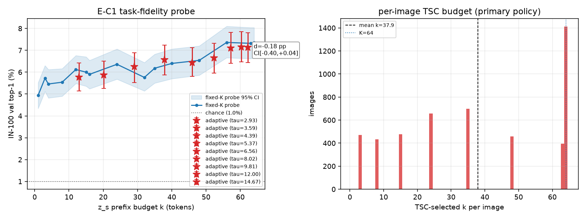
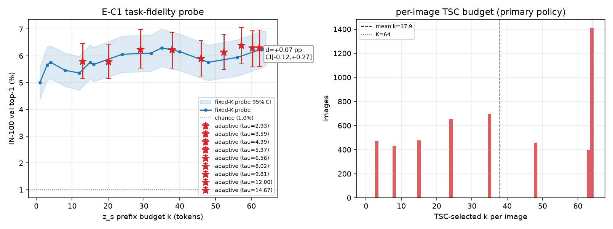
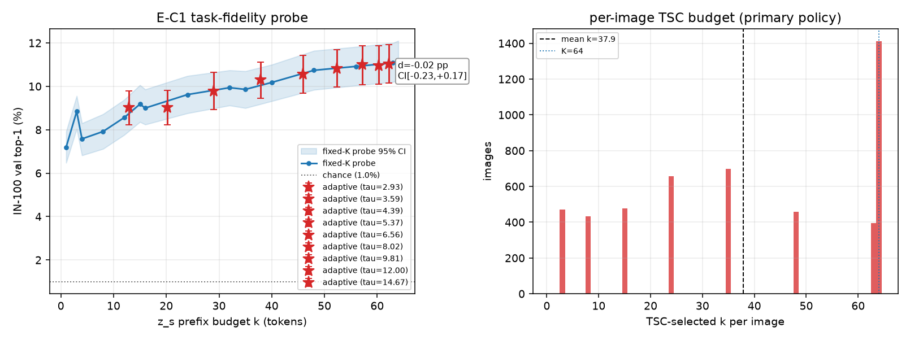
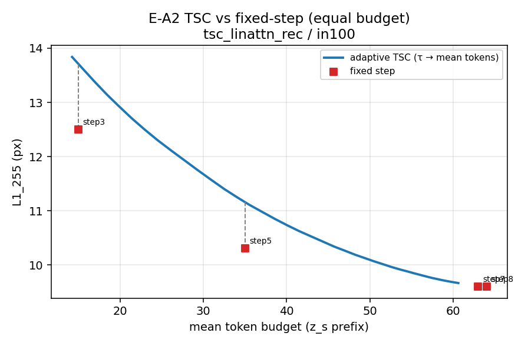
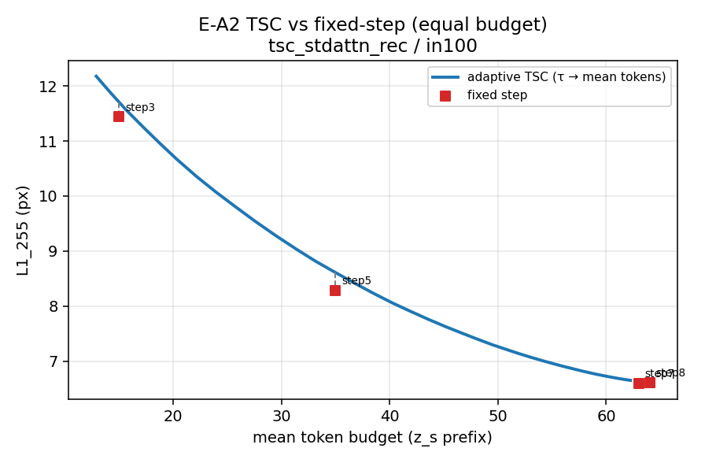
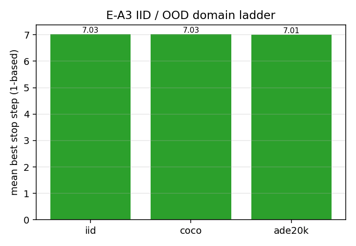
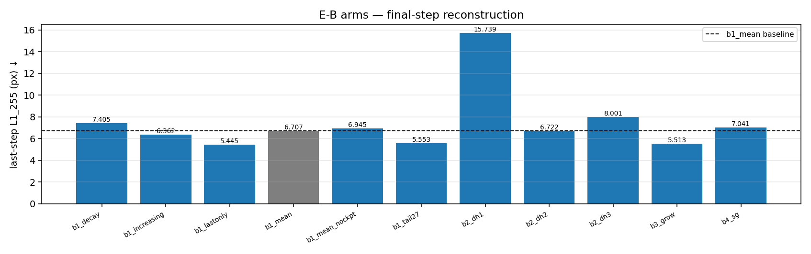

# ALIT 自适应长度实验 — 聚合表（自动生成）

> 由 `tools/alit_report.py` 生成于 2026-10-17 12:32:04；**请勿手改**。
> 报告正文: [`REPORT_alit_adaptive.md`](../REPORT_alit_adaptive.md)；规划: [`PLAN_alit_adaptive_experiments.md`](../PLAN_alit_adaptive_experiments.md)。
> 每个数字的来源文件名在表列或小节首行标注。

## 0. 数据可用性（自动）

- 产物目录: `doc/2026-10-16/artifacts/alit`
- 生成时间: 2026-10-17 12:32:04
- 生成命令: `python3 tools/alit_report.py`
- 口径: 只读产物 json；缺文件一律记为「数据不足」，不填任何估计值。

| 产物 | 用途 | 状态 | 生产者 |
|---|---|---|---|
| `baseline_four_arm_eval.json` | A0 四臂同进程全量评测 | **present** | eval_linattn.py（四臂） |
| `stepwise_stdattn_k64_rec.json` | 四臂基线·std 循环臂逐步 | **present** | eval_stepwise_linattn.py |
| `stepwise_linattn_k64_rec.json` | 四臂基线·lin 循环臂逐步 | **present** | eval_stepwise_linattn.py |
| `stepwise_stdattn_k64.json` | 四臂基线·std 单步逐步 | **present** | eval_stepwise_linattn.py |
| `stepwise_linattn_k64.json` | 四臂基线·lin 单步逐步 | **present** | eval_stepwise_linattn.py |
| `per_image_stdattn_k64_rec.json` | E-A1 每图逐步 dump（std 循环臂） | **present** | run_alit_a.sh a1_dump_std_rec |
| `per_image_linattn_k64_rec.json` | E-A1 每图逐步 dump（lin 循环臂） | **present** | run_alit_a.sh a1_dump_lin_rec |
| `tsc_stdattn_rec.json` | E-A1/A2/A4/A6 分析（std 循环臂） | **present** | run_alit_a.sh a2_analysis_std |
| `tsc_linattn_rec.json` | E-A1/A2/A4/A6 分析（lin 循环臂） | **present** | run_alit_a.sh a2_analysis_lin |
| `ood_in100_stdattn_rec.json` | E-A3 IID 级逐步 | **present** | run_alit_a.sh a3_iid |
| `ood_coco_stdattn_rec.json` | E-A3 中距 OOD（COCO2017 val）逐步 | **present** | run_alit_a.sh a3_coco |
| `ood_far_stdattn_rec.json` | E-A3 远距 OOD 逐步 | **present** | run_alit_a.sh a3_far |
| `domain_ladder.json` | E-A3 三级域阶梯汇总 | **present** | run_alit_a.sh a3_ladder |
| `zs_redundancy_stdattn_rec.json` | E-A5 z_s 冗余度 | **present** | run_alit_a.sh a5_zs_stats |
| `gate_diff_stdattn_rec.json` | 回归门：新代码默认路径逐位一致 | **present** | run_alit_a.sh a0b_gate_diff |
| `alit_a_summary.json` | E-A 产物汇总 | **present** | run_alit_a.sh 收尾 |
| `alit_a_steps.tsv` | E-A 步骤/rc/耗时表 | **present** | run_alit_a.sh |
| `alit_a_numbers.json` | E-A 原始数字汇总（无判决） | **present** | alit_a_numbers.py |
| `alit_b_arms.tsv` | E-B 臂执行状态表 | **present** | run_alit_b.sh |
| `eval_b1_mean.json` | E-B 基线复跑（b1_mean）全量评测 | **present** | run_alit_b.sh |
| `stepwise_b1_mean.json` | E-B 基线复跑（b1_mean）逐步 | **present** | run_alit_b.sh |
| `eval_b2_dh1.json` | E-B2 硬区域掩码臂评测 | **present** | run_alit_b.sh |
| `eval_b2_dh2.json` | E-B2 软停机臂评测 | **present** | run_alit_b.sh |
| `eval_b2_dh3.json` | E-B2 软停机+stop-grad 臂评测 | **present** | run_alit_b.sh |
| `eval_b4_sg.json` | E-B4 随机子集反传臂评测 | **present** | run_alit_b.sh |
| `probe_region_all11.json` | E-B2 区域隔离/后步非平凡探针（11 臂，报告优先） | **present** | probe_region_linattn.py |
| `probe_region_all.json` | E-B2 探针（9 臂，旧版兜底） | **present** | probe_region_linattn.py |
| `eval_b1_mean_nockpt.json` | 收尾探针：b1_mean grad-ckpt=0 归因 | **present** | run_alit_b.sh |
| `stepwise_b1_mean_nockpt.json` | 收尾探针：b1_mean grad-ckpt=0 逐步 | **present** | run_alit_b.sh |
| `task_fidelity_stdattn_rec.json` | E-C1 线性探针（主） | **present** | E-C1 执行 |
| `task_fidelity_stdattn_rec_cls.json` | E-C1 线性探针（cls 特征变体） | **present** | E-C1 执行 |
| `task_fidelity_stdattn_rec_lstsq.json` | E-C1 线性探针（lstsq 变体） | **present** | E-C1 执行 |

目录内其它 json（未登记）: `b_arms_table.json`, `eval_b1_decay.json`, `eval_b1_increasing.json`, `eval_b1_lastonly.json`, `eval_b1_tail27.json`, `eval_b3_grow.json`, `per_image_coco_stdattn_rec.json`, `per_image_far_stdattn_rec.json`, `per_image_in100_stdattn_rec.json`, `probe_region_tail_nockpt.json`, `smoke_task_fidelity.json`, `smoke_tsc_input.json`, `stepwise_b1_decay.json`, `stepwise_b1_increasing.json`, `stepwise_b1_lastonly.json`, `stepwise_b1_tail27.json`, `stepwise_b2_dh1.json`, `stepwise_b2_dh2.json`, `stepwise_b2_dh3.json`, `stepwise_b3_grow.json`, `stepwise_b4_sg.json`, `stepwise_gate_stdattn_k64_rec.json`, `stepwise_stdattn_k64_rec_published_code.json`, `truncation_table.json`

**missing 合计 0 项**：无

## 0.1 E-A 执行状态（自动）

来源: `alit_a_steps.tsv` / `alit_a_summary.json` / `SKIP_*.json`（`run_alit_a.sh`）。SKIP 是**显式降级标记**，不是静默跳过。

`alit_a_steps.tsv`（步骤 / rc / 耗时秒）:

| 步骤 | rc | 秒 |
|---|---|---|
| a0b_gate_eval | 0 | 22 |
| a0b_gate_diff | 0 | 0 |
| a1_dump_std_rec | 0 | 23 |
| a1_dump_lin_rec | 0 | 26 |
| a2_analysis_std | 0 | 6 |
| a2_analysis_lin | 0 | 6 |
| a3_iid_std_rec | 0 | 21 |
| a3_coco | 0 | 22 |
| a3_far | 0 | 14 |
| a3_ladder | 0 | 16 |
| a5_zs_stats | 0 | 317 |

`alit_a_summary.json → artifacts`:

| 产物 | 状态 |
|---|---|
| `baseline_four_arm_eval.json` | present |
| `per_image_stdattn_k64_rec.json` | present |
| `stepwise_stdattn_k64_rec.json` | present |
| `tsc_stdattn_rec.json` | present |
| `ood_in100_stdattn_rec.json` | present |
| `ood_coco_stdattn_rec.json` | present |
| `ood_far_stdattn_rec.json` | present |
| `domain_ladder.json` | present |
| `zs_redundancy_stdattn_rec.json` | present |
| `gate_diff_stdattn_rec.json` | present |

## 1. 四臂基线复现（E-A0）

来源: `baseline_four_arm_eval.json`（`eval_linattn.py`，全量 5,000 张同进程）；逐步列来源 `stepwise_*.json`（`eval_stepwise_linattn.py`）。
参照值来源: PLAN_alit_adaptive_experiments.md §2.2（10-15/10-16 旧实例发布值）。

| 臂 | PSNR (dB) ↑ | SSIM ↑ | L1(归一化) ↓ | L1(0-255) ↓ | PSNR per-patch DC 基线 | 相对 DC 增益 | 图数 | PLAN §2.2 PSNR | Δ复现 |
|---|---|---|---|---|---|---|---|---|---|
| `k64` | 26.602 | 0.7654 | 0.1463 | 8.432 | 18.45 | +8.15 | 5000 | 26.602 | +0.0000 |
| `stdattn_k64` | 31.219 | 0.9037 | 0.0901 | 5.195 | 18.45 | +12.77 | 5000 | 31.219 | -0.0004 |
| `k64_rec` | 25.304 | 0.7156 | 0.1666 | 9.602 | 18.45 | +6.85 | 5000 | 25.304 | +0.0003 |
| `stdattn_k64_rec` | 28.582 | 0.8505 | 0.1147 | 6.613 | 18.45 | +10.13 | 5000 | 28.582 | +0.0003 |

**复现判决**: 四臂与 PLAN §2.2 参照值在 |ΔPSNR| ≤ 0.05 dB 内逐一对齐 ⇒ **基线复现成立**（同实例、同 ckpt、同进程口径）。

- **回归门 `gate_diff_stdattn_rec.json`: PASS** ⇒ 新代码不加开关时默认路径与发布版一致。

> **口径换算（可复核）**: `eval_linattn.py` 的 `l1_norm` 是归一化空间 L1；`stepwise_*.json` 的 `L1_255` 是反归一化像素域值。二者关系 `L1_255 ≈ l1_norm × mean(IMAGENET_STD) × 255 = l1_norm × 57.63`（本表逐臂一致，见 `artifacts/ablation_table.md` 同一换算）。

## 2. 逐步曲线与停步分布（E-A1 基础数据）

来源: `stepwise_<arm>.json`（`eval_stepwise_linattn.py`，全量 5,000 张）。
`cum_z_s[t]` = 第 t 步实际读入的 z_s 前缀长度（= token 数）。

### 2.1 `linattn_k64_rec`（T=8，n=5000）

| step | t | z_s 累计 | L1_255 ↓ | ΔL1_255（正=变好） | PSNR (dB) ↑ |
|---|---|---|---|---|---|
| 1 | 1 | 3 | 16.944 | +2.768 | 20.189 |
| 2 | 4 | 8 | 14.176 | +1.670 | 21.668 |
| 3 | 9 | 15 | 12.505 | +1.313 | 22.772 |
| 4 | 16 | 24 | 11.193 | +0.887 | 23.806 |
| 5 | 25 | 35 | 10.306 | +0.513 | 24.606 |
| 6 | 36 | 48 | 9.793 | +0.192 | 25.109 |
| 7 | 49 | 63 | 9.600 | -0.003 | 25.310 |
| 8 | 64 | 64 | 9.603 | — | 25.304 |

- 总落差 `total_drop_255` = **7.344 px**；最优步 = **step 7**；Δ₁ 占比 = **37.7%**；正增量步数 = 6/7
- 每图最优停步分布（hist, step1..stepT）= [0, 0, 0, 0, 0, 1, 3046, 1953]
- 停步统计（由 hist 反推）: 平均 **7.39 ± 0.49** 步；众数占比 **60.92%**；熵 **0.671 nats**（归一化 0.323）
- oracle 停步（不可实现上界）: 平均 **63.388 tokens** vs 固定 step7 **63** tokens；oracle 增益 **+0.00294 px**（来源 `tsc_*.json → E_A1`）
- **E-A1 判决: 否证** —— 众数占比 60.92% < 90%（未命中字面否证），但 **oracle 上界增益仅 +0.0029 px < 0.10 px**（PLAN §9.1 噪声口径）⇒ 成立条件「oracle 明显优于固定 step7」不满足；oracle 63.39 tokens vs 固定 63

### 2.2 `stdattn_k64_rec`（T=8，n=5000）

| step | t | z_s 累计 | L1_255 ↓ | ΔL1_255（正=变好） | PSNR (dB) ↑ |
|---|---|---|---|---|---|
| 1 | 1 | 3 | 15.415 | +2.384 | 21.048 |
| 2 | 4 | 8 | 13.030 | +1.591 | 22.379 |
| 3 | 9 | 15 | 11.439 | +1.735 | 23.356 |
| 4 | 16 | 24 | 9.704 | +1.419 | 24.701 |
| 5 | 25 | 35 | 8.285 | +0.926 | 26.126 |
| 6 | 36 | 48 | 7.359 | +0.762 | 27.331 |
| 7 | 49 | 63 | 6.597 | -0.016 | 28.606 |
| 8 | 64 | 64 | 6.613 | — | 28.582 |

- 总落差 `total_drop_255` = **8.817 px**；最优步 = **step 7**；Δ₁ 占比 = **27.0%**；正增量步数 = 6/7
- 每图最优停步分布（hist, step1..stepT）= [0, 0, 0, 0, 0, 0, 4849, 151]
- 停步统计（由 hist 反推）: 平均 **7.03 ± 0.17** 步；众数占比 **96.98%**；熵 **0.135 nats**（归一化 0.065）
- oracle 停步（不可实现上界）: 平均 **63.030 tokens** vs 固定 step7 **63** tokens；oracle 增益 **+0.00016 px**（来源 `tsc_*.json → E_A1`）
- **E-A1 判决: 否证** —— 停步高度集中：众数档占比 96.98% ≥ 90%（PLAN §8 否证条件）

## 3. E-A2 自监督 TSC：等平均 token 数对照

来源: `tsc_*.json`（`tools/alit_adaptive_k.py` 读 `per_image_*.json`）。
口径: 每图取最小 t 使 `L1_255[t] ≤ τ`；对照臂 = 固定 step 3/5/7/8 的**等平均 token 数**（密集 τ 曲线插值）。

### 3.1 `tsc_linattn_rec` / 域 `in100`

固定步臂与等预算自适应对照（ΔL1 < 0 = 自适应更优；判据 >0.10 px 且方向一致）:

| 固定 step | 预算 tokens | 自适应@等预算 L1_255 | 固定 L1_255 | ΔL1_255 (px) | ΔPSNR (dB) | 预算在曲线范围内 |
|---|---|---|---|---|---|---|
| 3 | 15.0 | 13.711 | 12.505 | +1.206 | -1.260 | True |
| 5 | 35.0 | 11.160 | 10.306 | +0.854 | -1.325 | True |
| 7 | 63.0 | 9.616 | 9.600 | +0.016 | -0.058 | True |
| 8 | 64.0 | 9.603 | 9.603 | +0.000 | +0.000 | True |

- **E-A2 判决（`tsc_linattn_rec`/`in100`）: 否证** —— 等预算下自适应**更差**：ΔL1 最大 +1.2060 px （ΔL1>0 = 自适应更差；最小 +0.0000）⇒ 信息保持口径结案，判决权交 E-C1

### 3.2 `tsc_stdattn_rec` / 域 `in100`

固定步臂与等预算自适应对照（ΔL1 < 0 = 自适应更优；判据 >0.10 px 且方向一致）:

| 固定 step | 预算 tokens | 自适应@等预算 L1_255 | 固定 L1_255 | ΔL1_255 (px) | ΔPSNR (dB) | 预算在曲线范围内 |
|---|---|---|---|---|---|---|
| 3 | 15.0 | 11.708 | 11.439 | +0.269 | -0.653 | True |
| 5 | 35.0 | 8.613 | 8.285 | +0.327 | -0.922 | True |
| 7 | 63.0 | 6.634 | 6.597 | +0.036 | -0.150 | True |
| 8 | 64.0 | 6.613 | 6.613 | +0.000 | +0.000 | True |

- **E-A2 判决（`tsc_stdattn_rec`/`in100`）: 否证** —— 等预算下自适应**更差**：ΔL1 最大 +0.3272 px （ΔL1>0 = 自适应更差；最小 +0.0000）⇒ 信息保持口径结案，判决权交 E-C1

## 4. E-A3 IID / OOD 熟悉度阶梯

| 域 | n | 平均最优停步（1-based） | 停步 std | L1_255 step1 | L1_255 step7 | 落差 step1−step7 | 来源 |
|---|---|---|---|---|---|---|---|
| iid | 5000 | 7.03 | 0.17 | 15.415 | 6.597 | 8.817 | `domain_ladder.json` |
| coco | 5000 | 7.03 | 0.17 | 15.708 | 6.708 | 8.999 | `domain_ladder.json` |
| ade20k | 2000 | 7.01 | 0.07 | 14.978 | 5.972 | 9.006 | `domain_ladder.json` |

- **E-A3 判决: 否证** —— 三级平均停步跨度 0.02 步 < 0.5 步 ⇒ 熟悉度假设不成立
  - `domain_ladder.json` verdict: max_abs_mean_step_delta=0.02, monotone=False

共同 τ 下的所需步数（Δ 相对第一域；仅列 frac_capped ≤ 0.6 的 τ）:

| τ (L1_255) | iid | coco | ade20k | Δ coco vs iid | Δ ade20k vs iid |
|---|---|---|---|---|---|
| 6.5621 | 5.999 | 6.256 | 5.827 | +0.258 | -0.172 |
| 8.0244 | 5.139 | 5.360 | 4.894 | +0.220 | -0.245 |
| 9.8125 | 4.171 | 4.305 | 3.908 | +0.133 | -0.263 |
| 11.9990 | 3.188 | 3.253 | 2.946 | +0.065 | -0.242 |
| 14.6728 | 2.335 | 2.337 | 2.136 | +0.002 | -0.199 |

## 5. E-A4 复杂度相关性 / E-A6 Δ_t 分解

### 5.1a E-A4 Spearman（`tsc_linattn_rec`）

来源: `tsc_*.json → E_A4_complexity_spearman`。⚠️ 代理量（JPEG 大小/边缘密度/首步 L1）是**弱代理**，ρ 显著 ≠ 验证 ALIT 的熵假设。

| 域 | 代理 | 目标 | ρ | 95% CI | 显著(CI 不含 0) | n_finite |
|---|---|---|---|---|---|---|
| in100 | jpeg_bytes | best_step | +0.042 | [0.016, 0.070] | True | 5000 |
| in100 | jpeg_bytes | needed_step_at_final_median_tau | +0.479 | [0.456, 0.502] | True | 5000 |
| in100 | edge_density | best_step | +0.086 | [0.059, 0.113] | True | 5000 |
| in100 | edge_density | needed_step_at_final_median_tau | +0.902 | [0.896, 0.907] | True | 5000 |
| in100 | first_step_L1 | best_step | +0.109 | [0.082, 0.137] | True | 5000 |
| in100 | first_step_L1 | needed_step_at_final_median_tau | +0.877 | [0.868, 0.886] | True | 5000 |

### 5.1b E-A6 Δ_t 分解（`tsc_linattn_rec`）

来源: `tsc_*.json → E_A6_delta_decomposition`。判据: 复现「≥88% 降幅在前 4 步」。

| 域 | Δ₁ 占比 | step4 前置占比 | 末步过冲率 | 末步 ΔL1 均值 | ≥88%@step4 |
|---|---|---|---|---|---|
| in100 | 37.8% | 78.3% | 60.9% | -0.003 | False |

### 5.2a E-A4 Spearman（`tsc_stdattn_rec`）

来源: `tsc_*.json → E_A4_complexity_spearman`。⚠️ 代理量（JPEG 大小/边缘密度/首步 L1）是**弱代理**，ρ 显著 ≠ 验证 ALIT 的熵假设。

| 域 | 代理 | 目标 | ρ | 95% CI | 显著(CI 不含 0) | n_finite |
|---|---|---|---|---|---|---|
| in100 | jpeg_bytes | best_step | +0.022 | [-0.003, 0.047] | False | 5000 |
| in100 | jpeg_bytes | needed_step_at_final_median_tau | +0.544 | [0.523, 0.564] | True | 5000 |
| in100 | edge_density | best_step | -0.044 | [-0.073, -0.017] | True | 5000 |
| in100 | edge_density | needed_step_at_final_median_tau | +0.906 | [0.899, 0.911] | True | 5000 |
| in100 | first_step_L1 | best_step | -0.038 | [-0.066, -0.010] | True | 5000 |
| in100 | first_step_L1 | needed_step_at_final_median_tau | +0.860 | [0.852, 0.869] | True | 5000 |

### 5.2b E-A6 Δ_t 分解（`tsc_stdattn_rec`）

来源: `tsc_*.json → E_A6_delta_decomposition`。判据: 复现「≥88% 降幅在前 4 步」。

| 域 | Δ₁ 占比 | step4 前置占比 | 末步过冲率 | 末步 ΔL1 均值 | ≥88%@step4 |
|---|---|---|---|---|---|
| in100 | 27.6% | 65.1% | 97.0% | -0.016 | False |

## 6. E-A5 z_s 冗余度（第 1 项）

来源: `zs_redundancy_*.json` / `zs_stats*.json`（`metrics_linattn.zs_stats`）。注意: 注意力熵（第 2/3 项）**未做**，见诚实边界。

| 产物 | 臂 | K | D | 有效秩 | 有效秩/K | 去均值有效秩 | 两两 cos 均值 | cos>0.9 占比 | 逐 token 方差 (平均/D 维) | token 均值方差 (跨 K) | 判决 |
|---|---|---|---|---|---|---|---|---|---|---|---|
| `zs_redundancy_stdattn_rec` | stdattn_k64_rec | 64 | 448 | 47.077 | 0.736 | 49.439 | 0.2569 | 0.0030 | 1.0092 | 1.909e-07 | 成立 |

运营化阈值（PLAN 只给定性方向，本报告**自定并显式标注**）: **否证** = 有效秩 <0.5×K **且** cos 均值 >0.9；**成立（低冗余）** = 有效秩 ≥0.7×K **且** cos 均值 ≤0.5 **且** frac(cos>0.9) ≤0.05；否则数据不足。

- **E-A5 判决（zs_redundancy_stdattn_rec/stdattn_k64_rec）: 成立** —— 有效秩 0.736×K ≥ 0.7×K、cos 均值 0.257 ≤ 0.5、frac(cos>0.9)=0.0030 ≤ 0.05 ⇒ 低冗余（非「K 份副本」）

## 7. E-B 重训臂对照（E-B1..B4）

来源: `alit_b_arms.tsv`（执行状态）+ `eval_<arm>.json`（全量评测）+ `stepwise_<arm>.json`（逐步）。协议: IN-100 224², K=64, std 编码器, T=8 BPTT, 从 `stdattn_k64` 热启动, 6 ep/11,406 步/bs64/bf16。
**执行口径**: 全部 B 臂在同一台**新实例上串行**执行（同机、同后端、单一训练机器）⇒ 无跨机混淆；配对性来自「同进程 / 同批次评测」（PLAN §0 口径 2）。

### 7.1 执行状态（`alit_b_arms.tsv`）

| 臂 | 状态 | 明细 | 时间 |
|---|---|---|---|
| b1_increasing | OK | rc_eval=0 rc_stepwise=0 | 2026-10-16T23:09:00+08:00 |
| b1_lastonly | OK | rc_eval=0 rc_stepwise=0 | 2026-10-17T00:46:49+08:00 |
| b3_grow | OK | rc_eval=0 rc_stepwise=0 | 2026-10-17T02:36:57+08:00 |
| b2_dh1 | OK | rc_eval=0 rc_stepwise=0 | 2026-10-17T04:12:50+08:00 |
| b2_dh2 | OK | rc_eval=0 rc_stepwise=0 | 2026-10-17T05:48:52+08:00 |
| b2_dh3 | OK | rc_eval=0 rc_stepwise=0 | 2026-10-17T07:21:54+08:00 |
| b4_sg | OK | rc_eval=0 rc_stepwise=0 | 2026-10-17T08:59:40+08:00 |
| b1_tail27 | OK | rc_eval=0 rc_stepwise=0 | 2026-10-17T10:42:19+08:00 |
| b1_mean_nockpt | OK | rc_eval=0 rc_stepwise=0 | 2026-10-17T12:18:23+08:00 |

### 7.2 臂结果表

| 臂 | PSNR ↑ | SSIM ↑ | L1(归一化) ↓ | 末步 L1_255 ↓ | 最优 L1_255 | Δ₁ 占比 | 末步过冲 (px) | 后 4 步 ΔL1 均值 | 正增量步 | 来源 |
|---|---|---|---|---|---|---|---|---|---|---|
| `b1_decay` | 27.484 | 0.8185 | 0.1285 | 7.405 | 7.388 | 25.0% | 0.017 | +0.624 | 6 | `eval_b1_decay.json` + `stepwise_b1_decay.json` |
| `b1_increasing` | 28.857 | 0.8602 | 0.1104 | 6.362 | 6.355 | 23.4% | 0.007 | +0.954 | 6 | `eval_b1_increasing.json` + `stepwise_b1_increasing.json` |
| `b1_lastonly` | 30.522 | 0.8941 | 0.0945 | 5.445 | 5.445 | 6.5% | 0.000 | +8.883 | 7 | `eval_b1_lastonly.json` + `stepwise_b1_lastonly.json` |
| `b1_mean` | 28.409 | 0.8474 | 0.1164 | 6.707 | 6.692 | 25.4% | 0.016 | +0.772 | 6 | `eval_b1_mean.json` + `stepwise_b1_mean.json` |
| `b1_mean_nockpt` | 28.068 | 0.8358 | 0.1205 | 6.945 | 6.929 | 27.9% | 0.015 | +0.686 | 6 | `eval_b1_mean_nockpt.json` + `stepwise_b1_mean_nockpt.json` |
| `b1_tail27` | 30.038 | 0.8906 | 0.0964 | 5.553 | 5.553 | 7.1% | 0.000 | +8.489 | 7 | `eval_b1_tail27.json` + `stepwise_b1_tail27.json` |
| `b2_dh1` | 20.554 | 0.6969 | 0.2731 | 15.739 | 14.589 | 18.5% | 1.149 | +3.485 | 6 | `eval_b2_dh1.json` + `stepwise_b2_dh1.json` |
| `b2_dh2` | 28.686 | 0.8477 | 0.1166 | 6.722 | 6.704 | 32.9% | 0.019 | +0.594 | 6 | `eval_b2_dh2.json` + `stepwise_b2_dh2.json` |
| `b2_dh3` | 27.167 | 0.7975 | 0.1388 | 8.001 | 7.981 | 33.7% | 0.020 | +0.588 | 6 | `eval_b2_dh3.json` + `stepwise_b2_dh3.json` |
| `b3_grow` | 30.591 | 0.8937 | 0.0957 | 5.513 | 5.506 | 45.7% | 0.007 | +0.322 | 6 | `eval_b3_grow.json` + `stepwise_b3_grow.json` |
| `b4_sg` | 28.099 | 0.8351 | 0.1222 | 7.041 | 7.025 | 28.5% | 0.016 | +0.738 | 6 | `eval_b4_sg.json` + `stepwise_b4_sg.json` |

**相对同预算基线 `b1_mean` 的配对差**（同机同协议；正 = 该臂更好）：

| 臂 | ΔPSNR (dB) | ΔSSIM | Δ末步 L1_255 | Δ最优 L1_255 | ΔΔ₁ (pp) | 末步过冲 | 基线过冲 |
|---|---|---|---|---|---|---|---|
| `b1_decay` | -0.9250 | -0.0288 | -0.6982 | -0.6967 | -0.47 | 0.0172 | 0.0156 |
| `b1_increasing` | +0.4481 | +0.0129 | +0.3452 | +0.3366 | -2.08 | 0.0071 | 0.0156 |
| `b1_lastonly` | +2.1126 | +0.0467 | +1.2623 | +1.2467 | -18.97 | 0.0000 | 0.0156 |
| `b1_mean_nockpt` | -0.3410 | -0.0115 | -0.2377 | -0.2379 | +2.51 | 0.0154 | 0.0156 |
| `b1_tail27` | +1.6288 | +0.0433 | +1.1538 | +1.1382 | -18.34 | 0.0000 | 0.0156 |

**逐 step L1_255 与「该臂 − `b1_mean`」（来源 `stepwise_b1_*.json`；正 = 该臂在该步更差）：**

| step | t | z_s 累计 | `b1_mean` | `b1_decay` | `b1_increasing` | `b1_lastonly` | `b1_mean_nockpt` | `b1_tail27` | `b2_dh1` | `b2_dh2` | `b2_dh3` | `b3_grow` | `b4_sg` | Δ(`b1_decay`−mean) | Δ(`b1_increasing`−mean) | Δ(`b1_lastonly`−mean) | Δ(`b1_mean_nockpt`−mean) | Δ(`b1_tail27`−mean) | Δ(`b2_dh1`−mean) | Δ(`b2_dh2`−mean) | Δ(`b2_dh3`−mean) | Δ(`b3_grow`−mean) | Δ(`b4_sg`−mean) |
|---|---|---|---|---|---|---|---|---|---|---|---|---|---|---|---|---|---|---|---|---|---|---|---|
| 1 | 1 | 3 | 15.266 | 14.177 | 16.000 | 56.266 | 15.313 | 56.204 | 48.985 | 15.456 | 16.715 | 11.823 | 15.925 | -1.089 | +0.734 | +41.000 | +0.046 | +40.938 | +33.719 | +0.190 | +1.449 | -3.443 | +0.659 |
| 2 | 4 | 8 | 13.085 | 12.482 | 13.748 | 52.983 | 12.970 | 52.609 | 42.624 | 12.580 | 13.770 | 8.939 | 13.384 | -0.603 | +0.663 | +39.897 | -0.116 | +39.524 | +29.538 | -0.506 | +0.685 | -4.147 | +0.299 |
| 3 | 9 | 15 | 11.413 | 11.236 | 12.066 | 48.446 | 11.252 | 47.683 | 36.044 | 10.759 | 11.791 | 7.506 | 11.599 | -0.176 | +0.653 | +37.033 | -0.161 | +36.271 | +24.631 | -0.654 | +0.378 | -3.907 | +0.187 |
| 4 | 16 | 24 | 9.794 | 9.901 | 10.177 | 40.976 | 9.687 | 39.508 | 29.679 | 9.098 | 10.352 | 6.800 | 9.994 | +0.107 | +0.383 | +31.183 | -0.107 | +29.714 | +19.885 | -0.695 | +0.558 | -2.994 | +0.201 |
| 5 | 25 | 35 | 8.410 | 8.819 | 8.476 | 30.908 | 8.431 | 28.937 | 21.982 | 7.806 | 9.245 | 6.338 | 8.631 | +0.409 | +0.066 | +22.498 | +0.021 | +20.527 | +13.572 | -0.603 | +0.835 | -2.071 | +0.221 |
| 6 | 36 | 48 | 7.458 | 8.012 | 7.309 | 19.071 | 7.594 | 17.352 | 18.726 | 7.267 | 8.457 | 5.862 | 7.718 | +0.555 | -0.149 | +11.613 | +0.136 | +9.894 | +11.269 | -0.190 | +0.999 | -1.596 | +0.261 |
| 7 | 49 | 63 | 6.692 | 7.388 | 6.355 | 7.045 | 6.929 | 5.590 | 14.589 | 6.704 | 7.981 | 5.506 | 7.025 | +0.697 | -0.337 | +0.353 | +0.238 | -1.101 | +7.898 | +0.012 | +1.289 | -1.185 | +0.333 |
| 8 | 64 | 64 | 6.707 | 7.405 | 6.362 | 5.445 | 6.945 | 5.553 | 15.739 | 6.722 | 8.001 | 5.513 | 7.041 | +0.698 | -0.345 | -1.262 | +0.238 | -1.154 | +9.031 | +0.015 | +1.294 | -1.194 | +0.334 |

**截断 = 等 token 预算对照（t=3→15 / t=5→35 / t=7→63 / t=8→64；来源各臂 `stepwise_b1_*.json`；链式因果 ⇒ 截断档的 L1_255 就等于该步的全链值，无需额外训练）**

*L1_255*：

| 臂 | 15 tokens | 35 tokens | 63 tokens | 64 tokens |
|---|---|---|---|---|
| `b1_mean` | 11.413 | 8.410 | 6.692 | 6.707 |
| `b1_decay` | 11.236 | 8.819 | 7.388 | 7.405 |
| `b1_increasing` | 12.066 | 8.476 | 6.355 | 6.362 |
| `b1_lastonly` | 48.446 | 30.908 | 7.045 | 5.445 |
| `b1_mean_nockpt` | 11.252 | 8.431 | 6.929 | 6.945 |
| `b1_tail27` | 47.683 | 28.937 | 5.590 | 5.553 |
| `b2_dh1` | 36.044 | 21.982 | 14.589 | 15.739 |
| `b2_dh2` | 10.759 | 7.806 | 6.704 | 6.722 |
| `b2_dh3` | 11.791 | 9.245 | 7.981 | 8.001 |
| `b3_grow` | 7.506 | 6.338 | 5.506 | 5.513 |
| `b4_sg` | 11.599 | 8.631 | 7.025 | 7.041 |
| **常量灰基线** | 50.892 | 50.892 | 50.892 | 50.892 |

*PSNR*：

| 臂 | 15 tokens | 35 tokens | 63 tokens | 64 tokens |
|---|---|---|---|---|
| `b1_mean` | 23.387 | 25.989 | 28.431 | 28.409 |
| `b1_decay` | 23.634 | 25.712 | 27.506 | 27.484 |
| `b1_increasing` | 22.835 | 25.779 | 28.871 | 28.857 |
| `b1_lastonly` | 12.740 | 15.161 | 27.840 | 30.522 |
| `b1_mean_nockpt` | 23.528 | 26.045 | 28.090 | 28.068 |
| `b1_tail27` | 12.777 | 15.326 | 29.973 | 30.038 |
| `b2_dh1` | 14.481 | 17.424 | 20.983 | 20.554 |
| `b2_dh2` | 24.094 | 27.088 | 28.713 | 28.686 |
| `b2_dh3` | 23.537 | 25.758 | 27.188 | 27.167 |
| `b3_grow` | 27.345 | 29.089 | 30.603 | 30.591 |
| `b4_sg` | 23.272 | 25.877 | 28.123 | 28.099 |

- ⚠️ **L1_255 高于常量灰基线（50.89）的档位（全部 step）**: `b1_lastonly`: t=1（56.27）, t=2（52.98）；`b1_tail27`: t=1（56.20）, t=2（52.61） ⇒ 这些档位在「一条流多档」语境下**不可用**（等价于比灰图还差）。

- 同进程核对 `b1_decay` vs 历史 `stdattn_k64_rec`: ΔPSNR = **-1.0978 dB**（27.4845 vs 28.5823，来源 `eval_b1_decay.json`）　⚠️ **该差不可归因于机制**：从零/重跑漂移与训练开关差异（如 `dec_grad_ckpt`，历史 run 的 ckpt cfg 无该键）**不可分离**；同一条边界同样适用于任何「旧实例 arm vs 新实例 arm」的比较。

- 同进程核对 `b1_increasing` vs 历史 `stdattn_k64_rec`: ΔPSNR = **+0.2752 dB**（28.8575 vs 28.5823，来源 `eval_b1_increasing.json`）　⚠️ **该差不可归因于机制**：从零/重跑漂移与训练开关差异（如 `dec_grad_ckpt`，历史 run 的 ckpt cfg 无该键）**不可分离**；同一条边界同样适用于任何「旧实例 arm vs 新实例 arm」的比较。

- 同进程核对 `b1_lastonly` vs 历史 `stdattn_k64_rec`: ΔPSNR = **+1.9397 dB**（30.5220 vs 28.5823，来源 `eval_b1_lastonly.json`）　⚠️ **该差不可归因于机制**：从零/重跑漂移与训练开关差异（如 `dec_grad_ckpt`，历史 run 的 ckpt cfg 无该键）**不可分离**；同一条边界同样适用于任何「旧实例 arm vs 新实例 arm」的比较。

- 同进程核对 `b1_mean` vs 历史 `stdattn_k64_rec`: ΔPSNR = **-0.1729 dB**（28.4094 vs 28.5823，来源 `eval_b1_mean.json`）　⚠️ **该差不可归因于机制**：从零/重跑漂移与训练开关差异（如 `dec_grad_ckpt`，历史 run 的 ckpt cfg 无该键）**不可分离**；同一条边界同样适用于任何「旧实例 arm vs 新实例 arm」的比较。

- 同进程核对 `b1_mean_nockpt` vs 历史 `stdattn_k64_rec`: ΔPSNR = **-0.5139 dB**（28.0685 vs 28.5823，来源 `eval_b1_mean_nockpt.json`）　⚠️ **该差不可归因于机制**：从零/重跑漂移与训练开关差异（如 `dec_grad_ckpt`，历史 run 的 ckpt cfg 无该键）**不可分离**；同一条边界同样适用于任何「旧实例 arm vs 新实例 arm」的比较。

- 同进程核对 `b1_tail27` vs 历史 `stdattn_k64_rec`: ΔPSNR = **+1.4559 dB**（30.0382 vs 28.5823，来源 `eval_b1_tail27.json`）　⚠️ **该差不可归因于机制**：从零/重跑漂移与训练开关差异（如 `dec_grad_ckpt`，历史 run 的 ckpt cfg 无该键）**不可分离**；同一条边界同样适用于任何「旧实例 arm vs 新实例 arm」的比较。

- 同进程核对 `b2_dh1` vs 历史 `stdattn_k64_rec`: ΔPSNR = **-8.0285 dB**（20.5538 vs 28.5823，来源 `eval_b2_dh1.json`）　⚠️ **该差不可归因于机制**：从零/重跑漂移与训练开关差异（如 `dec_grad_ckpt`，历史 run 的 ckpt cfg 无该键）**不可分离**；同一条边界同样适用于任何「旧实例 arm vs 新实例 arm」的比较。

- 同进程核对 `b2_dh2` vs 历史 `stdattn_k64_rec`: ΔPSNR = **+0.1037 dB**（28.6860 vs 28.5823，来源 `eval_b2_dh2.json`）　⚠️ **该差不可归因于机制**：从零/重跑漂移与训练开关差异（如 `dec_grad_ckpt`，历史 run 的 ckpt cfg 无该键）**不可分离**；同一条边界同样适用于任何「旧实例 arm vs 新实例 arm」的比较。

- 同进程核对 `b2_dh3` vs 历史 `stdattn_k64_rec`: ΔPSNR = **-1.4153 dB**（27.1670 vs 28.5823，来源 `eval_b2_dh3.json`）　⚠️ **该差不可归因于机制**：从零/重跑漂移与训练开关差异（如 `dec_grad_ckpt`，历史 run 的 ckpt cfg 无该键）**不可分离**；同一条边界同样适用于任何「旧实例 arm vs 新实例 arm」的比较。

- 同进程核对 `b3_grow` vs 历史 `stdattn_k64_rec`: ΔPSNR = **+2.0087 dB**（30.5910 vs 28.5823，来源 `eval_b3_grow.json`）　⚠️ **该差不可归因于机制**：从零/重跑漂移与训练开关差异（如 `dec_grad_ckpt`，历史 run 的 ckpt cfg 无该键）**不可分离**；同一条边界同样适用于任何「旧实例 arm vs 新实例 arm」的比较。

- 同进程核对 `b4_sg` vs 历史 `stdattn_k64_rec`: ΔPSNR = **-0.4833 dB**（28.0990 vs 28.5823，来源 `eval_b4_sg.json`）　⚠️ **该差不可归因于机制**：从零/重跑漂移与训练开关差异（如 `dec_grad_ckpt`，历史 run 的 ckpt cfg 无该键）**不可分离**；同一条边界同样适用于任何「旧实例 arm vs 新实例 arm」的比较。

### 7.2d E-B2 探针：README §4.1 三判据（来源 `probe_region_all11.json`，11 臂、n=5,000）

> 口径：判据(1) 的绝对阈值 **0.015** 出自旧探针（`model_v2`/576 patch/5 区/另一 PixelHead 输出空间），与本次 **196 patch/8 区**不可假定同尺度 ⇒ 主用**尺度无关比值**；绝对量级只作参考。

| 臂 | 组 | `scale` step1 → 末步 | 末步/首步 | diag/offdiag 均值（范围） | diag_cv | ΔPSNR vs mean | 末步 L1 增益 |
|---|---|---|---|---|---|---|---|
| `b1_decay` | 权重/基线 | 0.9698 → 0.9992 | **1.0303** | 0.9852（0.887–1.143） | 0.2026 | -0.9250 | -0.6982 |
| `b1_increasing` | 权重/基线 | 0.9577 → 1.0034 | **1.0477** | 0.9787（0.842–1.128） | 0.2891 | +0.4481 | +0.3452 |
| `b1_lastonly` | 权重/基线 | 0.2107 → 1.0056 | **4.7717** | 0.9671（0.740–1.231） | 0.6273 | +2.1126 | +1.2623 |
| `b1_mean` | 权重/基线 | 0.9628 → 1.0025 | **1.0412** | 0.9949（0.854–1.230） | 0.2513 | +0.0000 | +0.0000 |
| `b1_mean_nockpt` | 权重/基线 | 0.9620 → 1.0014 | **1.0410** | 1.0113（0.902–1.135） | 0.2539 | -0.3410 | -0.2377 |
| `b1_tail27` | 权重/基线 | 0.1913 → 1.0055 | **5.2559** | 0.9075（0.700–1.126） | 0.6880 | +1.6288 | +1.1538 |
| `b2_dh1` | 监督口径 | 0.3646 → 0.8410 | **2.3067** | 0.2829（0.168–0.394） | 0.1376 | -7.8556 | -9.0314 |
| `b2_dh2` | 监督口径 | 0.9625 → 1.0022 | **1.0413** | 0.9908（0.883–1.095） | 0.2767 | +0.2766 | -0.0152 |
| `b2_dh3` | 监督口径 | 0.9492 → 0.9977 | **1.0511** | 0.9978（0.947–1.081） | 0.2473 | -1.2424 | -1.2936 |
| `b3_grow` | 机制(生长) | 0.9792 → 1.0060 | **1.0274** | 0.9756（0.835–1.079） | 0.2055 | +2.1815 | +1.1940 |
| `b4_sg` | 采样 | 0.9598 → 1.0007 | **1.0426** | 0.9984（0.895–1.122） | 0.2711 | -0.3104 | -0.3337 |

### 7.3 判决（PLAN §8）

| 实验 | 判决 | 依据 |
|---|---|---|
| E-B1 逐迭代损失权重 | **成立** | b1_increasing,b1_lastonly,b1_tail27 末步改善 >0.10 px 且过冲未放大（0.0071 ≤ 基线 0.0156）；b1_decay Δ末步L1=-0.6982 px(更差) 过冲0.0172; b1_increasing Δ末步L1=+0.3452 px(更好) 过冲0.0071; b1_lastonly Δ末步L1=+1.2623 px(更好) 过冲0.0000; b1_mean_nockpt Δ末步L1=-0.2377 px(更差) 过冲0.0154; b1_tail27 Δ末步L1=+1.1538 px(更好) 过冲0.0000；**剂量（ΔPSNR dB 降序）= b1_lastonly +2.113 > b1_tail27 +1.629 > b1_increasing +0.448 > b1_mean +0.000 > b1_mean_nockpt -0.341 > b1_decay -0.925**；`b1_tail27` 的 **s7=5.5904 为权重臂最优**（末步 5.5534，仅比 lastonly 差 0.1085 px） ；补充剂量臂: b1_mean_nockpt,b1_tail27 |
| E-B2 损失侧动态停机 | **否证** | README §4.1 三判据**未同时满足** ⇒ 否证。(1) 后步非平凡=满足（scale_ratio(end/start) 最小 1.041；b1_mean 1.041、b2_dh1 2.307、b2_dh2 1.041、b2_dh3 1.051）; (2) recon不劣化+真阶梯=不满足（b2_dh1 ΔPSNR=-7.856 末步ΔL1=-9.031、b2_dh2 ΔPSNR=+0.277 末步ΔL1=-0.015、b2_dh3 ΔPSNR=-1.242 末步ΔL1=-1.294）; (3) 区域专精=不满足（diag/offdiag 均值: b1_mean 0.995、b2_dh1 0.283、b2_dh2 0.991、b2_dh3 0.998）；**主因=任务同构**：每步都在做同一全局精修，而不是各自负责一块 ⇒ 该结构下损失侧动态停机不成立 |
| E-B3 ALIT 式自适应记忆 | **分裂** | **轴1「recon 增益」= 成立**（ΔPSNR=+2.1815 dB（recon 不劣=True）; Δ₁占比 25.43% → 45.66%（下降=False）; 后 4 步 ΔL1 均值 +0.772 → +0.322（上升=False））；**轴2「ALIT 后步激活机制假说」= 否证**（Δ₁ 占比未降（反而升），后步 Δt 未升）；判据 (c) 注意力熵 = 数据不足（未测）⇒ PLAN §8 三态表无法表达此分裂 |
| E-B4 随机预算/一条流多档 | **否证** | **随机子集反传不成立**: b4_sg ΔPSNR=-0.3104 dB（>−0.10 才追平）、末步 ΔL1=-0.3337 px（正=更好）、截断档(15/35/63/64 tok)=[0.1867, 0.2211, 0.3334, 0.3337] **全档更差**; 专训档 K'=16/32/48 **不做**（从零训练 3×~5 h 超预算，2026-10-16 Lead 决定）⇒ 「截断档 vs 专训档 <0.20 px」记数据不足 + 成本理由，**不是待补** |

## 8. E-C1 任务保真分类探针

来源: `task_fidelity_stdattn_rec{,_cls,_lstsq}.json`（`tools/alit_task_fidelity.py`；ckpt = `stdattn_k64_rec`，n_eval=5,000、100 类、chance=1%）。⚠️ 分类线性探针 ≠ Phase 2 生成任务；口径 = **等平均 token 数**。

### 8.0 探针质量（**醒目边界：严重过拟合 ⇒ 分辨力不足**）

| 产物 | 特征/探针 | train top-1 区间 | val top-1 区间 | val 曲线下降次数 | rho(k, val) | train−val 最小差 |
|---|---|---|---|---|---|---|
| `task_fidelity_stdattn_rec.json` | mean-prefix / logreg (d=448) | 0.6776–0.7687 | 0.0494–0.0736 （best @k=56） | 5/14 | +0.926 | 0.6040 |
| `task_fidelity_stdattn_rec_cls.json` | mean-prefix+cls / logreg (d=896) | 1.0000–1.0000 | 0.0500–0.0630 （best @k=35） | 5/14 | +0.809 | 0.9370 |
| `task_fidelity_stdattn_rec_lstsq.json` | mean-prefix / lstsq (d=448) | 0.4460–0.4841 | 0.0720–0.1120 （best @k=64） | 3/14 | +0.971 | 0.3340 |

> **读法（必须照录）**：三个变体的 `train_top1` 都远高于 `val_top1`（`_cls` 变体甚至 train=1.0000），且 **val 曲线非单调** ⇒ 该探针**分辨力不足**。因此 `indistinguishable` 只能读作「**该探针分辨力下测不到差异**」，**不能**读作「自适应 = 固定 K」，也不能据此判 E-C1 成立或否证。

### 8.1 `task_fidelity_stdattn_rec.json`（主）

- ckpt 签名: `ckpt_best.pt:757023643:1792132661`；数据源: imagenet100（synthetic=False）；K=64；probe=logreg
- **主判据行**（`E_C1_verdict`）: label=`tsc_tau=8.0244`, mean_k=**37.9014**（0.5922×K）, Δpp=**+0.2723**, CI=**[-0.3713, 0.9776]**, verdict=`indistinguishable`
- **全 τ 扫描**（9 行）: Δpp ∈ [**-0.3239**, **+0.2761**]；adaptive_better=False, fixed_better=False
- **探针质量**: train_top1 0.6776–0.7687；val_top1 0.0494–0.0736（chance 0.0100）；val 曲线下降 5/14 次
- **该文件判决: 数据不足** —— indistinguishable（CI 跨 0，未达成立判据）primary Δ=+0.2723 pp CI=[-0.3713098199999995, 0.9776490200000001]（mean_k=37.901）；探针分辨力不足（train_top1 0.678–0.769 vs val_top1 0.0494–0.0736，val 曲线下降 5/14 次）⇒ 只能说「该探针测不到差异」，不能说「自适应 = 固定 K」

- oracle 上界（不可实现，只量化 TSC-TOI gap）: `any_k_correct_rate`=**0.2968**, `mean_min_k_all_images`=49.86, `mean_min_k_correct_only`=16.37, `frac_images_needing_K`=0.7032, `chance_top1`=0.0100

| k | val top-1 | train top-1 | val 95% CI |
|---|---|---|---|
| 1 | 0.0494 | 0.6776 | [0.0434, 0.0552] |
| 3 | 0.0572 | 0.7258 | [0.0512, 0.06301] |
| 4 | 0.0546 | 0.7687 | [0.0482, 0.0612] |
| 8 | 0.0554 | 0.7602 | [0.049, 0.0616] |
| 12 | 0.0612 | 0.7503 | [0.0548, 0.06760499999999998] |
| 15 | 0.0600 | 0.7404 | [0.0536, 0.067005] |
| 16 | 0.0590 | 0.7397 | [0.052395000000000004, 0.0654] |
| 24 | 0.0636 | 0.7209 | [0.0568, 0.07060499999999999] |
| 32 | 0.0576 | 0.7075 | [0.0514, 0.0644] |
| 35 | 0.0618 | 0.7150 | [0.055, 0.06820499999999999] |
| 40 | 0.0640 | 0.7119 | [0.057, 0.0706] |
| 48 | 0.0654 | 0.7047 | [0.058595, 0.072] |
| 56 | 0.0736 | 0.6979 | [0.0666, 0.081] |
| 63 | 0.0732 | 0.7016 | [0.0662, 0.08040499999999999] |
| 64 | 0.0736 | 0.7010 | [0.0666, 0.08041] |

| τ | 平均 k | median k | 自适应 top-1 | 等预算固定档 top-1 | Δ (pp) | Δ 95% CI | 行判决 |
|---|---|---|---|---|---|---|---|
| 2.9348 | 62.241 | 64.0 | 0.0714 | 0.0732 | -0.184 | [-0.4026949142857131, 0.04005108571428546] | indistinguishable |
| 3.5887 | 60.326 | 64.0 | 0.0716 | 0.0734 | -0.175 | [-0.5038005285714283, 0.16721424285714226] | indistinguishable |
| 4.3884 | 57.186 | 64.0 | 0.0710 | 0.0735 | -0.253 | [-0.8230907428571429, 0.3317567999999998] | indistinguishable |
| 5.3663 | 52.331 | 64.0 | 0.0666 | 0.0698 | -0.324 | [-0.9014117499999998, 0.30765181249999896] | indistinguishable |
| 6.5621 | 45.970 | 63.0 | 0.0644 | 0.0650 | -0.064 | [-0.6448392500000004, 0.5505823749999994] | indistinguishable |
| 8.0244 | 37.901 | 35.0 | 0.0658 | 0.0631 | +0.272 | [-0.3713098199999995, 0.9776490200000001] | indistinguishable |
| 9.8125 | 29.014 | 24.0 | 0.0626 | 0.0598 | +0.276 | [-0.410118775, 0.9075125624999988] | indistinguishable |
| 11.9990 | 20.185 | 15.0 | 0.0588 | 0.0614 | -0.261 | [-0.9514523875000004, 0.4872669624999995] | indistinguishable |
| 14.6728 | 12.904 | 5.5 | 0.0578 | 0.0608 | -0.304 | [-1.0212704666666665, 0.3741671333333345] | indistinguishable |

### 8.2 `task_fidelity_stdattn_rec_cls.json`

- ckpt 签名: `ckpt_best.pt:757023643:1792132661`；数据源: imagenet100（synthetic=False）；K=64；probe=logreg
- **主判据行**（`E_C1_verdict`）: label=`tsc_tau=8.0244`, mean_k=**37.9014**（0.5922×K）, Δpp=**+0.0012**, CI=**[-0.5829, 0.6507]**, verdict=`indistinguishable`
- **全 τ 扫描**（9 行）: Δpp ∈ [**-0.0988**, **+0.4058**]；adaptive_better=False, fixed_better=False
- **探针质量**: train_top1 1.0000–1.0000；val_top1 0.0500–0.0630（chance 0.0100）；val 曲线下降 5/14 次
- **该文件判决: 数据不足** —— indistinguishable（CI 跨 0，未达成立判据）primary Δ=+0.0012 pp CI=[-0.5828973799999996, 0.6506503000000001]（mean_k=37.901）；探针分辨力不足（train_top1 1.000–1.000 vs val_top1 0.0500–0.0630，val 曲线下降 5/14 次）⇒ 只能说「该探针测不到差异」，不能说「自适应 = 固定 K」

- oracle 上界（不可实现，只量化 TSC-TOI gap）: `any_k_correct_rate`=**0.2062**, `mean_min_k_all_images`=53.42, `mean_min_k_correct_only`=12.71, `frac_images_needing_K`=0.7938, `chance_top1`=0.0100

| k | val top-1 | train top-1 | val 95% CI |
|---|---|---|---|
| 1 | 0.0500 | 1.0000 | [0.043795, 0.0558] |
| 3 | 0.0566 | 1.0000 | [0.0508, 0.06341] |
| 4 | 0.0576 | 1.0000 | [0.0514, 0.0638] |
| 8 | 0.0546 | 1.0000 | [0.0486, 0.061] |
| 12 | 0.0536 | 1.0000 | [0.047195, 0.0598] |
| 15 | 0.0576 | 1.0000 | [0.0514, 0.0642] |
| 16 | 0.0568 | 1.0000 | [0.0504, 0.0632] |
| 24 | 0.0606 | 1.0000 | [0.0538, 0.0674] |
| 32 | 0.0610 | 1.0000 | [0.054195, 0.0678] |
| 35 | 0.0630 | 1.0000 | [0.056, 0.07] |
| 40 | 0.0616 | 1.0000 | [0.054395, 0.0682] |
| 48 | 0.0576 | 1.0000 | [0.0508, 0.064] |
| 56 | 0.0594 | 1.0000 | [0.0524, 0.066] |
| 63 | 0.0626 | 1.0000 | [0.0556, 0.0692] |
| 64 | 0.0630 | 1.0000 | [0.0562, 0.0694] |

| τ | 平均 k | median k | 自适应 top-1 | 等预算固定档 top-1 | Δ (pp) | Δ 95% CI | 行判决 |
|---|---|---|---|---|---|---|---|
| 2.9348 | 62.241 | 64.0 | 0.0630 | 0.0623 | +0.075 | [-0.1218501999999999, 0.2690541428571436] | indistinguishable |
| 3.5887 | 60.326 | 64.0 | 0.0630 | 0.0614 | +0.162 | [-0.13254827142857106, 0.4642978142857141] | indistinguishable |
| 4.3884 | 57.186 | 64.0 | 0.0640 | 0.0599 | +0.406 | [-0.05345022857142861, 0.8769854285714288] | indistinguishable |
| 5.3663 | 52.331 | 64.0 | 0.0614 | 0.0586 | +0.283 | [-0.19045737499999998, 0.7660641375000001] | indistinguishable |
| 6.5621 | 45.970 | 63.0 | 0.0590 | 0.0586 | +0.038 | [-0.5105479374999997, 0.5458277125] | indistinguishable |
| 8.0244 | 37.901 | 35.0 | 0.0622 | 0.0622 | +0.001 | [-0.5828973799999996, 0.6506503000000001] | indistinguishable |
| 9.8125 | 29.014 | 24.0 | 0.0624 | 0.0609 | +0.155 | [-0.4697693875000003, 0.7681517749999993] | indistinguishable |
| 11.9990 | 20.185 | 15.0 | 0.0578 | 0.0588 | -0.099 | [-0.6928141124999991, 0.4916002375] | indistinguishable |
| 14.6728 | 12.904 | 5.5 | 0.0580 | 0.0548 | +0.319 | [-0.2597535999999996, 1.0057583333333326] | indistinguishable |

### 8.3 `task_fidelity_stdattn_rec_lstsq.json`

- ckpt 签名: `ckpt_best.pt:757023643:1792132661`；数据源: imagenet100（synthetic=False）；K=64；probe=lstsq
- **主判据行**（`E_C1_verdict`）: label=`tsc_tau=8.0244`, mean_k=**37.9014**（0.5922×K）, Δpp=**+0.2543**, CI=**[-0.3680, 0.8956]**, verdict=`indistinguishable`
- **全 τ 扫描**（9 行）: Δpp ∈ [**-0.2843**, **+0.2932**]；adaptive_better=False, fixed_better=False
- **探针质量**: train_top1 0.4460–0.4841；val_top1 0.0720–0.1120（chance 0.0100）；val 曲线下降 3/14 次
- **该文件判决: 数据不足** —— indistinguishable（CI 跨 0，未达成立判据）primary Δ=+0.2543 pp CI=[-0.36799189999999843, 0.8956125599999998]（mean_k=37.901）；探针分辨力不足（train_top1 0.446–0.484 vs val_top1 0.0720–0.1120，val 曲线下降 3/14 次）⇒ 只能说「该探针测不到差异」，不能说「自适应 = 固定 K」

- oracle 上界（不可实现，只量化 TSC-TOI gap）: `any_k_correct_rate`=**0.2766**, `mean_min_k_all_images`=50.02, `mean_min_k_correct_only`=13.45, `frac_images_needing_K`=0.7234, `chance_top1`=0.0100

| k | val top-1 | train top-1 | val 95% CI |
|---|---|---|---|
| 1 | 0.0720 | 0.4460 | [0.064795, 0.0792] |
| 3 | 0.0884 | 0.4730 | [0.0804, 0.0956] |
| 4 | 0.0758 | 0.4673 | [0.068195, 0.083] |
| 8 | 0.0792 | 0.4550 | [0.07119500000000001, 0.0872] |
| 12 | 0.0856 | 0.4716 | [0.0776, 0.0938] |
| 15 | 0.0918 | 0.4655 | [0.0836, 0.10060499999999999] |
| 16 | 0.0900 | 0.4682 | [0.08239500000000001, 0.09860499999999998] |
| 24 | 0.0962 | 0.4699 | [0.0876, 0.104805] |
| 32 | 0.0994 | 0.4725 | [0.0912, 0.10740499999999999] |
| 35 | 0.0986 | 0.4741 | [0.09, 0.107] |
| 40 | 0.1018 | 0.4729 | [0.0932, 0.11] |
| 48 | 0.1074 | 0.4816 | [0.0984, 0.1164] |
| 56 | 0.1092 | 0.4797 | [0.1004, 0.1182] |
| 63 | 0.1108 | 0.4837 | [0.102, 0.12] |
| 64 | 0.1120 | 0.4841 | [0.103, 0.121] |

| τ | 平均 k | median k | 自适应 top-1 | 等预算固定档 top-1 | Δ (pp) | Δ 95% CI | 行判决 |
|---|---|---|---|---|---|---|---|
| 2.9348 | 62.241 | 64.0 | 0.1104 | 0.1106 | -0.023 | [-0.2265763142857132, 0.1674368000000001] | indistinguishable |
| 3.5887 | 60.326 | 64.0 | 0.1096 | 0.1102 | -0.059 | [-0.34527762857142813, 0.2315595142857143] | indistinguishable |
| 4.3884 | 57.186 | 64.0 | 0.1100 | 0.1095 | +0.053 | [-0.425260157142858, 0.5526001000000003] | indistinguishable |
| 5.3663 | 52.331 | 64.0 | 0.1084 | 0.1084 | +0.003 | [-0.524584387499999, 0.5798459374999997] | indistinguishable |
| 6.5621 | 45.970 | 63.0 | 0.1056 | 0.1060 | -0.038 | [-0.5945325249999988, 0.5929590124999996] | indistinguishable |
| 8.0244 | 37.901 | 35.0 | 0.1030 | 0.1005 | +0.254 | [-0.36799189999999843, 0.8956125599999998] | indistinguishable |
| 9.8125 | 29.014 | 24.0 | 0.0978 | 0.0982 | -0.041 | [-0.6175125125000012, 0.620332262499999] | indistinguishable |
| 11.9990 | 20.185 | 15.0 | 0.0904 | 0.0932 | -0.284 | [-0.9712501124999995, 0.4071190375000003] | indistinguishable |
| 14.6728 | 12.904 | 5.5 | 0.0904 | 0.0875 | +0.293 | [-0.44640779999999974, 0.9976774666666663] | indistinguishable |

- **E-C1 判决（主文件 `task_fidelity_stdattn_rec.json`）: 数据不足** —— indistinguishable（CI 跨 0，未达成立判据）primary Δ=+0.2723 pp CI=[-0.3713098199999995, 0.9776490200000001]（mean_k=37.901）；探针分辨力不足（train_top1 0.678–0.769 vs val_top1 0.0494–0.0736，val 曲线下降 5/14 次）⇒ 只能说「该探针测不到差异」，不能说「自适应 = 固定 K」
- （按 PLAN §8，E-C1 的「成立」要求等平均 token 数下自适应 ≥ 固定 K 且差距 > 噪声；本产物三条臂的 CI 全部跨 0 ⇒ **既不成立也不否证**，记「数据不足（探针分辨力不足）」。）

## 9. 判决总表（PLAN §8 三态）

| ID | 实验 | 判决 | 依据/来源 |
|---|---|---|---|
| E-A0 | 四臂基线复现 | 成立 | baseline_four_arm_eval.json（见 §1） |
| E-A1[linattn_k64_rec] | 每图停步分布/oracle | 否证 | 众数占比 60.92% < 90%（未命中字面否证），但 **oracle 上界增益仅 +0.0029 px < 0.10 px**（PLAN §9.1 噪声口径）⇒ 成立条件「oracle 明显优于固定 step7」不满足；oracle 63.39 tokens vs 固定 63 |
| E-A1[stdattn_k64_rec] | 每图停步分布/oracle | 否证 | 停步高度集中：众数档占比 96.98% ≥ 90%（PLAN §8 否证条件） |
| E-A2[tsc_linattn_rec/in100] | TSC 等预算 | 否证 | 等预算下自适应**更差**：ΔL1 最大 +1.2060 px （ΔL1>0 = 自适应更差；最小 +0.0000）⇒ 信息保持口径结案，判决权交 E-C1 |
| E-A2[tsc_stdattn_rec/in100] | TSC 等预算 | 否证 | 等预算下自适应**更差**：ΔL1 最大 +0.3272 px （ΔL1>0 = 自适应更差；最小 +0.0000）⇒ 信息保持口径结案，判决权交 E-C1 |
| E-A3 | IID/OOD 阶梯 | 否证 | 跨度 0.02 步（见 §4） |
| E-A4 | 复杂度相关性（弱代理） | 成立 | 3/6 对 ρ 显著为正（最强 in100:edge_density~needed_step_at_final_median_tau ρ=+0.906）（needed_step 目标 3 行 / best_step 目标 3 行）；⚠️ 弱代理，且 `best_step` 目标因退化无信息量 |
| E-A6 | Δ_t 分解（≥88% 前置复核） | 否证 | ≥88% 未在前 4 步复现（in100 step4=65.1%） |
| E-A5[zs_redundancy_stdattn_rec/stdattn_k64_rec] | z_s 冗余度 | 成立 | 有效秩 0.736×K ≥ 0.7×K、cos 均值 0.257 ≤ 0.5、frac(cos>0.9)=0.0030 ≤ 0.05 ⇒ 低冗余（非「K 份副本」） |
| E-B1 | 逐迭代损失权重 | 成立 | b1_increasing,b1_lastonly,b1_tail27 末步改善 >0.10 px 且过冲未放大（0.0071 ≤ 基线 0.0156）；b1_decay Δ末步L1=-0.6982 px(更差) 过冲0.0172; b1_increasing Δ末步L1=+0.3452 px(更好) 过冲0.0071; b1_lastonly Δ末步L1=+1.2623 px(更好) 过冲0.0000; b1_mean_nockpt Δ末步L1=-0.2377 px(更差) 过冲0.0154; b1_tail27 Δ末步L1=+1.1538 px(更好) 过冲0.0000；**剂量（ΔPSNR dB 降序）= b1_lastonly +2.113 > b1_tail27 +1.629 > b1_increasing +0.448 > b1_mean +0.000 > b1_mean_nockpt -0.341 > b1_decay -0.925**；`b1_tail27` 的 **s7=5.5904 为权重臂最优**（末步 5.5534，仅比 lastonly 差 0.1085 px） ；补充剂量臂: b1_mean_nockpt,b1_tail27 |
| E-B2 | 损失侧动态停机 | 否证 | README §4.1 三判据**未同时满足** ⇒ 否证。(1) 后步非平凡=满足（scale_ratio(end/start) 最小 1.041；b1_mean 1.041、b2_dh1 2.307、b2_dh2 1.041、b2_dh3 1.051）; (2) recon不劣化+真阶梯=不满足（b2_dh1 ΔPSNR=-7.856 末步ΔL1=-9.031、b2_dh2 ΔPSNR=+0.277 末步ΔL1=-0.015、b2_dh3 ΔPSNR=-1.242 末步ΔL1=-1.294）; (3) 区域专精=不满足（diag/offdiag 均值: b1_mean 0.995、b2_dh1 0.283、b2_dh2 0.991、b2_dh3 0.998）；**主因=任务同构**：每步都在做同一全局精修，而不是各自负责一块 ⇒ 该结构下损失侧动态停机不成立 |
| E-B3 | ALIT 式自适应记忆 | 分裂 | **轴1「recon 增益」= 成立**（ΔPSNR=+2.1815 dB（recon 不劣=True）; Δ₁占比 25.43% → 45.66%（下降=False）; 后 4 步 ΔL1 均值 +0.772 → +0.322（上升=False））；**轴2「ALIT 后步激活机制假说」= 否证**（Δ₁ 占比未降（反而升），后步 Δt 未升）；判据 (c) 注意力熵 = 数据不足（未测）⇒ PLAN §8 三态表无法表达此分裂 |
| E-B4 | 随机预算/一条流多档 | 否证 | **随机子集反传不成立**: b4_sg ΔPSNR=-0.3104 dB（>−0.10 才追平）、末步 ΔL1=-0.3337 px（正=更好）、截断档(15/35/63/64 tok)=[0.1867, 0.2211, 0.3334, 0.3337] **全档更差**; 专训档 K'=16/32/48 **不做**（从零训练 3×~5 h 超预算，2026-10-16 Lead 决定）⇒ 「截断档 vs 专训档 <0.20 px」记数据不足 + 成本理由，**不是待补** |
| E-C1 | 任务保真自适应 K | 数据不足 | indistinguishable（CI 跨 0，未达成立判据）primary Δ=+0.2723 pp CI=[-0.3713098199999995, 0.9776490200000001]（mean_k=37.901）；探针分辨力不足（train_top1 0.678–0.769 vs val_top1 0.0494–0.0736，val 曲线下降 5/14 次）⇒ 只能说「该探针测不到差异」，不能说「自适应 = 固定 K」 |

> 三态定义: **成立** = 判据满足；**否证** = 明确的否证条件命中；**数据不足** = 产物未到位或落在判据边界（单种子无方差，<0.10 px / 0.1 dB 不作结论）。
> 数字来源：另见 `alit_a_numbers.json`（由 `alit_a_numbers.py` 产出，**只汇总原始数字、不做判决**）；本表是**唯一三态裁定**，两者不一致时以本表 + PLAN §8 原文为准。

## 10. 图（自动生成）

## 11. 未到位产物（missing）

| 产物 | 用途 | 生产者 |
|---|---|---|
| — | 全部到位 | — |

合计 **0** 项 missing。
