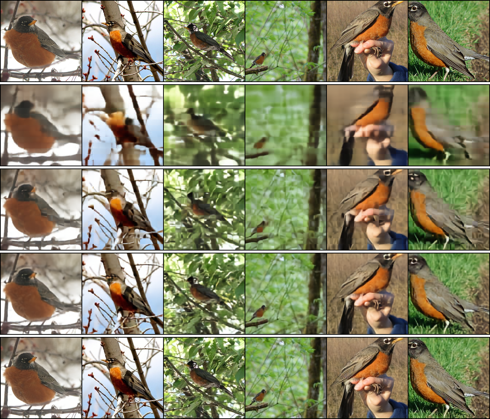
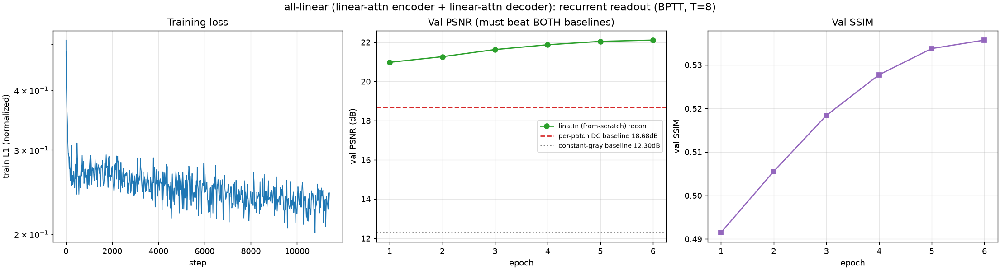
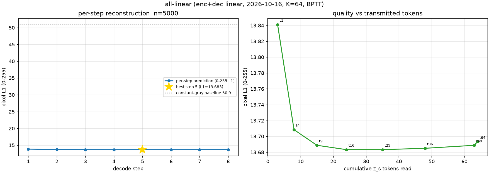
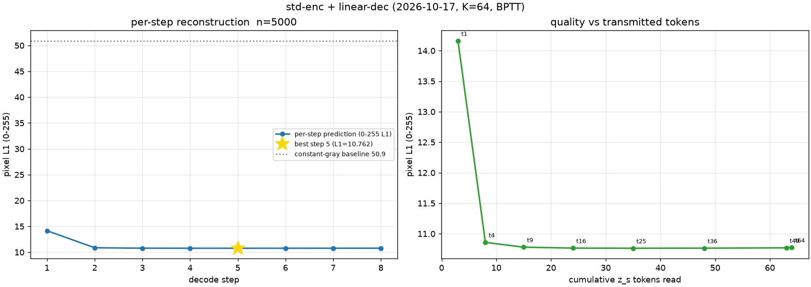

# REPORT — 注意力形式消融：编码器 × 解码器 × 读出方式（2×2×2，8 臂）

> 日期：**2026-10-16 ~ 2026-10-17**（跨夜跑完）
> 设计文档：[`DESIGN_stdattn_ablation.md`](../2026-10-16/DESIGN_stdattn_ablation.md)（第一臂）
> 汇总表：[`artifacts/ablation_matrix.md`](artifacts/ablation_matrix.md)（自动生成）
> 机器：AutoDL 单卡 **RTX 4080 SUPER 32 GB**（`ssh -p 17094 root@connect.weste.seetacloud.com`）
> 数据：**ImageNet-100**，121,689 train / 5,000 val，224×224 → 224×224，K=64（N=196 ⇒ 压缩率 3.06×）
> 代码：`model_v2_linattn.py` / `train_linattn.py` / `run_stdattn_chain.sh` / `run_alllinear_chain.sh` / `run_stdenc_linear_chain.sh`
> 工具：`ablate_table.py`（矩阵表）/ `ablate_stdattn.py`（配对表）/ `viz_ablation.py`（定性对比图）

---

## 1. 一句话结论

**三个因素里，解码器注意力形式的影响最大，编码器次之，BPTT 最小且方向不定。**
把解码器从 softmax 换成线性注意力要付出 **−4.4 ~ −6.5 dB**；编码器反过来换能拿 **+2.1 ~ +4.6 dB**；
BPTT 循环读出在同预算下多为 **−0.5 ~ −2.6 dB**，**唯一的例外是全线性臂（+0.16 dB）**——
但那个例外同时暴露了一个机制：**线性解码器几乎摧毁了逐步精炼能力**（§5）。

---

## 2. 实验设计：8 臂、单一变量配对

**2×2×2 = 8 臂**，每臂都是"**只动一个因素**"的可配对实验：

| 因素 | 取值 |
|---|---|
| 编码器注意力 | 线性核注意力（`enc_attn=linear`）/ 普通 softmax（`std`） |
| 解码器注意力 | 普通 softmax（`dec_attn=std`）/ 线性核注意力（`linear`） |
| 读出方式 | 单步并行 T=1 / **循环读出 BPTT T=8** |

**参数量全部对齐**（差异 ≤ 0.19%），所以差值可归因到"注意力形式"而不是"模型更大"：

| 编码器 | 解码器 | enc | dec (T=1) | dec (BPTT) |
|---|---|---|---|---|
| 线性 | softmax | 31.909M | 31.173M | 31.207M |
| 线性 | 线性 | 31.909M | 31.177M | 31.210M |
| 普通 softmax | softmax | 31.848M | 31.173M | 31.207M |
| 普通 softmax | 线性 | 31.848M | 31.177M | 31.210M |

**协议逐项相同**：阶段 1 单步 bs128 × 45ep（从零，42,750 步，lr 2e-4 cosine + warmup 8%，wd 0.05，grad_clip 1.0，
`--skip_grad 50`）；阶段 2 从阶段 1 `ckpt_best` 热启动跑 BPTT bs64 × 6ep（11,406 步，编码器联合微调不冻结）。
线性解码器BPTT 在 bs64 会 OOM（要跨 7 层 × 8 步保留 fp32 聚合中间量），故阶段 2 开**梯度检查点**
（自检证明与不检查点**梯度逐位等价**，相对差 0.00e+00）。

---

## 3. 主结果（全量留出集 5,000 张，**8 臂同一进程、同一批次**评测）

### 3.1 架构矩阵 — PSNR (dB)

| 编码器 \ 解码器·读出 | softmax · 单步 | softmax · **BPTT** | 线性 · 单步 | 线性 · **BPTT** |
|---|---|---|---|---|
| **普通 softmax** | **31.219** | 28.582 | 24.714 | 24.166 |
| **线性注意力** | 26.602 | 25.304 | 21.884 | **22.042** |

### 3.2 完整指标

| 编码器 | 解码器 | 读出 | PSNR↑ | SSIM↑ | L1(归一)↓ | L1(0-255)↓ | 相对 DC 基线 |
|---|---|---|---|---|---|---|---|
| 线性 | 线性 | T=1 | 21.884 | 0.5535 | 0.2424 | 13.970 | +3.43 |
| 线性 | 线性 | BPTT | **22.042** | 0.5622 | 0.2376 | 13.692 | +3.59 |
| 线性 | softmax | T=1 | 26.602 | 0.7654 | 0.1463 | 8.432 | +8.15 |
| 线性 | softmax | BPTT | 25.304 | 0.7156 | 0.1666 | 9.602 | +6.85 |
| softmax | 线性 | T=1 | 24.714 | 0.6882 | 0.1766 | 10.176 | +6.26 |
| softmax | 线性 | BPTT | 24.166 | 0.6655 | 0.1870 | 10.775 | +5.71 |
| softmax | softmax | T=1 | **31.219** | **0.9037** | 0.0901 | 5.194 | **+12.77** |
| softmax | softmax | BPTT | 28.582 | 0.8505 | 0.1147 | 6.613 | +10.13 |

（per-patch DC 基线 18.45 dB、常量灰基线 11.81 dB 对所有臂相同；**8 臂全部显著优于两条基线**，
所以上表 PSNR 有意义。`L1(0-255)` 由归一化空间换算：`l1_norm × 0.226 × 255`。）

### 3.3 配对差（每个配对只动一个因素，共 12 条）

**编码器：线性 → 普通 softmax（都是正收益）**

| 固定条件 | ΔPSNR | ΔSSIM |
|---|---|---|
| softmax 解码器 · 单步 | **+4.617** | +0.1382 |
| softmax 解码器 · BPTT | **+3.278** | +0.1349 |
| 线性解码器 · 单步 | **+2.829** | +0.1347 |
| 线性解码器 · BPTT | **+2.123** | +0.1033 |

**解码器：softmax → 线性（都是大幅负收益）**

| 固定条件 | ΔPSNR | ΔSSIM |
|---|---|---|
| 普通编码器 · 单步 | **−6.505** | −0.2155 |
| 普通编码器 · BPTT | **−4.417** | −0.1850 |
| 线性编码器 · 单步 | **−4.718** | −0.2120 |
| 线性编码器 · BPTT | **−3.262** | −0.1534 |

**读出：单步 → BPTT（预算不同，只作现象记录）**

| 架构 | ΔPSNR | ΔSSIM |
|---|---|---|
| 全 softmax | **−2.636** | −0.0532 |
| 线性 enc + softmax dec | **−1.298** | −0.0498 |
| 普通 enc + 线性 dec | **−0.548** | −0.0226 |
| **全线性** | **+0.158** | +0.0088 |

> **口径警告（重申昨日 §9.3 的坑）**：阶段 2 是"6 epoch 热启动微调"，阶段 1 是"45 epoch 从零"，
> 两者**训练预算差 7.5×**。所以这一组**不能**用来论证"BPTT 比单步差/好"，
> 只能说明"在本轮 6-epoch 预算下 BPTT 微调带来的净变化"。
> 值得注意的是它的**方向随架构变化**：越"线性"的架构，BPTT 微调越不亏（甚至可以变好）。

### 3.4 定性对比（四个编解码组合，均单步 T=1）



上→下：原图 / 线性enc+线性dec (21.88dB) / 普通enc+线性dec (24.71dB) / 线性enc+softmax dec (26.60dB) / 普通enc+softmax dec (31.22dB)。
肉眼可见两条正交的退化轴：**线性解码器**让图像整体变糊、纹理丢失；**线性编码器**进一步损失结构细节。



---

## 4. 训练开销与稳定性（实测）

| 臂 | 阶段 | 步数/ep | 墙钟 | 吞吐 | 峰值显存 | max `|grad|` | 跳步 |
|---|---|---|---|---|---|---|---|
| 全线性 | 单步 bs128 | 42,750 / 45 | **5.88 h** | ~259 img/s | 23.63 GB | 2.78 | **0** |
| 全线性 | BPTT bs64 | 11,406 / 6 | **2.93 h** | ~69 img/s | 11.18 GB | 1.50 | **0** |
| 普通enc+线性dec | 单步 bs128 | 42,750 / 45 | **4.40 h** | ~345 img/s | 17.96 GB | 5.95 | **0** |
| 普通enc+线性dec | BPTT bs64 | 11,406 / 6 | **2.79 h** | ~73 img/s | 8.37 GB | 1.50 | **0** |

- **8 条臂、4 个新训练全部 0 次跳步**。(max `|grad|` 最大 5.95，远低于 50 的护栏阈值。)
- ⚠️ **昨日线性编码器的 bf16 梯度爆炸没有在本轮任何臂复现** —— 因为线性注意力处处都开了
  QK-Norm（φ 输出被钉在 [0,~4]，Σφ(k) 有界）并把聚合段强制 fp32。这**支持**（但不等于证明）
  "QK-Norm + fp32 聚合是那次爆炸的有效修复"。
- **软编码器比线性编码器快得多**：单步 345 vs 259 img/s、17.96 vs 23.63 GB
  （省掉线性注意力 13 层的 fp32 聚合段 + DWConv）。
- **梯度检查点**把线性解码器 BPTT 的 bs64 从 OOM（>31.5 GB）压到 11.18 / 8.37 GB，
  代价是吞吐约减半（单步 ~260-345 → BPTT ~70 img/s）——但数学**逐位等价**。

---

## 5. 本轮最有信息量的发现：线性解码器摧毁了"逐步精炼"

BPTT 循环读出的设计初衷是**逐步精炼**：每步多读一块 `z_s`，输出逐步变好。
把 4 个架构的逐步曲线放在一起，结论非常清楚：

| 架构（BPTT T=8） | 第 1 步 L1_255 | 最优 L1_255 | **总落差** | **Δ₁ 占比** | 最优步 | 正增量步数 |
|---|---|---|---|---|---|---|
| 普通 softmax enc + softmax dec | 15.415 | 6.597 | **8.817 px** | 27.0% | 7 | 6/7 |
| 线性 enc + softmax dec | 16.944 | 9.600 | **7.344 px** | 37.7% | 7 | 6/7 |
| 普通 softmax enc + **线性 dec** | 14.161 | 10.762 | **3.399 px** | **97.2%** | 5 | 4/7 |
| 线性 enc + **线性 dec**（全线性） | 13.841 | 13.683 | **0.158 px** | **84.0%** | 5 | 4/7 |

**只要解码器是 softmax，"读更多 z_s"就能持续换到质量**（7.3–8.8 px 的总落差，跨 7 步平摊）。
**一旦解码器变成线性，这个机制基本失效**：
- 普通 enc + 线性 dec：总落差只剩 3.4 px，且 **97.2% 在第 1 步就吃掉了**，第 4 步起增量为负；
- 全线性：总落差 **0.158 px**（几乎为零），第 4 步起就再没有净收益。

一个自洽的解释：线性核注意力 `φ(x)=elu(x)+1` **没有 softmax 的行归一化**，`Σ_j φ(k_j)v_jᵀ`
近似一个"对 memory 求平均"的池化算子；memory 逐块接入时，后接入的块只改变平均项的一小部分，
而 softmax 的**强竞争归一化**让"新读到的那一块"能重新分配注意力权重、产生实质性的输出修正。
这解释了为什么"线性解码器 + 循环读出"这个组合**两头都不占**：既没有 softmax 的细粒度对齐能力，
又拿不到逐步精炼的收益。

> 这条机制**不受** §3.3 的预算不对称影响：它描述的是"同一份权重下 T 步之间的相对形态"，
> 而不是"两个不同预算模型之间的绝对差值"。





---

## 6. 验证与可复现性

1. **"线性"是真的线性**：`LinearCrossAttention` 与手工核形式 `φ(Q)(φ(K)ᵀV)/(φ(Q)Σφ(K))` 逐位一致
   （max|diff| = **0.00e+00**），且证明其注意力权重**不是行归一化**的（这正是与 softmax 的区别）；
   编码器侧 `StandardAttention` 与手工 `softmax(QKᵀ/√d)V` 一致到 5.96e-08。
2. **参数量对齐**：断言并实测编/解码器差异 ≤ 0.19% / 0.0122%。
3. **梯度检查点数学等价**：同权重下开/关检查点的**全部 110 个参数梯度相对差 0.00e+00**。
4. **默认路径零破坏**：`enc_attn='linear'` / `dec_attn='std'` 时参数量与昨日**逐位相同**
   （编码器 31,909,024 / 解码器 31,173,376）；昨日 757 MB `ckpt_best.pt` 用改后代码 `strict=True` 载入成功。
5. **评测管线可复现到 1e-7 dB**：本轮 8 臂评测里重新测的昨日两臂，与昨日存档差
   **2.9e-07 dB**（`k64`）/ **0.0**（`k64_rec`）—— 所以 12 条配对差不含管线噪声。
6. **单步↔循环 key 兼容**：线性解码器单步/循环版共享 208 个 key 且形状全同，循环版仅多零初始化 `mem_pos`
   ⇒ 阶段 1 → 阶段 2 热启动成立（日志中 `missing=['decoder.mem_pos']`）。

---

## 7. 复现命令

```bash
cd /root/SR-Diffusion-v3
LINATTN_CKPT=/root/autodl-tmp/srdiff_linattn/k64/ckpt_best.pt python model_v2_linattn.py   # 全部自检

# 臂 A: 全线性（enc+dec 线性）+ BPTT
nohup setsid bash run_alllinear_chain.sh > /root/autodl-tmp/srdiff_alllinear/nohup.out 2>&1 &
# 臂 B: 标准编码器 + 线性解码器 + BPTT（会先等臂 A 结束）
nohup setsid bash run_stdenc_linear_chain.sh > /root/autodl-tmp/srdiff_final/nohup.out 2>&1 &

# 单个臂也可以直接跑:
python -u train_linattn.py --enc_attn std --dec_attn linear --num_specials 64 \
    --batch_size 128 --epochs 45 --lr 2e-4 --output_dir out/stdlin_k64
python -u train_linattn.py --enc_attn std --dec_attn linear --dec_recurrent 1 --dec_grad_ckpt 1 \
    --num_specials 64 --batch_size 64 --epochs 6 --lr 2e-4 --init_from out/stdlin_k64/ckpt_best.pt \
    --output_dir out/stdlin_k64_rec

# 8 臂矩阵表
python ablate_table.py --eval doc/2026-10-17/artifacts/eval_ablation8.json \
  --stepwise-new "全线性"=doc/2026-10-17/artifacts/alllinear/stepwise.json \
  --stepwise-new "普通enc+线性dec"=doc/2026-10-17/artifacts/stdlin/stepwise.json \
  --out doc/2026-10-17/artifacts/ablation_matrix.md
```

---

## 8. 诚实边界

1. **消融对象是"方案整体"，不只是核函数**。线性方案的配套件 **DWConv 局部混合**（仅编码器）与
   **QK-Norm**（编解码器都有，为稳定性）随注意力形式一起去掉/加上。所以严格说是
   "线性方案 vs 普通方案"的对比。要拆开需额外跑 `--enc_dwconv 0` / `--enc_std_qk_norm 1` /
   `--dec_linear_qk_norm 0` 等（**本轮没跑**）。
2. **单种子（seed 0）**，无方差估计。本文的 Δ 都在 **0.16 ~ 6.5 dB** 量级，远超种子噪声；
   但**不应用它去解释 0.1 dB 级别的差异**。
3. **BPTT 组存在预算不对称**（阶段 2 只有 6 epoch 热启动 vs 阶段 1 的 45 epoch 从零），
   已在 §3.3 显式标注。**不要**据此下"BPTT 更差/更好"的结论。
4. **未做 K-sweep**（只跑 K=64）。压缩率对"线性解码器摧毁逐步精炼"这一现象的影响未知——
   直觉上 M 越小（K 越小），线性注意力的"平均池化"越接近全量平均，现象应该更强，但**未验证**。
5. **未与主线 DINOv2 臂对照**（数据/编码器来源/读出方式全不同)。
6. **只到像素重建**（Phase 1 信息保持探针），未接 Phase 2 的 Qwen 文字生成验收。
7. **PSNR 聚合口径**统一为"逐图 PSNR 再平均"（与 2026-10-15 报告同口径）；
   主线 `eval_stepwise.py` 的"先平均 MSE 再转 dB"口径约低 1.5 dB，**不可混用**。
