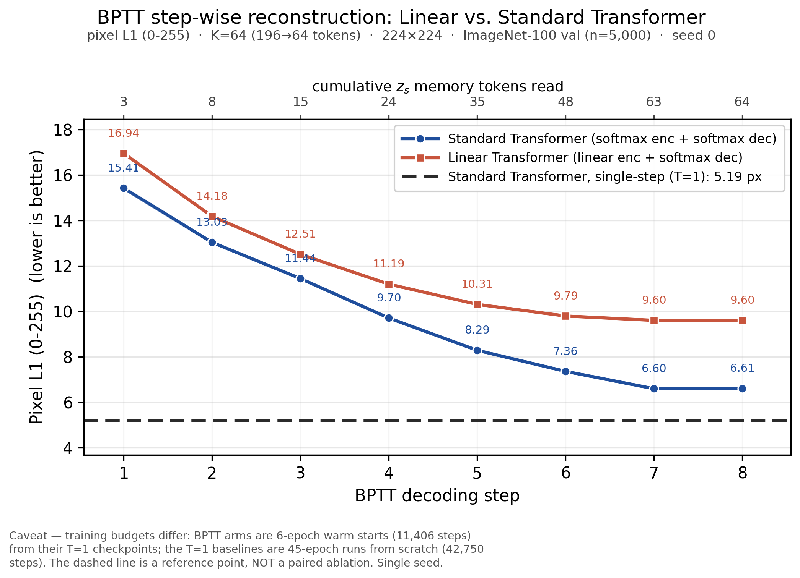
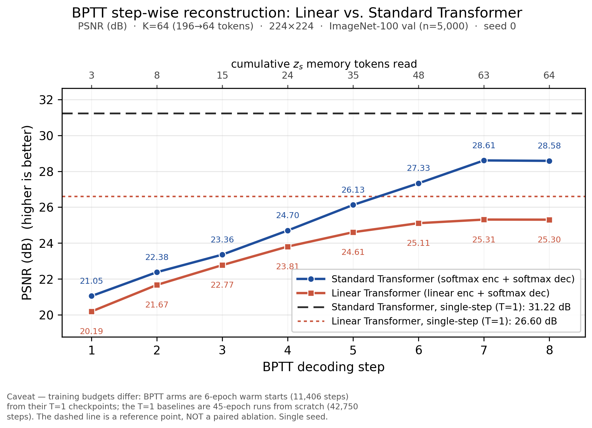

# REPORT — BPTT 逐步折线：线性 vs 标准 Transformer（step 1–8 + 标准 Transformer 单步基线）

> **日期**：2026-10-19（周一）  
> **仓库**：`AssocVTC`，本地 HEAD = `ebd0b2c`（与 `origin/main` 同步，工作区 clean）  
> **本文件性质**：**整理 + 画图**，没有重跑任何模型；所有数字来自仓库内**已落盘的评测 json**。  
> **绘图脚本**：`tools/plot_bptt_stepwise.py`（新增，可复跑）  
> **产物目录**：`doc/2026-10-19/artifacts/`

---

## 0. 一句话

标准 / 线性 Transformer 的 BPTT 曲线**形状相同**：step 1→7 单调上升（标准 +7.56 dB、线性 +5.12 dB），
step 7 最优，step 8 微降；但两条 BPTT 曲线**全程都低于各自单步（T=1）基线**
（标准差 2.61 dB、线性差 1.29 dB）。
⚠️ 这是**预算不对等**的两个交付点（BPTT = 6 ep 热启动，T=1 = 45 ep 从零），
**虚线只是参考线，不是"BPTT 有效性"的配对消融**——图的用法是"看逐步形态 + 提供参照"。

---

## 1. 交付物

| 文件 | 内容 |
|---|---|
| `artifacts/bptt_stepwise_std_linear_psnr.png` / `.pdf` | **主图**：PSNR (dB)，step 1–8 双曲线 + 标准 Transformer 单步虚线基线 |
| `artifacts/bptt_stepwise_std_linear_l1.png` / `.pdf` | 伴随图：pixel L1 (0–255)（仓库逐步分析一贯用的口径），同样带单步基线 |
| `artifacts/bptt_stepwise_std_linear_psnr_with_linear_t1.png` / `.pdf` | 可选图：额外画出**线性臂自己的 T=1**（点线），便于同族比较 |
| `artifacts/bptt_stepwise_std_linear_l1_with_linear_t1.png` / `.pdf` | 同上，L1 口径 |
| `artifacts/bptt_stepwise_data.csv` | step 1–8 的精确数值（PSNR / L1，双曲线） |
| `artifacts/bptt_stepwise_baselines.json` | T=1 基线、参数量、评测配置、来源 key |
| `tools/plot_bptt_stepwise.py` | 生成以上全部产物的脚本（数据路径写死在仓库内，可换臂/换指标） |

**主图（按需求：一条虚线 = 标准 Transformer 单步）**


**伴随图（L1 口径；数值越低越好）**



**可选图（额外加线性臂自己的 T=1 点线参考）**



---

## 2. 图注（可直接复用）

> **BPTT step-wise reconstruction: Linear vs. Standard Transformer.**
> Solid lines: mean reconstruction quality of the recurrent (BPTT, T=8) decoders at each decoding step,
> on the 5,000-image ImageNet-100 validation split (K=64, 196→64 tokens, 224×224, seed 0).
> Top axis: cumulative number of `z_s` memory tokens read by that step.
> Dashed line: the standard Transformer's **single-step (T=1)** result (31.22 dB), shown as a reference.
> Note the training budgets differ: BPTT arms are 6-epoch warm starts (11,406 steps) from their T=1
> checkpoints, whereas the T=1 baseline is a 45-epoch run from scratch (42,750 steps).

---

## 3. 数据来源与口径

### 3.1 两条曲线（BPTT, T=8）

| 曲线 | 臂（目录） | 逐步 json | 配置 |
|---|---|---|---|
| **标准 Transformer** | `stdattn_k64_rec` | `doc/2026-10-16/artifacts/alit/stepwise_stdattn_k64_rec.json` | softmax enc + softmax dec，13 层 enc / 7 层 dec，63.055 M |
| **线性 Transformer** | `k64_rec` | `doc/2026-10-16/artifacts/alit/stepwise_linattn_k64_rec.json` | **线性核 enc + softmax dec**（仓库默认"线性方案"），63.116 M |

> 说明：本仓库的"线性 Transformer"= 编码器用线性核注意力、解码器仍保留 softmax（`model_v2_linattn.py`
> 默认路径）。"全线性（enc+dec 都线性）"和"标准 enc + 线性 dec"是另外两个消融臂，见
> `doc/2026-10-17/artifacts/{alllinear,stdlin}/stepwise.json`；脚本用 `--arms std,linear,stdlin,alllinear`
> 可以一起画（本图按需求只画前两条）。
> 两个 json 与 `doc/2026-10-16/artifacts/ablation8/...` 下的副本**逐字节一致**（md5 相同），任取其一即可。

### 3.2 单步（T=1）基线

来自 `doc/2026-10-17/artifacts/eval_ablation8.json`——8 臂**同一进程、同一批次**、同样 5,000 张留出集的
`eval_linattn.py` 全量评测（所以两条曲线与基线之间不含评测管线噪声）。

| T=1 臂 | 目录 key | PSNR | SSIM | pixel L1 (0–255) |
|---|---|---|---|---|
| **标准 Transformer** | `stdattn_k64/ckpt_best.pt` | **31.2186 dB** | 0.9037 | **5.1944** |
| 线性 Transformer | `k64/ckpt_best.pt` | 26.6020 dB | 0.7654 | 8.4321 |

- 主图虚线 = **标准 Transformer 单步 31.22 dB**（按要求只有这一条）。
- 线性臂的 T=1（26.60 dB / 8.43 px）作为**参考数值**列在表里；若需要同族对照，用
  `--show-linear-t1` 生成的 `*_with_linear_t1.*` 图（点线）。

### 3.3 指标口径

- **PSNR**：stepwise json 的 `PSNR` 字段 = **逐图 PSNR 再平均**（与主报告 `eval_linattn.py` 同口径）。
  ⚠️ 同一 json 里还有 `PSNR_mean_mse`（先平均 MSE 再转 dB，约低 1.6 dB），**本图不用它**。
- **pixel L1 (0–255)**：stepwise json 的 `L1_255` 字段（0–255 空间、不做 clamp）。
  T=1 基线没有逐步 json，按仓库既有换算 `l1_norm × mean(IMAGENET_STD) × 255 = l1_norm × 0.226 × 255`
  （与 `doc/2026-10-17/REPORT_attention_matrix.md` §3.2 一致）。
- **x 轴**：BPTT decoding step 1–8（与 stepwise json 的 `T=8` 对齐）；
  顶轴是**累计读入的 `z_s` token 数** `[3, 8, 15, 24, 35, 48, 63, 64]`（`cum_z_s`），
  对应每步最后一个 `z_s` 下标 `[1, 4, 9, 16, 25, 36, 49, 64]`（`steps`）。
  step 8 只新增 1 个 token（63→64）。
- 评测集：ImageNet-100 val，**n = 5,000**，224×224，K=64（196→64 token，压缩 3.06×），seed 0。

---

## 4. 精确数值（图的数据表）

**PSNR (dB) 与 pixel L1 (0–255)**（来源：两个 stepwise json）

| step | 累计 `z_s` | 最后 `z_s` 下标 | 标准 PSNR | 线性 PSNR | Δ(std−lin) | 标准 L1 | 线性 L1 | ΔL1(std−lin) |
|---:|---:|---:|---:|---:|---:|---:|---:|---:|
| 1 | 3 | 1 | 21.0485 | 20.1887 | +0.8597 | 15.4145 | 16.9440 | −1.5295 |
| 2 | 8 | 4 | 22.3787 | 21.6685 | +0.7103 | 13.0301 | 14.1757 | −1.1456 |
| 3 | 15 | 9 | 23.3560 | 22.7722 | +0.5838 | 11.4388 | 12.5053 | −1.0665 |
| 4 | 24 | 16 | 24.7012 | 23.8059 | +0.8953 | 9.7040 | 11.1926 | −1.4886 |
| 5 | 35 | 25 | 26.1259 | 24.6062 | +1.5198 | 8.2854 | 10.3057 | −2.0203 |
| 6 | 48 | 36 | 27.3313 | 25.1094 | +2.2219 | 7.3591 | 9.7926 | −2.4335 |
| 7 | **63** | **49** | **28.6057** | **25.3096** | **+3.2962** | **6.5973** | **9.6002** | **−3.0029** |
| 8 | 64 | 64 | 28.5823 | 25.3043 | +3.2780 | 6.6129 | 9.6029 | −2.9899 |

**汇总**

| 量 | 标准 Transformer | 线性 Transformer |
|---|---|---|
| PSNR step 1 → best(step 7) | 21.0485 → 28.6057（**+7.5573 dB**） | 20.1887 → 25.3096（**+5.1209 dB**） |
| PSNR step 7 → step 8 | −0.0234 dB | −0.0053 dB |
| L1 step 1 → best(step 7) | 15.4145 → 6.5973（**−8.8173 px**） | 16.9440 → 9.6002（**−7.3438 px**） |
| 最优步（均值曲线） | step 7 | step 7 |
| 逐图最优步分布 | step 7：4,849 图（96.98%）/ step 8：151 图（3.02%） | step 7：3,046 图（60.92%）/ step 8：1,953 图（39.06%）/ step 6：1 图 |
| Δ₁ 占比（第一步吃掉的总收益） | 27.04% | 37.70% |
| 相对 T=1 基线（best step 7） | **−2.6128 dB**（31.2186 → 28.6057） | **−1.2924 dB**（26.6020 → 25.3096） |
| 相对 T=1 基线（step 8 终值） | −2.6363 dB | −1.2977 dB |
| 参数量 | 63.055 M（enc 31.848 + dec 31.207） | 63.116 M（enc 31.909 + dec 31.207） |
| BPTT 训练预算 | 6 ep / 11,406 步 / bs64（从 T=1 `ckpt_best` 热启动） | 同左 |

> 交叉核对：step 8（最后一步）的 PSNR 与 `eval_ablation8.json` 的全量评测**逐位一致**
> （28.582316 vs 28.582316；25.304327 vs 25.304327），说明逐步 json 与主表同源同口径。

---

## 5. 读图要点

1. **形状一致、单调性一致**：两条曲线都在 step 1→7 单调变好（各自 6 个正增量步，共 7 个增量步），
   都在 **step 7** 达到最优；step 8 只多读最后 1 个 `z_s`（63→64），均值出现 **−0.02 dB** 量级的
   极小回退（L1 同构：+0.016 / +0.003 px）。这个回退**小于单种子噪声的量级**，不要单独解释。
2. **标准 Transformer 全程更高，且差距随步数扩大**：step 1 只差 0.86 dB，step 5 起破 1.5 dB，
   step 7 达到最大 **3.30 dB**，step 8 为 3.28 dB。
   从逐 step 增量看：标准臂后段还能每步 +1.2~1.4 dB，线性臂后段只剩 +0.2~0.8 dB
   （step 6 / step 7 分别只有 +0.50 / +0.20 dB）——**线性臂的 BPTT 精炼饱和得早**，与报告 §3.3 "越线性的架构 BPTT 越不亏"
   是同一现象的两面：线性臂总收益小，所以相对损失也小。
3. **两条 BPTT 曲线都低于各自的单步基线**：
   标准 28.61（best）< 31.22（T=1），差 **2.61 dB**；线性 25.31（best）< 26.60（T=1），差 **1.29 dB**。
   ⚠️ **这不是"BPTT 比单步差"的证据**——BPTT 只训练了 6 ep（11,406 步，且是热启动微调），
   单步是 45 ep（42,750 步，从零）。两者是"不同预算的两个交付点"。
4. **逐图最优步的差异值得记一笔**：标准臂 **97%** 的图在 step 7 达到逐图最优、step 8 只剩 3%；
   线性臂却有 **39%** 的图在 step 8 才达到最优。也就是说线性臂的均值在 step 8 微降是"此消彼长"
   （一部分图还在变好、另一部分变差），而标准臂几乎是"全体在 step 7 收敛"。
   这与报告 §5 的 Δ₁ 占比（27% vs 38%）一起，说明**线性臂的逐步精炼更平、更晚、更不可预测**。
5. **L1 与 PSNR 结论同构**：两条曲线在 L1 口径下同样是 step 7 最优、标准全程更低（更好）；
   数值见 §4 表，图上形态与 PSNR 图一致（L1 是仓库逐步分析一贯用的口径）。

---

## 6. 诚实边界（与图一起引用，别只截曲线）

1. **预算不对等（最重要）**：BPTT 臂 = 单步版 `ckpt_best` **热启动 6 ep / 11,406 步**；
   T=1 基线 = **45 ep / 42,750 步从零**。所以：
   - 曲线内部（step 1→8）的**相对形态**可以用；
   - 曲线与虚线之间的**绝对差**只能读作"两个不同预算交付点的位置关系"，
     **不能**用来下"BPTT 有效/无效"的结论。
   - 要回答"BPTT 是否有效"，需要**同预算**对照（如 6 ep 单步热启动 vs 6 ep BPTT 热启动），本轮没有。
2. **单种子（seed 0）**：没有方差估计。step 8 的 −0.02 dB 回退、以及 0.1 dB 级差异不要过度解释；
   报告 `REPORT_attention_matrix.md` §8.2 已把这条列为硬边界。
3. **`dec_grad_ckpt` 混淆**：`stdattn_k64_rec` / `k64_rec` 的 `args.json` **没有**该键（= 默认 False，
   无梯度检查点）；另两个 BPTT 臂（`stdlin` / `alllinear`）是 True。本图只含前两条，两者一致，
   所以本图内部**不受**该混淆影响；但把本图与另外两条 BPTT 臂并排时要注意。
4. **训练实例可能不同**：`k64` / `k64_rec`（10-15 线性线）与 `stdattn_*`（10-16 线）**可能在不同
   AutoDL 实例上训练**，仅评测是同机同进程。⇒ 两条曲线之间的差异带**实例/代际混淆**，
   跨臂差值（尤其 0.1 dB 级）不要当精确配对差用。
5. **PSNR 口径**：本图用"逐图 PSNR 再平均"（与主报告 `eval_linattn.py` 一致）；不要与
   `eval_stepwise.py` 的"先平均 MSE 再转 dB"口径（约低 1.6 dB）混用。
6. **L1 基线是换算值**：T=1 的 L1(0–255) 由归一化 L1 × 0.226 × 255 换算，不是逐步评测量出来的；
   误差量级远小于本图讨论的 1~3 px 差异，但严格复现时应知道这一点。
7. **设定限定**：只针对 **224×224 / K=64 / ImageNet-100 / seed 0 / 6 ep BPTT 热启动**；
   不外推到其它分辨率、K、数据集或训练预算。
8. **"线性 Transformer"的口径**：本图指**线性编码器 + softmax 解码器**（仓库默认"线性方案"），
   不是"全线性（enc+dec 都线性）"。全线性臂的 BPTT 曲线几乎不动（总落差 0.16 px），见
   `REPORT_attention_matrix.md` §5；若要放进同一张图，用 `--arms std,linear,stdlin,alllinear`。

---

## 7. 复现

```bash
cd /home/linaro/dsh/AssocVTC

# 主图（PSNR + L1 两张）+ CSV + baselines.json
python3 tools/plot_bptt_stepwise.py

# 额外：把线性臂自己的 T=1 也画成点线
python3 tools/plot_bptt_stepwise.py --show-linear-t1

# 四个 BPTT 臂一起画（整理实验用；注意读 §6 的混淆条款）
python3 tools/plot_bptt_stepwise.py --arms std,linear,stdlin,alllinear \
    --out-dir doc/2026-10-19/artifacts/four_arms

# 只要 L1 图 / 去掉点旁数值
python3 tools/plot_bptt_stepwise.py --metric l1 --no-point-labels
```

脚本不依赖 GPU、不加载模型，只读 json；产物默认写到 `doc/2026-10-19/artifacts/`。
PNG 为 300 dpi，PDF 为矢量（可直接进论文/LaTeX）。

---

## 8. 下一步（"整理实验"的待办清单，建议按此顺序）

1. **同预算对照**（决定 BPTT 是否值得保留）：从同一 T=1 `ckpt_best` 热启动 6 ep，
   分别跑「单步微调」与「BPTT 微调」，这才是能下结论的配对；
   现有数据只能说明"逐 step 形态"和"两个交付点的位置"。
2. **四臂逐步图**：用 `--arms std,linear,stdlin,alllinear` 出一张 4 曲线图，
   配 `best_step_hist`，把"线性解码器摧毁逐步精炼"（Δ₁ 占比 84%/97%）和本图的"线性编码器
   后期饱和"放在同一张图里讲。
3. **per-image 分析**：stepwise json 已有 `best_step_hist`，可以补"按图类别/边缘密度分桶的最优步"，
   解释为什么线性臂有 39% 的图要到 step 8 才最优。
4. **K-sweep 的逐步形态**（目前只有 K=64）：报告 §8.4 已列为未验证项。
5. **论文用图**：主文建议只保留 **同一模型族** 的参考线（std BPTT vs std T=1），
   线性臂的 T=1 放附录或另画；本目录的 `*_with_linear_t1.*` 已备好。
