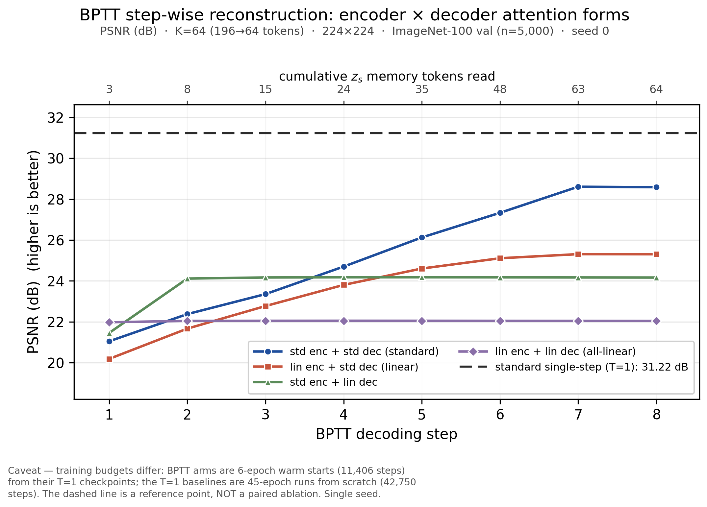
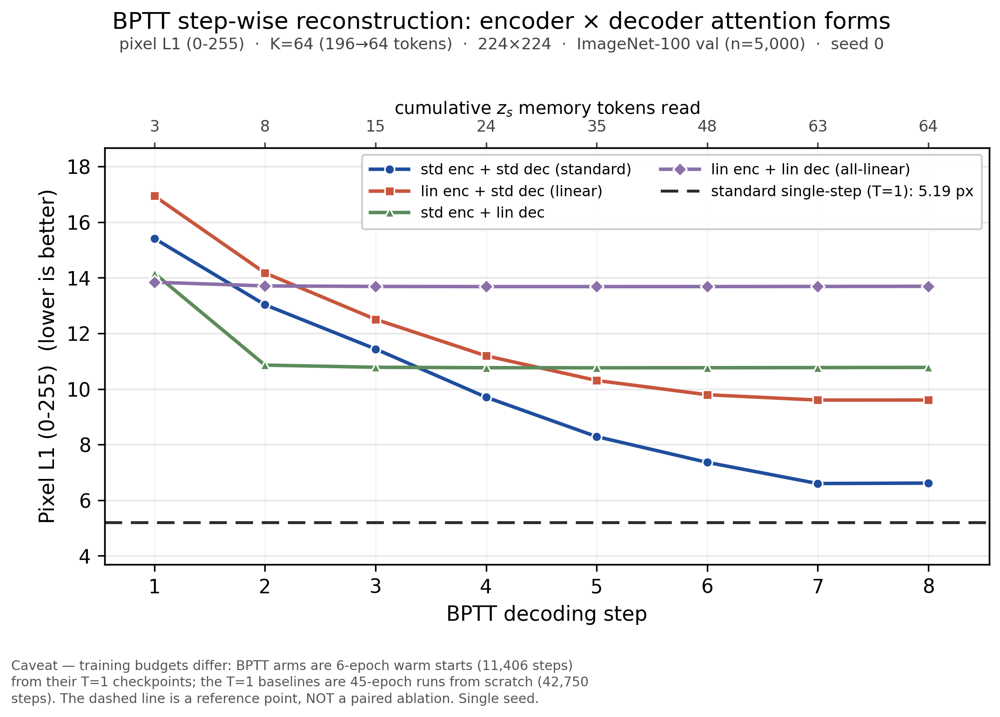
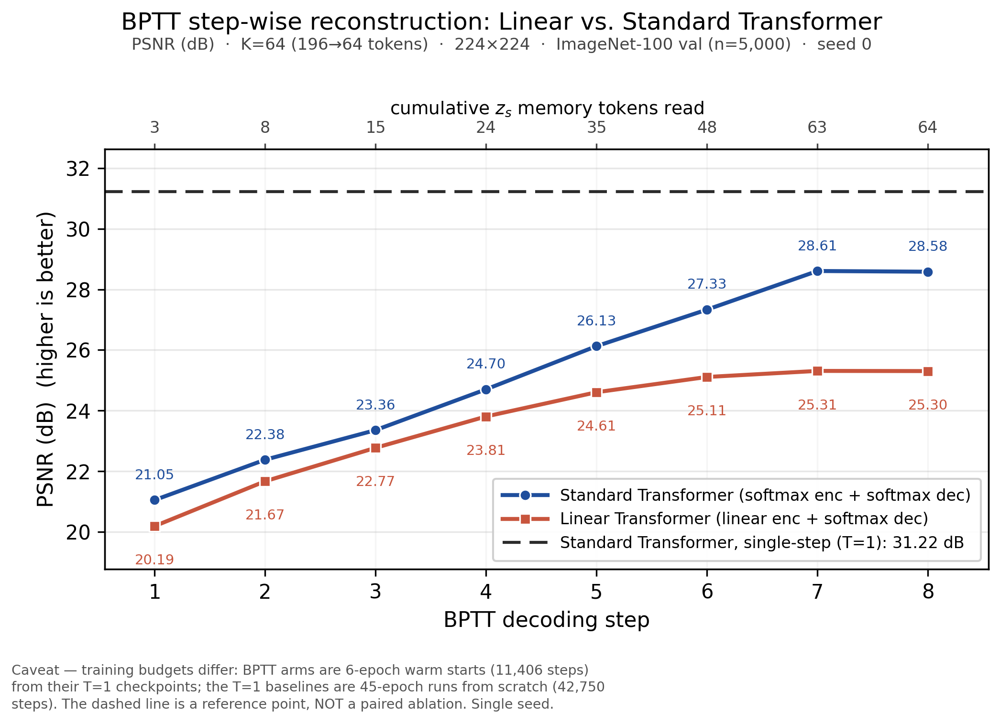

# REPORT — BPTT 逐步折线（编码器 × 解码器注意力形式，四臂）+ 标准 Transformer 单步基线

> **日期**：2026-10-19（周一）  
> **仓库**：`AssocVTC`，本地 HEAD = `ebd0b2c`（与 `origin/main` 同步，工作区 clean）  
> **版本**：v2（按反馈**补上另外两条 BPTT 臂**：`std enc + linear dec`、`all-linear`；v1 只有解码器为 softmax 的两条）  
> **本文件性质**：**整理 + 画图**，没有重跑任何模型；所有数字来自仓库内**已落盘的评测 json**。  
> **绘图脚本**：`tools/plot_bptt_stepwise.py`（可复跑，`--arms` 选择臂）  
> **产物目录**：`doc/2026-10-19/artifacts/four_arms/`（主图）、`doc/2026-10-19/artifacts/`（两臂简版）

---

## 0. 一句话

**BPTT 能不能"逐步精炼"，取决于解码器是不是 softmax。**
解码器为 softmax 的两条曲线（标准 Transformer、线性编码器 Transformer）从 step 1→7 持续上升
（**+7.56 / +5.12 dB**）；把解码器换成线性核后，两条曲线在 **step 1–2 就把收益吃光**
（Δ₁ 占比 **97.2% / 84.0%**，总增益只剩 **+2.72 / +0.07 dB**），此后基本是平线。
标准 Transformer 的**单步（T=1）基线 = 31.22 dB**（图中黑色虚线），四条 BPTT 曲线都在它下方
（⚠️ 预算不对等：BPTT = 6 ep 热启动，T=1 = 45 ep 从零，虚线只是参考线）。

---

## 1. 交付物

| 文件 | 内容 |
|---|---|
| `artifacts/four_arms/bptt_stepwise_four_arms_psnr.png` / `.pdf` | **主图**：四臂 BPTT（PSNR），step 1–8 + 标准 Transformer 单步虚线基线 |
| `artifacts/four_arms/bptt_stepwise_four_arms_l1.png` / `.pdf` | 伴随图：pixel L1 (0–255)，同样四臂 + 单步基线 |
| `artifacts/four_arms/bptt_stepwise_data.csv` / `bptt_stepwise_baselines.json` | 四臂逐步数值 + T=1 基线/参数量 |
| `artifacts/bptt_stepwise_std_linear_psnr.png` / `.pdf` | 两臂简版（标准 vs 线性编码器，解码器都是 softmax），v1 主图 |
| `artifacts/bptt_stepwise_std_linear_l1.png` / `.pdf` | 两臂简版 L1 |
| `artifacts/bptt_stepwise_std_linear_psnr_with_linear_t1.png` / `.pdf` | 两臂简版 + 线性臂自己的 T=1 点线（同族参照） |
| `artifacts/bptt_stepwise_std_linear_l1_with_linear_t1.png` / `.pdf` | 同上，L1 口径 |
| `artifacts/bptt_stepwise_data.csv` / `bptt_stepwise_baselines.json` | 两臂逐步数值 + T=1 基线 |
| `tools/plot_bptt_stepwise.py` | 生成以上全部产物的脚本（不加载模型、不占 GPU） |

**主图（四臂；一条虚线 = 标准 Transformer 单步基线）**



**伴随图（L1 口径）**



**两臂简版（v1，便于只看"线性编码器 vs 标准编码器"）**



---

## 2. 图注（可直接复用）

> **BPTT step-wise reconstruction across encoder × decoder attention forms.**
> Solid lines: mean reconstruction quality of the four recurrent (BPTT, T=8) decoders at each decoding
> step, on the 5,000-image ImageNet-100 validation split (K=64, 196→64 tokens, 224×224, seed 0).
> Top axis: cumulative number of `z_s` memory tokens read by that step.
> Dashed line: the standard Transformer's **single-step (T=1)** result (31.22 dB), shown as a reference.
> Arms with a softmax decoder keep improving with more `z_s`; arms with a linear decoder saturate after
> the first step. Note the training budgets differ: BPTT arms are 6-epoch warm starts (11,406 steps)
> from their T=1 checkpoints, whereas the T=1 baseline is a 45-epoch run from scratch (42,750 steps).

---

## 3. 数据来源与口径

### 3.1 四条 BPTT 曲线（T=8）

| 曲线（图例） | 臂（目录） | enc attn | dec attn | 逐步 json | 参数量 |
|---|---|---|---|---|---|
| `std enc + std dec (standard)` | `stdattn_k64_rec` | softmax | softmax | `doc/2026-10-16/artifacts/alit/stepwise_stdattn_k64_rec.json` | 63.055 M |
| `lin enc + std dec (linear)` | `k64_rec` | 线性核 | softmax | `doc/2026-10-16/artifacts/alit/stepwise_linattn_k64_rec.json` | 63.116 M |
| `std enc + lin dec` | `stdlin_k64_rec` | softmax | **线性核** | `doc/2026-10-17/artifacts/stdlin/stepwise.json` | 63.058 M |
| `lin enc + lin dec (all-linear)` | `alllinear_k64_rec` | 线性核 | **线性核** | `doc/2026-10-17/artifacts/alllinear/stepwise.json` | 63.119 M |

> 前两条 stepwise json 与 `doc/2026-10-16/artifacts/ablation8/...` 下的副本**逐字节一致**（md5 相同）。
> 四个臂都是 **6 ep / 11,406 步 / bs64**，从各自的单步版 `ckpt_best` 热启动；编码器联合微调（不冻结）。
> ⚠️ 四臂之间有一个**不可分离的开关差**：`stdattn_k64_rec` / `k64_rec` 的 args 没有
> `dec_grad_ckpt` 键（= 默认 False，无梯度检查点）；`stdlin_k64_rec` / `alllinear_k64_rec` = **True**。
> 见 §6.3。

### 3.2 单步（T=1）基线

来自 `doc/2026-10-17/artifacts/eval_ablation8.json`——8 臂**同一进程、同一批次**、同样 5,000 张留出集的
`eval_linattn.py` 全量评测。

| T=1 臂 | 目录 key | PSNR | SSIM | pixel L1 (0–255) |
|---|---|---|---|---|
| **标准 Transformer** | `stdattn_k64/ckpt_best.pt` | **31.2186 dB** | 0.9037 | **5.1944** |
| 线性 Transformer | `k64/ckpt_best.pt` | 26.6020 dB | 0.7654 | 8.4321 |
| Std enc + linear dec | `stdlin_k64/ckpt_best.pt` | 24.7138 dB | 0.6882 | 10.1758 |
| All-linear | `alllinear_k64/ckpt_best.pt` | 21.8844 dB | 0.5535 | 13.9704 |

- **主图虚线 = 标准 Transformer 单步 31.22 dB**（按要求只保留这一条）。
- 其它臂的 T=1 数值列在这里备查；如果要画同族参照线，用脚本的 `--show-linear-t1`
  （两臂简版已生成 `*_with_linear_t1.*`）。
- 四臂 T=1 均 **45 ep / 42,750 步从零**训练 ⇒ 与 BPTT 臂（6 ep 热启动）**预算不对等**。

### 3.3 指标口径

- **PSNR**：stepwise json 的 `PSNR` 字段 = **逐图 PSNR 再平均**（与主报告 `eval_linattn.py` 同口径）。
  ⚠️ 同一 json 里还有 `PSNR_mean_mse`（先平均 MSE 再转 dB，约低 1.6 dB），**本图不用它**。
- **pixel L1 (0–255)**：stepwise json 的 `L1_255` 字段（0–255 空间、不做 clamp）。
  T=1 基线按仓库既有换算 `l1_norm × 0.226 × 255`（与 `REPORT_attention_matrix.md` §3.2 一致）。
- **x 轴**：BPTT decoding step 1–8；顶轴是累计读入的 `z_s` token 数
  `[3, 8, 15, 24, 35, 48, 63, 64]`（`cum_z_s`），对应每步最后一个 `z_s` 下标
  `[1, 4, 9, 16, 25, 36, 49, 64]`（`steps`）。step 8 只新增 1 个 token（63→64）。
- 评测集：ImageNet-100 val，**n = 5,000**，224×224，K=64（196→64 token，压缩 3.06×），seed 0。
- 交叉核对：四个臂 step 8（最后一步）的 PSNR 与 `eval_ablation8.json` 的全量评测**逐位一致**
  （28.582316 / 25.304327 / 24.165752 / 22.042423）⇒ 逐步 json 与主表同源同口径。

---

## 4. 精确数值（图的数据表）

### 4.1 四臂逐步 PSNR (dB)

| step | 累计 `z_s` | **std enc + std dec** | lin enc + std dec | **std enc + lin dec** | **lin enc + lin dec** |
|---:|---:|---:|---:|---:|---:|
| 1 | 3 | 21.0485 | 20.1887 | 21.4575 | 21.9800 |
| 2 | 8 | 22.3787 | 21.6685 | 24.1159 | 22.0450 |
| 3 | 15 | 23.3560 | 22.7722 | 24.1692 | 22.0510 |
| 4 | 24 | 24.7012 | 23.8059 | 24.1777 | **22.0530** |
| 5 | 35 | 26.1259 | 24.6062 | **24.1780** | 22.0519 |
| 6 | 48 | 27.3313 | 25.1094 | 24.1750 | 22.0490 |
| 7 | 63 | **28.6057** | **25.3096** | 24.1701 | 22.0460 |
| 8 | 64 | 28.5823 | 25.3043 | 24.1658 | 22.0424 |

### 4.2 四臂逐步 pixel L1 (0–255)

| step | std enc + std dec | lin enc + std dec | std enc + lin dec | lin enc + lin dec |
|---:|---:|---:|---:|---:|
| 1 | 15.4145 | 16.9440 | **14.1611** | **13.8410** |
| 2 | 13.0301 | 14.1757 | 10.8588 | 13.7080 |
| 3 | 11.4388 | 12.5053 | 10.7801 | 13.6890 |
| 4 | 9.7040 | 11.1926 | 10.7651 | 13.6830 |
| 5 | 8.2854 | 10.3057 | 10.7622 | 13.6830 |
| 6 | 7.3591 | 9.7926 | 10.7642 | 13.6850 |
| 7 | **6.5973** | **9.6002** | 10.7694 | 13.6890 |
| 8 | 6.6129 | 9.6029 | 10.7756 | 13.6930 |

### 4.3 汇总（同臂内）

| 量 | std enc + std dec | lin enc + std dec | std enc + lin dec | lin enc + lin dec |
|---|---|---|---|---|
| PSNR step 1 → best | 21.05 → **28.61**（+7.56） | 20.19 → **25.31**（+5.12） | 21.46 → 24.18（+2.72） | 21.98 → 22.05（+0.07） |
| 最优步（均值曲线） | step 7 | step 7 | step 5 | step 5（L1）/ step 4（PSNR，差 0.001 dB） |
| L1 step 1 → best | 15.41 → **6.60**（−8.82） | 16.94 → **9.60**（−7.34） | 14.16 → 10.76（−3.40） | 13.84 → 13.68（−0.16） |
| **Δ₁ 占比**（第一步吃掉的总收益） | 27.04% | 37.70% | **97.16%** | **84.03%** |
| 正增量步数（共 7 步） | 6 | 6 | 4 | 4 |
| 逐图最优步众数 | step 7（96.98%） | step 7（60.92%） | step 5（39.34%） | step 4（29.44%） |
| 相对标准 T=1（31.22 dB） | −2.61（best） | −5.91 | −7.04 | −9.17 |

> 读法提醒：最后一列"相对标准 T=1"只说明**各臂与同一条参考线的距离**，不是同预算配对差；
> 跨臂的绝对差还叠了 enc/dec 形式 × 预算的混淆，见 §6。

---

## 5. 读图要点

1. **分水岭是解码器，不是编码器。** 四条曲线按解码器注意力一分为二：
   - **softmax 解码器**（蓝、橙）：step 1→7 单调上升，6 个正增量步，最优步 7，总增益 **+7.56 / +5.12 dB**；
   - **线性解码器**（绿、紫）：step 1→2 就基本吃完全部收益（Δ₁ 占比 **97.2% / 84.0%**），
     之后是平线（绿在 24.17–24.18 之间抖 ±0.01 dB，紫在 22.04–22.05 之间抖 ±0.005 dB）。
   这与 `REPORT_attention_matrix.md` §5 的表完全一致——**"BPTT 逐步精炼"这个机制只存在于 softmax 解码器**。
2. **第一步反而是线性解码器更好。** step 1 的排序是
   `all-linear 21.98 > std+lin-dec 21.46 > standard 21.05 > linear-enc 20.19`；
   到 step 2 绿线反超到 24.12，step 3–4 被蓝线（standard）超过，最终蓝 > 橙 > 绿 > 紫。
   形态上像"线性解码器把第一步当成一次池化平均，用上了先验；但它不会随新 `z_s` 继续修正"。
   这条与报告 §5 的解释（线性核没有行归一化，`Σφ(k)vᵀ` 更像对 memory 求平均）自洽。
3. **step 8 的微降只发生在 softmax 解码器臂**：蓝 −0.023 dB、橙 −0.005 dB；线性解码器臂在 step 5–8
   本来就没有净增量。step 8 只新增 1 个 `z_s`（63→64），回退 < 单种子噪声量级，不要单独解释。
4. **与单步基线的关系**：标准 Transformer 单步 31.22 dB 在四条 BPTT 曲线之上（best 曲线 28.61，
   差 −2.61 dB）；橙色 −5.91 dB、绿色 −7.04 dB、紫色 −9.17 dB。
   ⚠️ **不要据此说"BPTT 比单步差"**：BPTT 是 6 ep 热启动微调，单步是 45 ep 从零（见 §6.1）。
5. **两臂简版**（`bptt_stepwise_std_linear_*`）只保留蓝、橙两条，若只想讲"线性编码器 vs 标准编码器"用这张；
   四臂图用来讲机制（解码器形式决定形态），两张图来自同一份数据。

---

## 6. 诚实边界（与图一起引用，别只截曲线）

1. **预算不对等（最重要）**：BPTT 臂 = 单步版 `ckpt_best` **热启动 6 ep / 11,406 步**；
   T=1 基线 = **45 ep / 42,750 步从零**。⇒ 曲线内部（step 1→8）的**相对形态**可以用；
   曲线与虚线之间、以及跨臂的绝对差**不能**用来下"BPTT 有效/无效"。
2. **`dec_grad_ckpt` 混淆（四臂之间）**：`stdattn_k64_rec` / `k64_rec` = **OFF**（args 无该键 = 默认 False），
   `stdlin_k64_rec` / `alllinear_k64_rec` = **ON**。同一天的报告 §8.9 + 归因探针（`b1_mean` vs `b1_mean_nockpt`）
   实测开关差 **−0.34 dB 量级**（方向：OFF 反而更差）。所以"线性解码器 −3.4 dB/−4.6 dB"的**臂间绝对差**
   里混了这个开关；但"Δ₁ 占比 97%/84%、后段平线"是**同臂内的曲线形态**，不受预算/开关影响。
3. **训练实例可能不同**：`stdattn_*`（10-16 线）与 `stdlin/alllinear`（10-17 线）在不同 AutoDL 实例上训练；
   `k64/k64_rec`（10-15 线性线）也可能换过机。只有评测是同机同进程。⇒ 跨臂绝对差带实例混淆。
4. **单种子（seed 0）**：无方差估计；0.1 dB 级差异、step 8 的 −0.02 dB 回退不要过度解释。
5. **PSNR 口径**：本图用"逐图 PSNR 再平均"（与主报告 `eval_linattn.py` 一致）；不要与
   `eval_stepwise.py` 的"先平均 MSE 再转 dB"口径（约低 1.6 dB）混用。
6. **L1 基线是换算值**：T=1 的 L1(0–255) 由归一化 L1 × 0.226 × 255 换算，不是逐步评测量出来的。
7. **设定限定**：只针对 **224×224 / K=64 / ImageNet-100 / seed 0 / 6 ep BPTT 热启动**；
   不外推到其它分辨率、K、数据集或训练预算。
8. **"线性 Transformer"的口径**：本图里 `lin enc + std dec` 是仓库默认"线性方案"（`model_v2_linattn.py` 默认路径）；
   `lin enc + lin dec` 是"全线性"。两者都在图里，图例写明了 enc/dec 形式。

---

## 7. 复现

```bash
cd /home/linaro/dsh/AssocVTC

# 主图：四臂（PSNR + L1 两张）+ 四臂 CSV / baselines.json
python3 tools/plot_bptt_stepwise.py --arms std,linear,stdlin,alllinear \
    --tag four_arms --out-dir doc/2026-10-19/artifacts/four_arms

# 两臂简版（默认 arm 组合）
python3 tools/plot_bptt_stepwise.py

# 两臂简版 + 线性臂自己的 T=1 点线
python3 tools/plot_bptt_stepwise.py --show-linear-t1

# 只要 L1 图
python3 tools/plot_bptt_stepwise.py --metric l1
```

脚本只读仓库内 json，不依赖 GPU、不加载模型；PNG 300 dpi、PDF 矢量（可直接进论文/LaTeX）。
`--arms` 支持 `std` / `linear` / `stdlin` / `alllinear` 任意组合（>2 臂自动用紧凑图例、不标点旁数值）。

---

## 8. 下一步（"整理实验"的待办清单）

1. **同预算对照**（P1，决定 BPTT 是否值得保留）：从同一 T=1 `ckpt_best` 热启动 6 ep，
   分别跑「单步微调」与「BPTT 微调」；这样才能把"BPTT 的净收益"与"6 ep 微调本身"分开。
2. ✅ **四臂逐步图**（本报告已完成）：把"线性解码器摧毁逐步精炼"（Δ₁ 占比 97%/84%）和
   "线性编码器后期饱和"放在同一张图里讲。
3. **固定 `dec_grad_ckpt` 重跑四臂 rec**（P1）：消除 §6.2 的开关混淆，跨臂绝对差才敢用。
4. **per-image 分析**：stepwise json 已有 `best_step_hist`，可以补"按图类别/边缘密度分桶的最优步"，
   解释为什么线性解码器臂有 39%/29% 的图最优步落在 step 4–5 之后。
5. **K-sweep 的逐步形态**（目前只有 K=64）：报告 §8.4 已列为未验证项。
6. **论文用图**：主文用**四臂 PSNR**（或 L1）图讲机制；两臂简版可放附录或用于"线性编码器"单因素对比。
7. ✅ **复杂度维度的外部验证（同日完成）**：用公开 SAVOIAS 人评复杂度（OOD）复刻 ALIT Fig.4/11/12，
   证明「图越复杂 → 同 token 预算下 L1 越高、越需要更多 token」在我们的模型上成立
   （std 臂 ρ=+0.33~+0.58）⇒ [`REPORT_savoias_complexity.md`](REPORT_savoias_complexity.md)。
   注意它**不改变**本报告的四臂结论；且「复杂度相关」≠「oracle 停步有收益」
   （后者见 `doc/2026-10-16/REPORT_alit_adaptive.md` 的 E-A1/E-A2）。
