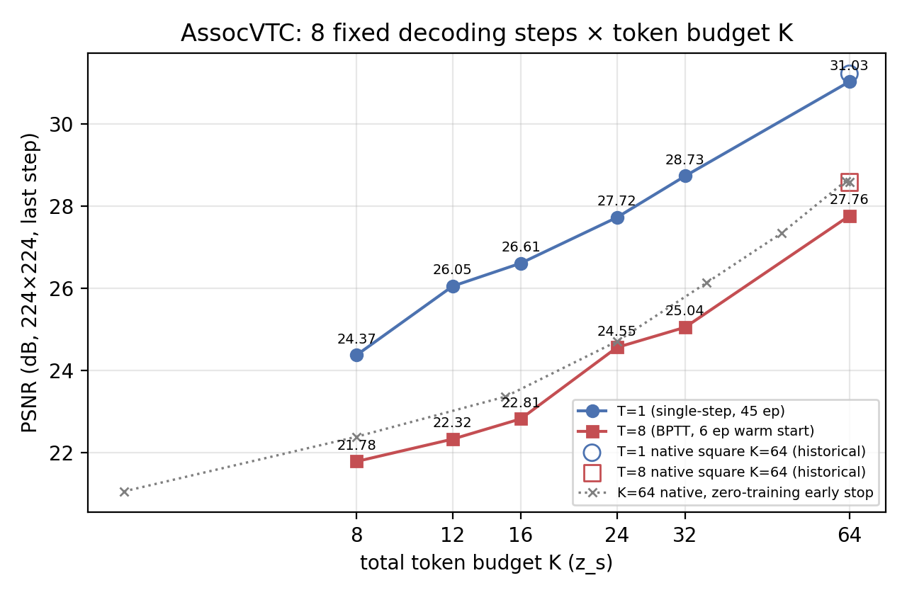
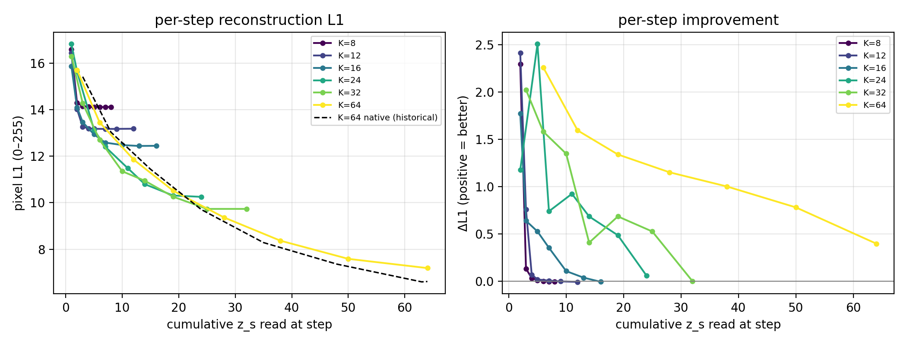

# REPORT — 固定 8 解码步 × token 预算 K 的消融（K=8/12/16/24/32/64）

> **日期**：2026-10-19（周一）
> **仓库/代码**：`AssocVTC`，代码基线 `787accb` + 本实验新增（`94fa8ea` 起的
> cumulative 读窗口计划；本次运行的最终代码见文末 §6）
> **机器**：AutoDL **2×A800-80GB**（`ssh -p 43732`），112 核 / 1 TB 内存 / 80 GB 数据盘
> **数据**：ImageNet-100，**train 121,689 / val 5,000**（每类等距抽 50 张，确定性切分）
> **口径**：224×224、K=z_s 总数、像素 L1/PSNR/SSIM、**单种子 seed 0**、bf16 autocast
> **产物**：`doc/2026-10-19/artifacts/k8sweep/`（评测 json / 表 / 图 / 训练曲线 / args）

---

## 0. 一句话结论

固定 8 个解码步、只把**总 token 预算 K 从 8 扫到 64**：末步 PSNR **单调上升
21.78 → 27.76 dB**（提升 5.98 dB），同 token 预算的**单步臂**也从 24.37 → 31.03 dB，
**到 K=64 仍没有饱和迹象**。但「固定 8 步」对小预算明显**过剩**：
**K≤12 时 L1 在第 3–4 步后完全走平**（后面几步只读 1 个 token，Δ≈0），
**K≥24 时 8 步都有正收益**。另有一个必须同读的对照：**同等累计 token 下，
K=64 大模型的「零训练 early-stop」前步预测仍比专训小 K 模型好 0.15–1.1 dB**
⇒ 本消融里 K 同时改变了「预算」与「编码器 memory 容量」，不能把差异全部归给预算。

---

## 1. 这次要回答什么 / 消融口径（用户 2026-10-19 指定）

按 ALIT（[arXiv:2411.02393](https://arxiv.org/abs/2411.02393)）的
「recurrent rollouts + 每次迭代新增 latent token」设定，在本仓库**自建模型**上固定
**8 个解码步**，扫 **总 token 预算 K = 32 / 24 / 16 / 12 / 8**（另加 **K=64 同协议参照点**）：

| 项 | 值 |
|---|---|
| 步数 T | **固定 8**（循环读出 + BPTT carry） |
| 总预算 K（z_s 数） | **32 / 24 / 16 / 12 / 8**（+ 64 参照） |
| 模型 | `SRPhase1LinAttn`（enc_attn=std 普通 softmax 编码器 31.8 M + std 解码器 31.2 M ≈ 63.0 M） |
| 数据 | ImageNet-100，无预训练编码器（从零训） |

⚠️ **为什么必须改代码**：本仓库主线的 token 预算与步数是**平方耦合**的
（`K = T²`：K=64 ↔ 8 步，`square_block_starts`），K<64 时自然只剩 5 步。
要让「T 固定 8、K 独立变化」成立，必须给解码器换一个**读窗口 schedule**
（见 §2.1）。这不是改评测口径，是给消融加一个**新的采样计划**（默认路径逐位不变）。

---

## 2. 方法

### 2.1 `cumulative` 计划：把 square 形状按总预算缩放

原生 square 计划（K=64、T=8）每步读窗口：

```
步 t=k² 读 z_s[k² : min((k+1)²−1, K)]，首步另含 z_cls
⇒ K=64 累计读入 = [3, 8, 15, 24, 35, 48, 63, 64]，块尺寸形状 ≈ 3,5,7,9,11,13,15,17
```

「固定 T 步 × 总预算 K」用同一**形状**缩放到 K：

```
C_i = round( K · ((i+1)²−1) / ((T+1)²−1) )   (i=1..T, C_T=K)
再确定性修正：每步 ≥1、严格递增、末项=K
```

| K | 每步累计读入的 z_s 数 C_1..C_8 | 每步窗口（z_s 下标） |
|---|---|---|
| 8  | 1, 2, 3, 4, 5, 6, 7, 8 | 每步 1 个 |
| 12 | 1, 2, 3, 4, 5, 7, 9, 12 | 1,1,1,1,1,2,2,3 |
| 16 | 1, 2, 3, 5, 7, 10, 13, 16 | 1,1,1,2,2,3,3,3 |
| 24 | 1, 2, 5, 7, 11, 14, 19, 24 | 1,1,3,2,4,3,5,5 |
| 32 | 1, 3, 6, 10, 14, 19, 25, 32 | 1,2,3,4,4,5,6,7 |
| 64 | 2, 6, 12, 19, 28, 38, 50, 64 | 2,4,6,7,9,10,12,14 |

- **为什么不用 uniform（每步 K/8）**：① 本仓库已有判据「**窗口不增长**是高 N 训不起来的
  近因」（`doc/2026-09-23/REPORT_fixw4_plan.md`：固定 4 窗口相对 square −4.03 dB 且慢 4×）；
  ② uniform 会把「预算变化」和「每步分配形状变化」混在同一个自变量里，缩放形状才是**只动预算**。
- **诚实边界**：K=64 用本计划与**历史原生 square 计划**（[3,8,15,24,35,48,63,64]）并不逐位相同
  —— 本计划前几步读得更少（2 vs 3、6 vs 8、12 vs 15…）。故 K=64 只作**同协议参照点**，
  原生 K=64 的历史数字另列（§3.5），两者差异见边界 §4.2。

### 2.2 训练协议（与既有 BPTT 臂**逐项同协议**）

两个阶段，每臂串行（与 `stdattn_k64` / `stdattn_k64_rec` 完全同参）：

| 相 | 步数 | epochs | batch | lr | 初始化 | 其它 |
|---|---|---|---|---|---|---|
| A 相 | T=1（单步读全 K） | 45 | 128 | 2e-4 | 从零 | warmup_frac 0.08、cosine→1e-6、bf16、grad clip 1.0 |
| B 相 | T=8（cumulative 窗口，BPTT） | 6 | 64 | 2e-4 | A 相 `ckpt_best` | `--init_from`、同 lr 曲线 |

- 每臂参数 ≈ **63.0 M**（K 只改 register 数，参数量差 < 0.1%）。
- 2 卡并行：GPU0 = K 32→16→8，GPU1 = K 24→12→64；**单臂 ≈ 3.0 h**（A 相 1.85–1.95 h +
  B 相 1.05–1.10 h），**6 臂总墙钟 9.2 h**（12:05→21:17）。
- 训练全程无 OOM、无跳步护栏触发；B 相显存 23.5 GB。

### 2.3 评测（全量 5,000 留出集）

| 脚本 | 口径 |
|---|---|
| `eval_linattn.py` | 末步（第 8 步）像素 **PSNR / SSIM / L1_norm**（与主报告同口径；PSNR 逐图再平均） |
| `eval_stepwise_linattn.py` | 逐步 1–8 的 **L1_255（不 clamp）**、PSNR、Δ_t、每图最优停步 |

代码改动（默认路径逐位不变，已回归）：
1. `model_v2_linattn.py`：新增 `step_plan="cumulative"` + `scaled_square_cumsum(K,T)` + 自检 §8e
   （覆盖 8 臂 K=8..64 的窗口 0..K 无缝、严格递增、前向形状）；`LinAttnConfig` 新增
   `dec_step_plan`/`dec_block`（默认 square/0）。
2. `train_linattn.py`：`--step_plan` / `--block` 透传进 cfg（ckpt 可重建）。
3. `eval_stepwise_linattn.py`：`cum_z_s` 改为取读窗口 `hi`（对 square/fixed/cumulative 通用；
   square 口径数值不变）+ `--override_dec_steps`（零训练截断实验用）。
4. `tools/{run_k8sweep_arm,launch_k8sweep,eval_k8sweep,plot_k8sweep}.*`。

**回归门**：用历史 `stdattn_k64_rec` ckpt 跑新 `eval_stepwise_linattn.py`，逐位复现
`cum_z_s=[3,8,15,24,35,48,63,64]`、末步 **28.582 dB**、L1 `[15.415,13.030,11.439,9.704,8.285,7.359,6.597,6.613]`
与 `doc/2026-10-16/artifacts/alit/stepwise_stdattn_k64_rec.json` 一致。

---

## 3. 结果

### 3.1 主表（5,000 张 ImageNet-100 val，末步）

| K (token) | T=1 PSNR | T=1 L1_255 | T=1 SSIM | T=8 PSNR | T=8 L1_255 | T=8 SSIM | T=8 oracle PSNR | Δ₁ 占比 | L1 最优步 |
|---|---|---|---|---|---|---|---|---|---|
| **8**  | 24.366 | 0.185 | 0.6670 | **21.777** | 0.245 | 0.5492 | 21.787 | 92.8% | 5 |
| **12** | 26.045 | 0.155 | 0.7390 | **22.321** | 0.229 | 0.5775 | 22.330 | 73.9% | 6 |
| **16** | 26.606 | 0.146 | 0.7634 | **22.815** | 0.216 | 0.6029 | 22.821 | 51.6% | 7 |
| **24** | 27.720 | 0.129 | 0.8089 | **24.554** | 0.178 | 0.6947 | 24.554 | 17.9% | 8 |
| **32** | 28.728 | 0.116 | 0.8427 | **25.045** | 0.169 | 0.7101 | 25.048 | 30.8% | 7 |
| **64**（参照） | 31.027 | 0.092 | 0.9002 | **27.760** | 0.125 | 0.8280 | 27.760 | 26.5% | 8 |

> T=8 oracle PSNR = 8 步中 PSNR 最高的那一步（与末步几乎相同 ⇒ 末步基本都在最优点）；
> 「L1 最优步」是该图集平均 L1 最低的步。
> ⚠️ **T=1 与 T=8 两列不可直接比**：A 相 45 ep 从零、B 相 6 ep 热启动，预算差 7.5×
> （与 `doc/2026-10-17/REPORT_attention_matrix.md` §9 同一条边界）。



### 3.2 预算–质量：到 K=64 仍是对数线性、无饱和

- **T=8 末步**：K 翻倍 +1.04 dB（8→16）/ +2.23 dB（16→32）/ +2.71 dB（32→64）；
  L1_255 0.245 → 0.125（−49%）。
- **T=1 末步**：K 翻倍 +2.24 / +2.12 / +2.30 dB（非常接近 log-linear，约 **+2.2 dB/doubling**）。
- 结论只到 K=64：**没有出现「再加 token 不涨」的饱和点**（N=196 patches，K=64 仍只压到 33%）。

### 3.3 逐步：固定 8 步时，K≤16 的后面几步是「空转」



每臂逐步 L1_255（左）与逐步增量 Δ_t（右，正=变好）。关键读数：

| K | 逐步 L1_255（step1→8） | 实质增益止于 |
|---|---|---|
| 8  | 16.580 → 14.287 → **14.155 → 14.122 → 14.111 → 14.110** → 14.113 → 14.118 | **step 2–3**（之后 Δ≤0.04 px） |
| 12 | 16.433 → 14.021 → **13.264 → 13.194 → 13.176 → 13.170** → … | **step 3**（之后 Δ≤0.02 px） |
| 16 | 15.871 → 14.100 → 13.461 → 12.936 → 12.583 → 12.477 → **12.439** → 12.445 | step 6–7 |
| 24 | 16.820 → 15.645 → 13.139 → 12.401 → 11.478 → 10.794 → 10.309 → **10.251** | **step 8**（8 步都正收益） |
| 32 | 16.299 → 14.277 → 12.696 → 11.349 → 10.942 → 10.258 → **9.733** → 9.733 | step 7 |
| 64 | 15.708 → 13.449 → 11.856 → 10.517 → 9.367 → 8.366 → 7.587 → **7.190** | step 8 |

- **K≤12：8 步严重过剩**——累计读入在第 3–4 步就到 K，后续步 Δ≈0 甚至轻微过冲
  （Δ₁ 占比 92.8% / 73.9% 即「第 2 步就把总落差基本吃完」）。
- **K≥24：8 步都有正 Δ**，且 Δ_t 在 7–9 步处仍有 0.4–1.0 px。
- 这给出一个**可操作的配方边界**：**固定 8 步时 K 应 ≥ ~24**；K<16 时应当**减步数**
  （等价于「步数 = √K」的原生 square 口径），否则后几步只是重复读 1 个 token。

### 3.4 零训练对照：K=64 的 early-stop 在同等预算下更好

用历史 `stdattn_k64_rec`（原生 square 计划，K=64）的逐步曲线做**零训练截断**
（第 j 步输出 = 累计读入 cum_z[j] 个 token 的预测），与「专训小 K、固定 8 步」对照：

| 累计 token 预算 | K=64 原生模型 early-stop | 专训臂（末步） | 差值（原生 − 专训） |
|---|---|---|---|
| 8 | **22.379**（step2） | K=8：21.777 | **+0.60 dB** |
| 15 | **23.356**（step3） | K=16：22.815 | **+0.54 dB** |
| 24 | **24.701**（step4） | K=24：24.554 | **+0.15 dB** |
| 35 | **26.126**（step5） | K=32：25.045 | +1.08 dB（预算多 3） |

- 即：**把一个大预算模型「只跑前几步」比专门训一个小预算模型略好**（0.15–1.1 dB）。
  ⚠️ 两者**步数不同**（early-stop 的步数由原生计划决定），且大 K 模型的编码器 memory
  容量也不同 ⇒ 这是「关联观察」，**不是**「截断优于专训」的判决。
- 它同时说明：**token 预算是大头，步数只在预算够分的时候才有意义**。

### 3.5 与历史原生 K=64 的对照（同预算、不同读窗口计划）

| 口径 | 本实验 K=64（cumulative 计划） | 历史 `stdattn_k64(_rec)`（原生 square） | 差 |
|---|---|---|---|
| T=1 | 31.027 dB / L1 0.0918 | 31.219 dB / L1 0.0901 | **−0.19 dB**（≈ 历史重跑漂移量级 −0.17~−0.34） |
| T=8 | 27.760 dB / L1 0.1247 | 28.582 dB / L1 0.1147 | **−0.82 dB** |
| T=8 逐步 cum_z | 2,6,12,19,28,38,50,64 | 3,8,15,24,35,48,63,64 | 计划不同 |

T=1 的 −0.19 dB 可完全由**单种子重跑漂移**解释（架构/超参完全相同）；T=8 的 −0.82 dB
则是**计划差异 + 漂移**的叠加（本计划前几步读得更少），不能单独归因。原生 K=64 的
28.58 dB **仍是本仓库 K=64/T=8 的权威数字**，本表 K=64 只用于本消融内部的**同协议参照**。

---

## 4. 结论、可写进论文的点与诚实边界

### 4.1 可以写的

1. **固定 8 步下，token 预算 K 与重建质量单调正相关，且到 K=64 无饱和**：
   T=8 末步 **21.78 → 27.76 dB（K 8→64）**，同预算单步臂 **24.37 → 31.03 dB**；
   PSNR 随 K 大致 **+2.2 dB/doubling**（单步臂）。
2. **「固定步数」是有代价的**：K≤12 时 8 步里只有 3–4 步干活（L1 走平），
   K≥24 才让 8 步全部贡献正 Δ ⇒ 步数与预算应匹配（本仓库原生 `T=√K` 正合此意）。
3. **同等累计 token 下，大 K 模型的前步输出仍略好**（+0.15~1.1 dB）——
   提示「per-token 信息密度」随编码器 memory 容量变化，不能把 K 的收益全解释成“多读了 token”。

### 4.2 边界（必须同读）

1. **单种子**（seed 0），无方差；< 0.10 dB 的差不能当结论（本报告没有做这种比较）。
2. **读窗口计划是构造出来的**：K<T² 时没有原生 square 计划，本报告用「形状缩放」的
   cumulative 计划（§2.1）。换一种分配形状（如 uniform / 前重）结论可能变；K=64 的计划
   与历史原生计划**不同**（§3.5），所以 K=64 不能与历史数字混用。
3. **T=1 与 T=8 不可比「BPTT 收益/代价」**（45 ep vs 6 ep，预算差 7.5×）。
4. **像素口径不是任务保真**：本项目唯一验收是 Phase 2 文字（`GOAL` §2），本报告只回答
   「给定预算能重建到什么程度」。
5. **K 的混淆**：改 K 同时改编码器 register 数（memory 容量）与解码器可读集合，
   参数量近同（±0.1%）但不能把差异单独归因于「预算」。
6. **early-stop 对照步数不同**（§3.4），只作参照，不是「截断 vs 专训」的判决实验。
7. 数据为 ImageNet-100（121,689/5,000），224×224、patch16（N=196）；不覆盖 448/多分辨率。
8. bf16 autocast 训练/评测；单机 2×A800；所有臂同机同后端 ⇒ 配对性来自**同机同批次评测**。

---

## 5. 产物清单与复现

| 文件 | 内容 |
|---|---|
| `artifacts/k8sweep/k8sweep_table.md` | 主表（本报告 §3.1） |
| `artifacts/k8sweep/k8sweep_psnr_vs_tokens.png/.pdf` | 图 1：末步 PSNR vs K（含历史 native K=64 与 early-stop 参照） |
| `artifacts/k8sweep/k8sweep_stepwise_l1.png/.pdf` | 图 2：逐 step L1_255 与 Δ_t |
| `artifacts/k8sweep/k8sweep_summary.json` | 全部数字（含 native K=64 参照与逐 step） |
| `artifacts/k8sweep/eval/*.json` | 每臂：`linattn_k{K}_t1/t8.json`（末步）+ `stepwise_k{K}_t8.json`（逐步） |
| `artifacts/k8sweep/val_curves.csv` | 6 臂 × 2 相 × 每 epoch 的 val L1/PSNR/SSIM |
| `artifacts/k8sweep/args/*.json` | 每臂训练 args（逐位可复核） |
| `tools/{run_k8sweep_arm,launch_k8sweep,eval_k8sweep}.sh` | 训练/启动/评测脚本 |
| `tools/plot_k8sweep.py` | 汇总表/图（纯 json，不加载模型） |

```bash
# 训练（2 卡，6 臂，约 9.2 h；GPU0: 32/16/8, GPU1: 24/12/64）
cd /root/AssocVTC && nohup setsid bash tools/launch_k8sweep.sh \
    > /root/autodl-tmp/srdiff_k8sweep/launch_outer.log 2>&1 &
# 评测（全量 5,000；约 7 min）
bash tools/eval_k8sweep.sh
# 汇总表 + 图（本地/服务器均可）
python tools/plot_k8sweep.py \
    --eval_dir doc/2026-10-19/artifacts/k8sweep/eval \
    --out_dir  doc/2026-10-19/artifacts/k8sweep
```
