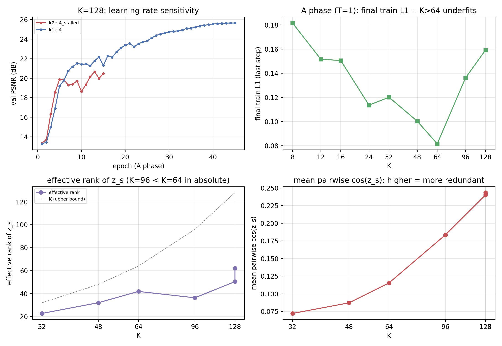

# REPORT — 固定 8 解码步 × token 预算 K 的消融（K=8…128）

> **日期**：2026-10-19（首轮 K=8/12/16/24/32/64）+ **2026-10-20（追加 K=48/96/128）**
> **代码基线**：`787accb` + 本实验新增（`94fa8ea` cumulative 读窗口计划；首轮报告提交
> `428805d`；追加轮新增 `LR1/LR2` 覆盖与 `tools/diag_zs_rank.py`）
> **机器**：AutoDL **2×A800-80GB**（`ssh -p 43732` → 次日同机重启 `ssh -p 23556`，
> 数据盘原样保留 ⇒ **两轮同机、同数据、同后端**），112 核 / 1 TB 内存 / 80 GB 数据盘
> **数据**：ImageNet-100，**train 121,689 / val 5,000**（每类等距抽 50 张，确定性切分）
> **口径**：224×224、K=z_s 总数、像素 L1/PSNR/SSIM、**单种子 seed 0**、bf16 autocast
> **产物**：`doc/2026-10-19/artifacts/k8sweep/`（评测 json / 表 / 图 / 训练曲线 / args /
> 诊断 json / K=128 lr 敏感性 csv）

---

## 0. 一句话结论

固定 8 个解码步、把**总 token 预算 K 从 8 扫到 128**：**K 的实际最优操作点在 64**。

- **T=8 末步 PSNR 在 K=8→64 单调上升**：**21.78 → 27.76 dB（+5.98）**，
  同预算单步臂 **24.37 → 31.03 dB**；K=48 干净地落在曲线上（**26.86 / 29.61 dB**），
  ⇒ **到 K=64 仍无饱和**（单步臂 ≈ **+2.2 dB/doubling**）。
- **但 K>64 在统一协议下退化**：K=96 **26.24 dB**、K=128 **25.09 dB**（T=1 更差：
  26.81 / 25.65 vs K=64 的 31.03）。这不是"容量到顶"，而是**优化受限**：
  K=96 的 A 相**收尾训练损失 0.136 vs K=64 0.082**、`z_s` **绝对有效秩 36 < 42**（register 冗余）；
  K=128 在 lr=2e-4 下 A 相**直接停在平凡解**（val ~20 dB 不涨），被迫降到 **lr=1e-4**，
  仍有 **73 次梯度跳过**。
- **固定 8 步对 K≤12 严重过剩**（累计读入第 3–4 步就到 K，之后 L1 走平）；
  **K≥24 才 8 步全干活**。**零训练对照**：K=64 原生模型 early-stop 在同等累计 token 下
  仍好 **+0.15~1.1 dB** ⇒ K 同时改变预算与编码器 memory 容量，「预算」不是唯一变量。

---

## 1. 这次要回答什么 / 消融口径

按 ALIT（[arXiv:2411.02393](https://arxiv.org/abs/2411.02393)）的
「recurrent rollouts + 每次迭代新增 latent token」设定，在本仓库**自建模型**上固定
**8 个解码步**，扫 **总 token 预算 K**：

| 项 | 值 |
|---|---|
| 步数 T | **固定 8**（循环读出 + BPTT carry） |
| 总预算 K（z_s 数） | **首轮** 32 / 24 / 16 / 12 / 8 + 64（参照）<br>**追加** 48 / 96 / 128 |
| 模型 | `SRPhase1LinAttn`（enc_attn=std 普通 softmax 编码器 ~31.8 M + std 解码器 ~31.2 M ≈ 63.0 M） |
| 数据 | ImageNet-100，无预训练编码器（从零训） |

⚠️ **为什么必须改代码**：本仓库主线的 token 预算与步数是**平方耦合**的
（`K = T²`：K=64 ↔ 8 步，`square_block_starts`），K<64 时自然只剩 5 步。
要让「T 固定 8、K 独立变化」成立，必须给解码器换一个**读窗口 schedule**
（见 §2.1）。这不是改评测口径，是给消融加一个**新的采样计划**（默认路径逐位不变）。

⚠️ **两轮的可比性**：追加轮在同一台机器重启后进行，**数据盘是同一份 14 GB
`imagenet100`（126,689 张，未重传/未改动）**，代码除新增 `LR1/LR2` 覆盖 + 诊断工具外
与首轮完全一致；唯一协议偏离是 **K=128 的 A 相 lr=1e-4**（见 §2.2、§3.4）。

---

## 2. 方法

### 2.1 `cumulative` 计划：把 square 形状按总预算缩放

原生 square 计划（K=64、T=8）每步读窗口：

```
步 t=k² 读 z_s[k² : min((k+1)²−1, K)]，首步另含 z_cls
⇒ K=64 累计读入 = [3, 8, 15, 24, 35, 48, 63, 64]，块尺寸形状 ≈ 3,5,7,9,11,13,15,17
```

「固定 T 步 × 总预算 K」用同一**形状**缩放到 K：

```
C_i = round( K · ((i+1)²−1) / ((T+1)²−1) )   (i=1..T, C_T=K)
再确定性修正：每步 ≥1、严格递增、末项=K
```

| K | 每步累计读入的 z_s 数 C_1..C_8 | 每步窗口大小（z_s） |
|---|---|---|
| 8   | 1, 2, 3, 4, 5, 6, 7, 8 | 1,1,1,1,1,1,1,1 |
| 12  | 1, 2, 3, 4, 5, 7, 9, 12 | 1,1,1,1,1,2,2,3 |
| 16  | 1, 2, 3, 5, 7, 10, 13, 16 | 1,1,1,2,2,3,3,3 |
| 24  | 1, 2, 5, 7, 11, 14, 19, 24 | 1,1,3,2,4,3,5,5 |
| 32  | 1, 3, 6, 10, 14, 19, 25, 32 | 1,2,3,4,4,5,6,7 |
| 48  | 2, 5, 9, 14, 21, 29, 38, 48 | 2,3,3,4,5,7,8,9 |
| 64  | 2, 6, 12, 19, 28, 38, 50, 64 | 2,4,6,7,9,10,12,14 |
| 96  | 4, 10, 18, 29, 42, 58, 76, 96 | 4,5,6,8,11,13,16,18 |
| 128 | 5, 13, 24, 38, 56, 77, 101, 128 | 5,6,8,11,14,18,21,24 |

- **为什么不用 uniform（每步 K/8）**：① 本仓库已有判据「**窗口不增长**是高 N 训不起来的
  近因」（`doc/2026-09-23/REPORT_fixw4_plan.md`：固定 4 窗口相对 square −4.03 dB 且慢 4×）；
  ② uniform 会把「预算变化」和「每步分配形状变化」混在同一个自变量里，缩放形状才是**只动预算**。
- **诚实边界**：K=64 用本计划与**历史原生 square 计划**（[3,8,15,24,35,48,63,64]）并不逐位相同
  —— 本计划前几步读得更少（2 vs 3、6 vs 8、12 vs 15…）。故 K=64 只作**同协议参照点**，
  原生 K=64 的历史数字另列（§3.6），两者差异见边界 §4.2。
- K>80 时（96/128）本计划每步窗口比原生 8 步更大（原生 8 步只到 80 个 z_s）——
  这是「固定 8 步」在大预算下的必然代价，也是 §3.4 讨论的一部分。

### 2.2 训练协议（与既有 BPTT 臂**逐项同协议**）

两个阶段，每臂串行（与 `stdattn_k64` / `stdattn_k64_rec` 完全同参）：

| 相 | 步数 | epochs | batch | lr | 初始化 | 其它 |
|---|---|---|---|---|---|---|
| A 相 | T=1（单步读全 K） | 45 | 128 | **2e-4**（K=128 例外：**1e-4**） | 从零 | warmup_frac 0.08、cosine→1e-6、bf16、grad clip 1.0 |
| B 相 | T=8（cumulative 窗口，BPTT） | 6 | 64 | 2e-4 | A 相 `ckpt_best` | `--init_from`、同 lr 曲线 |

- 每臂参数 ≈ **63.0 M**（K 只改 register 数，参数量差 < 0.1%）。
- ⚠️ **K=128 的 lr 偏离（必须标注）**：同一协议 lr=2e-4 下 A 相**停在平凡解**
  （val 19–20 dB 横盘 10 epoch、5 次梯度跳过）⇒ 手动 kill 后改 **lr=1e-4** 重跑，
  B 相仍用 2e-4。其余 8 臂全部 lr=2e-4。诊断见 §3.4。
- 两轮墙钟：首轮 6 臂 **9.2 h**（2 卡并行，单臂 ≈3.0 h）；追加轮 3 臂 **≈5.8 h**
  （含一次 K=128 的 lr 重跑）。

### 2.3 评测（全量 5,000 留出集）

| 脚本 | 口径 |
|---|---|
| `eval_linattn.py` | 末步（第 8 步）像素 **PSNR / SSIM / L1_norm**（与主报告同口径；PSNR 逐图再平均） |
| `eval_stepwise_linattn.py` | 逐步 1–8 的 **L1_255（不 clamp）**、PSNR、Δ_t、每图最优停步 |
| `tools/diag_zs_rank.py`（新增） | `z_s` 冗余度诊断：两两余弦 / frac(cos>0.9) / **有效秩**（SVD 熵指数）/ token 方差 |
| `tools/eval_rfid.py`（新增，2026-10-21） | **rFID**（ALIT 口径：pytorch-fid 0.3.0 / InceptionV3 pool3 / dims=2048，GT dir vs recon dir）+ 逐步 PSNR/L1 交叉校验 |

代码改动（默认路径逐位不变，已回归）：
1. `model_v2_linattn.py`：新增 `step_plan="cumulative"` + `scaled_square_cumsum(K,T)` + 自检 §8e
   （覆盖 K=8..64 的窗口 0..K 无缝、严格递增、前向形状）；`LinAttnConfig` 新增
   `dec_step_plan`/`dec_block`（默认 square/0）。
2. `train_linattn.py`：`--step_plan` / `--block` 透传进 cfg（ckpt 可重建）。
3. `eval_stepwise_linattn.py`：`cum_z_s` 改为取读窗口 `hi`（对 square/fixed/cumulative 通用；
   square 口径数值不变）+ `--override_dec_steps`。
4. `tools/{run_k8sweep_arm,launch_k8sweep,eval_k8sweep,plot_k8sweep,diag_zs_rank}.*`；
   `run_k8sweep_arm.sh` 新增 `LR1/LR2` 环境变量覆盖（默认 2e-4）。

**回归门**：用历史 `stdattn_k64_rec` ckpt 跑新 `eval_stepwise_linattn.py`，逐位复现
`cum_z_s=[3,8,15,24,35,48,63,64]`、末步 **28.582 dB**、L1
`[15.415,13.030,11.439,9.704,8.285,7.359,6.597,6.613]`
与 `doc/2026-10-16/artifacts/alit/stepwise_stdattn_k64_rec.json` 一致。

---

## 3. 结果

### 3.1 主表（5,000 张 ImageNet-100 val，末步）

| K (token) | T=1 PSNR | T=1 L1_255 | T=1 SSIM | T=8 PSNR | T=8 L1_255 | T=8 SSIM | T=8 oracle PSNR | Δ₁ 占比 | L1 最优步 |
|---|---|---|---|---|---|---|---|---|---|
| **8**  | 24.366 | 0.185 | 0.6670 | **21.777** | 0.245 | 0.5492 | 21.787 | 92.8% | 5 |
| **12** | 26.045 | 0.155 | 0.7390 | **22.321** | 0.229 | 0.5775 | 22.330 | 73.9% | 6 |
| **16** | 26.606 | 0.146 | 0.7634 | **22.815** | 0.216 | 0.6029 | 22.821 | 51.6% | 7 |
| **24** | 27.720 | 0.129 | 0.8089 | **24.554** | 0.178 | 0.6947 | 24.554 | 17.9% | 8 |
| **32** | 28.728 | 0.116 | 0.8427 | **25.045** | 0.169 | 0.7101 | 25.048 | 30.8% | 7 |
| **48** | 29.608 | 0.106 | 0.8680 | **26.861** | 0.139 | 0.7910 | 26.861 | 38.1% | 8 |
| **64** | 31.027 | 0.092 | 0.9002 | **27.760** | 0.125 | 0.8280 | 27.760 | 26.5% | 8 |
| **96** | 26.812 | 0.142 | 0.7785 | **26.244** | 0.150 | 0.7558 | 26.244 | 36.2% | 8 |
| **128** | 25.653 | 0.162 | 0.7314 | **25.086** | 0.173 | 0.7034 | 25.086 | 38.0% | 8 |

> T=8 oracle PSNR = 8 步中 PSNR 最高的那一步（与末步几乎相同 ⇒ 末步基本都在最优点）；
> 「L1 最优步」是该图集平均 L1 最低的步。
> ⚠️ **T=1 与 T=8 两列不可直接比**：A 相 45 ep 从零、B 相 6 ep 热启动，预算差 7.5×
> （与 `doc/2026-10-17/REPORT_attention_matrix.md` §9 同一条边界）。
> ⚠️ **K=96/128 两行的 T=1 lr/稳定性与其余行不同**（§2.2）——它们是"同协议下退化"的观测，
> 不是干净的容量点。


### 3.2 预算–质量：单调到 K=64，K=48 落在曲线上

- **T=8 末步**：K 翻倍 +1.04 dB（8→16）/ +2.23 dB（16→32）/ +2.71 dB（32→64）；
  L1_255 0.245 → 0.125（−49%）。**K=48 = 26.861 dB**，正好插在 32（25.045）与 64（27.760）之间。
- **T=1 末步**：K 翻倍 +2.24 / +2.12 / +2.30 dB（非常接近 log-linear，约 **+2.2 dB/doubling**）；
  **K=48 = 29.608 dB**，同样落在 32（28.728）与 64（31.027）之间。
- 单调性在 **K=64 处达到峰值**，**K=96/128 反向回落**（T=8：27.76 → 26.24 → 25.09；
  T=1：31.03 → 26.81 → 25.65）⇒ **K=64 是这套协议下的实际最优操作点**，见 §3.4。

### 3.3 逐步：固定 8 步时，K≤12 的后面几步是「空转」


每臂逐步 L1_255（左）与逐步增量 Δ_t（右，正=变好）。关键读数：

| K | 逐步 L1_255（step1→8） | 实质增益止于 |
|---|---|---|
| 8  | 16.580 → 14.287 → **14.155 → 14.122 → 14.111 → 14.110** → 14.113 → 14.118 | **step 2–3**（之后 Δ≤0.04 px） |
| 12 | 16.433 → 14.021 → **13.264 → 13.194 → 13.176 → 13.170** → … | **step 3**（之后 Δ≤0.02 px） |
| 16 | 15.871 → 14.100 → 13.461 → 12.936 → 12.583 → 12.477 → **12.439** → 12.445 | step 6–7 |
| 24 | 16.820 → 15.645 → 13.139 → 12.401 → 11.478 → 10.794 → 10.309 → **10.251** | **step 8**（8 步都正收益） |
| 32 | 16.299 → 14.277 → 12.696 → 11.349 → 10.942 → 10.258 → **9.733** → 9.733 | step 7 |
| 48 | 16.600 → 13.336 → 11.827 → 10.774 → 9.771 → 8.995 → 8.380 → **8.035** | step 8 |
| 64 | 15.708 → 13.449 → 11.856 → 10.517 → 9.367 → 8.366 → 7.587 → **7.190** | step 8 |
| 96 | 16.900 → 13.919 → 12.028 → 10.813 → 9.905 → 9.286 → 8.853 → **8.670** | step 8（但绝对 L1 高于 K=64） |
| 128 | 21.434 → 17.069 → 14.242 → 12.398 → 11.186 → 10.498 → 10.122 → **9.953** | step 8（第 1 步明显更差） |

- **K≤12：8 步严重过剩**——累计读入在第 3–4 步就到 K，后续步 Δ≈0 甚至轻微过冲
  （Δ₁ 占比 92.8% / 73.9% 即「第 2 步就把总落差基本吃完」）。
- **K≥24：8 步都有正 Δ**，且 Δ_t 在 7–8 步处仍有 0.4–1.0 px。
- 这给出一个**可操作的配方边界**：**固定 8 步时 K 应 ≥ ~24**；K<16 时应当**减步数**
  （等价于「步数 = √K」的原生 square 口径），否则后几步只是重复读 1 个 token。
- K=96/128 的逐步曲线**形状**与 K=64 类似（前几步大降、后几步小降），但**整条曲线被抬高了
  2–3 px**（K=128 第 1 步 21.4 px 尤其差）——即"每步都更差"，不是"某一步坏掉"。

### 3.4 高 K 段（96/128）为什么退化：这是优化问题，不是容量结论



四条证据（均来自 `artifacts/k8sweep/{train_summary.csv,k128_lr_sensitivity.csv,diag_zs_rank.json}`）：

1. **A 相收尾训练损失**（自己训练集上的 L1，越低越好）在 K=64 触底后回升：
   K=32 0.120 / **K=64 0.082** / K=96 **0.136** / K=128 **0.159**。
   ⇒ 高 K 模型**连训练集都拟合得更差**（不是过拟合、不是容量不够），是**优化到更差的解**。
2. **K=128 对 lr 极敏感**：A 相 lr=2e-4 时 val **19–20 dB 横盘**（best 20.67 dB，5 次梯度跳过，
   第 15 epoch 手动止损）；改 **lr=1e-4** 后才正常爬升到 **25.65 dB**（但仍有 **73 次
   grad-skip**，且比统一协议多花 151 min）。B 相 2e-4 也有 16 次 skip。
3. **K=96 的训练是"干净"的**（全程 2 次 skip、val 平滑收敛到 26.81），所以它的退化
   **不能归因于不稳定**；更像"register 过多 ⇒ 学出冗余表示"：
   `z_s` **绝对有效秩** K=64 **41.9** → K=96 **36.3**（不升反降，比例 0.65×K → 0.38×K），
   token 方差 0.357 → **0.163**（明显变小 = 更相似/更冗余），两两余弦 0.115 → **0.184**。
4. **K=128 的有效秩回到 62.2（0.49×K）**，但需要更小 lr 才训得动 ⇒ 高 K 区间同时受
   「优化稳定性」与「register 冗余」两类问题支配，机制**尚未分离**。

⇒ **结论边界**：本消融只能得出"**统一协议下 K 的可用上限 ≈ 64**"，
**不能**得出"K>64 容量到顶/更多 token 无用"——要判后者，需要先做高 K 的稳定性扫描
（lr / warmup / QK-Norm / epochs / register 初始化），这是**明确的下一步**（§4.3）。

### 3.5 零训练对照：K=64 的 early-stop 在同等预算下更好

用历史 `stdattn_k64_rec`（原生 square 计划，K=64）的逐步曲线做**零训练截断**
（第 j 步输出 = 累计读入 cum_z[j] 个 token 的预测），与「专训小 K、固定 8 步」对照：

| 累计 token 预算 | K=64 原生模型 early-stop | 专训臂（末步） | 差值（原生 − 专训） |
|---|---|---|---|
| 8 | **22.379**（step2） | K=8：21.777 | **+0.60 dB** |
| 15 | **23.356**（step3） | K=16：22.815 | **+0.54 dB** |
| 24 | **24.701**（step4） | K=24：24.554 | **+0.15 dB** |
| 35 | **26.126**（step5） | K=32：25.045 | +1.08 dB（预算多 3） |

- 即：**把一个大预算模型「只跑前几步」比专门训一个小预算模型略好**（0.15–1.1 dB）。
  ⚠️ 两者**步数不同**（early-stop 的步数由原生计划决定），且大 K 模型的编码器 memory
  容量也不同 ⇒ 这是「关联观察」，**不是**「截断优于专训」的判决。
- 它同时说明：**token 预算是大头，步数只在预算够分的时候才有意义**。
- 该对照只覆盖 ≤64 token（原生计划上限），不覆盖 K=96/128。

### 3.6 与历史原生 K=64 的对照（同预算、不同读窗口计划）

| 口径 | 本实验 K=64（cumulative 计划） | 历史 `stdattn_k64(_rec)`（原生 square） | 差 |
|---|---|---|---|
| T=1 | 31.027 dB / L1 0.0918 | 31.219 dB / L1 0.0901 | **−0.19 dB**（≈ 历史重跑漂移量级 −0.17~−0.34） |
| T=8 | 27.760 dB / L1 0.1247 | 28.582 dB / L1 0.1147 | **−0.82 dB** |
| T=8 逐步 cum_z | 2,6,12,19,28,38,50,64 | 3,8,15,24,35,48,63,64 | 计划不同 |

T=1 的 −0.19 dB 可完全由**单种子重跑漂移**解释（架构/超参完全相同）；T=8 的 −0.82 dB
则是**计划差异 + 漂移**的叠加（本计划前几步读得更少），不能单独归因。原生 K=64 的
28.58 dB **仍是本仓库 K=64/T=8 的权威数字**，本表 K=64 只用于本消融内部的**同协议参照**。

### 3.7 K=64 的 rFID（ALIT 指标口径，2026-10-21 补）

ALIT（[arXiv:2411.02393](https://arxiv.org/abs/2411.02393)）报告重建质量用的是 **rFID**
（官方口径：`python -m pytorch_fid {recon_dir} {gt_dir}`，pytorch-fid 0.3.0 / InceptionV3
pool3 / `dims=2048`）。为了与论文指标对齐，本报告 K=64 的三臂补测了**同一口径**的 rFID
（全量 5,000 张 val；实现与逐臂/eval json 见
[`doc/2026-10-21/REPORT_rfid_k64.md`](../2026-10-21/REPORT_rfid_k64.md)）：

| 臂（K=64） | 读窗口计划 | T | PSNR (dB) | L1_255 | **rFID ↓** |
|---|---|---|---|---|---|
| `stdattn_k64_rec`（native square） | 递增（与 ALIT 的 rollout 同构） | 8 | 28.582 | 6.613 | **15.89** |
| `stdattn_k64_t8`（本报告主表 K=64） | cumulative（前少后多） | 8 | 27.760 | 7.190 | **19.86** |
| `stdattn_k64_t1`（本报告主表 K=64 的 T=1 列） | cumulative A 相（单步读全 64） | 1 | 31.027 | 5.293 | **8.32** |

- **与 PSNR 同向**：rFID 也在 **K=64 最低**，K=96/128 回升（**35.10 / 48.80**，比 K=64 高
  **+76.7% / +145.7%**），且 rFID 的相对惩罚远大于 PSNR（K=8→64：rFID **−84.5%** vs PSNR +5.98 dB）
  ⇒ §3.4「K=64 是本协议下的实际最优操作点」**不依赖像素口径**。
- **与 ALIT IN-100 @64 token 同量级**（ALIT Ours-S 16.17 / Ours-B 15.88 vs 本仓库 native 15.89），
  ⚠️ 但数据划分、分辨率（224 vs 256）、重建器（连续 z_s + 线性注意力 vs VQGAN + 量化 1D + GAN）
  全不同，**只能作量级参照、不可宣称追平**；低 token 段（≤32）本仓库 rFID 约差 1.6×，
  与「本仓库训练无 GAN 阶段」一致。
- 同一 native 模型的**逐 step rFID 曲线**（3→64 token，与 ALIT「同一模型不同 token 预算」同构）
  及 cumulative K-sweep 的 rFID 表见 `REPORT_rfid_k64.md` §3.2–3.3。

---

## 4. 结论、可写进论文的点与诚实边界

### 4.1 可以写的

1. **固定 8 步下，token 预算 K ≤ 64 时质量单调正相关**：
   T=8 末步 **21.78 → 27.76 dB（K 8→64）**，同预算单步臂 **24.37 → 31.03 dB**；
   PSNR 随 K 大致 **+2.2 dB/doubling**（单步臂）；K=48 落在曲线上（26.86 / 29.61 dB）。
2. **「固定步数」是有代价的**：K≤12 时 8 步里只有 3–4 步干活（L1 走平），
   K≥24 才让 8 步全部贡献正 Δ ⇒ 步数与预算应匹配（本仓库原生 `T=√K` 正合此意）。
3. **K>64 在统一协议下退化，且这是优化受限而非容量上限**：K=96 在训练集上欠拟合
   （train L1 0.136 vs 0.082）且 `z_s` 绝对有效秩反而低于 K=64；K=128 需要更小 lr 才收敛，
   仍有大量梯度尖峰 ⇒ **本仓库当前最优操作点就是 K=64**，想往上走必须先解决高 K 的
   优化/稳定性（而不是直接加 token）。
4. **同等累计 token 下，大 K 模型的前步输出仍略好**（K=64 early-stop vs 专训小 K：
   +0.15~1.1 dB）——提示「per-token 信息密度」随编码器 memory 容量变化。

### 4.2 边界（必须同读）

1. **单种子**（seed 0），无方差；< 0.10 dB 的差不能当结论。
2. **读窗口计划是构造出来的**：K<T² 时没有原生 square 计划，本报告用「形状缩放」的
   cumulative 计划（§2.1）。K=64 的计划与历史原生计划**不同**（§3.6），所以 K=64 不能与
   历史数字混用；K>80 时每步窗口比原生 8 步更大（§2.1 末条）。
3. **T=1 与 T=8 不可比「BPTT 收益/代价」**（45 ep vs 6 ep，预算差 7.5×）。
4. **K=96/128 不是干净的容量点**：它们同时受优化稳定性（K=128 换 lr、73/16 次 skip）与
   register 冗余（K=96 有效秩下降）支配；机制未分离，**不能**据此说「更多 token 无用」。
5. **K=128 的 A 相 lr=1e-4 与其余 8 臂不同**（2e-4 停在平凡解），因此 K=128 的 T=1/T=8
   与其它点的 lr 不可完全配对，只能作「同协议下退化」的观测。
6. **像素口径不是任务保真**：本项目唯一验收是 Phase 2 文字（`GOAL` §2），本报告只回答
   「给定预算能重建到什么程度」。
7. **K 的混淆**：改 K 同时改编码器 register 数（memory 容量）与解码器可读集合，
   参数量近同（±0.1%）但不能把差异单独归因于「预算」。
8. **early-stop 对照步数不同**（§3.5），只作参照。
9. 数据为 ImageNet-100（121,689/5,000），224×224、patch16（N=196）；不覆盖 448/多分辨率。
10. bf16 autocast；追加轮与首轮**同机同数据**但跨了一次重启（数据未变，已核对 126,689 张）；
    同机同后端 ⇒ 配对性来自**同机同批次评测**。

### 4.3 下一步（若要继续这条线）

1. **高 K 稳定性扫描（P0）**：K=96/128 × {lr 5e-5/1e-4/2e-4} × {warmup 8%/25%} 各 1–2 臂
   （每臂 ≈2.5 h），判断高 K 退化是 lr 还是 register 冗余；若 lr 能救，再补 QK-Norm 臂。
2. **register 初始化/结构**：高 K 下的 `special_tokens` 初始化与冗余（如 token 去相关正则 /
   分组 register），目标是把 `z_s` 有效秩拉回 ≥0.65×K。
3. **更多 epoch 的 K=96**：当前 45 ep cosine 到 0，若 90 ep 能追平 K=64 则说明是预算而非容量。
4. **任务保真（E8）**：把 K-sweep 接到 Phase 2 captioning/分类探针（唯一验收）。

---

## 5. 产物清单与复现

| 文件 | 内容 |
|---|---|
| `artifacts/k8sweep/k8sweep_table.md` | 主表（9 臂，本报告 §3.1） |
| `artifacts/k8sweep/k8sweep_psnr_vs_tokens.png/.pdf` | 图 1：末步 PSNR vs K（含历史 native K=64 与 early-stop 参照） |
| `artifacts/k8sweep/k8sweep_stepwise_l1.png/.pdf` | 图 2：逐 step L1_255 与 Δ_t（9 臂） |
| `artifacts/k8sweep/k8sweep_highk_diagnostics.png/.pdf` | 图 3：高 K 诊断（K=128 lr 敏感性 / A 相 train L1 / z_s 有效秩 / z_s 余弦） |
| `artifacts/k8sweep/k8sweep_summary.json` | 全部数字（含 native K=64 参照与逐 step） |
| `artifacts/k8sweep/eval/*.json` | 每臂：`linattn_k{K}_t1/t8.json`（末步）+ `stepwise_k{K}_t8.json`（逐步），K=8..128 共 27 个 |
| `artifacts/k8sweep/val_curves.csv` | 9 臂 × 2 相 × 每 epoch 的 val L1/PSNR/SSIM（含 K=128 lr2e-4 stalled 的 A 相） |
| `artifacts/k8sweep/train_summary.csv` | 每臂每相：lr / best val PSNR / 墙钟 / 收尾 train L1 / 累计 skip 数 |
| `artifacts/k8sweep/k128_lr_sensitivity.csv` | K=128 A 相 lr=2e-4（stalled）vs lr=1e-4 的逐 epoch val |
| `artifacts/k8sweep/diag_zs_rank.json` | z_s 冗余度诊断（K=32/48/64/96/128 + stalled） |
| `artifacts/k8sweep/logs/k128_stage1_lr2e-4_stalled.log` | K=128 在 lr=2e-4 下停在平凡解的训练日志（证据） |
| `artifacts/k8sweep/args/*.json` | 每臂训练 args（逐位可复核） |
| `tools/{run_k8sweep_arm,launch_k8sweep,eval_k8sweep}.sh` | 训练/启动/评测脚本（`LR1/LR2` 可覆盖 lr） |
| `tools/plot_k8sweep.py` | 汇总表/图（纯 json，不加载模型） |
| `tools/diag_zs_rank.py` | z_s 冗余度/有效秩诊断 |
| `../2026-10-21/artifacts/rfid_k64/eval/<arm>/eval_rfid.json` | K=64 三臂 + K-sweep 9 臂的 **rFID**（ALIT 口径）；表/图/summary 见 `doc/2026-10-21/REPORT_rfid_k64.md` |
| `tools/eval_rfid.py` | **rFID 评测**（pytorch-fid 0.3.0 / GT 落盘 / 逐步重建落盘 / PSNR 交叉校验 / scipy shim） |
| `tools/plot_rfid_k64.py` | rFID 汇总表/图（纯 json，不加载模型） |

```bash
# 训练（2 卡；首轮 6 臂: GPU0=32/16/8, GPU1=24/12/64）
cd /root/AssocVTC && GPU0_ARMS="32 16 8" GPU1_ARMS="24 12 64" \
    nohup setsid bash tools/launch_k8sweep.sh \
    > /root/autodl-tmp/srdiff_k8sweep/launch_outer.log 2>&1 &
# 追加轮 3 臂（K=128 的 A 相用 LR1=1e-4，其余默认 2e-4；两卡分配见 run2 日志）
GPU0_ARMS="128" GPU1_ARMS="96 48" nohup setsid bash tools/launch_k8sweep.sh > …run2.log 2>&1 &
K=128 GPU=0 LR1=1e-4 bash tools/run_k8sweep_arm.sh     # K=128 重跑（lr 覆盖）
# 评测（全量 5,000）
bash tools/eval_k8sweep.sh 8 12 16 24 32 48 64 96 128
# 汇总表 + 图 + 诊断图
python tools/plot_k8sweep.py \
    --eval_dir doc/2026-10-19/artifacts/k8sweep/eval \
    --out_dir  doc/2026-10-19/artifacts/k8sweep
# z_s 冗余度诊断
PYTHONPATH=$PWD python tools/diag_zs_rank.py --n 128 \
    --out /root/autodl-tmp/srdiff_k8sweep/diag_zs_rank.json --ckpts <ckpt ...>
```
