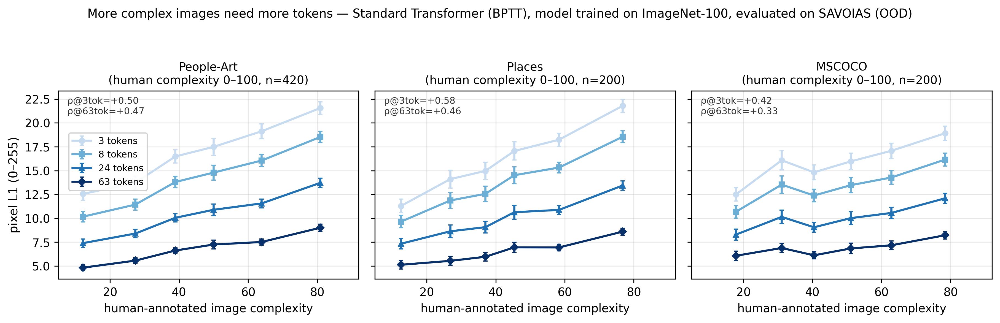
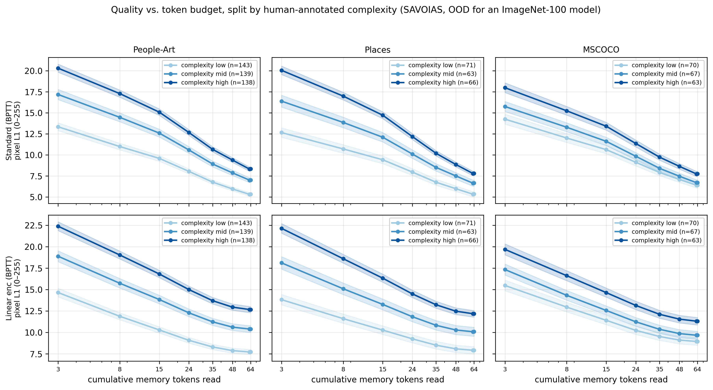
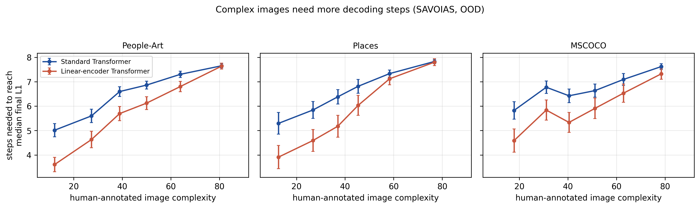
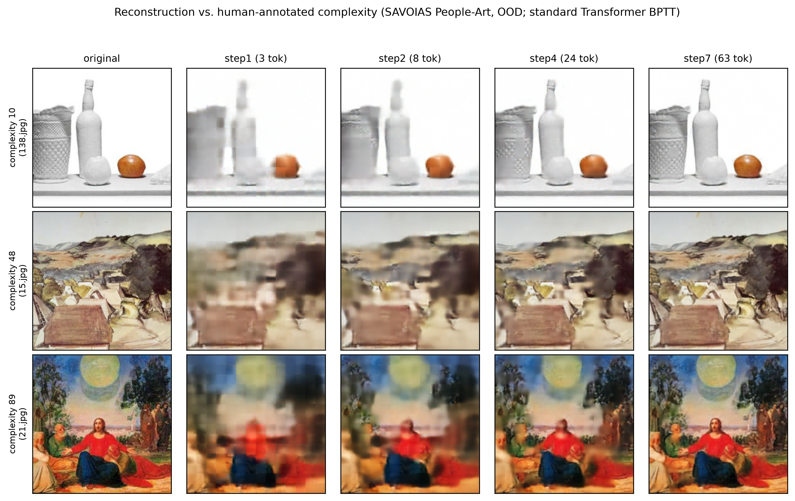
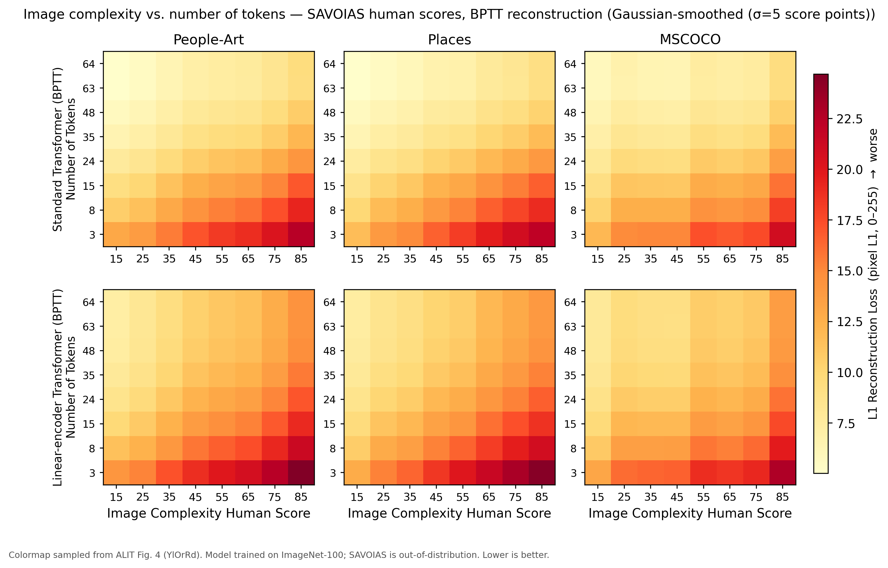
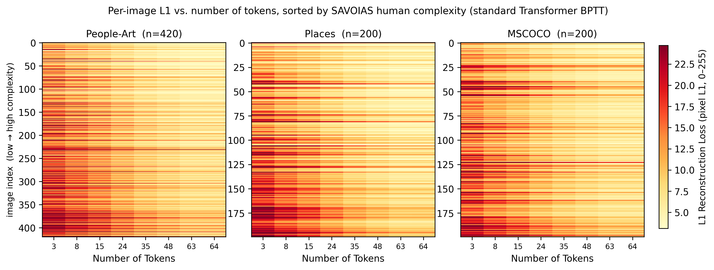

# REPORT — SAVOIAS 人评复杂度 × BPTT token 预算（ALIT Fig.4 / Fig.11 / Fig.12 复刻）

> **日期**：2026-10-19（周一）
> **仓库**：`AssocVTC`，本地 HEAD = `ebd0b2c`（与 `origin/main` 同步）
> **上游**：ALIT — [arXiv:2411.02393](https://arxiv.org/abs/2411.02393)（Duggal et al., MIT CSAIL）
> **数据**：SAVOIAS — [arXiv:1810.01771](https://arxiv.org/abs/1810.01771)（Saraee et al., 2018），
> 代码/数据：<https://github.com/esaraee/Savoias-Dataset>
> **模型**：本仓库 `stdattn_k64_rec`（标准 Transformer，BPTT T=8，ImageNet-100 训练）
> **脚本**：`tools/fetch_savoias.sh` / `tools/run_savoias_eval.sh` /
> `tools/plot_savoias_complexity.py` / `tools/plot_savoias_heatmap.py` / `tools/render_savoias_grid.py`
> **产物**：`doc/2026-10-19/artifacts/savoias_complexity/`

---

## 0. 一句话

之前卡住的「我们没有 Image Complexity Human Score」这一缺口，**用 ALIT 原论文的办法补上了**：
不在自己的验证集上标复杂度，而是把公开的 **SAVOIAS 人评复杂度（0–100）** 当作 **OOD 分析集**，
让 ImageNet-100 训好的模型在 People-Art / Places / MSCOCO 三个子集上重建，按 token 预算画损失。

**结论：ALIT 的核心定性结论在我们模型上复现了。**
人评复杂度与像素 L1 在**所有 8 个 token 预算**上正相关（std 臂 **ρ = +0.33 ~ +0.58**）：
图越复杂，同样 token 数下重建越差（需要更多 token）；固定复杂度时，token 越多损失越低。
复杂度最高/最低三分位的 L1 差距从 **6.97 px（3 tokens）** 缩到 **3.01 px（63 tokens）**
（People-Art）——**复杂图从增加预算中获益更大**。

---

## 1. 为什么做（问题闭环）

前一轮 E-A1/E-A4 的讨论暴露了一个真缺口：

- E-A4 只能拿 JPEG 大小 / 边缘密度 / 首步 L1 当**弱代理**，报告里也写明「弱代理 ≠ 感知复杂度」；
- 我们的验证集（ImageNet-100 val）没有 SAVOIAS 那种人评分，因此「复杂图是否真的需要更多 token」
  在本项目里一直是**未验证**，而不是被否证。

**ALIT 原论文的解法**（见 §4）：它也没给自己的训练数据标复杂度，而是用 SAVOIAS 的
People-Art（正文 Fig. 4）与 Places / MSCOCO 子集（附录 Fig. 11 / 12）做 **OOD 复杂度分析**。
本轮把这套实验原样搬到我们的模型上。

---

## 2. 设置

### 2.1 数据：SAVOIAS 的三个子集

SAVOIAS 共 1,456 张、7 类（Scenes / Advertisements / Visualization / Objects / Interior design /
Art / Suprematism），复杂度来自 **37,000+ 次众包成对比较**，用 Bradley-Terry + matrix completion
转成 **0–100 绝对分数**。我们只取与 ALIT 对应的三个子集：

| 子集（文件夹） | 对应源数据 | n（有分数的图） | 用途（ALIT） |
|---|---|---:|---|
| `Images/Art` | People-Art | **420** | 正文 Fig. 4 |
| `Images/Scenes` | Places | **200** | 附录 Fig. 11 |
| `Images/Objects` | MSCOCO objects | **200** | 附录 Fig. 12 |

- 图像：`Resize(256, BICUBIC) + CenterCrop(224) + ImageNet Normalize`（与训练 val 逐位同口径）。
- 分数：官方 `Ground truth/npy/global_ranking_{art,scenes,objects}.npy` = `{index: [filename, score]}`，
  与图像按 **index 对齐**（`0.jpg ↔ 0.png` 分数）。做了一个 face-validity 检查：Art 里 score=0 的图
  是极简构成，score=100 的是人物密集的古典战争画——排序符合直觉；后文 ρ 也为正，支持对齐正确。
- 下载脚本 `tools/fetch_savoias.sh`（只下这 3 个子集，约 60 MB；不随仓库分发图像/分数）。

### 2.2 模型与读出预算

| 臂 | ckpt | 参数量 | 训练 | 读出 | step → 累计 token |
|---|---|---:|---|---|---|
| **stdattn_k64_rec** | `srdiff_stdattn/stdattn_k64_rec/ckpt_best.pt` | 63.055 M | ImageNet-100，45 ep 单步 + 6 ep BPTT 热启动 | BPTT T=8 | `3, 8, 15, 24, 35, 48, 63, 64` |
| linattn_k64_rec（对照） | `srdiff_linattn/k64_rec/ckpt_best.pt` | 63.116 M | 同上（线性编码器） | BPTT T=8 | 同上 |

- 评测：`eval_stepwise_linattn.py --data_dir_ood <SAVOIAS> --dump_per_image`
  一次前向跑完 8 步，落每图每步 `L1_255` / `PSNR` / 最优停步；820 张 × 8 步，单臂**不到 2 分钟**（RTX 4080 SUPER）。
- 全量 820 张的逐步均值（OOD）：

| 臂 | step1 (3 tok) | step2 (8) | step4 (24) | step6 (48) | **step7 (63)** | step8 (64) |
|---|---|---|---|---|---|---|
| stdattn | 16.51 px / 20.47 dB | 13.92 / 21.76 | 10.23 / 24.13 | 7.63 / 26.83 | **6.79 / 28.15** | 6.80 / 28.13 |
| linattn | 18.14 / 19.61 | 15.15 / 21.04 | 11.86 / 23.18 | 10.31 / 24.51 | **10.09 / 24.72** | 10.10 / 24.72 |

（OOD 比 IN-100 val 差：std 臂 IN-100 是 15.41→6.60 px；这里 16.51→6.79，符合「SAVOIAS 对 IN-100 模型 OOD」。）

---

## 3. 结果

### 3.1 主图：复杂度 → L1（按 token 预算）



- 每个 token 预算下，**复杂度越高 L1 越高**（所有子集、所有步一致）；
- **固定复杂度**时，token 越多 L1 越低；
- 低复杂度图的曲线在 24→63 token 段已经很平（简单图早饱和），高复杂度图仍在明显下降
  —— 与 ALIT「复杂图需要更多 token」一致。

**Spearman ρ（复杂度 vs L1，逐 step；std 臂）**

| 子集 | 3 tok | 8 | 15 | 24 | 35 | 48 | 63 | 64 |
|---|---:|---:|---:|---:|---:|---:|---:|---:|
| People-Art（420） | +0.496 | +0.515 | +0.515 | +0.505 | +0.493 | +0.483 | **+0.470** | +0.470 |
| Places（200） | +0.584 | +0.573 | +0.556 | +0.523 | +0.504 | +0.478 | **+0.458** | +0.459 |
| MSCOCO（200） | +0.418 | +0.410 | +0.398 | +0.370 | +0.351 | +0.338 | **+0.327** | +0.328 |

**线性编码器臂（linattn）同样成立**：ρ = +0.37 ~ +0.60（Art +0.507→+0.526、Places +0.601→+0.515、
MSCOCO +0.416→+0.368），方向与 std 臂一致。

### 3.2 复杂度三分位 → L1 vs token 预算



| 子集（std 臂） | 最低三分位 L1@3tok → @63tok | 最高三分位 L1@3tok → @63tok | 高−低差距 @3tok → @63tok |
|---|---|---|---|
| People-Art | 13.34 → 5.30（−8.04） | 20.32 → 8.30（**−12.02**） | **6.97 → 3.01** |
| Places | 12.65 → 5.31（−7.34） | 20.06 → 7.78（**−12.28**） | **7.41 → 2.46** |
| MSCOCO | 14.24 → 6.38（−7.86） | 17.99 → 7.73（**−10.26**） | **3.74 → 1.34** |

两点读法：
1. **复杂图从「多给 token」中获益更大**（高三分位 −10.3~−12.3 px vs 低三分位 −7.3~−8.0 px）；
2. 即使给到 63 token，高复杂度图仍比低复杂度图差 1.3~3.0 px ⇒ **同 token 预算下复杂图始终更难**，
   这正是「需要自适应分配 token」的动机。

### 3.3 复杂度 → 达到中位质量所需步数



以「该臂全量最终 L1 的中位数」为阈值 τ，算每图达到 τ 所需的最少步数：

| 子集 | std 臂 mean±std | ρ(complexity, needed step) | lin 臂 mean±std | ρ |
|---|---|---:|---|---:|
| People-Art | 6.53 ± 1.88 | **+0.446** | 5.78 ± 2.54 | **+0.511** |
| Places | 6.59 ± 1.86 | **+0.439** | 5.79 ± 2.56 | **+0.544** |
| MSCOCO | 6.74 ± 1.59 | **+0.331** | 5.94 ± 2.38 | **+0.364** |

人评复杂度越高，需要越多解码步（token）——与 3.1/3.2 同向。
⚠️ 两个臂的阈值 τ 是**各自**的最终中位 L1（std 6.79、lin 10.09 px），所以**跨臂高度不可直接比**；
可读的是「同一臂内，复杂度 ↑ ⇒ needed step ↑」。

### 3.4 定性：低/中/高复杂度的重建网格



- 复杂度 10（极简静物）：3 token 已能还原布局，8 token 后基本饱和；
- 复杂度 50（风景画）：逐步改善明显；
- 复杂度 89（人物密集的古典绘画）：3 token 严重糊，24→63 token 持续改善但仍偏软
  —— 与 ALIT Fig. 4 左的定性对照同构。

### 3.5 热力图（版式对齐 ALIT Fig.4 / Fig.11 / Fig.12）



- **版式按原论文**：x 轴 = **Image Complexity Human Score**（刻度 **15, 25, …, 85**，8 档 10 分宽）；
  y 轴 = **Number of Tokens**（用本仓库自己的 8 档 `3, 8, 15, 24, 35, 48, 63, 64`，自下而上、
  等距排列、标签为实际 token 数）；颜色 = L1 Reconstruction Loss（pixel L1，0–255，越亮越差）。
- **颜色条直接从 ALIT Fig.4 的 colorbar 采样**（17 个锚点，见脚本 `ALIT_YlOrRd`；
  与 matplotlib `YlOrRd` 几乎逐位一致，mean|err| ≈ 0.6/255）。
- 上排 std、下排 lin；三列 = 三个子集；**共享色标**，可跨臂/跨子集直接比较。
- **读法（与原文同向）**：固定 token 时，复杂度 15→85 时 L1 单调升高；固定复杂度时，
  token 3→64 时 L1 单调下降。例 std 臂 People-Art：x=15 时 **13.1 → 5.1 px**（3→63 tok），
  x=85 时 **22.2 → 9.3 px**；到 63 token 高复杂度仍比低复杂度差约 4 px。
- 两排梯度形状一致（线性编码器整排更亮、更平）⇒ 复杂度效应不是某一种注意力形式造成的。
- 主图用 **Gaussian 核平滑（σ=5 复杂度分）** 复现原论文的光滑曲面；**原始 10 分箱均值**
  另存 `savoias_complexity_heatmap_raw.png` 供核对（Art 每格 n=37–64，Places/Objects n=8–38，
  边缘 bin 最稀）。



- 逐图版：行 = 图（按复杂度低→高排序），列 = Number of Tokens，颜色 = 单图 L1（稳健色标 2–98%）；
- 上段（低复杂度）3 token 已偏暗、几列内趋饱和；下段（高复杂度）到 63 token 仍偏亮
  ⇒ 结论不是"均值曲线"造成的假象，**逐图分布**同样如此；列内条纹 = 复杂度之外的图间差异
  （内容/纹理/尺寸）。

---

## 4. 与 ALIT 原论文的对照

ALIT 的做法（原文）：

- **不做**自己数据集的复杂度标注；把复杂度分析放在 **SAVOIAS** 的 OOD 子集上，
  模型仍是 ImageNet-100 训练（与我们的设置相同）；
- 正文 **Fig. 4**：People-Art，展示 32/64/128/256 token 的重建，以及
  `human complexity × token budget → L1` 曲线；结论 (a) 复杂度↑ ⇒ 需要更多 token，
  (b) 固定复杂度 ⇒ token↑ ⇒ L1↓；
- 附录 **Fig. 11 / Fig. 12**：Places / MSCOCO 子集重复，并明确写「COCO/Places 相对 codebook 可能略 OOD」；
- 复杂度只是**分析变量**：ALIT 的自适应长度来自训练出的 recurrent rollout + 重建阈值 TSC，
  不是「先预测复杂度再决定 token 数」。

我们复刻了同一套分析（三个子集全做），**定性结论一致**，差异在：

| | ALIT | 本仓库（本轮） |
|---|---|---|
| 模型 | 编码器 recurrent + 并行解码器；VQ latent，32–256 token | 解码器 recurrent（BPTT）+ 连续 z_s；3–64 token |
| 训练数据 | ImageNet-100 | ImageNet-100 |
| 复杂度数据 | SAVOIAS（People-Art 正文 / Places / MSCOCO 附录） | 同三子集 |
| 主要结论 | 复杂度↑ ⇒ 需要更多 token；token↑ ⇒ L1↓ | **同向复现**（ρ=+0.33~+0.60，全部预算） |
| 未复刻项 | Fig. 6 TSC–TOI（60% 预算保住任务性能） | 未做（那是 E-A2/E-C1 的另一条线） |

---

## 5. 与 E-A1 / E-A4 的关系（重要，别混口径）

1. **E-A4 的「human complexity 未测」缺口被补上了**：在 SAVOIAS 上、
   用 0–100 人评分，我们得到 `ρ(complexity, needed_step) = +0.33 ~ +0.54`（两臂、三子集全正）。
   ⇒ ALIT 的「复杂度 → token 需求」在**本仓库的模型 + OOD 人评数据**上成立。
2. **但这不改变 E-A1/E-A2 的结论**：
   - E-A1（oracle 停步上界 ≈ 0）测的是**同一份权重下像素 L1 的最优停步自由度**，
     结果主要由 BPTT 读出结构决定（96.98% 图最优步 = step7），与「复杂度能否解释 token 需求」是两件事；
   - E-A2（等预算 TSC 反而更差）说明「复杂度相关性」≠「按图分配 token 能挣到收益」——
     相关性存在，但用 τ 阈值去分配是负向的。
   - 所以正确的表述是：**「复杂图需要更多 token」在本项目上被验证（OOD 人评口径）；
     「按图自适应分配能提升像素保真」仍未被证明/被 E-A2 否证（信息保持口径）。**
3. 这条线的正确用法是**解释性分析/论文 Fig.**（对应 ALIT Fig. 4），而不是 adaptive stopping 的可行性证据。

---

## 6. 诚实边界

1. **OOD**：SAVOIAS（艺术/广告/场景）与 ImageNet-100 分布差异大；ALIT 自己也承认同一 OOD 问题，
   所以我们只能声称「在 OOD 人评复杂度轴上呈对齐趋势」，不能声称「IN-100 val 的复杂度分布如何」。
2. **样本量小、单种子**：420 / 200 / 200 张；ρ 的点估计没有 bootstrap CI（下轮可补），
   也没有跨 seed 方差。0.03 量级的 ρ 差异不要解释。
3. **分数↔图像对齐**：官方 npy 用 `{index}.png`，仓库图像是 `{index}.jpg`，按 index 对齐；
   做了 face-validity 检查与 ρ>0 的间接验证，但**没有逐文件哈希级校验**。
4. **只覆盖 3/7 个 SAVOIAS 子集**：Advertisement / Interior Design / Suprematism / Visualizations 未跑
   （Visualizations 单类 137 MB，且多为文字/图表，与自然图像不同）。
5. **token 范围不同**：3–64（ALIT 32–256）；低预算端更粗，高预算端覆盖较少。
6. **needed step 的阈值是各臂自己的最终中位 L1**：跨臂高度不可比（§3.3 已标）；同臂内趋势可读。
7. **像素 L1 ≠ 任务保真**；本报告不涉及 Phase 2 生成质量。
8. **resize/crop 到 224 会改变构图**；与训练/评测协议一致，但会引入非等比缩放。
9. **相关性 ≠ 因果**：复杂度与 L1 相关可能部分由「纹理/边缘/内容类别」等混杂驱动；
   子集内已天然控制了一部分域差异，但没有做偏相关（控制 JPEG 大小/边缘密度）。
10. **SAVOIAS 数据许可**：图像与分数不随仓库分发；`tools/fetch_savoias.sh` 从官方 GitHub 拉取，
    使用前请阅读其 `LICENSE.md`。

---

## 7. 复现

```bash
# ── 1) 数据（控制机或 GPU 机均可；只下 3 个子集 + 分数，约 60 MB）─────────
bash tools/fetch_savoias.sh /root/autodl-tmp/savoias

# ── 2) GPU 机：两个 BPTT 臂的 SAVOIAS 逐步评测 ────────────────────────────
CKPT_STD=/root/autodl-tmp/srdiff_stdattn/stdattn_k64_rec/ckpt_best.pt \
CKPT_LIN=/root/autodl-tmp/srdiff_linattn/k64_rec/ckpt_best.pt \
bash tools/run_savoias_eval.sh /root/autodl-tmp/savoias /root/autodl-tmp/savoias_eval

# ── 3) 分析 + 图（不需要 GPU；把 per_image_*.json 与 gt_*.npy 放同一目录）──
python3 tools/plot_savoias_complexity.py \
    --data-dir /root/autodl-tmp/savoias_eval \
    --out-dir  doc/2026-10-19/artifacts/savoias_complexity

# ── 3b) 热力图（聚合 + 逐图）────────────────────────────────────────────
python3 tools/plot_savoias_heatmap.py \
    --data-dir /root/autodl-tmp/savoias_eval \
    --out-dir  doc/2026-10-19/artifacts/savoias_complexity

# ── 4) 定性重建网格（需要 GPU + ckpt）────────────────────────────────────
python3 tools/render_savoias_grid.py \
    --images /root/autodl-tmp/savoias/Art \
    --scores /root/autodl-tmp/savoias/gt/gt_art.npy \
    --ckpt   /root/autodl-tmp/srdiff_stdattn/stdattn_k64_rec/ckpt_best.pt \
    --out    doc/2026-10-19/artifacts/savoias_complexity/savoias_recon_grid.png
```

> 本轮实际执行环境：AutoDL 单卡 RTX 4080 SUPER 32 GB；两个臂各一次 820 图 × 8 步推理。
> 评测产物在 `doc/2026-10-19/artifacts/savoias_complexity/`（PNG 300 dpi + 矢量 PDF）。

---

## 8. 产物清单

| 文件 | 内容 |
|---|---|
| `artifacts/savoias_complexity/savoias_l1_vs_complexity.png` / `.pdf` | 主图：复杂度 → L1（3 子集 × 4 token 预算） |
| `artifacts/savoias_complexity/savoias_l1_vs_tokens.png` / `.pdf` | 复杂度三分位 → L1 vs token（两臂 × 3 子集） |
| `artifacts/savoias_complexity/savoias_needed_step.png` / `.pdf` | 复杂度 → 所需步数（两臂 × 3 子集） |
| `artifacts/savoias_complexity/savoias_recon_grid.png` / `.pdf` | 低/中/高复杂度重建网格（ALIT Fig.4-left 对照） |
| `artifacts/savoias_complexity/savoias_complexity_heatmap.png` / `.pdf` | **论文版式热力图**：x=Image Complexity Human Score（15–85），y=我们的 token 数，颜色条取色自 ALIT Fig.4（两臂 × 3 子集，Gaussian σ=5 平滑） |
| `artifacts/savoias_complexity/savoias_complexity_heatmap_raw.png` / `.pdf` | 同上但用**原始 10 分箱均值**（不光滑，核对用） |
| `artifacts/savoias_complexity/savoias_complexity_heatmap_per_image.png` / `.pdf` | 逐图热力图（按 human complexity 排序） |
| `artifacts/savoias_complexity/savoias_complexity_summary.json` | 全部数字：ρ/三分位/needed-step/均值曲线 |
| `artifacts/savoias_complexity/savoias_per_image_joined.csv` | 逐图 join 后的原始数值（1,640 行 = 2 臂 × 820 图） |
| `artifacts/savoias_complexity/per_image_*.json` | `--dump_per_image` 原始产物（两臂） |
| `artifacts/savoias_complexity/stepwise_*.json` | 逐步聚合（两臂） |
| `tools/{fetch_savoias.sh,run_savoias_eval.sh,plot_savoias_complexity.py,plot_savoias_heatmap.py,render_savoias_grid.py}` | 数据/评测/分析/画图脚本 |

---

## 9. 下一步

1. **补齐四臂**：`stdlin_k64_rec` / `alllinear_k64_rec` 的 ckpt 不在当前实例（旧实例），
   拿到后同样跑 `run_savoias_eval.sh` 即可出四臂复杂度曲线；预计线性解码器臂的
   「复杂度→L1」斜率更平（因为它对 token 预算本来就不敏感）。
2. **bootstrap CI + 偏相关**：给 ρ 加 95% CI；控制 JPEG 大小/边缘密度后看复杂度是否仍有独立解释力。
3. **扩到其它 SAVOIAS 子集**（Advertisement / Suprematism / Visualization）：
   检验「复杂度轴」在极端类（极简 Suprematism vs 信息图）上的形状。
4. **任务保真版本**：把 SAVOIAS 图接到 Phase 2 captioning/分类探针，看「按复杂度给 token」
   是否在任务指标上兑现——这是 ALIT Fig. 6 / 我们 E-C1 的落点。
5. 论文用图：主文放 **§3.5 论文版式热力图**（x=复杂度 15–85，y=token，颜色条取色自 ALIT Fig.4）
   + §3.4 网格；§3.1/§3.2/§3.3 放附录或补充材料。
