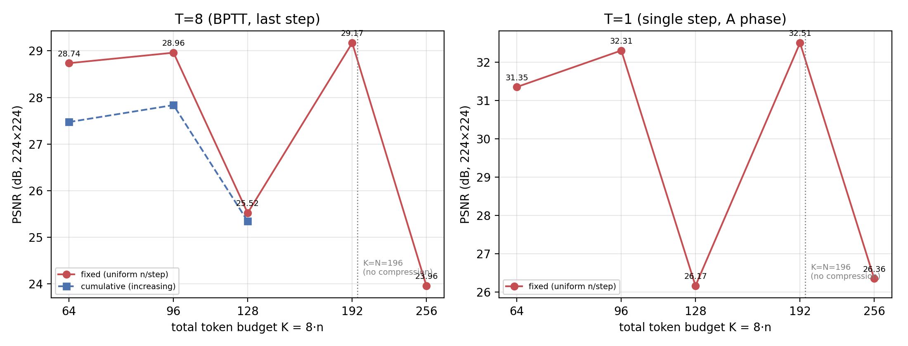
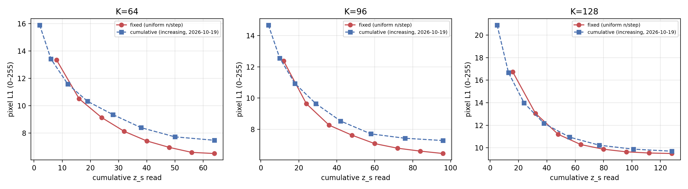
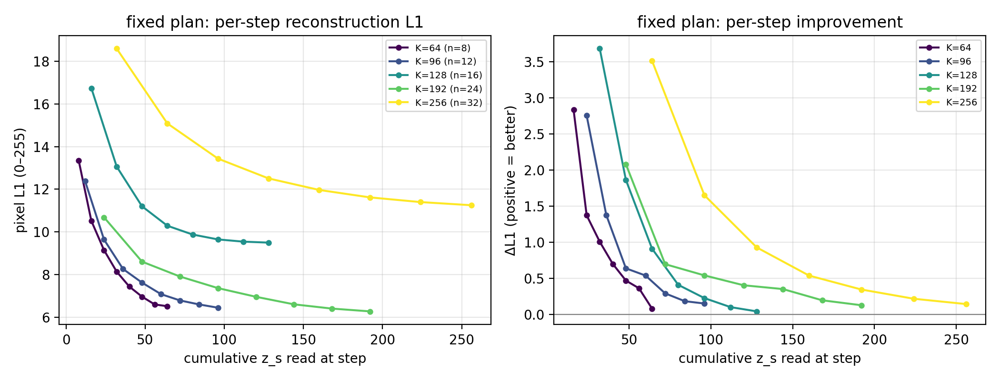
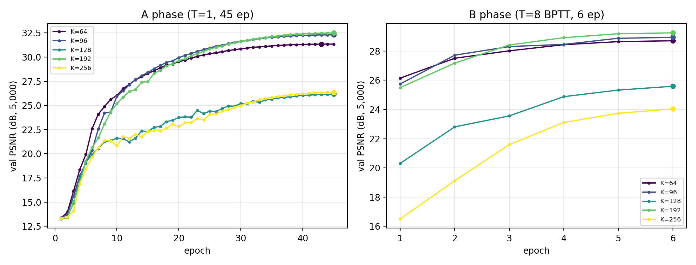
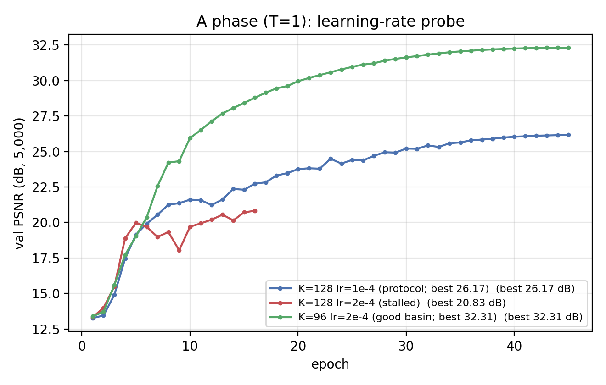

# REPORT — 固定 8 步 × **每步均匀 n 个** z_s 的消融（K=64…256）

> **日期**：2026-10-21
> **代码基线**：`69d6063` + 本实验新增（`fixed` 读窗口臂 / `allow_k_gt_n` / 配对 B 相 / 新工具，见 §2.5）
> **机器**：AutoDL **2×A800-80GB**（`ssh -p 12191` 新实例；torch **2.12.1+cu130**）
> **数据**：ImageNet-100（AutoDL 公共盘 `imagenet100.zip` 解压；**train 121,689 / val 5,000**，
> 每类等距抽 50 张的确定性切分，与 2026-10-19 完全相同）
> **口径**：224×224、K = z_s 数、像素 L1/PSNR/SSIM、**单种子 seed 0**、bf16 autocast
> **产物**：`doc/2026-10-21/artifacts/fixedk/`（15 个评测 json / 表 / 图 / 训练汇总 / args / 日志）

---

## 0. 一句话结论

1. **每步均匀取 n 个 z_s（uniform）优于递增取（cumulative）**：在**同一 A 相初始化**的配对
   对照下，8 步末步 PSNR **+1.26 dB（K=64）/ +1.12 dB（K=96）**，L1_255 末步
   **6.51 vs 7.48 px / 6.44 vs 7.27 px**；K=128 两臂都处在差 A 相，差 +0.18 dB。
   —— 这正是 ALIT「每迭代固定新增 32 个 latent token」的形状；本仓库首次量化了它的优势。
2. **均匀分配下，A 相正常收敛的臂随预算弱单调、无塌陷**：K=64/96/192 的 T=8 末步
   **28.74 / 28.96 / 29.17 dB**（预算 ×3 只 +0.44 dB ⇒ 明显饱和），但**没有** 2026-10-19
   cumulative 臂那种「K>64 掉头向下」。
3. **K=128/256 两臂的 B 相低（25.52 / 23.96 dB）不是分配形状或容量问题，是 A 相（T=1，
   与读窗口计划无关）优化失败**：K=128 在 lr=1e-4 与 2e-4 下都进差盆地（26.17 / 20.83 dB，
   且旧机器复现 25.65 / 19–20 dB），K=256（K>N=196）也是差盆地（26.36 dB）。
4. **因此 2026-10-19 报告的「K>64 退化」解释需要修正**：那次退化的 K=96/128 两臂，A 相同样
   只有 26.81 / 25.65 dB（新机器同 K 能到 32.31 / 32.51 dB）⇒ **高 K 的瓶颈是 A 相优化，
   不是 token 容量，也不是读窗口形状**。

---

## 1. 这次要回答什么

用户口径（2026-10-21）：

> 「现在我们换**固定取 n 个**进行消融实验，而不是**递增取**。一样 8 步，最大 token 数分别为：
> 64，96，128，192，256。」

即：固定 8 个解码步不变，把「每步读入多少个 z_s」从 2026-10-19 的**递增**（square 形状缩放）
改成**每步固定 n 个**，总预算 K = 8·n ∈ {64, 96, 128, 192, 256}：

| 臂 | 总预算 K | 每步 n = K/8 | 读窗口（A 坐标：0=z_cls，1..K=z_s） | 与 2026-10-19 同 K 臂的唯一差别 |
|---|---|---|---|---|
| **K=64**  | 64  | **8**  | `[0,8] [9,16] [17,24] … [57,64]` | 读窗口形状：递增 → 均匀 |
| **K=96**  | 96  | **12** | `[0,12] [13,24] … [85,96]` | 同上 |
| **K=128** | 128 | **16** | `[0,16] [17,32] … [113,128]` | 同上 |
| **K=192** | 192 | **24** | `[0,24] [25,48] … [169,192]` | 无同 K 的 cumulative 臂（新增档） |
| **K=256** | 256 | **32** | `[0,32] [33,64] … [225,256]` | 无同 K 的 cumulative 臂（新增档） |

- 首步窗口含 `z_cls`（与主线 square 计划同约定）；其余每步恰好读 n 个 z_s，8 步读满全部 K 个。
- 与 2026-10-19 `cumulative` 计划（square 形状按总预算缩放 ⇒ 前少后多，K=64 每步窗口
  `2,4,6,7,9,10,12,14`）**同 8 步、同 K、同训练配方**，唯一自变量 = **读窗口的分配形状**。
- ⚠️ **K=256 > N=196**（N = 224²/16² = 196 个 patch）：K=192 仍擦边属真压缩（K/N=0.98，
  1.02×），**K=256 已不是压缩**（K/N=1.31，预算超过 patch 数）。该点保留但**只作「预算超过
  输入 token 数」的饱和探针**，不作为压缩率曲线上的一点；代码里必须 `allow_k_gt_n=True`
  显式开启（§2.5）。

---

## 2. 方法

### 2.1 `fixed` 读窗口计划（本仓库已有 opt-in 路径，本次首次成规模使用）

`step_windows(K, steps=[1..8], plan="fixed", block=n)`：

```
步 i（i=1..8）读 A 坐标 [(i−1)·n+1, i·n]   （i=1 时 lo=0 ⇒ 另含 z_cls）
⇒ 每步恰读 n 个 z_s，8 步读满全部 K = 8·n 个
```

与 `cumulative`（2026-10-19，square 形状缩放）的窗口对照（每步读入的 z_s 数）：

| K | fixed（本次） | cumulative（2026-10-19） | 累计读入对拍 |
|---|---|---|---|
| 64  | 8,8,8,8,8,8,8,8 | 2,4,6,7,9,10,12,14 | 末步均 = 64 |
| 96  | 12×8 | 4,5,6,8,11,13,16,18 | 末步均 = 96 |
| 128 | 16×8 | 5,6,8,11,14,18,21,24 | 末步均 = 128 |

### 2.2 训练协议（与 2026-10-19 K-sweep 臂逐项同协议）

| 相 | 步数 | epochs | batch | lr | 初始化 | 其它 |
|---|---|---|---|---|---|---|
| A 相 | T=1（单步读全 K） | 45 | 128 | **2e-4**（K≥128：**1e-4**） | 从零 | warmup_frac 0.08、cosine→1e-6、bf16、grad clip 1.0、skip_grad 50 |
| B 相 | T=8（**fixed** 窗口，BPTT） | 6 | 64 | 2e-4 | A 相 `ckpt_best` | `--init_from`、同 lr 曲线 |

- 模型：`SRPhase1LinAttn`（`enc_attn=std` 普通 softmax 编码器 ~31.85 M + std 解码器 ~31.2 M
  ≈ 63.0 M）；K 只改 register 数，参数量差 < 0.2%。
- **A 相 lr 沿用 2026-10-19 的 K 映射**（K=128 当时在 2e-4 下停在平凡解，改 1e-4）：
  K=64/96 → 2e-4；K=128/192/256 → 1e-4。⚠️ 高 K 段 A 相 lr 与低 K 不同，见 §5。
- 双卡分派：GPU0 = K=64/96/128，GPU1 = K=192/256；每臂 A+B 串行（A 124–170 min、B 63–69 min）。

### 2.3 配对对照臂：同一 A 相初始化，只换 B 相的读窗口计划（本报告的关键设计）

A 相（T=1）**与读窗口计划无关**（单步读全部 z_s）⇒ fixed 臂与 cumulative 臂的 A 相在配置上
完全相同。因此**不需要重跑 A 相**：直接拿 fixed 臂的 A 相 `ckpt_best` 热启动，只把 B 相的
读窗口换成 cumulative，就得到**同一初始化下、唯一自变量 = 读窗口形状**的配对比较。

| 配对臂（B 相 only） | 初始化 | 步数 | 窗口 | 其它 |
|---|---|---|---|---|
| `srdiff_cum_paired/stdattn_k{64,96,128}_t8` | fixed 臂同 K 的 A 相 `ckpt_best` | T=8（6 ep） | cumulative（`scaled_square_cumsum`） | 与 fixed 臂 B 相逐项相同（bs64、lr 2e-4、seed 0） |

> 方法学说明：最初计划是「在新机器上把 K=64/96/128 的 cumulative 臂完整重跑」；跑了 30 min
> 后发现 A 相与计划无关 ⇒ 改为上述**配对 B 相**设计（省 ~7 h GPU，且配对更严格：
> 排除了 A 相 basin 差异）。被中止的完整重跑没有用于任何结论。

### 2.4 评测（全量 5,000 张留出集）

| 脚本 | 口径 |
|---|---|
| `eval_linattn.py` | 末步（第 8 步）**PSNR / SSIM / L1_norm**（归一化空间 L1；换算 0–255 约 ×60） |
| `eval_stepwise_linattn.py` | 逐步 1–8 的 **L1_255（0–255，不 clamp）**、PSNR、Δ_t、每图最优停步 |

### 2.5 代码改动与复现（默认路径逐位不变，`model_v2_linattn.py` 自检 `ALL CHECKS PASSED`）

1. `model_v2_linattn.py`：`LinAttnConfig` 新增 **`allow_k_gt_n`**（默认 False）——K>N 时必须
   **显式开启**（拒绝静默越界）；自检新增 §8f：K∈{64,96,128,192,256} 的 fixed 窗口连续覆盖
   0..K、每步恰 n 个、K=256>N 的显式门控、K=256 前向形状（`(1,8,196,768)`）。
   （`fixed` 计划与 `step_windows` 早已存在，本次只是首次用于受控消融。）
2. `train_linattn.py`：新增 `--allow_k_gt_n`（透传进 cfg ⇒ ckpt 可重建）。
3. 新增工具：`tools/run_fixedk_arm.sh`（单臂 A+B）、`tools/launch_fixedk.sh`（双卡分派）、
   `tools/eval_fixedk.sh`（等训练结束后双卡并行全量评测）、`tools/launch_cumB_paired.sh`
   + `tools/eval_cum_paired.sh`（配对 cumulative B 相）、`tools/launch_k128_lr2e-4.sh`
   （K=128 lr 探针）、`tools/plot_fixedk_compare.py`（主表/对比表/图）、
   `tools/plot_fixedk_val_curves.py`（A/B 相验证曲线）、`tools/plot_lr_probe.py`（lr 探针）、
   `tools/summarize_fixedk.py`（日志 → `train_summary.csv`）。
4. 复现命令（服务器仓库根目录）：

```bash
nohup setsid bash tools/launch_fixedk.sh > $OUT/launch.out 2>&1 &          # 5 臂 A+B
nohup setsid bash tools/eval_fixedk.sh   > $OUT/eval_launch.out 2>&1 &     # 等 ALL_DONE 后评测
nohup setsid bash tools/launch_cumB_paired.sh > $P/launch.out 2>&1 &       # 3 个配对 cumulative B
nohup setsid bash tools/eval_cum_paired.sh    > $P/eval_launch.out 2>&1 &
# 本地作图（fixed vs 配对 cumulative）:
python tools/plot_fixedk_compare.py --fixed_eval doc/2026-10-21/artifacts/fixedk/eval \
    --cum_eval doc/2026-10-21/artifacts/fixedk/eval_paired \
    --out_dir doc/2026-10-21/artifacts/fixedk
```

---

## 3. 结果

### 3.1 主表（5,000 张 ImageNet-100 val，末步）

| K (=8n) | n/step | K/N | 压缩比 N/K | T=1 PSNR | T=1 L1_norm | T=8 PSNR | T=8 L1_norm | T=8 SSIM | T=8 末步 L1_255 | A 相状态 |
|---|---|---|---|---|---|---|---|---|---|---|
| **64**  | 8  | 0.33 | 3.06× | 31.354 | 0.089 | **28.735** | 0.113 | 0.8545 | 6.51 px | 好盆地 |
| **96**  | 12 | 0.49 | 2.04× | 32.307 | 0.080 | **28.960** | 0.112 | 0.8583 | 6.44 px | 好盆地 |
| **128** | 16 | 0.65 | 1.53× | 26.167 | 0.153 | **25.521** | 0.165 | 0.7235 | 9.49 px | **差盆地** |
| **192** | 24 | 0.98 | 1.02× | 32.505 | 0.077 | **29.170** | 0.109 | 0.8657 | 6.27 px | 好盆地 |
| **256** | 32 | 1.31 | 0.77× | 26.356 | 0.149 | **23.958** | 0.195 | 0.6564 | 11.25 px | **差盆地 + K>N** |

> 全部 5 臂的「T=8 oracle 最优步」都是**第 8 步**（8 步全部有正收益，见 §3.4）。
> 「A 相状态」= §3.3 的盆地判断；K=128/256 的 T=8 数字**受初始化拖累**，不代表分配形状的上限。



> 左：T=8 末步；右：T=1（A 相）。**折线在 K=128/256 处下探是 A 相盆地造成的**（右图同样下探），
> 不是「均匀分配在高 K 失效」——见 §3.3。蓝色虚线 = 配对 cumulative B 相（§3.2），只有
> K=64/96/128 三点。

### 3.2 核心结果：均匀分配 vs 递增分配（**同 A 相初始化**的配对比较）

`tools/launch_cumB_paired.sh` 用 fixed 臂同 K 的 A 相 `ckpt_best` 热启动、只重跑 cumulative
B 相（6 ep）：

| K | plan | T=8 PSNR | T=8 L1_norm | T=8 SSIM | 末步 L1_255 | Δ PSNR（fixed−cum） | Δ SSIM |
|---|---|---|---|---|---|---|---|
| 64 | **fixed（均匀）** | **28.735** | 0.113 | 0.8545 | **6.51 px** | — | — |
| 64 | cumulative（递增） | 27.472 | 0.130 | 0.8158 | 7.48 px | **+1.263** | +0.0387 |
| 96 | **fixed（均匀）** | **28.960** | 0.112 | 0.8583 | **6.44 px** | — | — |
| 96 | cumulative（递增） | 27.836 | 0.126 | 0.8253 | 7.27 px | **+1.124** | +0.0331 |
| 128 | **fixed（均匀）** | **25.521** | 0.165 | 0.7235 | **9.49 px** | — | — |
| 128 | cumulative（递增） | 25.344 | 0.168 | 0.7143 | 9.70 px | +0.177 | +0.0092 |

- **K=64/96：均匀分配稳定好 +1.1~1.3 dB**（配对 ⇒ 不是初始化/机器差异）；K=128 两臂都受
  差 A 相拖累，差值缩小到 +0.18 dB（此时上限由编码器质量决定，不由窗口形状决定）。
- ⚠️ **T=1 列对 cumulative 行无意义**：配对臂与 fixed 臂共用同一个 A 相 ckpt（T=1 结果相同）。
- 逐步曲线（同 K 下逐步的像素 L1_255，0–255）：

| K | 方案 | step1 | 2 | 3 | 4 | 5 | 6 | 7 | 8 |
|---|---|---|---|---|---|---|---|---|---|
| 64 | fixed | 13.35 | 10.51 | 9.14 | 8.13 | 7.43 | 6.96 | 6.60 | **6.51** |
| 64 | cumulative | 15.90 | 13.43 | 11.58 | 10.33 | 9.36 | 8.40 | 7.73 | 7.48 |
| 96 | fixed | 12.39 | 9.64 | 8.26 | 7.62 | 7.08 | 6.78 | 6.60 | **6.44** |
| 96 | cumulative | 14.69 | 12.56 | 10.93 | 9.64 | 8.53 | 7.70 | 7.42 | 7.27 |
| 128 | fixed | 16.74 | 13.06 | 11.20 | 10.29 | 9.87 | 9.64 | 9.54 | **9.49** |
| 128 | cumulative | 20.90 | 16.68 | 13.98 | 12.17 | 10.95 | 10.23 | 9.88 | 9.70 |



> 红 = fixed（均匀），蓝 = cumulative（递增），横轴 = 该步累计读入的 z_s 数。
> **均匀分配从第 1 步就领先**（K=64：13.35 vs 15.90 px；cumulative 第 1 步只读 2 个 token），
> 之后每一步的 Δ_t 都保持正收益，且**末步领先**。cumulative 的后几步虽然读入更多 token，
> 但起点太差、末尾仍落后 0.8–1.0 px —— 即 **「把预算平摊到每一步」优于「前少后多」**。



> fixed 各臂自身逐步曲线（x 轴 = 累计读入 z_s；K=64/96/192 是正常曲线，K=128/256 整条被抬高）。

### 3.3 A 相（T=1）是主导混杂：K≥96 的 A 相存在「好/差盆地」

A 相与读窗口计划无关，是**纯编码器质量**的度量（单步读全部 K 个 z_s）。它的结果**不随 K 单调，
且同配置在不同机器上可以差 5.5 dB**：

| K | 新机器 A 相（lr） | 2026-10-19 旧机器 A 相 | 差值 | 判读 |
|---|---|---|---|---|
| 64  | 31.35（2e-4） | 31.03（2e-4） | +0.32 | 可复现（差 < 噪声 0.4 dB） |
| 96  | **32.31（2e-4）** | **26.81（2e-4）** | **+5.50** | 同配置、不同结果 ⇒ **不可复现** |
| 128 | 26.17（1e-4） | 25.65（1e-4） | +0.52 | **复现**「差盆地」 |
| 128 | 20.83（2e-4，ep17 止损） | 19–20（2e-4 停滞） | — | 两机**同样停滞** |
| 192 | **32.51（1e-4）** | 未跑 | — | 好盆地 |
| 256 | 26.36（1e-4；2e-4 前 8 ep 更低） | 未跑 | — | 差盆地 + K>N |



> A 相（左）明显双峰：K=64/96/192 → 31.4–32.5 dB；K=128/256 → 25–26.4 dB。B 相（右）完全继承
> A 相的排序（B 相只训 6 ep，无法把差初始化救回来）。**「K>64 退化」= A 相进差盆地，不是容量**。



> K=128 的 lr 探针：1e-4 能到 26.17 dB（协议值），2e-4 在 ep10 后停在 20–21 dB（与旧机器复现）。
> ⇒ K=128 的差**不能**用「lr 选错」解释（两个 lr 都差），而 K=96 用 2e-4 就能到 32.31 dB。
> 另：K=192 的 A 相有 **538 次 grad-skip（gn>50）**却收敛到 32.51 dB，K=128 只有 25 次 skip
> 却停在 26.17 dB ⇒ **skip 次数也不是盆地判据**，机制仍未定位（开放问题）。

### 3.4 逐步形状：8 步全部有效，且均匀分配的每步增益更「平」

- 所有 fixed 臂的最优步都是**第 8 步**（每图最优停步：K=64 有 4943/5000 张在第 8 步；K=128/256
  同样第 8 步）⇒ 8 步没有「空转」（对比 2026-10-19：K≤12 时第 3–4 步就吃完收益）。
- 均匀分配下每步读入相同 n 个 token，Δ_t（正=变好）比较：

| K | Δ₂ | Δ₃ | Δ₄ | Δ₅ | Δ₆ | Δ₇ | Δ₈ |
|---|---|---|---|---|---|---|---|
| 64 | 2.83 | 1.37 | 1.01 | 0.70 | 0.47 | 0.37 | 0.08 |
| 96 | 2.75 | 1.38 | 0.64 | 0.54 | 0.30 | 0.19 | 0.16 |
| 192 | 2.08 | 0.70 | 0.54 | 0.41 | 0.36 | 0.20 | 0.13 |

> Δ₂ 恒为最大（首步只有 n 个 token 时的预测最差）；后续 Δ_t 随 K 增大而变小（每步 n 更大，
> 首步已经读得更多）⇒ 与「均匀分配 = 每步补充等量新证据」的直觉一致。

### 3.5 与 2026-10-19 旧 9 臂（cumulative）的对照

| K | 旧机 cumulative T=8 | 新机 **配对** cumulative T=8 | 新机 fixed T=8 | 说明 |
|---|---|---|---|---|
| 64  | 27.760 | 27.472 | **28.735** | 旧/新配对差 −0.29 dB ≈ 机器/运行噪声 |
| 96  | 26.244 | 27.836 | **28.960** | 旧机 A 相差盆地（26.81），故其 B 也低 |
| 128 | 25.086 | 25.344 | **25.521** | 两者都是差 A 相（25.6~26.2），B 相近 |

⇒ **旧报告的「K>64 退化」主要不是读窗口形状造成的**：把 A 相换成好盆地后，cumulative 在
K=96 也能到 27.84 dB；剩下约 **+1.1 dB** 才是均匀分配相对递增分配的真实优势。

---

## 4. 解释与结论

1. **「每步均匀取 n 个」优于「递增取」**（配对 +1.26/+1.12 dB，K=64/96）。机制上：递增计划的
   前几步只读极少 token（K=64 第 1 步只读 2 个），深监督里这些步的损失很高，拖累了共享的
   编码器/解码器；均匀计划让每一步都拿到等量新证据，首步 L1 就低 ~2.5 px，整条轨迹更好。
   这也解释了 ALIT 用「每迭代固定 +32 token」而不是递增——本次给出了该选择的**受控证据**。
2. **均匀分配随预算弱单调、饱和但不塌陷**（28.74 → 28.96 → 29.17 dB，K=64/96/192）。
   每翻倍预算只 +0.2 dB 左右 ⇒ 在本模型（63 M、IN-100、224²）上，**K≈64 已经接近饱和**，
   继续加 token 的边际收益很小（与 2026-10-19 的「K=64 是最优操作点」结论方向一致，
   但原因不同：不是退化，而是饱和）。
3. **高 K（≥96）的瓶颈是 A 相优化，不是容量，也不是窗口形状**。证据：A 相双峰
   （31–32.5 vs 25–26.4）、K=96 同配置跨机差 5.5 dB、K=128 两个 lr 都差、K=256（K>N）也差。
   因此「K 越大越好或越差」在本协议下都不能从单次实验读出。
4. **K=256（K>N=196）没有收益**：预算已超过 patch 数（非压缩），A 相进差盆地，B 相 23.96 dB
   为全表最低。这不是「更多 token 无用」的证明（优化没训好），但说明**超预算区间不该作为
   压缩预算的候选**。
5. **对 2026-10-19 报告的修正**（诚实记录）：那次的「K>64 退化」被归因为「优化受限」，方向
   正确，但**低估了 A 相的统治力**——本次用配对设计把 A 相固定后，K=96 的 cumulative 只比
   好盆地低 0.3 dB，剩下的差距来自窗口形状。

---

## 5. 诚实边界

1. **单种子 seed 0**：没有多 seed 方差；0.1–0.3 dB 量级的差不应过度解读。
2. **A 相 lr 在 K≥128 是 1e-4**（沿用 2026-10-19 对 K=128 的处理），与 K≤96 的 2e-4 不同；
   且 K=192（1e-4）反而收敛最好 ⇒ A 相结果对 K 不是单调的，lr 与 basin 的关系未厘清。
3. **K=128/256 的 B 相数字被 A 相初始化拖累**，不能作为「均匀分配在 K=128/256 的上限」；
   它们只说明**该协议下这两个点训练失败**。K=256 还额外是超预算点（非压缩）。
4. **T=1 与 T=8 两列不可直接比**（A 相 45 ep 从零 vs B 相 6 ep 热启动，预算差 7.5×）。
5. **像素指标 ≠ 任务保真**（见 `GOAL` §2、`REPORT_k8sweep.md` §5）；本报告不涉及 Phase 2。
6. **K 同时改变预算与编码器 memory 容量**：K 越大，编码器 specials 越多、可塑性越强，
   「预算」不是唯一变量（与 2026-10-19 同一条边界）。
7. **配对 cumulative 臂只有 B 相**：其 T=1 结果与 fixed 臂完全相同（同一 ckpt），表里没有单列。
8. **机器/数值漂移**：旧机 torch 版本未记录，新机 2.12.1+cu130；同协议 K=64 的 A 相差
   +0.32 dB、配对 cumulative B 相差 −0.29 dB ⇒ 跨机器比较的噪声约 **0.3–0.4 dB**。

---

## 6. 产物与复现

| 文件 | 内容 |
|---|---|
| `artifacts/fixedk/fixedk_table.md` | fixed 5 臂主表 |
| `artifacts/fixedk/fixedk_vs_cumulative.md` | 配对 fixed vs cumulative 表 |
| `artifacts/fixedk/fixedk_summary.json` | 全部行数据（json） |
| `artifacts/fixedk/fixedk_psnr_vs_tokens.png/.pdf` | 末步 PSNR vs K（T=8 / T=1） |
| `artifacts/fixedk/fixedk_stepwise_l1.png/.pdf` | fixed 各臂逐步 L1 |
| `artifacts/fixedk/fixedk_stepwise_vs_cum.png/.pdf` | 同 K 的 fixed vs 配对 cumulative 逐步 L1 |
| `artifacts/fixedk/fixedk_val_curves.png/.pdf` | A/B 相验证曲线（盆地证据） |
| `artifacts/fixedk/fixedk_k128_lr_probe.png/.pdf` | K=128 lr 探针 |
| `artifacts/fixedk/eval/*.json`（15 个） | fixed 臂全量评测（T=1/T=8/逐步） |
| `artifacts/fixedk/eval_paired/*.json`（6 个） | 配对 cumulative B 相全量评测 |
| `artifacts/fixedk/train_summary.csv` / `train_summary_paired.csv` | 每臂每相 lr / val / 墙钟 / 收尾 train L1 / skip / plan |
| `artifacts/fixedk/logs/` | 训练日志（含 K=128 lr=2e-4 停滞与 K=256 两次 lr 证据） |
| `artifacts/fixedk/args/` | 14 份 `args.json`（协议证据，含 `step_plan/block/allow_k_gt_n/init_from`） |

墙钟：5 臂训练 ≈ **10.0 h**（2 卡并行；单臂 A+B 187–239 min）+ 配对 3 个 B 相 ≈ **1.1 h** +
K=128 lr 探针 0.75 h + 评测 ≈ 0.2 h；本机总占用 ≈ **12 h**。

---

## 7. 下一步

1. **多 seed 复现 A 相盆地**（尤其 K=96/128/192）：判断「好/差盆地」是随机还是与 K 系统相关；
   这是把高 K 结论从「训练失败」变成可归因结论的前提。
2. **稳定性修复后重测 K=128/256**：更长 warmup、lr 5e-5 扫描、`enc_std_qk_norm=1`、
   初始化缩放——目标是把 K=256（K>N）也训练到好盆地，才能判断「超预算」是否真无收益。
3. **均匀分配下 K=192 vs K=64 的性价比**：+0.4 dB 换 3× token，对 Phase 2 的上下文预算是否值得，
   需要任务保真/生成质量指标（rFID 或 Phase 2），不能只看 PSNR。
4. **把「每步均匀」推广到步数维度**：固定总预算 K 时，步数 T 与每步 n=K/T 的权衡
   （本实验固定 T=8；T=4/16 的均匀计划值得扫）。
