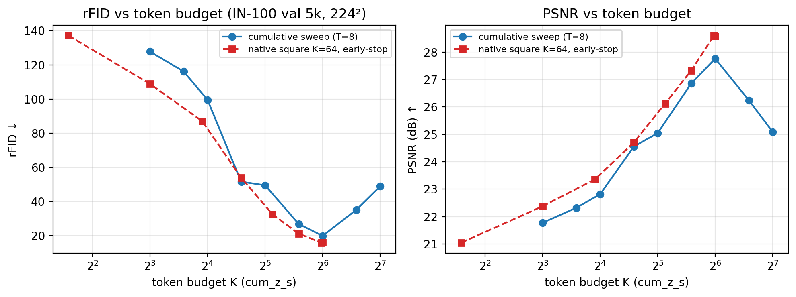
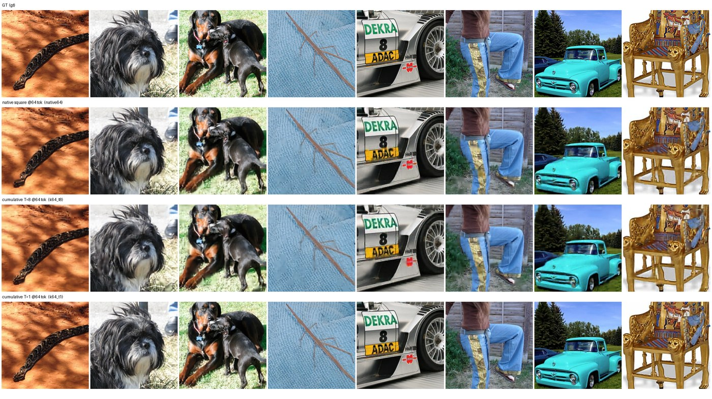

# REPORT — K=64 臂的 **rFID**（对齐 ALIT 论文指标口径）

> **日期**：2026-10-21
> **代码基线**：`69d6063` + 本实验新增（`tools/eval_rfid.py`、`tools/plot_rfid_k64.py`）
> **机器**：AutoDL **2×A800-80GB**（`ssh -p 23556`；即 2026-10-19/20 K-sweep 的同一实例，
> 数据盘原样保留；**本实验收尾后已关机**）
> **数据**：ImageNet-100，**val 5,000 张**（每类等距 50 张的确定性切分，与 K-sweep 逐位相同）
> **口径**：224×224、K=z_s 总数、**rFID（pytorch-fid 0.3.0, InceptionV3 pool3/2048）**、
> 单种子 seed 0、bf16 autocast
> **产物**：`doc/2026-10-21/artifacts/rfid_k64/`（每臂 eval json / 表 / 图 / 汇总 json / 日志 / 运行脚本）

---

## 0. 一句话结论

把 K-sweep 的 **K=64** 三臂补上 ALIT 口径的 **rFID**（reconstruction FID）：

| 臂（K=64） | 读窗口计划 | T | PSNR (dB) | L1_255 | **rFID ↓** |
|---|---|---|---|---|---|
| `native_k64`（历史 `stdattn_k64_rec`） | **原生 square（递增；ALIT 同构）** | 8 | 28.582 | 6.613 | **15.89** |
| `k64_t8`（2026-10-19 主表 K=64） | cumulative（前少后多） | 8 | 27.760 | 7.190 | **19.86** |
| `k64_t1`（2026-10-19 主表 K=64 的 T=1 列） | cumulative A 相（单步读全 64） | 1 | 31.027 | 5.293 | **8.32** |

- **K=64 的 rFID = 15.89（native square）/ 19.86（cumulative T=8）/ 8.32（T=1）**。
- 与 ALIT 论文 ImageNet-100 **@64 token** 的 rFID 对照：**Ours-S = 16.17、Ours-B = 15.88**
  ⇒ 本仓库 native square K=64 的 **15.89 落在同一量级**（−1.7% vs Ours-S）。
  ⚠️ **这只是「同量级」，不是「追平」**：数据划分、分辨率（224 vs 256）、重建器
  （连续 z_s + 线性注意力 vs VQGAN + 量化 1D + GAN）、token 语义全不同（§5.2）。
- **rFID 与 PSNR 同向**：K-sweep 上 rFID 在 **K=64 最低（19.86）**，K=96/128 反向回升
  （**35.10 / 48.80**；比 K=64 高 **+76.7% / +145.7%**）——与 PSNR 的「K=64 是最优操作点、K>64 优化受限」
  完全同向，但 rFID 的相对变化幅度大得多（K=8→64：PSNR +5.98 dB，rFID **−84.5%**）。
- **与 ALIT 的差距在低 token 段**：ALIT Ours-S @32 token = 22.57，本仓库同预算
  （native early-stop @35 = 32.44、cumulative K=32 = 49.47）**差约 1.5–2.2×**；
  到 64 token 才追到同量级 ⇒ 本仓库的 rFID–token 曲线更陡，低 token 感知质量是弱项
  （与 ALIT 的 GAN 阶段有关，见 §4.3）。

---

## 1. 为什么加这个实验 / 对齐的是什么

`doc/2026-10-19/REPORT_k8sweep.md` 的 9 臂主表只有像素指标（L1/PSNR/SSIM）。
ALIT（[arXiv:2411.02393](https://arxiv.org/abs/2411.02393)，ICLR 2025，
[官方仓库](https://github.com/ShivamDuggal4/adaptive-length-tokenizer)）报告重建质量用的是
**rFID（reconstruction FID）**，并且其 Table 3 / Fig.10 的「FID vs token 数」正是
「同一模型、不同 token 预算」的曲线。本实验把本仓库 K=64 补上**同一指标定义与同一计算流程**的
rFID，使数字可以放进 ALIT 的指标列格式里对照。

### 1.1 ALIT 的 rFID 口径（已核对论文 + 官方代码）

- 官方 `evaluate_rfid.py`：留出集逐图重建 → **GT 与重建图分别写成 PNG**
  （`evaluation_logs/gt/`、`evaluation_logs/reconstructed_imgs_{iter}/`，uint8 RGB，256×256）
  → 用 subprocess 调 **`python -m pytorch_fid {recon_dir} {gt_dir}`**；
  `--input_size` 默认 256，常规 val 只做 `CenterCrop(256)+ToTensor()`（**没有**额外 Resize）。
- `pytorch-fid` 默认：**InceptionV3（TF 移植权重 inception-2015-12-05）、`dims=2048`（pool3）**，
  库内部把图 resize 到 299×299。
- 论文正文/附录**没有**写 FID 的实现细节（全文 0 次 "Inception"/"pytorch-fid"/"resize"），
  也未写评测图像数（仓库直接遍历整个 `val/` 目录）。
- 论文里同一节的 **「FID using VGG16 features」是 Fig.6 的 TSC–TOI 分析用的另一套特征，
  不是主表 FID**，不能混用（这条很容易踩坑，§5.2）。

**本仓库的 rFID 实现与之逐项对齐**：同一个库 `pytorch-fid 0.3.0`、同一 InceptionV3 权重、
同 `dims=2048`、同样「GT PNG 目录 + 重建 PNG 目录」的 dir-based 流程、同样 `recon vs gt` 方向。
唯一实现差异是 GT 用 224×224（本仓库 val transform：`Resize(256)+CenterCrop(224)`）而不是 256×256。

### 1.2 ALIT 重建 FID 主表（论文数值，供对照）

> 来源：ALIT 论文重建 FID 表（arXiv v1 PDF 中 caption 为 "Table 1"、arXiv HTML 正文引用为
> "Tab. 3"，同一张表、数值一致；ICLR 2025 camera-ready 该页文本损坏，编号未能复核）。
> 数据为 **ImageNet-100 val（IN-1K val 的 100 个 synset，共 5,000 张）、256×256**。

| 方法 | IN-100 32 | 64 | 96 | 128 | 160 | 192 | 224 | 256 |
|---|---|---|---|---|---|---|---|---|
| Titok-L-32 | 11.60 | — | — | — | — | — | — | — |
| Titok-B-64 | — | 8.22 | — | — | — | — | — | — |
| VQ-GAN | — | — | — | — | — | — | — | 7.04 |
| **Ours-S（`alit_small`）** | **22.57** | **16.17** | **13.30** | **11.69** | **10.22** | **9.30** | **8.55** | **8.25** |
| Ours-SemiLarge | 19.70 | 13.92 | 11.39 | 10.41 | 9.23 | 8.75 | 8.22 | 8.03 |
| Ours-B（附录 Table 3, 12 层/768, IN-100 Stage2） | 22.15 | 15.88 | 12.57 | 10.44 | 9.50 | 8.96 | 8.39 | 8.19 |
| **本仓库 `native_k64`（IN-100 val 5k, 224²）** | **—**（无 32 token 专训臂；early-stop @35 = 32.44） | **15.89** | — | — | — | — | — | —（无 K=256 臂） |

---

## 2. 方法

### 2.1 三臂定义（都是 K=64，仅「读窗口计划 / 相」不同）

| 臂 | ckpt | 定义 | 为什么选它 |
|---|---|---|---|
| `native_k64` | `/root/autodl-tmp/srdiff_k8sweep/_ref_k64_native/ckpt_best.pt` | **原生 square 计划**，逐步累计读入 `[3,8,15,24,35,48,63,64]` 个 z_s | **与 ALIT 的「每次 rollout 新增 token」同构**；也是本仓库 K=64/T=8 的权威数字（28.582 dB） |
| `k64_t8` | `…/stdattn_k64_t8/ckpt_best.pt` | 2026-10-19 K-sweep 的 K=64 臂（`cumulative` 计划，前少后多 `2,4,6,7,9,10,12,14`） | K-sweep 主表 K=64 行 |
| `k64_t1` | `…/stdattn_k64_t1/ckpt_best.pt` | 同臂 A 相（T=1 单步读全 64 个 z_s） | K-sweep 主表 K=64 的 T=1 列 |

另外为了给出 **rFID vs token 预算** 曲线，还顺带算了：
- `native_k64` 的 **逐步** rFID（cum_z = 3/8/15/24/35/48/63/64，共 8 点）——与 ALIT
  「同一模型、不同 token 数」的曲线同构；
- cumulative K-sweep 的 **K=8/12/16/24/32/48/64/96/128** 共 9 臂末步 rFID——与 K-sweep 主表逐臂配对。

### 2.2 评测流程（`tools/eval_rfid.py`，新增）

1. **GT 落盘一次**：val transform 后的 5,000 张 224×224 PNG（全部臂共用；80 s）；
2. 用官方 CLI 预计算 **GT 的 Inception 统计量**（`python -m pytorch_fid --save-stats gt gt_stats.npz`），
   每个臂只需算重建图一侧 ⇒ 多臂/多步时 FID 时间约减半；
3. 每臂：加载 ckpt → 逐 batch 前向拿 `Y_pix`（B,T,N,3pp）→ 反归一化到 [0,1] → 逐步落 PNG
   （`recon_step{t:02d}/`）→ 同时算 PSNR/L1 做交叉校验 → `calculate_fid_given_paths([recon, gt_stats.npz])`；
4. 输出 `eval_rfid.json`：`cum_z_s` / 每步 PSNR、L1_255、rFID / cfg / n_images。

**兼容性 shim（必须记一笔）**：远程 `scipy=1.18.1` 删除了 `scipy.linalg.sqrtm(..., disp=)`
参数，而 `pytorch-fid 0.3.0` 仍在用旧 API（`disp=False` 返回 `(sqrtm, errest)`）⇒
`tools/eval_rfid.py` 里装了一个 6 行的向后兼容 shim（语义与旧 scipy 一致，不改 FID 公式）。
这是环境兼容补丁，不影响与官方 `python -m pytorch_fid` 的数值一致性。

### 2.3 交叉校验（这是本实验可信度的关键）

脚本在同一遍前向里重算 PSNR/L1，与既有评测逐位对拍：

- 9 个 K-sweep 臂末步 PSNR：21.777 / 22.321 / 22.815 / 24.554 / 25.045 / 26.861 / **27.760** /
  26.244 / 25.086 —— 与 `REPORT_k8sweep.md` §3.1 主表**逐位一致**；
- `native_k64` 末步 28.582 dB、逐步 L1_255
  `[15.415, 13.030, 11.439, 9.704, 8.285, 7.359, 6.597, 6.613]` —— 与 §3.3/§3.6 及
  `doc/2026-10-16/artifacts/alit/stepwise_stdattn_k64_rec.json` **逐位一致**；
- `k64_t1` 31.027 dB —— 与主表 T=1 K=64 一致。

⇒ rFID 与既有像素指标**同数据、同前向、同 ckpt**，不是另起一套评测。
⚠️ **过程记录**：首轮有 4 个 t8 臂（K=8/16/32/48）因脚本按 `enumerate` 序号而非**步号**取列，
错取了 step1（表现为 PSNR ≈ step1 的 20.4–20.8 dB，与主表对不上）；修复为按 `s-1` 取列后重跑，
上表的 PSNR 交叉校验即修复后的结果。首轮日志保留在 `artifacts/rfid_k64/logs/chain_gpu1.log` 备查。

### 2.4 复现命令

```bash
# 0) 只需一次：GT 落盘 + GT Inception 统计量
cd /root/AssocVTC
python tools/eval_rfid.py --out_dir /root/autodl-tmp/rfid_k64 --gt_only
python tools/eval_rfid.py --out_dir /root/autodl-tmp/rfid_k64 --gt_stats_only

# 1) K=64 三臂（--steps last = 末步; 单步臂自动只有 1 步）
K=/root/autodl-tmp/srdiff_k8sweep
python tools/eval_rfid.py --ckpt $K/_ref_k64_native/ckpt_best.pt --out_dir /root/autodl-tmp/rfid_k64 --tag native_k64 --steps all
python tools/eval_rfid.py --ckpt $K/stdattn_k64_t8/ckpt_best.pt  --out_dir /root/autodl-tmp/rfid_k64 --tag k64_t8     --steps last
python tools/eval_rfid.py --ckpt $K/stdattn_k64_t1/ckpt_best.pt  --out_dir /root/autodl-tmp/rfid_k64 --tag k64_t1     --steps last

# 2) （可选）K-sweep 其余 8 臂：把上面的 tag/ckpt 换成 stdattn_k{8,12,16,24,32,48,96,128}_t8
# 3) 汇总表 + 图 + summary（纯 json, 不加载模型）
python tools/plot_rfid_k64.py --eval_dir doc/2026-10-21/artifacts/rfid_k64/eval \
    --out_dir doc/2026-10-21/artifacts/rfid_k64
```

实测耗时（A800，同一实例）：GT 80 s + stats 10 s；每臂 ≈2.2 min（5,000 张前向+落 PNG+FID）；
11 臂 + native 8 步全量 ≈ **25 min**（2 卡并行分派，见 `artifacts/rfid_k64/logs/run_all.sh`）。

---

## 3. 结果

### 3.1 K=64 主表

| 臂 | 读窗口计划 | T | token 预算 | PSNR (dB) ↑ | L1_255 ↓ | **rFID ↓** |
|---|---|---|---|---|---|---|
| `native_k64` | 原生 square（递增） | 8 | 64 | 28.582 | 6.613 | **15.889** |
| `k64_t8` | cumulative（前少后多） | 8 | 64 | 27.760 | 7.190 | **19.862** |
| `k64_t1` | cumulative A 相（单步读全） | 1 | 64 | 31.027 | 5.293 | **8.322** |

（来源：`artifacts/rfid_k64/eval/*/eval_rfid.json`、`rfid_k64_table.md`）

### 3.2 rFID vs token 预算



- **native square K=64 的 early-stop 曲线**（同一模型、逐 rollout，与 ALIT 同构）：

| 步 | 累计 token（cum_z_s） | PSNR (dB) | L1_255 | **rFID** |
|---|---|---|---|---|
| 1 | 3 | 21.048 | 15.415 | 137.181 |
| 2 | 8 | 22.379 | 13.030 | 108.825 |
| 3 | 15 | 23.356 | 11.439 | 87.047 |
| 4 | 24 | 24.701 | 9.704 | 53.888 |
| 5 | 35 | 26.126 | 8.285 | 32.445 |
| 6 | 48 | 27.331 | 7.359 | 21.191 |
| 7 | 63 | 28.606 | 6.597 | **15.828**（最低） |
| 8 | 64 | 28.582 | 6.613 | **15.889** |

> 末步 rFID（15.889）比第 7 步（15.828，63 token）**高 0.06**，与 PSNR 末步略降（−0.02 dB）
> 同向、且幅度都在 FID 抽样噪声量级内（§5.1）⇒ **不构成「63 优于 64」的结论**。

- **cumulative K-sweep（9 臂，末步）**：rFID 在 K=8→64 单调下降，K>64 回升：

| K | 8 | 12 | 16 | 24 | 32 | 48 | **64** | 96 | 128 |
|---|---|---|---|---|---|---|---|---|---|
| PSNR | 21.777 | 22.321 | 22.815 | 24.554 | 25.045 | 26.861 | **27.760** | 26.244 | 25.086 |
| L1_255 | 14.118 | 13.179 | 12.445 | 10.251 | 9.733 | 8.035 | **7.190** | 8.670 | 9.953 |
| **rFID** | 127.778 | 116.099 | 99.527 | 51.542 | 49.469 | 26.808 | **19.862** | 35.099 | 48.801 |

（表：`artifacts/rfid_k64/rfid_ksweep_table.md`；逐臂 json 在 `eval/`）

### 3.3 rFID 与 PSNR 的一致性 / 差异

- **K≥24 的排序一致**：rFID 与 PSNR 都把 K=64 排第一、K>64 排后（K=96/128 的 rFID 分别比
  K=64 高 76.7% / 39.0%，而 PSNR 只低 1.52 / 2.67 dB）⇒ **rFID 对「K 偏离最优」的惩罚比 PSNR 重**；
- **极低预算段 rFID 更敏感**：K=8→16 的 PSNR 只 +1.04 dB（21.78→22.81），rFID 却从
  127.78 降到 99.53（−22%）——即「PSNR 看起来还行」的低 token 重建，在感知上已经明显崩；
- 轻微不一致：K=24（PSNR 24.554）与 K=32（25.045）的 0.49 dB 差，rFID 只差 4%
  （51.54→49.47）⇒ 单看 rFID 会把 24/32 当成平台。K=32 与 K=24 在这里接近，是本表唯一
  「PSNR 单调、rFID 近平台」的相邻点，不构成矛盾（两者都远差于 K≥48）。

### 3.4 与 ALIT 主表的数值对照（只作量级参照）

| token | 本仓库（native square, 224², IN-100 val 5k 留出） | 本仓库（cumulative 专训） | ALIT Ours-S（256², IN-100 val 5k） | 差（native vs ALIT） |
|---|---|---|---|---|
| 32 | ~37（@35 = 32.44，@24 = 53.89 之间插值） | 49.47 | **22.57** | ≈ +65% |
| 64 | **15.89** | 19.86 | **16.17** | **−1.7%** |
| 96 | —（K 只到 64 的模型） | 35.10 | 13.30 | — |
| 128 | — | 48.80 | 11.69 | — |

- **64 token 处同量级**（15.89 vs 16.17；也几乎等于 Ours-B 的 15.88）——但**不能解读为追平**（§5.2）；
- **32 token 处本仓库明显更差**（约 1.6× ALIT）：与 ALIT 的 **GAN 阶段**关系最大（ALIT 附录
  Table 3 显示 Stage1 无 GAN 时 64 token rFID 从 16.17 退化到 35.66；本仓库训练协议**无 GAN**）；
- 本仓库 K>64 的 rFID 回升（96: 35.10 / 128: 48.80）与 ALIT 的单调下降到 256（8.25）**方向相反**，
  原因已在 `REPORT_k8sweep.md` §3.4 定位为**优化受限（lr/register 冗余）而非容量上限**——
  rFID 只是把这个结论从像素域复现到感知域。



> 上→下：GT / native square @64 / cumulative T=8 @64 / cumulative T=1 @64。
> 224² 下肉眼差异不大（rFID 15.9 vs 19.9 对应的是分布级差异，不是单图判断）；T=1 行最锐
> （PSNR 31.0 dB / rFID 8.32），与像素指标同向。

---

## 4. 解释与结论

### 4.1 可以写进论文的点

1. **K=64 的感知指标已补齐，且与像素指标同向**：rFID = 15.89（原生递增计划）/ 19.86
   （cumulative）/ 8.32（T=1）；K-sweep 上 **K=64 是 rFID 最低点**（19.86），K=96/128 回升
   （35.10/48.80）⇒ 「K=64 是当前协议下的实际最优操作点」这一结论**不依赖 PSNR 口径**。
2. **rFID 对低 token / 超最优 K 的惩罚远重于 PSNR**：K=8→64 的 rFID 改善 **−84.5%** 远大于
   PSNR 的 +5.98 dB 所暗示的改善 ⇒ 只用 PSNR 会**低估** token 预算的感知价值；
   反过来，K>64 的退化在 rFID 上被放大（+76.7% / +39.0%）。
3. **与 ALIT 的指标对齐方式是可复现的**：同一 pytorch-fid 库 / InceptionV3 pool3 / 同方向、
   同「GT dir vs recon dir」流程，仅分辨率不同；后续任何新臂只要跑一个脚本就能进 ALIT 格式表。
4. **本仓库短板被量化**：低 token 段（≤32）的 rFID 比 ALIT 差 ≈1.6×，与「无 GAN 阶段」一致
   ⇒ 若要与 ALIT 的 rFID 曲线对标，**加 GAN/perceptual loss 阶段**比继续调 register 更可能有效。

### 4.2 与 ALIT 的结论对照

- ALIT 的「64→256 token FID gap 随 OOD 程度增大（IN-100 7.92 < COCO 12.56 < WIT 23.32）」
  在本实验里**只能部分检验**：本仓库只有 IID IN-100 val、且没有 K=256 臂（K=128 已是
  「优化受限」区）。本实验给出的是 **64→128 的 rFID gap = +28.94（反向）**，与本仓库
  PSNR 结论一致，属于「优化受限」而非「容量饱和」——**不能**拿来反驳 ALIT 的 OOD 结论。
- ALIT 的「token 数应与内容复杂度/熟悉度匹配」需要逐图 rFID 或逐图 L1 才可检验；
  本实验只做数据集级 rFID，**不覆盖**该结论。

### 4.3 诚实边界

1. **单种子**（seed 0），无方差；rFID 本身是**分布级统计量**，5,000 张的 FID 估计有可观抽样
   噪声（文献常用 10k–50k 张；ALIT 也未公布其评测张数——仓库遍历 `val/` 全目录）。
   < 0.1 的 rFID 差（如 15.828 vs 15.889）**不作结论**。
2. **与 ALIT 绝对数值不可比**（只对齐定义/流程）：
   - 数据：ALIT 用 IN-1K val 的 100 synset（5,000 张）；本仓库用 AutoDL IN-100 包（126,689 张）
     每类等距抽 50 张的确定性留出 —— **图像总体不同**；
   - 分辨率：256×256（CenterCrop 256，无 Resize） vs **224×224**（Resize 256+CenterCrop 224）；
   - 重建器：**VQGAN 2D→1D 量化 tokenizer + GAN loss、200 epoch** vs **从零训连续 z_s +
     线性注意力解码器（63.0 M、无 GAN、A 相 45 ep + B 相 6 ep）**；
   - token 语义：ALIT 的 1D latent token（32→256）vs 本仓库 z_s（K=8…128）。
   ⇒ 绝对数值**只能作量级参照**；本文所有跨方法比较均明确标注了这一点。
3. **FID 的 InceptionV3 在 ImageNet-1k 上训练**，对 OOD 有偏；本实验只用 IID IN-100 val，
   不覆盖 OOD（COCO/WIT）——那需要另跑数据集，属下一步。
4. **T=1 与 T=8 不可比**（45 ep 从零 vs 6 ep 热启动，预算差 7.5×）：`k64_t1` 的 rFID 8.32
   只能说明「A 相单步重建质量好」，**不能**说「T=1 优于 T=8」。
5. **K>64 的 rFID 不是干净容量点**：K=96/128 受优化稳定性/register 冗余支配
   （见 `REPORT_k8sweep.md` §3.4），rFID 的回升不能解释为「更多 token 对感知无用」。
6. **感知指标 ≠ 任务保真**：本项目唯一验收仍是 Phase 2 文字/下游任务；rFID 只是重建侧的
   感知代理（PSNR 的补充，不是替代）。
7. **重建 PNG 未入库**：5,000 张 × 18 个重建目录 + GT ≈ 7.5 GB，留在 `/root/autodl-tmp/rfid_k64/`，
   **实例收尾后已关机 ⇒ 这些 PNG 已随实例消失**；入库的是每臂 `eval_rfid.json`、
   `gt_stats.npz` 的生成方式、表与图，按 §2.4 可完整重算。
8. **scipy shim**：远程 scipy 1.18.1 与 pytorch-fid 0.3.0 的 API 不兼容，已用语义等价的
   shim 解决（§2.2）；若换环境（旧 scipy）脚本行为不变。

---

## 5. 产物清单与复现

| 文件 | 内容 |
|---|---|
| `artifacts/rfid_k64/eval/<arm>/eval_rfid.json` | 11 臂：cfg / `cum_z_s` / 每步 PSNR、L1_255、**rFID**（报告唯一数据源） |
| `artifacts/rfid_k64/rfid_k64_table.md` | K=64 三臂主表（本报告 §3.1） |
| `artifacts/rfid_k64/rfid_step_table.md` | native square K=64 逐步表（3…64 token，ALIT 同构曲线） |
| `artifacts/rfid_k64/rfid_ksweep_table.md` | cumulative K-sweep 9 臂 rFID 表 |
| `artifacts/rfid_k64/rfid_k64_summary.json` | 全部数字（表/图的 JSON 版） |
| `artifacts/rfid_k64/rfid_vs_tokens.png/.pdf` | 图：rFID（左）与 PSNR（右）vs token 预算 |
| `artifacts/rfid_k64/rfid_k64_samples.jpg` | 图：GT / 三臂 @64 token 的 8 张重建样例 |
| `artifacts/rfid_k64/logs/log_*.out` | 每臂评测日志（含逐臂 PSNR/rFID 终值） |
| `artifacts/rfid_k64/logs/run_all.sh`、`rerun_t8_gpu1.sh` | 双卡分派脚本（可复现） |
| `tools/eval_rfid.py` | **新增**：GT 落盘 / 逐步重建落盘 / pytorch-fid / PSNR 交叉校验 / scipy shim |
| `tools/plot_rfid_k64.py` | **新增**：纯 json 汇总表 + 图 + summary |

复现见 §2.4。环境：`pytorch-fid==0.3.0`、`scipy>=1.16`（脚本已自带 shim）、`Pillow`；
远程 `python=/root/miniconda3/bin/python`。

---

## 6. 下一步（若要继续这条线）

1. **多 seed rFID**（3 seeds）给 K=64 的 rFID 误差棒——当前 15.89/19.86/8.32 都是单种子；
   FID 的 5k 抽样噪声需要用同 ckpt 的 bootstrap 或不同 seed 量化，否则「63 vs 64」之类
   0.06 的差永远无法判读。
2. **OOD rFID（COCO val2017 / WIT）**：直接对应 ALIT 的 7.92/12.56/23.32 结论；这是本实验
   与 ALIT 对齐中**信息量最大**的缺口。
3. **加 GAN / perceptual loss 阶段**（ALIT Stage2）：当前低 token 段 rFID 差 1.6×，
   最可能的原因就是缺少 GAN 阶段（ALIT 附录 Table 3：Stage1 vs Stage2 在 64 token 差
   35.66 vs 16.17）。
4. **K=256 臂**：ALIT 的 FID 曲线到 256 token；本仓库需要先解决 K>64 的优化受限
   （`REPORT_k8sweep.md` §4.3 的 lr/warmup 扫描），再谈 64→256 的 gap。
5. **逐图 rFID 代理**（如按图算 Inception 特征距离）以便检验 ALIT 的「复杂度/熟悉度 → token」
   结论；数据集级 FID 无法回答。
