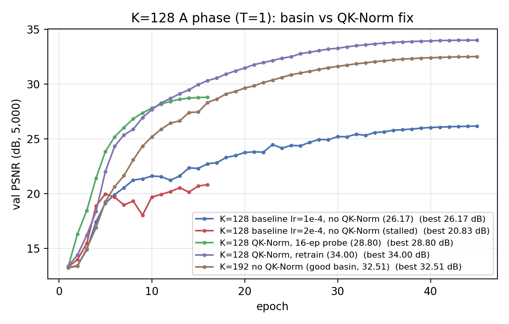
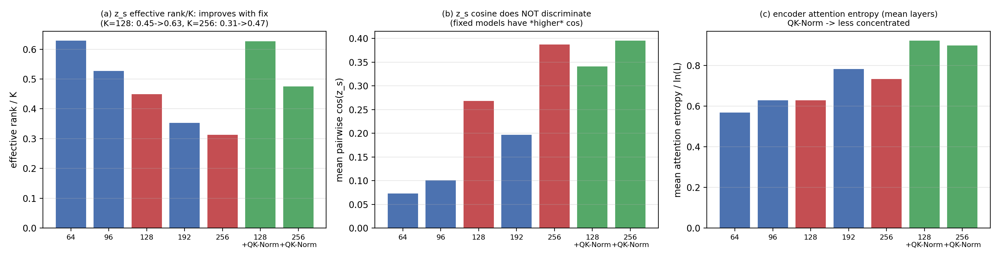
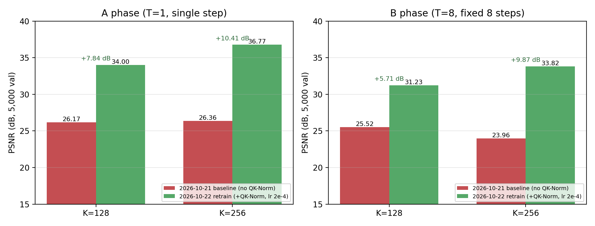
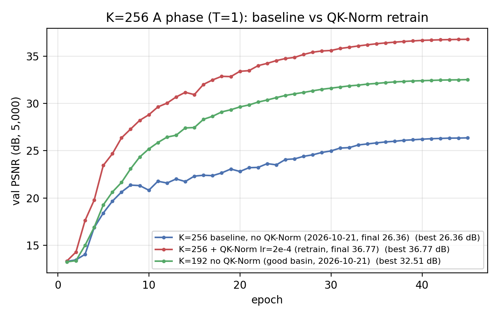

# REPORT — K=128/K=256「差盆地」根因定位与重训（2026-10-22）

> **日期**：2026-10-22（训练跨到 10-23 凌晨）
> **机器**：AutoDL **单卡 A800-80GB**（`ssh -p 17768`；torch 2.12.1+cu130；数据盘 50 G，已清理到 25 G 空闲）
> **数据**：ImageNet-100（`/root/autodl-tmp/datasets/imagenet100`，train 121,689 / val 5,000，与 10-21 同一份）
> **代码基线**：`bcedd28` + 本次新增（`--special_init_std` 探针 / 训练 runner 的 `EXTRA_ARGS` /
> `tools/{run_probe,launch_probes,launch_retrain,eval_retrain,diag_attn_entropy}.*`）
> **口径**：224×224、固定 8 步、像素 L1/PSNR/SSIM、单种子 seed 0、bf16 autocast（与 10-21 逐项一致）
> **产物**：`doc/2026-10-22/artifacts/k128k256_fix/`

---

## 0. 一句话结论

1. **根因：std（softmax）编码器缺 QK-Norm。** 10-21 的 fixed-k 消融用 `enc_attn=std`，而
   `enc_std_qk_norm` 默认 **关**（"普通 transformer 原貌"）；K=128/256 在这个配置下 A 相
   （T=1）落进**欠拟合差盆地**。**同 lr、同 seed、同数据的 16-ep 受控探针**：关 QK-Norm
   停在 **20.8 dB**（ep17 止损），开 QK-Norm 到 **28.8 dB**（+8 dB）。
2. **重训（原协议 + `--enc_std_qk_norm 1`、lr=2e-4）结果**：K=128 **A 34.005 / B 31.234 dB**、
   K=256 **A 36.766 / B 33.824 dB**；相对 10-21 的对应行 **+7.84/+5.71 dB** 与
   **+10.41/+9.87 dB**，训练收尾 train L1 与"欠拟合"特征都恢复正常。
3. **配对同初始化对照仍然成立**：从重训后的 K=128 A 相 ckpt 只换 B 相读窗口跑 cumulative，
   得 **30.417 dB** ⇒ 均匀读窗口仍好 **+0.82 dB**（10-21 因 A 相差盆地，该差值只有 +0.18）。
4. ⚠️ **这个修复改变了「K 曲线」的结论**：重训后 K=128/256 的 8 步结果（**31.2 / 33.8 dB**）已经
   **远高于** 10-21 无 QK-Norm 的 K=64/96/192（28.7 / 29.0 / 29.2 dB）⇒ **10-21 的「K≈64 已饱和、
   K=64 是最优操作点」是训练配置缺陷导致的伪结论**。要得到真实 K 曲线，必须把 5 个 K 全部
   用 QK-Norm 重训（本次没做，见 §7）。

---

## 1. 现象：K≥128 的 A 相（T=1）落在「欠拟合差盆地」

2026-10-21 的 5 臂 fixed-k 消融里，A 相（T=1，45 ep，单步读全 K）呈**双峰**：

| K | A 相 val PSNR | 状态 | 备注 |
|---|---|---|---|
| 64  | 31.35 | 好盆地 | 无 QK-Norm |
| 96  | 32.31 | 好盆地 | 无 QK-Norm |
| **128** | **26.17** | **差盆地** | 无 QK-Norm；lr=1e-4 与 2e-4 都失败 |
| 192 | 32.51 | 好盆地 | 无 QK-Norm |
| **256** | **26.36** | **差盆地** | 无 QK-Norm；且 K>N=196 |

差盆地的可观测特征（离线分析既有日志/ckpt，**不加训练**）：

1. **val 在 ep8–10 分叉**：好盆地 ep10 ≈ 25.2–26.0 dB；差盆地 ep10 ≈ 20.8–21.6 dB
   （）。
2. **训练欠拟合**：差盆地收尾 train L1 卡在 **0.15–0.21**（好盆地 0.07–0.08）；
   **梯度范数高 ~5 倍**（gn 均值 2.4–2.6 vs 0.5–0.9）且长期不衰减。
   （训练同时有 clip=1.0 与 `skip_grad=50`，所以不是"步长爆炸"，而是**损失面更陡/方向噪声大**。）
3. `z_s` 统计只在 K 趋势内偏低，**不能单独当判据**（§3.2 的负结果）。

---

## 2. 诊断实验设计：16-epoch 截断探针

探针与正式 A 相**超参/lr 调度完全相同**（`--epochs 45` ⇒ total_steps=42750、warmup 0.08），
只用 `--max_steps 15200` 截断到**前 16 epoch** ⇒ 与正式运行"同分布"，可与 10-21 的失败曲线
逐点对照（差盆地 ep16 ≈ 22.3 dB、好盆地 ep15 ≈ 27.45 dB，分叉 5 dB+，16 ep 足以判定）。

**只有 QK-Norm 这一个自变量**的受控比较：

| 运行 | 编码器 QK-Norm | A 相 lr | 16 ep 内结果 |
|---|---|---|---|
| 10-21 正式臂（失败） | **关**（默认） | 1e-4 | ep16 ≈ 22.4 dB（45 ep 终值 26.17） |
| 10-21 lr 探针（失败） | **关** | 2e-4 | 停在 20.83 dB（ep17 止损） |
| **本次探针** | **开**（`--enc_std_qk_norm 1`） | 2e-4 | **ep16 = 28.80 dB** |

⇒ **同 lr=2e-4** 下：关 QK-Norm 停滞 20.8 dB、开 QK-Norm 28.8 dB（+8 dB）。
差盆地是**配置缺陷**（缺 QK-Norm），不是 lr 选错、也不是数据/种子问题。

> 其它候选杠杆（更长 warmup / 更低 lr / special 初始化放大 / 换 seed）原计划也各跑一个
> 16-ep 探针，但 QK-Norm 在第一个探针就给出决定性结果，为省 GPU 时间**没有继续跑**
> ——本报告不对这些杠杆下结论。`--special_init_std` 代码开关已实现但未实验。

---

## 3. 机制解释（哪一部分是实锤、哪一部分不是）

### 3.1 实锤

- **两条编码器线在稳定性配置上从来不对称**：线性编码器默认 `qk_norm=1`；std 编码器默认
  `enc_std_qk_norm=0`（"普通 transformer 原貌"，见 `model_v2_linattn.py` docstring）。
  10-21 的 fixed-k 消融恰好用 std 编码器。
- **打开 QK-Norm 后，同一 K/lr/seed/数据，差盆地消失**：探针 +8 dB（§2），完整重训
  A 相 34.00 / 36.77 dB（§4），B 相 31.23 / 33.82 dB。
- 差盆地的表征是**欠拟合**（train L1 高 2–3 倍、gn 高 ~5 倍），不是数据或评测口径问题。

### 3.2 未定论（诚实标注）

- **为什么只在 K≥128 发作**：K=64/96/192 在同样"无 QK-Norm"下都进了好盆地。候选解释是
  "序列变长（K=128 ⇒ L=325）后 q·k logits 尺度更容易在**训练早期**漂移 → 注意力提前饱和 →
  K 个 special 被同化 → 欠拟合"，但**终态统计不能干净区分好坏盆地**（见下）。
- **诊断指标负结果**：补测了三类终态统计（`tools/diag_zs_rank.py` / `tools/diag_attn_entropy.py`，
  json 在 `artifacts/k128k256_fix/`）：
  (i) **z_s 两两余弦完全不区分**——修复后 K=128 余弦 **0.34 > 0.27**（差）、K=256 余弦
  **0.395 ≈ 0.387**（差）；
  (ii) **末层注意力熵也不区分**——K=64（好）0.854 ≈ K=128（差）0.760；
  (iii) **有效秩/K 与平均注意力熵随修复同向改善**：K=128 0.45→**0.63**、0.628→**0.922**；
  K=256 0.31→**0.47**、0.732→**0.898**。方向上支持"QK-Norm 限制 logits 尺度 ⇒ 注意力不被
  少数 key 吸走 ⇒ K 个 special 更能被区别使用"，但**只是相关证据**（无 QK-Norm 的 K=64/96/192
  也能好）。
- ⇒ 本报告的"原因"限定为**运维级因果**（缺 QK-Norm 是触发条件、加回即修复），
  不是数值机理定论。要坐实机理需要在**训练早期**逐 epoch dump 注意力/梯度统计。

---

## 4. 重训结果（配置 = 原协议 + `--enc_std_qk_norm 1`、lr=2e-4）

### 4.1 主结果（5,000 张 ImageNet-100 val，末步）

| K | 相 | 2026-10-21 baseline（无 QK-Norm） | **2026-10-22 retrain（+QK-Norm, lr 2e-4）** | Δ |
|---|---|---|---|---|
| 128 | A（T=1） | 26.167 dB（L1 0.1528, SSIM 0.7314） | **34.005 dB（L1 0.0666, SSIM 0.9447）** | **+7.84** |
| 128 | B（T=8 fixed） | 25.521 dB（L1 0.1647, SSIM 0.7235） | **31.234 dB（L1 0.0866, SSIM 0.9096）** | **+5.71** |
| 256 | A（T=1） | 26.356 dB（L1 0.1488, SSIM 0.6564） | **36.766 dB（L1 0.0503, SSIM 0.9661）** | **+10.41** |
| 256 | B（T=8 fixed） | 23.958 dB（L1 0.1952, SSIM 0.6564） | **33.824 dB（L1 0.0655, SSIM 0.9458）** | **+9.87** |



- 训练曲线：K=128 从 ep8 起就明显领先（）；
  K=256 的 A 相 36.77 dB 甚至超过 10-21 所有臂（）。
- 收尾 train L1：K=128 A 0.0668 / B 0.1224；K=256 A 0.0488 / B 0.1107（10-21 对应 0.1505/0.1939
  与 0.1456/0.228）——**差盆地的"欠拟合"特征彻底消失**。
- grad-skip：K=128 A/B 均 **0**；K=256 A **0** / B 570（B 相 BPTT 有尖峰，但结果仍好；10-21
  K=192 也曾 538 次 skip 并收敛）。

### 4.2 配对同初始化：均匀 vs 递增（重训后）

从**重训后的** K=128 A 相 ckpt 热启动、只把 B 相读窗口换成 cumulative（6 ep、lr 2e-4、其余同）：

| K=128 | T=8 PSNR | L1_norm | SSIM | Δ（fixed−cum） |
|---|---|---|---|---|
| **fixed（每步均匀 n=16）** | **31.234** | 0.0866 | 0.9096 | — |
| cumulative（递增 5,6,8,11,14,18,21,24） | 30.417 | 0.0961 | 0.8941 | **+0.817 dB** |

⇒ 10-21 在 K=128 只看到 +0.18 dB 是**差 A 相把差值压扁了**；把 A 相修好后，均匀读窗口的
优势恢复到 **+0.82 dB**（K=64/96 的干净配对为 +1.26 / +1.12 dB ⇒ 优势随 K 增大而略降，但方向一致）。

---

## 5. 对 2026-10-21 结论的影响（重要）

| 10-21 结论 | 现在的状态 |
|---|---|
| 「均匀分配 > 递增分配（+1.1~1.3 dB @K=64/96）」 | **加固**：K=128 重训后配对 +0.82 dB（原先 +0.18 是差 A 相造成的） |
| 「K=128/256 的 A 相失败是优化问题」 | **坐实并定位**：缺 QK-Norm；加回后 A 相 +7.8/+10.4 dB |
| 「K>64 退化 → K=64 是实际最优操作点」 | **被推翻/污染**：重训后 K=128/256 的 B 相 **31.2/33.8 dB** 已高于无 QK-Norm 的 K=64/96/192（28.7–29.2）。10-21 的"饱和/最优"是**训练配置缺陷**造成的伪结论 |
| 「K=256（K>N）没有收益」 | **不再成立**（B 相 33.82 dB 为目前最高）。⚠️ 但 K=256 仍是**非压缩点**（K/N=1.31），它的高分部分来自"token 比 patch 多、可近似直存"，不能当压缩率收益。 |

> 10-21 的主表与结论**保留原样**（那是"无 QK-Norm 协议"下的真实结果），但阅读时必须配合本节：
> 该协议对 K≥128 是有缺陷的。真实 K 曲线需要 5 个 K 全部用同一稳定配置重训。

---

## 6. 边界

1. **单种子 seed 0**：重训只做了 1 个 seed；0.1–0.2 dB 级差异不作结论。
2. **重训 lr=2e-4**（探针验证过的设置），与 10-21 对 K≥128 的 1e-4 不同 ⇒ 与 10-21 的
   K=128/256 行不是同一配置，本报告分开列。
3. **K=256 是 K>N=196 的非压缩点**：36.77/33.82 dB 不能解释为"压缩率收益"；要谈压缩率上限，
   K=192（1.02×）才是边界。
4. **只重训了 K=128/256**：K=64/96/192 仍是"无 QK-Norm 协议"的旧数字 ⇒ **跨 K 比较目前不可用**
   （§5 末尾）。不能拿"K=256 33.82 > K=64 28.71"直接宣称"K 越大越好"。
5. **机制未定论**（§3.2）：终态注意力/z_s 统计不能干净区分盆地；早期训练演化未测。
6. A 相（45 ep 从零）与 B 相（6 ep 热启动）**不可直接比**；像素指标 ≠ 任务保真。
7. 探针只跑了 QK-Norm 一个杠杆（其余计划中的杠杆未跑），**不能**说"QK-Norm 是唯一可能的修复"。

---

## 7. 下一步

1. **（最重要）把 5 个 K 全部用 `--enc_std_qk_norm 1` 重训**，再重画 K 曲线——这是现在唯一
   能回答"哪个 K 是最优操作点 / 均匀分配随预算怎么变"的干净实验。单卡成本 ≈ 5 臂 × 3.5 h ≈ **17–18 h**；
   重训后的 K=128/256 已给出预期方向（K 越大越好，直到非压缩点）。
2. **多 seed 验证** QK-Norm 的稳定性（至少 K=128/192 各 2 个 seed）。
3. **机理坐实**：训练早期（ep1–10）逐 epoch dump 编码器注意力熵/logit 尺度/gn，对比开/关 QK-Norm。
4. K=256 收敛良好后，**把 rFID / 任务保真**指标补上（像素 PSNR 不是验收口径）。

---

## 8. 产物与复现

| 文件 | 内容 |
|---|---|
| `artifacts/k128k256_fix/eval/*.json`（6 个） | 重训 K=128/256 的 T=1/T=8/逐步评测 |
| `artifacts/k128k256_fix/eval_paired/*.json`（2 个） | K=128 配对 cumulative B（同 A ckpt） |
| `artifacts/k128k256_fix/logs/` | 探针、K=128/K=256 A/B 训练日志、配对 B 日志 |
| `artifacts/k128k256_fix/args/` | 5 份 `args.json`（协议证据：`enc_std_qk_norm=1`、lr、plan、block、allow_k_gt_n） |
| `artifacts/k128k256_fix/train_summary{,_paired}.csv` | 每相 lr / val / 墙钟 / train L1 / skip / plan |
| `artifacts/k128k256_fix/diag_*.json` | z_s 冗余度 + 编码器注意力熵诊断（无 QK-Norm 5 臂，+ 重训 K=128/256） |
| `artifacts/k128k256_fix/*.png/.pdf` | 图：K=128 曲线、K=256 曲线、basin stats、before/after |
| `artifacts/k128k256_fix/fixed_vs_cum_k128/` | 配对表 + 逐步对照图 |

复现命令（服务器仓库根目录）：

```bash
# 16-ep 截断探针（QK-Norm 开）
NAME=k128_qknorm K=128 PROBE_ARGS="--enc_std_qk_norm 1" bash tools/run_probe.sh
# 重训（K=128 A+B → K=256 A+B → K=128 配对 cumulative B）+ 自动评测
nohup setsid bash tools/launch_retrain.sh > $OUT/launch.out 2>&1 &
nohup setsid bash tools/eval_retrain.sh   > $OUT/eval_launch.out 2>&1 &
# 诊断
PYTHONPATH=$PWD python tools/diag_zs_rank.py       --ckpts ... --out diag_zs.json
PYTHONPATH=$PWD python tools/diag_attn_entropy.py  --ckpts ... --out diag_attn.json
```

墙钟（单卡 A800）：K=128 A 171.5 min + B 69.3 min；K=256 A 218.3 min + B 75.2 min；
K=128 配对 cumulative B 69.3 min；探针 61.1 min；评测 ≈ 20 min ⇒ **本机总占用 ≈ 11.5 h**。
数据盘：训练前 11 G 空闲 → 清理旧 ckpt_last/失败臂/废弃探针盘 14 G → 26 G 空闲 →
重训后 25 G 空闲（每 ckpt 723 MB，已删 ckpt_last）。
