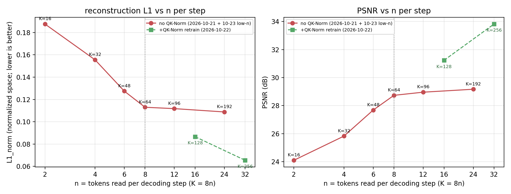

# REPORT — 固定 8 步 × 每步均匀 n 个 z_s 的**低 n 延伸**（n=2/4/6，K=16/32/48）

> **日期**：2026-10-23
> **机器**：AutoDL 2×A800-80GB（用户升级为 2 卡；本次只用了 2 卡并行，单臂仍单卡）
> **数据/口径**：ImageNet-100、224×224、固定 8 步、全量 5,000 张 val、单种子 seed 0、bf16 autocast
> **协议**：与 2026-10-21 的 fixed-k 臂**逐项相同**（A 相 T=1 45ep/bs128/lr2e-4 从零 →
> B 相 T=8 6ep/bs64/lr2e-4 热启动、`--step_plan fixed --block n`；无 QK-Norm，与 K=64/96/192 那批一致）
> **产物**：`doc/2026-10-23/artifacts/lown/`（9 个评测 json / 表 / 图 / 日志 / args / summary）

---

## 0. 一句话结论

1. **平台区在 n≥8（K≥64）**：n=8/12/24 的 8 步末步 **L1_norm 0.1130/0.1118/0.1088、
   PSNR 28.735/28.960/29.170 dB** —— 每步 token 数 ×3 只换来 **+0.44 dB**（与用户"64、96、192
   的 T=8 的 L1 都差不多"的观察一致）。
2. **往 n 小推，质量在 n≈6 开始掉、n<4 快速恶化**：
   | n | 2 | 4 | 6 | **8（平台起点）** |
   |---|---|---|---|---|
   | K | 16 | 32 | 48 | 64 |
   | 8 步 PSNR | **24.10**（−4.64） | **25.82**（−2.91） | **27.68**（−1.05） | 28.74 |
   | L1_norm | 0.1875（+66%） | 0.1555（+38%） | 0.1275（+13%） | 0.1130 |
   > 括号内为相对 n=8 的差。**边际收益**：n 2→4 **+1.72 dB**、4→6 **+1.86**、6→8 **+1.05**、
   > 8→12 **+0.23**、12→24 **+0.21** ⇒ **拐点在 n≈6–8**；若允许 ≈1 dB 损失，下限是
   > **n=6（K=48，3.1× 压缩）**；再往下每减 2 个 token 就掉近 2 dB。
3. **8 步在低 n 时"用不满"**：n=2（K=16）与 n=4（K=32）的最后 1–2 步 ΔL1≈0（K=16 最优步是第 7 步、
   K=32 是第 6 步）⇒ 低 n 档应减步数（或回到 `square` 的"步数=√K"口径），固定 8 步是过剩的；
   n=6/8 时第 8 步仍有正收益。
4. **均匀分配在低 n 同样优于递增分配**：与 2026-10-19 同 K 的 cumulative 臂（旧机器）相比，
   同 K 的 fixed 均匀臂 **+1.28 dB（K=16）/ +0.78（K=32）/ +0.82（K=48）**；K=16 的优势最大
   —— 递增计划在 K=16 时每步窗口只有 `1,1,1,2,2,3,3,3` 个 token，首步只读 1 个，起点就输。
5. **可复现性交叉验证**：本次三个 A 相（T=1）与 2026-10-19 旧机器同 K 的 A 相
   **逐位吻合**（29.608 / 28.728 / 26.606 dB）⇒ 训练协议与评测口径稳定。



---

## 1. 动机（用户口径，2026-10-23）

> 「我看了一下结果，64、96、192 的 T=8 的 L1 都差不多，所以我想看看极限在哪里，所以
> 关机前增加两个实验：固定 n=6 的实验，固定 n=4 的实验，固定 n=2 的实验，一样是 8 步。」

即：固定 8 步、每步均匀读 n 个 z_s，**把 n 从 8 往小推**（K=8n），找"每步至少读多少 token"
的下限。共 3 个新臂：n=6（K=48）、n=4（K=32）、n=2（K=16）。

## 2. 方法

| 臂 | 总预算 K | 每步 n | 读窗口（z_s 数/步） | 压缩比 N/K |
|---|---|---|---|---|
| n=2 | 16 | 2 | 2,2,2,2,2,2,2,2 | 12.25× |
| n=4 | 32 | 4 | 4×8 | 6.13× |
| n=6 | 48 | 6 | 6×8 | 4.08× |
| （参照）n=8/12/24 | 64/96/192 | 8/12/24 | 各 K/8 | 3.06×/2.04×/1.02× |

- 每臂 A+B 两相，超参与 2026-10-21 完全一致（A 45 ep 从零、B 6 ep 热启动、lr 2e-4、seed 0、
  bf16、`--step_plan fixed --block n`；首步窗口另含 `z_cls`）。
- 评测：`eval_linattn.py`（末步 PSNR/L1/SSIM）+ `eval_stepwise_linattn.py`（逐步 1–8、Δ_t）。
- 效率：2×A800 并行两条链（GPU0 = K=48；GPU1 = K=32 → K=16），墙钟 ≈ **5.8 h** 训练 + 0.2 h 评测。

## 3. 结果

### 3.1 主表（5,000 张 ImageNet-100 val，8 步末步）

| K (=8n) | n/step | 压缩比 N/K | T=1（A 相） | **T=8 PSNR** | **T=8 L1_norm** | T=8 SSIM | 相对 n=8 |
|---|---|---|---|---|---|---|---|
| **16** | 2 | 12.25× | 26.606 | **24.098** | **0.1875** | 0.6624 | **−4.64 dB** |
| **32** | 4 | 6.13× | 28.728 | **25.823** | **0.1555** | 0.7439 | **−2.91 dB** |
| **48** | 6 | 4.08× | 29.608 | **27.682** | **0.1275** | 0.8181 | **−1.05 dB** |
| 64 | 8 | 3.06× | 31.354 | 28.735 | 0.1130 | 0.8545 | 0（平台起点） |
| 96 | 12 | 2.04× | 32.307 | 28.960 | 0.1118 | 0.8583 | +0.23 |
| 192 | 24 | 1.02× | 32.505 | 29.170 | 0.1088 | 0.8657 | +0.44 |

> ⚠️ T=1 列（A 相）与 T=8 不可直接比（A 相 45 ep 从零 vs B 相 6 ep 热启动）。
> 128/256 两档是 2026-10-22 的 **+QK-Norm 重训**配置（另一协议），只作参照画在图里，不进本表排名。

### 3.2 拐点：n≥8 平台、n=6 起下降、n<4 崩塌

- **边际收益（每加 2 个 token/步）**：n 2→4 **+1.72 dB**；4→6 **+1.86**；6→8 **+1.05**；
  8→12 **+0.23**；12→24 **+0.21**。
- **L1_norm 相对增幅**：n=6 +13%、n=4 +38%、n=2 +66%（相对 n=8 的 0.1130）。
- 实用判读：
  - **要"不掉质量"**（≤0.3 dB）：**n≥8（K≥64）**；
  - **可接受 ~1 dB**：**n=6（K=48）**——这是本协议下"高压缩档"的实用下限；
  - **n=4/n=2**：进入陡降区（−2.9 / −4.6 dB），只有在对 token 预算极度敏感时才值得考虑，
    且必须同时减少解码步数（见 §3.3）。
- 与 2026-10-21 的 K-sweep 对照：本表的"平台"正是 10-21 里 K=64/96/192 那三个点；
  10-21 没往下扫，所以当时看不到这个拐点。

### 3.3 逐步：低 n 时 8 步是过剩的

| K (n) | step1 | 2 | 3 | 4 | 5 | 6 | 7 | 8 | 最优步 | Δ₁ 占比 |
|---|---|---|---|---|---|---|---|---|---|---|
| 16 (2) | 14.93 | 12.92 | 12.23 | 11.44 | 11.12 | 10.81 | **10.80** | 10.81 | **7** | 48.7% |
| 32 (4) | 14.10 | 11.66 | 10.30 | 9.58 | 9.15 | **8.95** | 8.95 | 8.96 | **6** | 47.5% |
| 48 (6) | 13.73 | 11.08 | 9.58 | 8.88 | 8.34 | 7.81 | 7.43 | **7.35** | **8** | 41.4% |
| 64 (8) | 13.35 | 10.51 | 9.14 | 8.13 | 7.43 | 6.96 | 6.60 | **6.51** | **8** | 41.4% |

（L1_255，0–255 像素口径；"最优步"= 平均 L1 最低的步。）

- **n=2 / n=4：第 6–7 步后 ΔL1≈0**，末步甚至轻微反弹 ⇒ 8 步中最后 1–2 步纯属浪费；
- **n=6 / n=8：第 8 步仍有小幅正收益**（Δ 0.09 / 0.08），8 步基本用满；
- 与 10-21 的结论一致：**固定 8 步时"每步预算"不能太小**，否则应把步数一起减下来。

### 3.4 与递增（cumulative）对照：低 n 时均匀分配的优势更明显

同 K 的 2026-10-19 cumulative 臂（旧机器 2×A800，同协议；读窗口前少后多）vs 本次 fixed 均匀臂：

| K | fixed 均匀（本次） | cumulative（10-19） | Δ PSNR | Δ L1_norm |
|---|---|---|---|---|
| 16 | **24.098**（L1 0.1875） | 22.815（L1 0.2159） | **+1.283** | −0.0284 |
| 32 | **25.823**（0.1555） | 25.045（0.1689） | **+0.778** | −0.0134 |
| 48 | **27.682**（0.1275） | 26.861（0.1394） | **+0.821** | −0.0119 |

> K=16 的窗口对比最直观：cumulative 是 `1,1,1,2,2,3,3,3`（首步只读 1 个 z_s），
> 均匀是 `2,2,2,2,2,2,2,2`（首步 2 个）⇒ 起点就领先，全程领先。与 10-21 在 K=64/96 的
> +1.26/+1.12 dB 合起来看：**"每步均匀"相对"递增"的优势在 0.8–1.3 dB 之间，低 K 端更大**。

### 3.5 可复现性

本次三个 A 相（T=1，与读窗口计划无关）与 2026-10-19 旧机器同 K 的 A 相**逐位吻合**：

| K | 本次 A 相（新机、2 卡） | 2026-10-19 A 相（旧机） |
|---|---|---|
| 48 | 29.608 | 29.608 |
| 32 | 28.728 | 28.728 |
| 16 | 26.606 | 26.606 |

⇒ A 相训练+评测链路在换机器后完全复现（同 code/seed/数据），本批 B 相数字可信。

---

## 4. 解释与结论

1. **"极限"在哪**：固定 8 步、每步均匀 n 个 z_s 时，**平台从 n=8 开始**（K=64，3.06× 压缩，
   L1_norm≈0.113）；再往上加 token 几乎没用（×3 只 +0.44 dB）。往下则是**陡坡**：
   n=6 掉 1.05 dB、n=4 掉 2.91、n=2 掉 4.64。⇒ 实际的"压缩-质量"拐点就是 **K≈48–64**；
   想要更高压缩率就要接受明显质量损失，并且应该**同步减少解码步数**（低 n 下 8 步用不满）。
2. **与均匀 vs 递增结论的衔接**：低 n 端均匀分配的优势（+0.8~+1.3 dB）比高 K 端更大，
   原因是递增计划在低 K 时把前几步压到只剩 1–3 个 token。⇒ 若要做"高压缩"档，
   **均匀分配 + 减步数**是更合理的组合。
3. **给 Phase 2 的实用建议**（本项目最终验收是文本生成，非像素）：若上下文预算紧，
   K=48（n=6、8 步）是"像素信息保持"可接受的下限档；K=32/16 建议先做任务保真评估再决定。

---

## 5. 边界

1. **单种子 seed 0**；0.1–0.2 dB / 0.003 L1 量级的差不宜过度解读。
2. 本批 3 臂是**无 QK-Norm** 配置（与 K=64/96/192 可比）。2026-10-22 已证明 K≥128 在该配置下
   会进差盆地；本次 K≤48 序列更短、A 相全部正常（与 10-19 逐位吻合），但未做 QK-Norm 复测。
3. n 与 K 在本实验里绑定（K=8n）⇒ **无法区分"每步 n 太小"与"总预算太小"**；要分离需要固定 K、
   改步数 T（未做）。
4. K=16（压缩 12.25×）已接近"每步只读 2 个 token"的极端；此时 8 步的最优步只有第 7 步，
   说明"固定 8 步"这一前提本身在该档不再合理。
5. 像素指标 ≠ 任务保真（见 `GOAL` §2）；本报告不涉及 Phase 2 / rFID。
6. 10-19 的 cumulative 对照来自**旧机器**（torch 版本未记录），跨机噪声约 0.3–0.4 dB
   （见 10-21 报告 §5）；K=16/32/48 的 +0.78~+1.28 dB 差值大于该噪声，方向可信但绝对值有 ±0.3 误差。

---

## 6. 产物与复现

| 文件 | 内容 |
|---|---|
| `artifacts/lown/eval/linattn_k{16,32,48}_t{1,8}.json`（6 个） | 末步 PSNR/L1/SSIM（T=1 与 T=8） |
| `artifacts/lown/eval/stepwise_k{16,32,48}_t8.json`（3 个） | 逐步 1–8 的 L1_255/PSNR/Δ_t |
| `artifacts/lown/lown_table.md` / `lown_summary.json` | n–质量主表（含 n=8/12/24 参照与 10-22 重训参照） |
| `artifacts/lown/lown_n_vs_quality.png/.pdf` | 图：L1_norm 与 PSNR vs n（log2 x） |
| `artifacts/lown/logs/` | 3 臂 A/B 训练日志 |
| `artifacts/lown/args/` | 3 份 `args.json`（`step_plan=fixed`, `block=2/4/6`, lr, seed） |
| `artifacts/lown/train_summary.csv` | 每相 lr / val / 墙钟 / train L1 / skip |

复现命令（服务器仓库根目录）：

```bash
nohup setsid bash tools/launch_lown.sh > $OUT/launch.out 2>&1 &   # 2 卡并行; 单卡则顺序
nohup setsid bash tools/eval_lown.sh   > $OUT/eval_launch.out 2>&1 &
# 本地: PORT=17768 bash tools/fetch_lown_artifacts.sh
#       python tools/plot_lown_compare.py \
#         --base_eval doc/2026-10-21/artifacts/fixedk/eval \
#         --lown_eval doc/2026-10-23/artifacts/lown/eval \
#         --retrain_eval doc/2026-10-22/artifacts/k128k256_fix/eval \
#         --out_dir doc/2026-10-23/artifacts/lown
```

墙钟（2×A800）：GPU0 = K=48（A 118.0 + B 62.2 min）；GPU1 = K=32（A 114.5 + B 61.8）→ K=16
（A 110.0 + B 61.1）⇒ **训练墙钟 ≈ 5.8 h**；评测（9 次）≈ 0.2 h。
