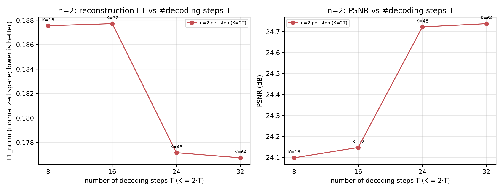
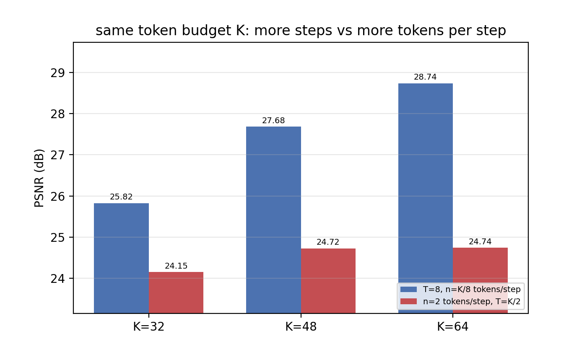
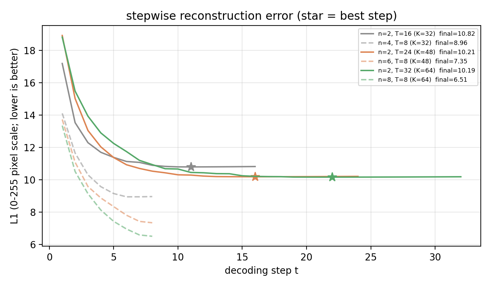
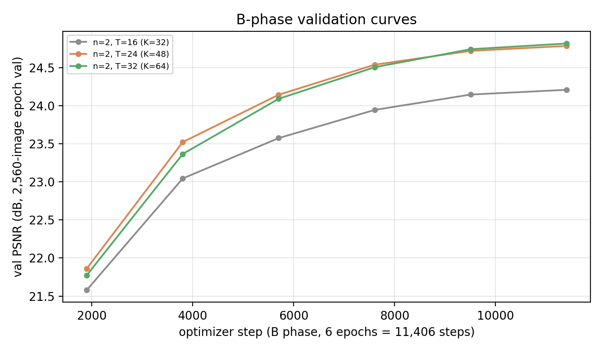
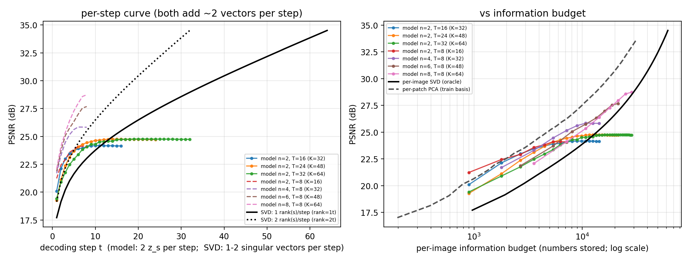

# REPORT — 固定每步 n=2 × 解码步数 T=16/24/32（K=32/48/64）+ 与 SVD/PCA 还原基线对比

> **日期**：2026-10-23
> **机器**：AutoDL 2×A800-80GB（`connect.nma1.seetacloud.com:23556`；实验完成即关机）
> **数据/口径**：ImageNet-100、224×224、N=196 patch、全量 5,000 张 val、单种子 seed 0、bf16 autocast
> **协议**：A 相（T=1）**不重跑**（复用 2026-10-19 `srdiff_k8sweep` 的 ckpt，已验证逐位一致）→
> B 相 T 步 / `--step_plan fixed --block 2` / 6 ep / 等效 bs64 / lr 2e-4 / 从 A 相 `ckpt_best` 热启动；
> 无 QK-Norm（与 10-21 K=64/96/192、10-23 低 n 那两批同配置；10-22 的 QK-Norm 修好版是另一配置，不混入）
> **用户口径**：①「n/step=2，step=16；n/step=2，step=24；n/step=2，step=32」；
> ②「这次实验完就和奇异值对比一下，毕竟都是每次使用 2 个向量进行还原」
> **产物**：`doc/2026-10-23/artifacts/n2bigstep/`（9 个评测 json + 2 个基线 json + 6 张图 + 表 + 日志 + args + train_summary）

---

## 0. 一句话结论

1. **n=2 时加解码步数几乎无用**：T=8→16→24→32（K=16→64，总预算 ×4）末步 PSNR
   **24.098 → 24.148 → 24.722 → 24.738 dB**，L1_norm **0.1875 → 0.1877 → 0.1772 → 0.1767**；
   相邻边际只有 **+0.05 / +0.58 / +0.02 dB**。逐步曲线显示**读满 32–44 个 z_s（第 16–22 步）后就饱和**，
   之后 10–16 步的额外 token 完全没用（甚至 L1 微升 0.02）。
2. **同 K 下，预算花在「每步宽度」远优于「步数」**：把 K=32/48/64 的预算从「T=8 × n=K/8」改成
   「T=K/2 × n=2」，末步 PSNR **低 1.68 / 2.96 / 4.00 dB** —— 差距随预算单调放大。
   即 8 步不是瓶颈；**每步只读 2 个 z_s 的循环解码器本身是瓶颈**。
3. **与奇异值（SVD）对比（同为「每步 ~2 个向量还原」）**：低步数时模型更好
   （t=8：模型 24.06 vs SVD rank-7 22.62 dB），但 **SVD 在大步数反超**：
   t=32 时同预算（28,672 vs 28,950 个数）**SVD rank-30 = 28.57 dB vs 模型 24.74 dB（+3.83 dB）**。
   而 T=8 宽窗口臂在同预算下仍略胜 SVD（**+0.17 ~ +0.76 dB**）⇒ n=2 档的短板是
   「窄窗口的循环信息累积能力」，**不是信息预算不够**（同预算的线性码就能到 28.6 dB）。
4. **A 相复用可信**：三臂 T=1 评测 **28.7283 / 29.6077 / 31.0271 dB** 与 2026-10-19 同机同 K 的
   `eval_val.json`（28.7283 / 29.6077 / 31.0271）**逐位一致** ⇒ 「不重跑 A 相」没有引入误差。



---

## 1. 动机与定位

用户此前两轮已经把「每步读多少 token」这一维扫完：

| 轮次 | 固定什么 | 扫什么 | 关键结果 |
|---|---|---|---|
| 2026-10-21 fixed-k | T=8 步 | n=8/12/16/24/32（K=64…256） | K=64/96/192 → 28.74/28.96/29.17 dB（近似饱和） |
| 2026-10-23 lown | T=8 步 | n=2/4/6（K=16/32/48） | 24.10/25.82/27.68 dB（n≈6–8 是拐点） |
| **本轮（10-23）** | **n=2 个 token/步** | **T=16/24/32 步（K=32/48/64）** | 见下 |

本轮把**步数**这一维拉开：同一个 n=2 下 T 从 8 加到 32（总预算 K=2T 从 16 涨到 64），
一方面回答「n=2 到底能靠多迭代几步补回来吗」，另一方面与「**同 K**、T=8、每步 n=K/8」
形成一对**受控对照**（同 A 相、同 B 相协议，唯一差别 = 预算怎么分配到「步数×每步宽度」）。

再加用户第 ② 条要求：拿「每步用 2 个向量还原」的**奇异值分解**做基线 —— 模型是
「每步读 2 个学到的 z_s」，SVD 是「每步加 ~1 个秩-1 分量（左右奇异向量各 1 个 = 2 个向量）」。

---

## 2. 设计与协议

### 2.1 读窗口：`--step_plan fixed --block 2`

第 i 步读 z_s 的第 `[(i−1)·2+1, i·2]` 个（首步另含 `z_cls`），T 步恰好把 K=2T 个 z_s **各读一次**：

| T | K=2T | 步窗（前 4 步 … 末步） | 每图 token 数 |
|---|---|---|---|
| 16 | 32 | `(0,2) (3,4) (5,6) (7,8) … (31,32)` | 32 |
| 24 | 48 | `(0,2) (3,4) (5,6) (7,8) … (47,48)` | 48 |
| 32 | 64 | `(0,2) (3,4) (5,6) (7,8) … (63,64)` | 64 |

> 与 `cumulative`（10-19，每步读**前面全部**）和 `square`（`K=T²`）不同：fixed 的每步窗口
> **只有自己那 2 个**，跨步的信息靠解码器的 carry（`Y = query_base + Y`，BPTT 不 detach）累积。

### 2.2 A 相复用（省 ~6 h GPU）

A 相是 **T=1 单步读完所有 K 个 z_s**，与 B 相的读窗口计划**无关** ⇒ 直接复用 10-19
`srdiff_k8sweep/stdattn_k{32,48,64}_t1/ckpt_best.pt` 热启动，只跑 B 相。
**验证**：三臂 T=1 评测 = **28.7283 / 29.6077 / 31.0271 dB**，与服务器上 10-19 的
`eval_val.json`（28.728331 / 29.607710 / 31.027115）**逐位一致**（见 §3 表）。

> ⚠️ 但注意 K=64 的 A 相在 **10-21 那台机器**上同协议跑到 **31.354 dB**（+0.33 dB）——即同协议
> A 相存在 ~0.3 dB 的跨机/版本噪声。本轮 K=64 的同 K 对照（T=8 n=8 = 28.735 dB）用的是那台
> 机器的 A 相，因此 K=64 的 −4.00 dB 对比里含 ~0.2–0.3 dB 的 A 相差异，**报告按保守方向标注**。

### 2.3 B 相协议与显存（梯度累积）

B 相与所有历史 fixed 臂逐项相同：**6 ep / 11,406 优化步 / lr 2e-4（cosine→1e-6，warmup 8%）/
bf16 / grad-clip 1.0 / `skip_grad=50`**。唯一执行差异：

> **T=32 在 bs64 直接反传 OOM**（实测 forward 后 `max_memory_allocated=74.4 G / 峰值 80.7 G`，
> backward 再要 1.15 G 就炸）。本机 80 G 卡放不下 ⇒ 三臂**统一**用 `--accum_steps 2`
> （micro-batch 32 × 2 累积）：**等效批量 = 64、优化步数 = 11,406、lr 曲线、每 epoch val 张数
> 全部不变**（梯度 = 两个 micro-batch 均值之和 = 64 张的均值），数学等价；统一用累积也让三臂
> 执行路径一致。实测 vram：T=16 **22.0 G** / T=24 **31.7 G** / T=32 **41.4 G**。

| 臂 | T | K | wall | 吞吐 | vram | 末步 best val(2560) |
|---|---|---|---|---|---|---|
| n=2 × T=16 | 16 | 32 | 138.3 min | ~88 img/s | 22.0 G | 24.21 dB |
| n=2 × T=24 | 24 | 48 | 201.6 min | ~60 img/s | 31.7 G | 24.79 dB |
| n=2 × T=32 | 32 | 64 | 268.4 min | ~45 img/s | 41.4 G | 24.82 dB |

墙钟：14:56 开跑 → 20:36 三臂全完（5 h 40 m；GPU0 跑 T=32，GPU1 串行 T=16→T=24）。
评测：`eval_linattn.py`（5,000 张全量末步）+ `eval_stepwise_linattn.py`（逐步）+ T=1 复评。

---

## 3. 主结果：n=2 下的步数扫描（5,000 张 val，末步）

| T | K (=2T) | 压缩比 N/K | PSNR dB | L1_norm | SSIM | 来源 |
|---|---|---|---|---|---|---|
| **8** | **16** | 12.25× | **24.098** | 0.1875 | 0.6624 | 10-23 lown（T=8 臂） |
| **16** | **32** | 6.12× | **24.148** | 0.1877 | 0.6638 | 本轮 |
| **24** | **48** | 4.08× | **24.722** | 0.1772 | 0.6877 | 本轮 |
| **32** | **64** | 3.06× | **24.738** | 0.1767 | 0.6942 | 本轮 |

**边际收益（相邻 T，同一 n=2）**

| 区间 | ΔT | ΔK | ΔPSNR dB | 每步 dB |
|---|---|---|---|---|
| T=8→16 | +8 | +16 | +0.049 | +0.0061 |
| T=16→24 | +8 | +16 | +0.575 | +0.0719 |
| T=24→32 | +8 | +16 | +0.015 | +0.0019 |
| **合计 T=8→32** | **+24** | **+48（预算 ×4）** | **+0.640** | — |

> **预算翻两番只买 0.64 dB**，而且增量几乎全来自 T=16→24（K 32→48）这一段；
> T=24→32（K 48→64）**+0.015 dB = 白给**。

**A 相（T=1）自洽核对**（也与 10-19 的 `eval_val.json` 交叉验证）

| K | A 相 PSNR dB | A 相 L1_norm | 10-19 eval_val.json | 一致？ |
|---|---|---|---|---|
| 32 | 28.728 | 0.1163 | 28.728331 | ✅ 逐位 |
| 48 | 29.608 | 0.1063 | 29.607710 | ✅ 逐位 |
| 64 | 31.027 | 0.0918 | 31.027115 | ✅ 逐位 |

> 即「A 相（单步读满 K 个 z_s）很强（28.7–31.0 dB），一进 T 步循环就掉到 24.1–24.7」——
> **B 相（循环窄窗口）相对 A 相损失 4.6–6.3 dB**，这个损失随 T 增大而增大（见 §5 的机制）。

---

## 4. 同 K 对照：步数 vs 每步宽度

| K | T=8 臂（n=K/8） | T=8 PSNR | n=2 臂（T=K/2） | n=2 PSNR | ΔPSNR（n=2 − T=8） |
|---|---|---|---|---|---|
| 32 | n=4 | **25.823** | n=2, T=16 | 24.148 | **−1.675** |
| 48 | n=6 | **27.682** | n=2, T=24 | 24.722 | **−2.959** |
| 64 | n=8 | **28.735** | n=2, T=32 | 24.738 | **−3.998** |



**读法**：预算相同时，把预算摊成「更多步、每步更窄」**系统性更差**，而且 K 越大差距越大
（−1.7 → −3.0 → −4.0 dB）。极端地说：**n=2 的臂即使把预算从 K=16 加到 K=64（4×），
也追不上 K=32 的 T=8 n=4 臂（24.74 vs 25.82）**。

---

## 5. 逐步分析：饱和点在哪



| 臂 | 读满的 z_s 数 | 第 8 步 L1_255 | 末步 L1_255 | 最低 L1_255（步） | 末步 PSNR |
|---|---|---|---|---|---|
| n=2 × T=8（K=16） | 16 | 10.81 | 10.81 | 10.80（第 7 步） | 24.098 |
| n=2 × T=16（K=32） | 32 | 10.90 | 10.82 | 10.79（第 11 步） | 24.148 |
| n=2 × T=24（K=48） | 48 | 10.53 | 10.21 | 10.19（第 16 步） | 24.722 |
| n=2 × T=32（K=64） | 64 | 10.94 | 10.19 | 10.16（第 22 步） | 24.738 |

- **前 8 步拿走了 91% 的降幅**（T=32：18.81 → 10.94 共 7.87 px，之后 24 步只再降 0.75 px）。
- **饱和点 ≈ 读满 32–44 个 z_s（第 16–22 步）**：T=24 从第 16 步起 L1 就锁在 10.19；
  T=32 从第 22 步（44 个 z_s）起锁在 10.16，之后**微升到 10.19**（多读的 20 个 z_s 是负收益）。
- 三个 n=2 臂的**平台几乎重合在 L1_255 ≈ 10.2**（PSNR ≈ 24.7 dB）——说明 n=2 这个宽度下
  解码器的信息累积上限就在 ~10.2 px，和总预算基本无关；而 T=8 宽窗口臂的平台是
  **L1_255 6.51（n=8）/ 7.35（n=6）/ 8.96（n=4）**。



B 相 val 都在第 6 epoch 收敛（T=32：21.78 → 23.37 → 24.09 → 24.51 → 24.74 → 24.82 dB，
末两 epoch 只 +0.08）⇒ **不是「还没训完」**。⚠️ 但只有单种子 + 6 ep 预算，见 §7 局限。

---

## 6. 与奇异值（SVD）/ PCA 还原基线对比

### 6.1 两个口径的「每步 2 个向量」

| 口径 | 每步 2 个向量 = | 每图信息量（个数） | 与模型（896t/图）的预算比 |
|---|---|---|---|
| 模型 | 2 个 z_s × 448 维 | **896·t** | 1.00 |
| SVD-A（预算对齐） | 1 个秩-1 分量 = u(196)+v(768)+σ(1) | **965·t** | **1.08×** |
| SVD-B（字面「2 个奇异向量/步」） | 2 个秩-1 分量 | **1930·t** | **2.15×** |
| 附：per-patch PCA | 每块 r 个主成分，196·r | 196·r（+768×160 共享基） | 0.44×（r=2t） |

> 全图原始信息量 = 196×768 = **150,528 个数**；模型 K=64 码 = 64×448 = **28,672 个数**
> （5.25× 压缩）。SVD 的 rank r 码 = r×965（左右奇异向量 + 奇异值都要传）。
> **SVD 是 per-image 最优（oracle）线性码**：基由这张图自己算，不需要训练，但每张图都要传基。

### 6.2 逐步对照（模型 K=64/T=32 臂 vs SVD）

| 解码步 t | 模型（896t 个数） | SVD 预算对齐（≈0.93t，1.08×） | SVD 2 分量/步（2t，2.15×） |
|---|---|---|---|
| 1 | L1 18.81 / 19.41 dB | 24.78 / **17.71**（rank 1） | 20.41 / 19.15 |
| 2 | 15.48 / 20.90 | 20.41 / 19.15（rank 2） | 16.38 / 21.01 |
| 4 | 12.90 / 22.48 | 16.38 / 21.01（rank 4） | 13.11 / **23.03** |
| 8 | 10.94 / 24.06 | 13.69 / 22.62（rank 7） | 10.26 / **25.50** |
| 16 | 10.21 / **24.73** | 10.52 / 25.24（rank 15） | 7.42 / 28.96 |
| 24 | 10.17 / 24.76 | 8.97 / **26.92**（rank 22） | 5.66 / 31.83 |
| 32 | 10.19 / 24.74 | 7.69 / **28.57**（rank 30） | 4.37 / 34.51 |



- **t ≤ 13：模型占优**（每步 2 个学到的向量比 per-image 最优线性码更高效；t=8 时 **+1.44 dB**，
  t=7 时 +1.67 dB，t=12 仍 +0.44 dB）；t≈14 起交叉（t=13 +0.17 / t=14 −0.12）。
- **t ≥ 14：SVD 反超并拉开**（t=16 +0.51 / t=20 +1.47 / t=24 +2.16 / t=32 **+3.83 dB**，
  都是 1.08× 预算对齐口径）—— 因为模型在 ~20 步后就锁死在 24.7 dB，而 SVD 随 rank 线性涨。
- 换成对 SVD 更宽松的「每步 2 个秩-1 分量」（2.15× 预算）口径：t=1 模型 +0.26 dB 外，
  **t ≥ 2 起 SVD 一直领先**，t=32 时 34.51 dB（+9.8 dB）。

### 6.3 同预算下的码族对比（每图 ≈28,700 个数，5.25× 压缩）

| 码 | 每图信息量 | PSNR | L1_255 | 备注 |
|---|---|---|---|---|
| per-patch PCA rank 143 | 28,028（+共享基） | **32.84** | 4.46 | 每块 143/768 个系数，基在训练集上学 |
| 模型 **K=64 / T=1（A 相）** | 28,672 | **31.03** | ~5.5 | 单步读满 64 个 z_s；训练 45 ep |
| 模型 **K=64 / T=8 / n=8** | 28,672 | **28.735** | 6.51 | 8 步 × 8 token（10-21 臂） |
| per-image SVD rank 30 | 28,950 | **28.57** | 7.69 | per-image 最优线性码（oracle） |
| 模型 **K=64 / T=32 / n=2** | 28,672 | **24.738** | 10.19 | 本轮；32 步 × 2 token |

其它预算点（模型各臂 vs 同预算 SVD/PCA）：

| K（模型臂） | 模型每图个数 | 模型 PSNR | SVD（同预算 rank, PSNR） | per-patch PCA（同预算 rank, PSNR） |
|---|---|---|---|---|
| 16（n=2, T=8） | 7,168 | 24.098 | rank 7（6,755）22.62 | rank 37（7,252）26.29 |
| 32（n=4, T=8） | 14,336 | **25.823** | rank 15（14,475）25.24 | rank 73（14,308）**29.07** |
| 32（n=2, T=16） | 14,336 | 24.148 | rank 15 25.24 | rank 73 29.07 |
| 48（n=6, T=8） | 21,504 | **27.682** | rank 22（21,230）26.92 | rank 110（21,560）**31.18** |
| 48（n=2, T=24） | 21,504 | 24.722 | rank 22 26.92 | rank 110 31.18 |
| 64（n=8, T=8） | 28,672 | **28.735** | rank 30（28,950）28.57 | rank 143（28,028）**32.84** |
| 64（n=2, T=32） | 28,672 | 24.738 | rank 30 28.57 | rank 143 32.84 |

### 6.4 结论与解读

1. **「每步 2 个向量」这个更窄的码族，模型在高步数档输给了不需要训练的 SVD**：t=32 差 3.83 dB（同预算）。
   模型能赢 SVD 的只有「一步读满」的 A 相（+2.5 dB）和「8 步 × 宽窗口」B 相（+0.2~0.8 dB）。
   ⇒ **限制不在信息预算，在「每步只注入 2 个 z_s 的循环累积效率」**：同预算的线性码能到 28.6 dB，
   模型只到 24.7 dB。
2. **per-patch PCA 是最强基线（32.84 dB，比最好的模型臂还高 4.1 dB）**：它是「每块自己 143 个系数 +
   训练集共享基」的**逐块线性码**，码字结构与模型的「全局 token」完全不同。这条不是否定模型的
   全局 token 设计（Phase 2 要的是语义 token），而是说明：**在像素重建这个代理指标上，全局 token
   瓶颈是主要损失源**（与项目 GOAL §2「信息保持是必要条件」一致，也解释了 Phase 2 之前为何要
   更宽的每步窗口）。
3. 与 10-21 的结论衔接：10-21 说「T=8 时 K≈64 接近饱和」，本轮补充 —— **饱和的前提是 T=8 宽窗口**；
   把同一 K 摊成窄窗口（n=2, T=32），质量掉回 24.7 dB，远未饱和。

---

## 7. 局限与待办

- **单种子**；无多 seed 方差估计。
- **B 相预算沿革固定为 6 ep / 11,406 步**：T 越大，每图的计算量越大但**参数更新次数相同**。
  val 曲线已在第 6 epoch 收敛（末两 epoch +0.08 dB），所以不是「还没训完」，但不能排除
  「换个更长 cosine / 更小 T 的 warm start（如从 T=8 ckpt 热启动再放宽窗口）」能把 n=2 档救回来。
- **A 相复用**：K=64 的 A 相与 10-21 那台机器的同协议 A 相有 0.33 dB 差（跨机/版本噪声）⇒
  K=64 的同 K 对照有 ~0.2–0.3 dB 不确定性；K=32/48 无此问题（逐位一致）。
- **SVD/PCA 基线的口径**：per-image SVD 是 **oracle**（基由该图自己算，需要连同左右奇异向量一起传），
  per-patch PCA 的共享基（768×160 = 122,880 个数）没有计入每图预算（5000 张摊薄后 ≈25 个数/图；
  严格单图码率意义下应计入）。两者都是**线性码**，不用训练、没有语义；模型是 63M 共享参数的非线性码，
  因此**这不构成「模型无用」的结论**，只是在「像素重建 / 每图预算」这一口径下的位置。
- **像素指标 ≠ 任务保真**：项目唯一验收是 Phase 2 文字生成（rFID 也只在 10-21 的 K=64 三臂上测过）。
  本轮未测 rFID/任务保真；「n=2 重建更差」不必然等于「n=2 token 对 Phase 2 更差」。

---

## 8. 复现

```bash
# 0) 服务器仓库根目录（代码 = 本地 HEAD + 本轮 accum_steps 补丁）
#    数据: /root/autodl-tmp/datasets/imagenet100; A 相 ckpt: /root/autodl-tmp/srdiff_k8sweep
# 1) 冒烟（验证 T=16/24/32 前向/反传 + A 相热启动 + 显存）
ARMS="32:16 48:24 64:32" GPU=0 BS=64 ACCUM=2 MAX_STEPS=20 bash tools/smoke_bigstep.sh
# 2) 训练（GPU0: T=32; GPU1: T=16 → T=24; A 相复用 ⇒ SKIP_STAGE1=1 由脚本软链）
nohup setsid bash -c 'bash tools/launch_n2bigstep.sh; bash tools/eval_n2bigstep.sh' \
  > /root/autodl-tmp/srdiff_n2bigstep/launch.out 2>&1 &
# 3) 训练汇总
PYTHONPATH=$PWD /root/miniconda3/bin/python tools/summarize_n2bigstep.py \
  --out_root /root/autodl-tmp/srdiff_n2bigstep --csv /root/autodl-tmp/srdiff_n2bigstep/train_summary.csv
# 4) SVD / PCA 基线（纯 CPU，~2 min 每口径）
PYTHONPATH=$PWD nice -n 10 /root/miniconda3/bin/python tools/baseline_svd_stepwise.py \
  --out /root/autodl-tmp/srdiff_n2bigstep/eval/baseline_svd_per_image.json --mode per_image_svd --max_rank 64
PYTHONPATH=$PWD nice -n 10 /root/miniconda3/bin/python tools/baseline_svd_stepwise.py \
  --out /root/autodl-tmp/srdiff_n2bigstep/eval/baseline_pca_per_patch_r160.json \
  --mode per_patch_pca --max_rank 160
# 5) 本地: 拉产物 + 汇总表/图
PORT=23556 bash tools/fetch_n2bigstep_artifacts.sh
python tools/plot_n2bigstep.py --n2_eval doc/2026-10-23/artifacts/n2bigstep/eval \
  --out_dir doc/2026-10-23/artifacts/n2bigstep --train_logs doc/2026-10-23/artifacts/n2bigstep/train_logs
python tools/plot_model_vs_svd.py --n2_eval doc/2026-10-23/artifacts/n2bigstep/eval \
  --svd_json doc/2026-10-23/artifacts/n2bigstep/eval/baseline_svd_per_image.json \
  --pca_json doc/2026-10-23/artifacts/n2bigstep/eval/baseline_pca_per_patch_r160.json \
  --out_dir doc/2026-10-23/artifacts/n2bigstep
```

**新增/改动代码**

| 文件 | 说明 |
|---|---|
| `train_linattn.py` | **新增 `--accum_steps`**（默认 1 = 原行为逐位不变）：`batch_size/accum` 的 micro-batch 累积，保持等效批量/优化步数/lr 曲线/val 张数不变（T=32 显存不够用；`dec_grad_ckpt` 只对 linear 解码器有效） |
| `tools/launch_n2bigstep.sh` | 三臂 B 相分派（GPU0 T=32；GPU1 T=16→T=24；A 相软链复用；`ACCUM` 透传） |
| `tools/eval_n2bigstep.sh` | 等 `N2BIGSTEP_DONE` → 每臂末步 + 逐步 + T=1 评测 |
| `tools/smoke_bigstep.sh` | 跑前冒烟（构建/前向/反传/显存） |
| `tools/summarize_n2bigstep.py` | 训练协议/结果 → `train_summary.csv` |
| `tools/baseline_svd_stepwise.py` | **SVD（per-image，oracle）与 per-patch PCA 的逐步还原基线**（L1_255/PSNR 与模型 stepwise 同口径；全秩 196 时 L1=0.0001、PSNR=118.8 dB 自检通过） |
| `tools/plot_n2bigstep.py` / `tools/plot_model_vs_svd.py` | 表格 + 6 张图 |

---

## 9. 产物清单

```
doc/2026-10-23/artifacts/n2bigstep/
├── eval/  linattn_k{32_t16,48_t24,64_t32}.json     ← 末步全量 5,000 张
│          stepwise_k{32_t16,48_t24,64_t32}.json    ← 逐步（含 Δ_t / 最优步 / hist）
│          linattn_k{32,48,64}_t1.json              ← A 相复评（与 10-19 对拍）
│          baseline_svd_per_image.json              ← per-image SVD rank 1..64
│          baseline_pca_per_patch_r160.json         ← per-patch PCA rank 1..160
├── train_logs/k{32_t16,48_t24,64_t32}.jsonl        ← 训练日志（含每 epoch val）
├── logs/  k{32,48,64}_stage2.log, n2bigstep.log, launch.out, eval/*.log
├── args/  k{32_t16,48_t24,64_t32}_args.json        ← 协议证据（含 accum_steps=2）
├── train_summary.csv
├── n2bigstep_table.md / n2bigstep_summary.json
├── model_vs_svd_table.md
├── n2_steps_vs_quality.png / .pdf
├── n2_fixedK_compare.png / .pdf
├── n2_stepwise_l1.png / .pdf
├── n2_val_curves.png / .pdf
└── model_vs_svd_psnr.png / .pdf, model_vs_svd_stepwise.png / .pdf
```
