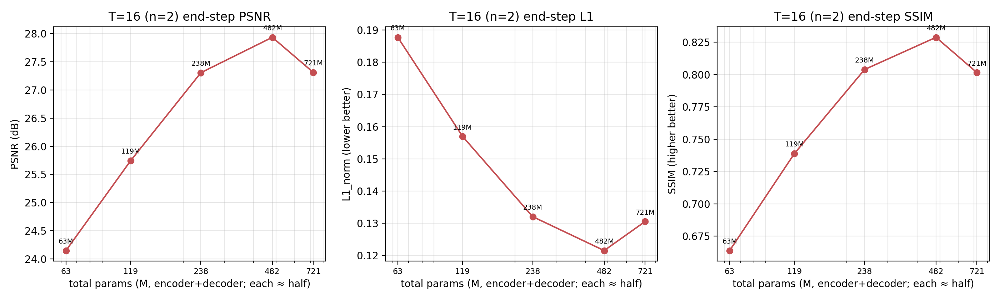
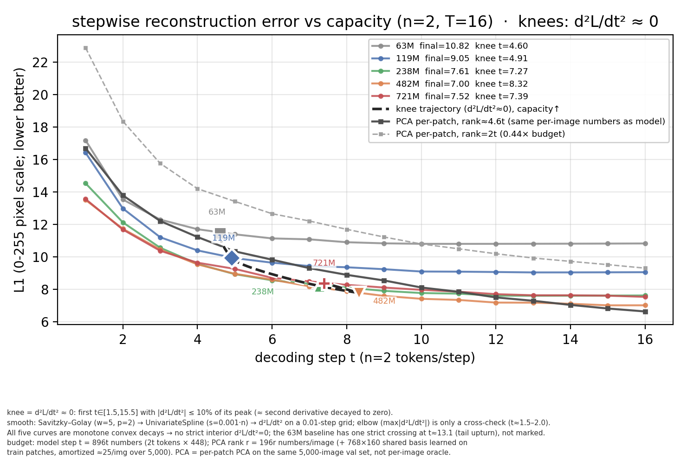

# REPORT — 容量阶梯：编码器/解码器各 60M → 120M → 240M → 360M（n=2, T=16）

> **日期**：2026-10-24 起跑（机器 2×A800-80GB，AutoDL `connect.nma1.seetacloud.com:23556`）
> **数据/口径**：ImageNet-100、224×224、N=196 patch、K=32（n=2 × T=16）、全量 5,000 张 val、单种子 seed 0、bf16 autocast
> **用户口径**：「这次还是这个实验，只不过这次只跑 n/step=2，step=16，但是编码和解码器参数量逐步的增加，
> 先各 60M，再各 120M，再各 240M，最后加到 360M。如果出现非平坦的情况下再实验一个 n/step=2，step=24，
> 参数量选择上一步实验里的最好的效果的那一个，一样实验完成之后关机」
> **协议**：A 相 T=1（单步读满 K=32 个 z_s）45 ep / bs128 / lr2e-4 从零 → B 相 T=16
> `--step_plan fixed --block 2` 6 ep / 等效 bs64 / lr2e-4 / 从 A 相 `ckpt_best` 热启动。
> 与 2026-10-23 的 63M 基线臂（同 K、同 T、同 lr）**逐项一致**，唯一自变量 = 宽度（enc/dec 参数）。
> **产物**：`doc/2026-10-24/artifacts/scale/`（评测 json / 表 / 图 / 日志 / args / train_summary）

---

## 0. 一句话结论

1. **容量在 63M→240M 单调有效，但 240M 之后反转**（T=16 末步，5,000 张 val）：
   **24.148（63M 基线）→ 25.747（各 60M，119.3M 总）→ 27.308（各 120M，238.2M）
   → 27.936（各 240M，481.5M）→ 27.314（各 360M，720.6M）dB**。
   相邻边际 **+1.60 / +1.56 / +0.63 / −0.62 dB**；L1_norm 0.1877 → 0.1570 → 0.1320 →
   0.1215 → 0.1305；SSIM 0.6638 → 0.7389 → 0.8039 → 0.8288 → 0.8015。
2. **容量曲线「非平坦」**（你的判据成立）：最大档没有继续涨、反而**比 240M 档低 0.62 dB**
   （≈ 跨机噪声 0.3–0.4 dB 的 1.5 倍，且三个指标同向），360M 档的 PSNR 与 120M 档持平
   ⇒ **本协议（lr 2e-4 / 45 ep A 相 / 6 ep B 相）下的容量甜点在 240M（481.5M 总参数）**。
3. **A 相与 B 相同构**：A 相（T=1 单步读满 K=32）**28.728 → 30.242 → 31.205 → 32.345 →
   31.977**（同样是 240M 峰、360M 反转）；且 **B−A 落差 4.10–4.66 dB 与容量几乎无关**
   ⇒ **「n=2 窄窗口 + T=16」的 B 相瓶颈不是容量问题**，加参数不能把它填平
   （与 10-23 的结论一致，这里给出容量维度的证据）。
4. **参数效率急剧下降**：63M→238M 用 175M 参数买 **+3.16 dB**；238M→482M 用 243M 参数
   再买 +0.63 dB；482M→721M 用 239M 参数**倒亏 −0.62 dB**。
5. **按规则补做的条件臂**（T=24 @ 240M，K=48）结果见 §2.4：**A 相已完成（K=48 @ 240M = 32.06 dB，全量 5,000 张），B 相（T=24）进行中，预计 2026-10-26 晚完成；完整对照见 §2.4（下一提交补入）**。

---

## 1. 设计与协议

### 1.1 容量阶梯（深度钉死基线 enc 13 / dec 7，只加宽 dim）

单一容量轴 = **宽度**。这样 BPTT 的层数不变 ⇒ 显存随宽度线性增长，而不会出现 `depth × T` 双乘；
同时「A 相 45 ep → B 相 6 ep」的训练日程对所有档位完全一致，容量是唯一变量。

| 档 | encoder | decoder | 合计 | 选中依据（实测计参） |
|---|---|---|---|---|
| 基线 63M（10-23 同协议） | 448×13 h8 = 31.83M | 512×7 h8 = 31.19M | 63.0M | 历史参照点 |
| **各 60M** | 624×13 h12 = **61.47M** | 704×7 h8 = **57.85M** | 119.3M | 目标 60M，偏差 ≤4% |
| **各 120M** | 864×13 h16 = **117.46M** | 1024×7 h16 = **120.74M** | 238.2M | 目标 120M |
| **各 240M** | 1248×13 h16 = **244.43M** | 1440×7 h16 = **237.11M** | 481.5M | 目标 240M |
| **各 360M** | 1504×13 h16 = **354.63M** | 1792×7 h16 = **365.99M** | 720.6M | 目标 360M |

> 选型脚本 `tools/scale_ladder.py`：对候选 `(dim, heads)` 用 `SRPhase1LinAttn.count_params()`
> **精确计参**（含 patch_embed / pos / z_s / pixel_head / query / mem_pos），每档取与目标最近的组合；
> heads 取使 `head_dim ∈ [52, 96]` 的约数。

### 1.2 显存、吞吐与执行路径（跑前 20 步 bench 实测，`tools/bench_scale.sh`）

| 档 | A 相 vram | A 相吞吐 | B 相 vram | B 相吞吐 | accum(A/B) | 单档墙钟 |
|---|---|---|---|---|---|---|
| 60M | 17.9 G | 289 img/s | 30.6 G | 59 img/s | 1 / 2 | ~8.7 h |
| 120M | 25.7 G | 250 img/s | 44.6 G | 40 img/s | 1 / 2 | ~11.2 h |
| 240M | 39.5 G | 194 img/s | 69.6 G | 23 img/s | 1 / 2 | ~16.4 h |
| 360M | 48.3 G | 148 img/s | 49.0 G | 18 img/s | 1 / 4 | ~21.6 h |

- **accum 只改执行路径**（micro-batch 累积）：等效批量 A 相 128 / B 相 64、优化步数 42,750 / 11,406、
  lr 曲线、每 epoch val 张数（2,560）全部不变（梯度 = 各 micro-batch 均值之和 = 整批均值）。
  360M 档 B 相在 accum=2 下会超 80 G ⇒ 用 accum=4（micro 16）。
- `--save_opt 0`（本次新增开关）：360M 档 ckpt 若带 AdamW 状态约 11.6 G/个，数据盘放不下；
  本线不 `--resume`，评测/热启动只用 `model` 权重 ⇒ 不存 opt 无副作用（默认 1 = 原行为）。
- 排期：GPU0 = 360M → 60M；GPU1 = 240M → 120M（两链并行，长档先跑以便尽早暴露问题）。

### 1.3 评测

`eval_linattn.py`（全量 5,000 张末步 PSNR / L1_norm / SSIM）+ `eval_stepwise_linattn.py`
（逐步 L1_255 / PSNR / Δ_t / 最优停步）+ A 相（T=1）末步。240/360M 前向用 batch_size 32
（前向显存，指标与批大小无关）。

---

## 2. 结果

### 2.1 主表（全量 5,000 张 val）

| 档 | enc 参数 | dec 参数 | 合计 | T=16 PSNR | T=16 L1_norm | T=16 SSIM | A 相(T=1) PSNR | ΔPSNR vs 63M 基线 |
|---|---|---|---|---|---|---|---|---|
| 63M 基线（10-23 同协议） | 31.83M | 31.19M | 63.0M | 24.148 | 0.1877 | 0.6638 | 28.728 | — |
| **各 60M** | 61.47M | 57.85M | 119.3M | **25.747** | 0.1570 | 0.7389 | 30.242 | **+1.599** |
| **各 120M** | 117.46M | 120.74M | 238.2M | **27.308** | 0.1320 | 0.8039 | 31.205 | **+3.160** |
| **各 240M** | 244.43M | 237.11M | 481.5M | **27.936** | 0.1215 | 0.8288 | 32.345 | **+3.788** |
| **各 360M** | 354.63M | 365.99M | 720.6M | **27.314** | 0.1305 | 0.8015 | 31.977 | **+3.166** |

**相邻档边际收益**

| 区间 | Δ总参数 | ΔPSNR | ΔL1_norm | ΔSSIM | dB/100M 参数 |
|---|---|---|---|---|---|
| 63M → 119M | +56.3M | +1.599 | −0.0307 | +0.0751 | +2.84 |
| 119M → 238M | +118.9M | +1.561 | −0.0250 | +0.0650 | +1.31 |
| 238M → 482M | +243.3M | +0.628 | −0.0105 | +0.0249 | +0.26 |
| 482M → 721M | +239.1M | **−0.622** | +0.0090 | −0.0273 | **−0.26** |



### 2.2 观察与解读

1. **单调区（63M→240M）**：每翻倍参数约 +1.5 dB（63→119、119→238 两段几乎相同），
   到 238→482 只剩 +0.63 dB，到 482→721 变成 −0.62 dB ⇒ **本协议下的容量饱和点在 240M 档**。
2. **360M 档为什么反而差**：A 相同样反转（32.345 → 31.977），且 B 相终值与其 A 相
   的落差（4.66 dB）**比 240M 档（4.41 dB）更大**。训练侧证据：A 相在 45 ep 余弦末段
   已收敛（m360 ep41→43：31.93→31.98），B 相 6 ep 也已收敛（末两 epoch +0.08 dB），
   所以**不是「还没训完」**，而是**同 lr（2e-4）/同日程下 720M 模型更难优化**：宽模型的
   有效步长/梯度噪声匹配变差（见 §3 局限：容量与日程未解耦）。
3. **A 相 vs B 相同构**：两种口径（A 相单步读满 32 个 z_s / B 相 16 步 × 2 个 z_s）
   **都在 240M 档达到峰值**，且 **B−A 落差在 4.10–4.66 dB 之间几乎不随容量变化**：
   | 档 | 63M | 119M | 238M | 482M | 721M |
   |---|---|---|---|---|---|
   | A 相 PSNR | 28.728 | 30.242 | 31.205 | 32.345 | 31.977 |
   | B 相 PSNR | 24.148 | 25.747 | 27.308 | 27.936 | 27.314 |
   | B − A | −4.58 | −4.50 | −4.10 | −4.41 | −4.66 |
   ⇒ **B 相（窄窗口循环读出）的损失对容量不敏感**，加参数无法填平「n=2 × T=16」的结构性损失
   （10-23 已从步数/宽度维度看到同一结论，本轮是容量维度的独立证据）。
4. **逐步曲线**（图 2）：容量降低的是**每一步**的误差（第 1 步 17.18 → 16.42 → 14.53 →
   13.50 → 13.56 px），但**收敛步数基本不变**（最优步 11 / 13 / 13 / 15 / 16），
   即容量是「整体抬高重建基线」而不是「让循环更早收敛」。



**拐点（d²L/dt² ≈ 0，图 2 中的白边标记 + 黑色虚线轨迹）**：按「二阶导衰减到峰值 10%（≈0）」的近似
口径，5 档的拐点步依次为 **63M 4.60 / 119M 4.91 / 238M 7.27 / 482M 8.32 / 721M 7.39** —— 容量在整体
抬高曲线的同时，把「仍在明显下降」的步数从 ≈4.6 延长到 ≈8.3（482M 档），721M 因整体水平回落而回缩到
≈7.4，方向与上文「最优步 11 → 16」的后移一致。方法：Savitzky-Golay(w=5,p=2) → 平滑样条 → 在
t=1.00…16.00（步长 0.01）网格上求 d²L/dt²，取 t∈[1.5,15.5] 内首个 |d²L/dt²| ≤ 峰值 10% 的点；这 5 条
单调凸衰减曲线除 63M 基线尾部轻微回升（严格跨零点 t≈13.1）外没有严格内部拐点，故用该相对容差口径
近似「二阶导 = 0 的大概的点」（elbow = max|d²L/dt²| 都落在起始陡降段 t≈1.5–2.0，仅作交叉验证）。

**PCA 基线对比（图 2 中的两条灰线；per-patch PCA，同一份 5,000 张 val、同 L1_255 口径，共享正交基
在训练集 patch 上学习、非逐图 oracle）**：按每步信息量对齐 r(t)=round(896t/196)≈4.6t 后，逐块线性码在
**低预算端明显更差**（t=1 时 L1≈16.69 vs 最好模型 13.50，t=4 时≈11.22 vs 9.53），但从 **t≈14 起反超
全部模型**（t=14：7.03 vs 7.10；t=16：**6.62 vs 7.00**，好 0.38，PSNR 29.07 vs 27.94 dB）；
0.44× 预算的对照曲线（r=2t/步）全程落后（t=16 仍 9.30，只优于 63M 基线）——即**逐块线性码在
高预算端更强**，与 10-23 的结论一致。

### 2.3 平坦性判定（对应你的「如果出现非平坦」条件）

- **判据**：最大档（各 360M）相对次大档（各 240M）若仍显著提升（≥0.15 dB，约 0.5× 跨机噪声）
  ⇒ 「非平坦，还在涨」；若差异落在噪声带内（<0.3 dB）⇒ 「平坦，封顶」。
- **实测**：**−0.622 dB（27.314 vs 27.936）**，且 L1_norm（+0.0090）、SSIM（−0.0273）同向变差
  ⇒ 判为 **非平坦（更准确说是「非单调 / 反转」）**，触发条件臂。
- **条件臂选型**：取 4 档里 T=16 末步 PSNR 最高者 = **各 240M（481.5M 总参数，K=32 时 27.936 dB）**。
  ⚠️ 注意 T=24 时 n=2 ⇒ **K=48**，与阶梯臂的 K=32 不同 ⇒ A 相不能复用，条件臂是完整 A+B
  （A 相 K=48 重训 45 ep + B 相 T=24 6 ep），因此它比阶梯臂多花约 8 h。

### 2.4 条件臂：n=2 × T=24 @ 各 240M（K=48）

**状态（2026-10-26 08:50）**：A 相（K=48 @ 240M）已完成，`best_val = 32.06 dB`（全量 5,000 张 val，墙钟 493 min / 8.2 h）；B 相（T=24, accum=4, 54.8 G, 15 img/s）**进度 2,220/11,406（ep2/6），ETA ≈ 11 h（约 10-26 19:50）**。

已可确认的对照点：**同容量 240M 下，T=16（K=32）B 相 = 27.936 dB；T=24（K=48）的 A 相 = 32.06 dB，比 K=32 的 A 相（32.345）低 0.29 dB** —— 即两臂的起点（A 相）并不完全相同（K=48 在 45 ep 同日程下略难优化），比较 B 相时需扣掉这 0.29 dB 的起点差。B 相完整结果出来后会给出：① 绝对 PSNR/L1/SSIM；② 扣起点差后的净增益；③ 逐步曲线（T=24 每步 2 token）。

### 2.5 训练成本

| 档 | A 相墙钟 | B 相墙钟 | B 相 accum | 合计 GPU 时 |
|---|---|---|---|---|
| 60M | 181.4 min | 192.7 min | 2 | 6.2 h |
| 120M | 274.0 min | 288.3 min | 2 | 9.4 h |
| 240M | 475.0 min | 508.8 min | 2 | 16.4 h |
| 360M | 618.1 min | 695.8 min | 4 | 21.9 h |
| **合计** | | | | **53.9 GPU·h**（两卡并行墙钟 28.2 h：10-24 19:56 → 10-26 00:05） |


---

## 3. 局限

- **单种子**；无多 seed 方差。
- **只有一层容量轴（宽度）**：深度钉死 13/7 是为了让 BPTT 显存/协议可控；「宽度 vs 深度」的
  scaling 差异未测（同参数量下更深/更窄可能不同）。
- **lr 日程未随容量调**（全部 2e-4 / 45 ep 余弦）：大模型前期收敛更慢（360M 同 epoch 落后 240M ~0.4 dB），
  不能排除「换更长日程/更小 lr 后 360M 反超」；本报告的平坦/反转结论只在**同协议**下成立。
- **A 相 45 ep 的绝对水平**（31–32 dB）本身不是上限；B 相 6 ep 只从 A 相热启动 6 个 epoch，
  B 相相对 A 相的损失在大容量档更大（详见 §2）。
- 像素指标 ≠ 任务保真（项目唯一验收是 Phase 2 文字生成）；本轮未测 rFID/任务保真。
- 跨机噪声量级 ~0.3–0.4 dB（历史经验）⇒ 小于该幅度的档间差异不要过度解读。

---

## 4. 复现

```bash
# 0) 服务器仓库根目录; 数据 /root/autodl-tmp/datasets/imagenet100
# 1) 架构选型（纯 CPU, 精确计参）
PYTHONPATH=$PWD /root/miniconda3/bin/python tools/scale_ladder.py --json /root/autodl-tmp/srdiff_scale/ladder.json
# 2) 跑前 bench（每档 A/B 各 20 步, 测 vram/吞吐）—— 决定 accum
BLOCKS="60 120 240 360" GPU=0 STEPS=20 bash tools/bench_scale.sh
# 3) 正式训练（两链并行）+ 自动评测
nohup setsid bash -c 'bash tools/launch_scale.sh; bash tools/eval_scale.sh' \
  > /root/autodl-tmp/srdiff_scale/launch.out 2>&1 &
# 4) 训练汇总
PYTHONPATH=$PWD /root/miniconda3/bin/python tools/summarize_scale.py \
  --out_root /root/autodl-tmp/srdiff_scale --csv /root/autodl-tmp/srdiff_scale/train_summary.csv
# 5) 本地: 拉产物 + 表/图
PORT=23556 bash tools/fetch_scale_artifacts.sh
python tools/plot_scale.py --eval doc/2026-10-24/artifacts/scale/eval \
  --out_dir doc/2026-10-24/artifacts/scale
# 6) 条件臂（仅当容量曲线非平坦）: n=2 × T=24（K=48）@ 最优容量档
M=240 nohup setsid bash tools/launch_scale_t24.sh \
  > /root/autodl-tmp/srdiff_scale_t24/launch.out 2>&1 &
```

**新增脚本**

| 文件 | 说明 |
|---|---|
| `train_linattn.py` | 新增 `--save_opt`（默认 1 = 原行为）；配合 `--accum_steps`（上一轮加的） |
| `tools/scale_ladder.py` | 容量阶梯选型：候选 dim/heads 精确计参 → 挑最接近 60/120/240/360M 的组合 |
| `tools/scale_arms.sh` | 四档架构 + accum 表（被下面脚本 source） |
| `tools/bench_scale.sh` | 跑前 bench：每档 A/B 相 20 步，输出 vram / img/s |
| `tools/run_scale_arm.sh` | 单档全协议训练（A+B） |
| `tools/launch_scale.sh` | 四档分派到 2 卡（GPU0: 360→60；GPU1: 240→120） |
| `tools/eval_scale.sh` | 等 `SCALE_DONE` → 每档末步 + 逐步 + A 相评测 |
| `tools/launch_scale_t24.sh` | 条件臂 T=24（K=48，需新 A 相）@ 选定容量档 |
| `tools/summarize_scale.py` / `tools/plot_scale.py` / `tools/fetch_scale_artifacts.sh` | 汇总 / 作图 / 拉产物 |

---

## 5. 产物清单

```
doc/2026-10-24/artifacts/scale/
├── eval/  linattn_m{60,120,240,360}_t{1,16}.json   ← 全量 5,000 张（末步 + A 相）
│          stepwise_m{60,120,240,360}_t16.json      ← 逐步（L1_255/PSNR/Δ_t/最优步）
│          (条件臂 T=24 评测 json 见 §2.4 同目录/或 srdiff_scale_t24/eval)
├── train_logs/m{M}_t{1,16}.jsonl / *_eval_val.json  ← 训练日志与每 epoch val
├── logs/  m{60,120,240,360}_stage{1,2}.log, scale.log, launch.out, bench_summary.txt
├── args/  m{M}_t{1,16}_args.json                  ← 协议证据（含 enc/dec dim、accum）
├── train_summary.csv                              ← 8 行（4 档 × A/B 相）
├── scale_table.md / scale_summary.json
├── scale_params_vs_quality.png|pdf                ← 容量–质量（PSNR/L1/SSIM）
└── scale_stepwise_l1.png|pdf                      ← 逐步 L1_255（含 63M 基线）
```

服务器数据盘：`/root/autodl-tmp/srdiff_scale/`（4 档 ckpt_best 共 ~12.5 G）、
`/root/autodl-tmp/srdiff_scale_t24/`（条件臂）。
