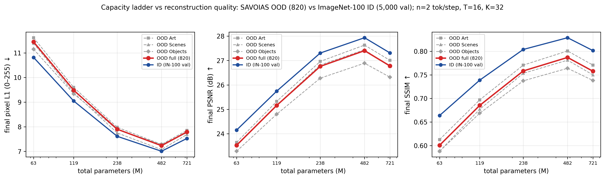
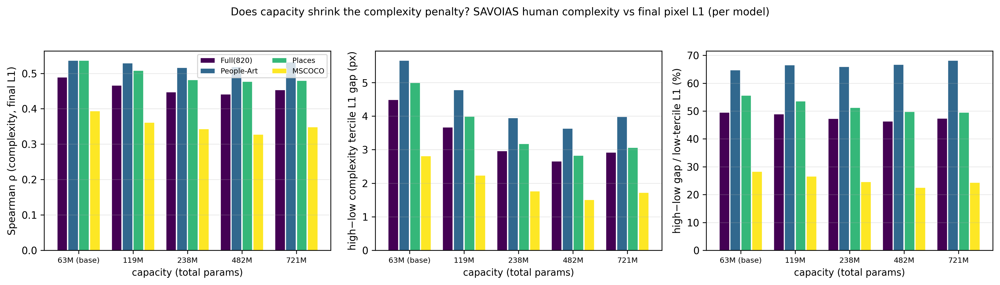
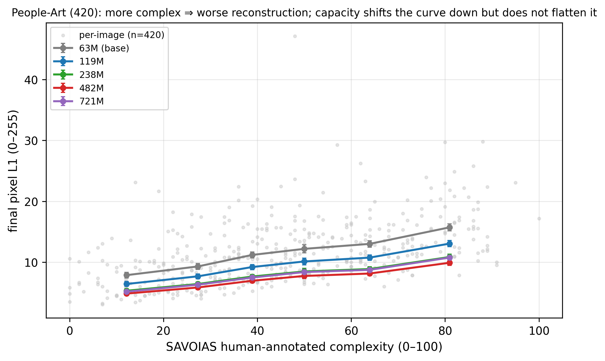
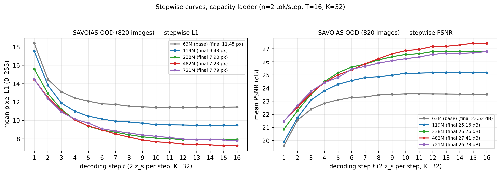

# REPORT — SAVOIAS OOD 泛化 × 容量阶梯（n=2 token/步、T=16、K=32）

> **日期**：2026-10-26（周一）
> **评测机**：`ssh -p 34314 root@connect.westb.seetacloud.com`（RTX 4080 SUPER 32G，新开机）
> **模型来源**：23556（`connect.nma1.seetacloud.com`，**全程只读**；其 GPU1 上 T=24 条件臂作业未受影响）
> **仓库**：`AssocVTC`（代码同步时的 HEAD = `a24624a`；同步后 6 个关键文件 md5 逐字节一致。评测期间 Lead 在本地继续提交，不影响远端快照，见 `artifacts/ood_savoias/setup_log.md`）
> **数据**：SAVOIAS — [arXiv:1810.01771](https://arxiv.org/abs/1810.01771)（Saraee et al., 2018），
> 仓库 <https://github.com/esaraee/Savoias-Dataset>；`tools/fetch_savoias.sh`
> **脚本**：`eval_stepwise_linattn.py`（canonical 评测）/ `tools/plot_savoias_scale.py`（本轮新增：分析 + 4 图）/
> `/root/autodl-tmp/savoias_eval/ssim_pass.py`（补充 SSIM pass，不改 canonical 脚本）
> **产物**：`doc/2026-10-26/artifacts/ood_savoias/`（json / csv / 4 图 png+pdf / setup_log.md / logs）

---

## 0. 一句话

把 2026-10-24 容量阶梯的 5 个 ckpt（63M / 119M / 238M / 482M / 721M 总参数，均固定 **n=2 token/步、T=16、K=32**）
在 **SAVOIAS 人评复杂度数据集（820 张：Art 420 + Scenes 200 + Objects 200）** 上做 OOD 重建评测：

1. **OOD 排序与 ID 完全同序，甜点仍是 482M 档**（OOD 末步 PSNR **27.406 dB / L1 7.231 px / SSIM 0.7870**），
   721M 档在 OOD 上**同样反转**（26.779 dB / 7.787 px），与 ID 结论一致；
2. **OOD 惩罚随容量单调收窄**（但 721M 略反弹）：OOD−ID 的末步 L1 差 **+0.631 → +0.436 → +0.289 → +0.227 → +0.264 px**
   （相对差 5.83% → 3.24% → 3.51%），PSNR 差 −0.62 → −0.53 dB；
   63M→482M 的容量收益在 OOD 上（−4.22 px）**略大于** ID（−3.82 px）；
3. **人评复杂度 → 重建误差的正相关在所有 5 个容量档上都成立**：ρ = **+0.33 ~ +0.54**（3 子集 × 5 档全正），
   ρ 随容量只有轻微下降（子集平均 0.489 → 0.441，721M 回 0.453）；
4. **容量收缩的是复杂度惩罚的绝对幅度，不是相对结构**：高/低复杂度三分位的 L1 差从
   mean **4.49 px（63M）压到 2.65 px（482M，−41%）**，但 Art 子集的**相对**差距稳定在 ~65–68%
   ⇒ 更多容量买的是"整体质量水平"，复杂图"永远更难"的结构没有被容量抹平；
5. **OOD 最优停步与 ID 完全一致**（11 / 13 / 13 / 15 / 16 步）——用 SAVOIAS 与 IN-100 val 两种数据得到同一组
   收敛步数，说明该现象由读出协议（n=2、T=16 的 BPTT 窗口）决定，而不是数据分布造成的。

---

## 1. 设置

### 1.1 评测对象（5 个容量档，均来自 2026-10-24 容量阶梯）

| tag | 总参数 | ckpt（34314 上路径） | 大小 | md5（源=目标） | 训练/读出配置 |
|---|---:|---|---:|---|---|
| base63 | 63.02 M | `/root/autodl-tmp/ckpts/base63/ckpt_best.pt` | 756,655,771 B | `0c4a9b93…` | 10-23 同协议基线 |
| m60 | 119.33 M | `/root/autodl-tmp/ckpts/m60/ckpt_best.pt` | 477,417,227 B | `762cf120…` | enc/dec 各 60M |
| m120 | 238.20 M | `/root/autodl-tmp/ckpts/m120/ckpt_best.pt` | 952,921,547 B | `a1ca850c…` | 各 120M |
| m240 | 481.54 M | `/root/autodl-tmp/ckpts/m240/ckpt_best.pt` | 1,926,287,179 B | `bc6f6583…` | 各 240M |
| m360 | 720.62 M | `/root/autodl-tmp/ckpts/m360/ckpt_best.pt` | 2,882,599,883 B | `422c1622…` | 各 360M |

全部 ckpt 均 `num_specials=32 / dec_steps=1..16 / dec_step_plan=fixed / img_size=224 / patch=16`（与 ID 参考同配置），
`torch.load` 校验通过、5 个 ckpt 均通过 8 张 SAVOIAS 冒烟前向（无 OOM）。传输/校验细节见
`artifacts/ood_savoias/setup_log.md`。

### 1.2 数据：SAVOIAS 三个子集（820 张）

| 子集（文件夹） | 对应源数据 | n | 用途（ALIT） |
|---|---|---:|---|
| `Art` | People-Art | **420** | 正文 Fig. 4 |
| `Scenes` | Places | **200** | 附录 Fig. 11 |
| `Objects` | MSCOCO objects | **200** | 附录 Fig. 12 |

- 人评复杂度：官方 `Ground truth/npy/global_ranking_{art,scenes,objects}.npy` =
  `{index: [filename, score 0–100]}`，按**文件名 stem（整数）**与图像 join（与 2026-10-19 分析同口径）。
- 预处理：`Resize(256, BICUBIC) + CenterCrop(224) + ImageNet Normalize`（= `data_linattn.build_ood_dataset`，
  与 IID val 逐位同口径）。
- 评测机 34314 上 `raw.githubusercontent.com` 被封（30s 超时），改用 `codeload.github.com` 整仓 tarball（≈13 MB/s）
  绕行，再按 `tools/fetch_savoias.sh` 的布局落盘并跑该脚本校验（skip-existing，exit 0）——
  详见 setup_log §3。

### 1.3 评测口径

- 命令（canonical）：
  `eval_stepwise_linattn.py --ckpt <tag> --data_dir_ood /root/autodl-tmp/savoias --num_images 0 --domain savoias --dump_per_image ... --out ...`
- **L1_255**：0–255 像素 L1、**不做 clamp**（主线 `eval_stepwise` 口径），报告里"末步"= 第 16 步；
- **PSNR**：`[0,1]` clamp 空间、**逐图 PSNR 再平均**（与主报告 `eval_linattn.py` 同口径）；
- **SSIM**：canonical 脚本不输出 SSIM；用独立补充 pass（`ssim_pass.py`，复用 `metrics_linattn.ssim`，
  `[0,1]` clamp、逐图平均）第二遍前向补齐，**未改动 canonical 脚本**；
- batch_size：base63/m60/m120 = 32，m240 = 16，m360 = 8（前向显存；指标与批大小无关，已在冒烟中确认不 OOM）；
- 820 张全量跑一次：12 s / 15 s / 20 s / ~30 s / ~60 s（4080 SUPER，bf16 autocast）。

---

## 2. OOD 重建质量（主表）

### 2.1 全量 820 张

| 档 | 总参数(M) | 末步 L1_255 ↓ | 末步 PSNR ↑ | 末步 SSIM ↑ | OOD 最优步 |
|---|---:|---:|---:|---:|---:|
| 63M（base63） | 63.0 | 11.450 | 23.525 | 0.6007 | 11 |
| 119M | 119.3 | 9.482 | 25.161 | 0.6853 | 13 |
| 238M | 238.2 | 7.899 | 26.761 | 0.7583 | 13 |
| **482M（m240）** | **481.5** | **7.231** | **27.406** | **0.7870** | 15 |
| 721M（m360） | 720.6 | 7.787 | 26.779 | 0.7578 | 16 |

相邻档边际（OOD，L1_255 / PSNR）：63→119M **−1.968 px / +1.636 dB**；119→238M
**−1.583 px / +1.600 dB**；238→482M −0.668 px / +0.645 dB；482→721M **+0.556 px / −0.627 dB**。
**与 ID 完全同构的"单调改善 → 饱和 → 反转"**：OOD 上 721M 同样比 482M 差（且幅度与 ID 的 −0.519 px 相近）。

### 2.2 三个子集分别（末步 L1_255 / PSNR / SSIM）

| 档 | People-Art（420） | Places（200） | MSCOCO（200） |
|---|---|---|---|
| 63M | 11.618 / 23.643 / 0.61283 | 11.391 / 23.521 / 0.58799 | 11.154 / 23.280 / 0.58804 |
| 119M | 9.597 / 25.328 / 0.69707 | 9.382 / 25.170 / 0.67714 | 9.338 / 24.800 / 0.66874 |
| 238M | 7.979 / 26.965 / 0.77072 | 7.747 / 26.816 / 0.75333 | 7.884 / 26.277 / 0.73734 |
| **482M** | **7.283 / 27.634 / 0.80075** | **7.072 / 27.442 / 0.78116** | **7.281 / 26.891 / 0.76396** |
| 721M | 7.852 / 27.010 / 0.77078 | 7.684 / 26.756 / 0.74999 | 7.754 / 26.318 / 0.73816 |

- 三个子集**同序**：482M 三子集全部最优，721M 三个子集全部回落；
- 子集难度：63M 时 Art 最难（L1 11.62）> Scenes（11.39）> Objects（11.15）；到 482M 三者几乎收敛到
  7.07–7.28 px（PSNR 上 Art 最高，因为 Art 的高分图噪声/纹理结构不同，见 §5 局限）。

---

## 3. ID vs OOD：泛化差距怎么随容量变？

ID 参考（同 T=16 / n=2 / K=32，ImageNet-100 val 5000 张，来自
`doc/2026-10-24/artifacts/scale/eval/stepwise_m*_t16.json` 与
`doc/2026-10-23/artifacts/n2bigstep/eval/stepwise_k32_t16.json`）：

| 档 | ID L1_255 | ID PSNR | ID SSIM | OOD L1_255 | OOD PSNR | OOD SSIM | **ΔL1 (OOD−ID)** | **ΔPSNR** | **ΔSSIM** | OOD/ID L1 |
|---|---:|---:|---:|---:|---:|---:|---:|---:|---:|---:|
| 63M | 10.819 | 24.148 | 0.6638 | 11.450 | 23.525 | 0.6007 | **+0.631** | −0.623 | −0.0631 | 1.0583 |
| 119M | 9.046 | 25.747 | 0.7389 | 9.482 | 25.161 | 0.6853 | **+0.436** | −0.586 | −0.0536 | 1.0482 |
| 238M | 7.610 | 27.308 | 0.8039 | 7.899 | 26.761 | 0.7583 | **+0.289** | −0.547 | −0.0456 | 1.0380 |
| **482M** | 7.004 | 27.936 | 0.8288 | 7.231 | 27.406 | 0.7870 | **+0.227** | −0.530 | −0.0418 | **1.0324** |
| 721M | 7.523 | 27.314 | 0.8015 | 7.787 | 26.779 | 0.7578 | **+0.264** | −0.535 | −0.0438 | 1.0351 |



**读法**：

1. **OOD 惩罚随容量单调收窄，到 482M 为最小，721M 略反弹**（ΔL1 +0.631 → +0.227 px，ΔPSNR −0.62 → −0.53 dB，
   ΔSSIM −0.063 → −0.042）；相对差 5.83% → 3.24%。**但 OOD 惩罚没有消失**：482M 仍差 0.53 dB。
2. **容量带来的收益在 OOD 上略大于 ID**：63M → 482M，ID 改善 3.815 px / +3.788 dB / +0.1650 SSIM，
   OOD 改善 4.219 px / +3.881 dB / +0.1863 SSIM（OOD/ID 收益比 1.11 / 1.02 / 1.13）
   ⇒ 这一轮"加容量"并不是只在 ID 上过拟合，OOD 的相对收益更大，所以差距收窄。
3. **721M 的反转在 ID 与 OOD 上同时出现且幅度相当**（ID +0.519 px，OOD +0.556 px）
   ⇒ 反转是"同 lr/同日程下 720M 更难优化"的训练侧问题（与 2026-10-24 容量阶梯报告 §2.2 的判断一致），
   **不是 OOD 数据特异的**。

### 3.1 与 2026-10-19 旧 SAVOIAS 分析的衔接（跨协议，谨慎读）

旧分析用的 63M 臂是 **K=64 / BPTT T=8**（63 token），OOD 末步 **6.79 px / 28.15 dB**，其 ID 为 6.60 px；
本轮同 63M 但 **K=32 / T=16**（32 token）的 OOD 是 11.45 px / 23.53 dB。差异来自**读出预算与 BPTT 日程**，
不是 OOD 数据。可比的对照是：本轮 **482M（32 token）的 OOD 质量（7.23 px）已接近旧 63M 臂 48–63 token
的水平（7.63 → 6.79 px）**，且复杂度结构（ρ≈+0.5、Art 三分位差 3.6 px）也接近旧臂 48–63 token 段
（旧臂 63 token 时 Art 三分位差 3.01 px）。**跨协议绝对数不可直接比**，但"容量可以部分替代 token 预算"
这一读法在 OOD 上成立。

---

## 4. 人评复杂度 × 重建误差（OOD）

### 4.1 Spearman ρ（人评复杂度 vs 末步 L1_255）

| 档 | People-Art（420） | Places（200） | MSCOCO（200） | 子集平均 |
|---|---:|---:|---:|---:|
| 63M | +0.536 | +0.536 | +0.393 | +0.489 |
| 119M | +0.529 | +0.508 | +0.361 | +0.466 |
| 238M | +0.516 | +0.481 | +0.343 | +0.447 |
| **482M** | +0.518 | +0.477 | +0.327 | **+0.441** |
| 721M | +0.531 | +0.479 | +0.348 | +0.453 |

**15 个（模型 × 子集）格子全部为正**（+0.327 ~ +0.536），与 2026-10-19 旧分析（K=64 臂 +0.33 ~ +0.58）
同向同量级。ρ 随容量只有轻微下降（子集平均 0.489 → 0.441），721M 回 0.453
⇒ **"越复杂越难重建"的排序结构对容量不敏感**。



### 4.2 复杂度三分位 → 末步 L1_255（高−低差距 = 复杂度惩罚）

**People-Art（420）**

| 档 | 低三分位 L1 | 中三分位 | 高三分位 | **高−低差距** | 相对差（/低三分位） |
|---|---:|---:|---:|---:|---:|
| 63M | 8.745 | 11.813 | 14.400 | **5.655 px** | 64.7% |
| 119M | 7.182 | 9.739 | 11.957 | **4.775 px** | 66.5% |
| 238M | 5.977 | 8.113 | 9.918 | **3.941 px** | 65.9% |
| **482M** | 5.443 | 7.399 | 9.072 | **3.629 px** | 66.7% |
| 721M | 5.838 | 7.976 | 9.816 | **3.978 px** | 68.2% |

**Places（200）/ MSCOCO（200）**

| 档 | Places 高−低 | Places 相对差 | MSCOCO 高−低 | MSCOCO 相对差 |
|---|---:|---:|---:|---:|
| 63M | 4.992 px | 55.6% | 2.811 px | 28.2% |
| 119M | 3.984 px | 53.5% | 2.235 px | 26.6% |
| 238M | 3.170 px | 51.2% | 1.760 px | 24.5% |
| **482M** | **2.821 px** | 49.7% | **1.504 px** | 22.5% |
| 721M | 3.058 px | 49.5% | 1.722 px | 24.3% |

**结论**：

1. **绝对复杂度惩罚随容量大幅缩小**：63M → 482M，Art 5.66 → 3.63 px（−36%），Places 4.99 → 2.82 px（−43%），
   MSCOCO 2.81 → 1.50 px（−46%），子集平均 4.49 → 2.65 px（−41%）；
2. **相对惩罚基本不变**：Art 的"高三分位/低三分位−1"始终 ~65–68%，Places 55.6 → 49.7%，MSCOCO 28.2 → 22.5%
   ⇒ 容量是把**整条 复杂度–L1 曲线按比例往下压**，而不是专门"补偿复杂图"；复杂图在 482M 上仍比简单图
   差约 2/3 的 L1。这与 2026-10-19 的读法一致（增加 token 预算也是"按比例"改善，见旧报告 §3.2）。
3. **721M 的复杂度惩罚同样反弹**（Art 3.978 / Places 3.058 / MSCOCO 1.722）——再次说明 721M 的问题
   是整体优化，不是复杂度子集特异的表现。



图 3 逐图散点（灰，n=420）+ 6 分箱均值：所有容量档的曲线都随复杂度上升；容量把曲线整体下移，
**在低复杂度端下移得更多**（63M 低三分位 8.75 → 482M 5.44，−38%；高三分位 14.40 → 9.07，−37%），
所以绝对差缩小、相对差不变。

---

## 5. 逐步曲线（OOD 820 张平均）



末步之外的逐步 L1_255（第 1/2/4/8/12/16 步）与最优停步：

| 档 | step1（2 tok） | step2（4） | step4（8） | step8（16） | step12（24） | step16（32） | 最优步 |
|---|---:|---:|---:|---:|---:|---:|---:|
| 63M | 18.39 | 14.47 | 12.43 | 11.54 | 11.43 | 11.45 | 11 |
| 119M | 17.52 | 13.83 | 10.99 | 9.82 | 9.49 | 9.48 | 13 |
| 238M | 15.57 | 12.93 | 10.06 | 8.44 | 7.89 | 7.90 | 13 |
| **482M** | 14.45 | 12.49 | 10.04 | 8.18 | 7.41 | **7.23** | 15 |
| 721M | 14.46 | 12.37 | 10.12 | 8.61 | 7.97 | 7.79 | 16 |

- **每一步都随容量变好**（step1 18.39 → 14.45 px，−21%；step16 11.45 → 7.23 px，−37%）
  ⇒ 容量收益在**后期步**更大（相对值），对应最优停步从 11 变到 15/16：更大模型"用满"了 16 步窗口；
- **OOD 最优步 = 11 / 13 / 13 / 15 / 16，与 ID（2026-10-24 容量阶梯报告）逐档完全一致**
  ⇒ 收敛步数由读出协议（n=2 / T=16）决定，与数据分布无关；721M 在 OOD 上 785/820 图的最优步 = 16（未收敛）；
- 721M 在早期步甚至略优于 482M（step2 12.37 vs 12.49），但从 step4 起稳定落后 —— 与 ID/训练侧
  "720M 在同 lr/日程下优化不足"的解释一致。

---

## 6. 结论

1. **SAVOIAS OOD 上容量阶梯的排序与 ID 完全一致**：63M → 482M 单调改善，**482M 是 OOD 甜点**
   （L1 7.231 px / PSNR 27.406 dB / SSIM 0.7870），**721M 反转**（7.787 px / 26.779 dB）且反转幅度与 ID 相当。
   容量曲线不是 ID 特异的过拟合现象，OOD 上同样成立。
2. **容量显著收窄 ID→OOD 的泛化差距**：ΔL1 +0.631 → +0.227 px、ΔPSNR −0.62 → −0.53 dB、ΔSSIM −0.063 → −0.042
   （相对差 5.83% → 3.24%），且 63M→482M 的 OOD 收益（−4.22 px）略大于 ID（−3.82 px）。
   **"加容量"买到的是更好的泛化，而不只是更好的拟合**（在本协议、本数据上）。
3. **人评复杂度效应稳健**：ρ = +0.33 ~ +0.54（5 档 × 3 子集全正），与 2026-10-19 的 K=64 臂同向；
   容量对 ρ 影响很小（0.489 → 0.441）。
4. **容量压缩的是复杂度惩罚的绝对幅度（−41%），不是相对幅度**（Art 相对差 ~65–68% 稳定）。
   这给"自适应 token 分配"一个更准确的动机表述：复杂度决定了**同预算下的误差水平**，而容量决定**整体误差水平**；
   容量不会让复杂图变得和简单图一样容易。
5. **OOD 最优停步（11/13/13/15/16）与 ID 逐档一致**：收敛行为是协议属性，不是数据属性；
   482M/721M 在 OOD 上仍处于"用满 16 步"的状态，说明该协议下 240M 档还有读出预算/训练日程的空间。

---

## 7. 局限

1. **单种子**：每个容量档 1 个 ckpt（seed 0），跨机噪声 ~0.3–0.4 dB 的背景下，
   482M vs 721M 的差距（0.63 dB）是稳健的，但 482M vs 238M 的 OOD 排序建议不做过细解读；
2. **ID 与 OOD 的域差不止"域"**：IN-100 val 是 224×224 中心裁剪的 ImageNet；SAVOIAS 三子集是
   艺术画 / Places / MSCOCO 场景，**分辨率、缩放、构图分布都不同**，所以 OOD 惩罚里混合了"域偏移 + 图像统计差异"；
3. **SSIM 来自补充 pass**（第二遍前向，独立脚本），与 canonical 的 L1/PSNR 不是同一次前向；口径一致
   （`[0,1]` clamp、逐图平均），但与 ID 的 SSIM 来自 `eval_linattn.py`——两者都是同一 `metrics_linattn.ssim` 实现；
4. **复杂度只取末步**；逐步 ρ（见 `summary.json` 的 `rho_l1_per_step`）有细微变化，主结论不变；
   SAVOIAS 分数是"整体复杂度"人评，与内容类别/画风混淆（Art 的人像/战争画与 Scenes 的风景天然不同）；
5. **跨协议不可比**：本轮固定 K=32/T=16；2026-10-19 的 K=64/T=8 臂、2026-10-23/24 的 ID 数字都在不同读出预算下，
   §3.1 的对照只用于"容量 ≈ 部分 token 预算"的定性读法，不能逐位比较；
6. 评测机单卡、无重复运行（820 张全量，指标确定性强，重复误差可忽略）。

---

## 8. 复现与产物

```bash
# 0) 数据（评测机；raw.githubusercontent 不通时用 codeload tarball 绕行，见 setup_log §3）
cd /root/AssocVTC && bash tools/fetch_savoias.sh /root/autodl-tmp/savoias

# 1) OOD 评测（canonical；5 个 tag，batch_size 32/32/32/16/8）
PYTHONPATH=$PWD CUDA_VISIBLE_DEVICES=0 /root/miniconda3/bin/python -u eval_stepwise_linattn.py \
  --ckpt /root/autodl-tmp/ckpts/<tag>/ckpt_best.pt --data_dir_ood /root/autodl-tmp/savoias \
  --num_images 0 --batch_size 32 --num_workers 8 --domain savoias \
  --dump_per_image /root/autodl-tmp/savoias_eval/per_image_<tag>.json \
  --out /root/autodl-tmp/savoias_eval/stepwise_<tag>.json

# 2) 补充 SSIM（独立 pass，不改 canonical 脚本）
PYTHONPATH=$PWD CUDA_VISIBLE_DEVICES=0 /root/miniconda3/bin/python -u /root/autodl-tmp/savoias_eval/ssim_pass.py \
  --ckpt /root/autodl-tmp/ckpts/<tag>/ckpt_best.pt --data_dir_ood /root/autodl-tmp/savoias \
  --batch_size 32 --num_workers 8 --num_images 0 \
  --out /root/autodl-tmp/savoias_eval/per_image_ssim_<tag>.json \
  --out_summary /root/autodl-tmp/savoias_eval/ssim_<tag>.json

# 3) 分析 + 4 图 + summary/csv（本地；--gt-dir 指向 SAVOIAS 的 gt npy）
python3 tools/plot_savoias_scale.py --data-dir doc/2026-10-26/artifacts/ood_savoias --gt-dir <...>/savoias/gt
```

**产物清单**（`doc/2026-10-26/artifacts/ood_savoias/`）：

| 文件 | 内容 |
|---|---|
| `stepwise_<tag>.json` ×5 | canonical 逐步聚合（L1_255 / PSNR / 最优步 / 曲线） |
| `per_image_<tag>.json` ×5 | canonical 逐图逐步（820 张 × 16 步 + 文件名/类别/代理量） |
| `per_image_ssim_<tag>.json` ×5、`ssim_<tag>.json` ×5 | 补充 SSIM pass 逐图 / 聚合 |
| `summary.json` | 主表 / ID vs OOD / ρ / 三分位 / 曲线（全部数字） |
| `per_image_joined.csv` | 逐图 join（复杂度 + 逐步 L1/PSNR/SSIM，4100 行 = 5 模型 × 820 图） |
| `ood_capacity_vs_quality.png/pdf` | 图 ① 容量 vs OOD/ID（L1/PSNR/SSIM） |
| `ood_complexity_rho_tercile.png/pdf` | 图 ② 每模型 ρ 与三分位差（全量+三子集） |
| `ood_l1_vs_complexity_art.png/pdf` | 图 ③ 复杂度–L1（Art 420 张 × 5 模型，散点+分箱） |
| `ood_step_curves.png/pdf` | 图 ④ 逐步 L1/PSNR（5 模型 × OOD 平均） |
| `setup_log.md`、`logs/` | 环境/数据/ckpt/评测的全过程实测日志 |

**约束遵守**：未在 23556 上 pkill / 写文件（只读 tar/md5）；未 git commit/add/checkout；未改 README、
`doc/2026-10-24/`、`tools/` 下既有脚本；34314 未关机。
