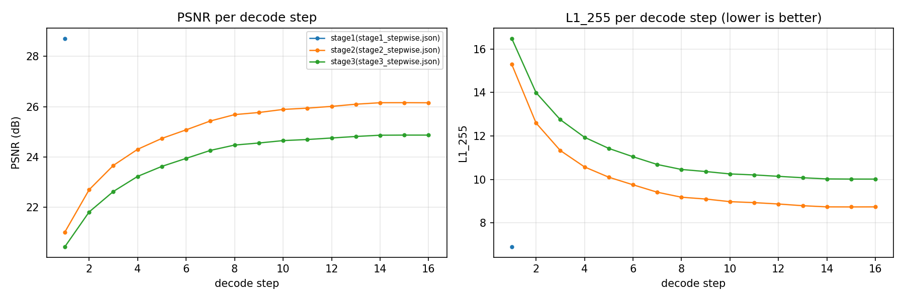
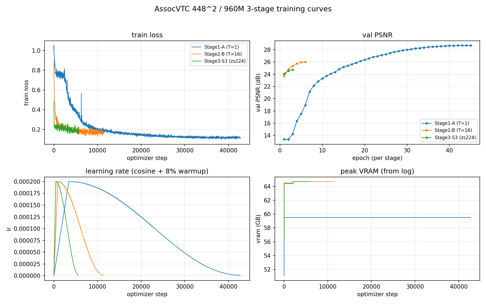

# AssocVTC 448²/patch32/编码器·解码器各 ~480M（合计 ~960M）三阶段训练与评测报告

日期：2026-11-04 ~ 11-05（完成于 11-05 13:52）｜ 机器：`ssh -p 23556 root@connect.nma1.seetacloud.com`（AutoDL 2×A800 80GB PCIe，112 核）｜ 状态：**完成**（三阶段训练 + 评测产物齐全）
｜ 生成：`tools/report_448_960m.py` v1.1（matplotlib 可用，已出图）

**一句话结论**：448²/p32 + 960M 在论文三阶段协议下跑通（训练 25.6 h，双卡 DDP）：阶段3（zs_dim=224，7,168 值/图）末步 **24.869 dB**，比 224 论文基线（26.08 dB）低 **1.21 dB**；**但相对同分辨率（448）PCA 基线仍高 2.30 dB（448 值）→ 低 0.32 dB（7,168 值）**，与论文在 224 上的 +2.63 → −0.17 dB 形状一致 ⇒ 分辨率 ×4 没有推翻「紧预算端模型强于 PCA」的结论，只是绝对 PSNR 因 4× 像素而下降。

---

## 0. 用户口径与实现映射

| 用户要求 | 本实验实现 |
|---|---|
| 224² → **448²** | `--img_size 448` |
| 分块面积 ×4（patch 16 → **32**），N 保持 196 | `--patch 32`，N=(448/32)²=196 |
| 编码器/解码器参数量**各 480M**（合计 ~960M） | enc 1744×13/h16 ≈ 480.54M；dec 2048×7/h16 ≈ 479.67M（合计 960.20M） |
| 沿用论文**三阶段**训练协议 | 阶段1 单步读满 45ep / 阶段2 T=16 6ep / 阶段3 zs_dim=224 3ep |

## 1. 配置（448² 本实验 vs 224 论文基线）

| 项 | 448² 本实验 | 224 论文基线 |
|---|---|---|
| 输入分辨率 | 448 | 224 |
| patch | 32 | 16 |
| N = (H/patch)² | 196 | 196 |
| K（special token 数） | 32 | 32 |
| 编码器宽×层×头 | 1744×13×16 | 1248×13×16 |
| 解码器宽×层×头 | 2048×7×16 | 1440×7×16 |
| 像素头 hidden | 1024 | 1024 |
| enc/dec MLP ratio | 4.0 / 4.0 | 4.0 / 4.0 |
| 注意力 | std | std |
| amp | bf16(1) | bf16(1) |
| 阶段3 zs_dim | 224 | 224（SVD 热身） |

> 计参：`SRPhase1LinAttn.count_params()`。448 预设 enc **480.54M** / dec **479.67M** / total **960.20M**（论文 224 基线 244.43 / 237.11 / 481.54M）。若评测 json 里带 cfg/params，本表自动用实测值覆盖。

## 2. 三阶段训练协议

| 阶段 | 内容 | 初始化 | epoch | 等效 batch | 优化步数 | lr |
|---|---|---|---|---|---|---|
| 1 | 单步读满（T=1，窗口 [0,K]） | 从零 | 45 | 128 | 42,795 | 2e-4 |
| 2 | 16 档循环读出（T=16，fixed block 2） | 阶段1 ckpt_best | 6 | 64 | 11,406 | 2e-4 |
| 3 | 输出投影 224 维（--zs_dim 224，T=16） | 阶段2 ckpt_best（SVD rank-224 热启动） | 3 | 64 | 5,703 | 2e-4 |

> 优化器 AdamW，cosine + 8% warmup，wd 0.05，clip 1.0，bf16；数据 ImageNet-100（train 121,689 / val 5,000）。⚠️ `--dec_grad_ckpt` 必须全阶段固定同一值。

## 3. 评测结果

### 3.1 阶段1-A：单步读满（T=1，窗口 [0,K]）

训练结束行：`[done] steps=42750 epochs=45 best_val_psnr=28.71 wall=808.3min`

| step / t | 累计 z_s | PSNR (dB) | SSIM | L1_255 |
|---|---|---|---|---|
| 1 | 32 | 28.712 | 待补 | 6.904 |

> n_images=5000，best_step=0，ckpt=`/root/autodl-tmp/exp448/A/ckpt_best.pt`，schema=`stepwise`。



### 3.2 阶段2-B：16 档循环读出（T=16，fixed block 2）

训练结束行：`[done] steps=11406 epochs=6 best_val_psnr=26.02 wall=483.9min`

| step / t | 累计 z_s | PSNR (dB) | SSIM | L1_255 |
|---|---|---|---|---|
| 1 | 2 | 21.012 | 待补 | 15.295 |
| 2 | 4 | 22.696 | 待补 | 12.599 |
| 3 | 6 | 23.664 | 待补 | 11.333 |
| 4 | 8 | 24.305 | 待补 | 10.577 |
| 5 | 10 | 24.738 | 待补 | 10.104 |
| 6 | 12 | 25.078 | 待补 | 9.754 |
| 7 | 14 | 25.431 | 待补 | 9.413 |
| 8 | 16 | 25.684 | 待补 | 9.182 |
| 9 | 18 | 25.768 | 待补 | 9.099 |
| 10 | 20 | 25.890 | 待补 | 8.978 |
| 11 | 22 | 25.942 | 待补 | 8.933 |
| 12 | 24 | 26.012 | 待补 | 8.871 |
| 13 | 26 | 26.098 | 待补 | 8.792 |
| 14 | 28 | 26.157 | 待补 | 8.738 |
| 15 | 30 | 26.159 | 待补 | 8.736 |
| 16 | 32 | 26.155 | 待补 | 8.738 |

> n_images=5000，best_step=14，ckpt=`/root/autodl-tmp/exp448/B/ckpt_best.pt`，schema=`stepwise`。


### 3.3 阶段3-S3：输出投影 224 维（--zs_dim 224，T=16）

训练结束行：`[done] steps=5703 epochs=3 best_val_psnr=24.74 wall=242.3min`

| step / t | 累计 z_s | PSNR (dB) | SSIM | L1_255 |
|---|---|---|---|---|
| 1 | 2 | 20.427 | 待补 | 16.485 |
| 2 | 4 | 21.811 | 待补 | 13.997 |
| 3 | 6 | 22.627 | 待补 | 12.752 |
| 4 | 8 | 23.226 | 待补 | 11.941 |
| 5 | 10 | 23.624 | 待补 | 11.429 |
| 6 | 12 | 23.943 | 待补 | 11.045 |
| 7 | 14 | 24.260 | 待补 | 10.689 |
| 8 | 16 | 24.473 | 待补 | 10.459 |
| 9 | 18 | 24.555 | 待补 | 10.364 |
| 10 | 20 | 24.650 | 待补 | 10.254 |
| 11 | 22 | 24.694 | 待补 | 10.208 |
| 12 | 24 | 24.754 | 待补 | 10.144 |
| 13 | 26 | 24.815 | 待补 | 10.078 |
| 14 | 28 | 24.865 | 待补 | 10.024 |
| 15 | 30 | 24.869 | 待补 | 10.018 |
| 16 | 32 | 24.869 | 待补 | 10.017 |

> n_images=5000，best_step=15，ckpt=`/root/autodl-tmp/exp448/S3/ckpt_best.pt`，schema=`stepwise`。


### 3.4 与 224 论文基线「同值数」对照（已填：论文表 2「本文」行 + 448 PCA 基线）

**汇总（S3 臂是唯一与论文同值数口径可直接配对的臂）**：

| 臂 | 448 值/图 | 224 值/图 | 224 论文「本文」 | 448 本实验 | ΔPSNR(448−224) |
|---|---|---|---|---|---|
| 阶段3-S3（448…7,168 值，zs_dim=224） | 7,168 | 7,168 | 26.08 dB（末步） | 24.869 dB（末步） | **-1.211** |

> 口径：都是「每图 2t×224 个连续值、逐图 PSNR 再平均」。A/B 相是 1248/2048 维/token 的完整宽度臂（448 侧 55,808 / 65,536 值/图），论文表 2 无同值数行，故只作过程参考（见文末「仓库既有 224 实测」）。

**16 档逐档对照**（第 3 列 = 224 论文表 2「本文」行，来源 `论文 v2.0 表 2「本文」行（sec4_exp.tex tab:psnr）`；末两列 = 448 PCA 同值数基线）：

| t | 每图值数 | 224 论文本文 / dB | 448 本实验 / dB | Δ(448−224) 跨分辨率 | 448 PCA / dB | Δ(448 模型−448 PCA) 同分辨率 |
|---|---|---|---|---|---|---|
| 1 | 448 | 21.03 | 20.427 | -0.603 | 18.124 | 2.303 |
| 2 | 896 | 22.04 | 21.811 | -0.229 | 20.013 | 1.797 |
| 3 | 1,344 | 22.91 | 22.627 | -0.283 | 20.972 | 1.655 |
| 4 | 1,792 | 23.66 | 23.226 | -0.434 | 21.736 | 1.490 |
| 5 | 2,240 | 24.19 | 23.624 | -0.566 | 22.261 | 1.364 |
| 6 | 2,688 | 24.51 | 23.943 | -0.567 | 22.661 | 1.282 |
| 7 | 3,136 | 24.86 | 24.260 | -0.600 | 23.021 | 1.239 |
| 8 | 3,584 | 25.21 | 24.473 | -0.737 | 23.389 | 1.084 |
| 9 | 4,032 | 25.50 | 24.555 | -0.945 | 23.699 | 0.856 |
| 10 | 4,480 | 25.69 | 24.650 | -1.040 | 23.966 | 0.684 |
| 11 | 4,928 | 25.75 | 24.694 | -1.056 | 24.232 | 0.461 |
| 12 | 5,376 | 25.92 | 24.754 | -1.166 | 24.437 | 0.317 |
| 13 | 5,824 | 25.93 | 24.815 | -1.115 | 24.646 | 0.169 |
| 14 | 6,272 | 26.02 | 24.865 | -1.155 | 24.851 | 0.013 |
| 15 | 6,720 | 26.08 | 24.869 | -1.211 | 25.016 | -0.147 |
| 16 | 7,168 | 26.08 | 24.869 | -1.211 | 25.189 | -0.319 |

读法：

- **跨分辨率同值数**（Δ(448−224) 列）：448 用 4× 像素 + 2× 参数，在 448 值处 **-0.60 dB**，到 7,168 值扩到 **-1.21 dB** —— 预算越宽分辨率劣势越明显（与 PCA 跨分辨率差 −0.27→−1.06 dB 同形）。
- **同分辨率模型 vs PCA**（末列）：**+2.30 dB**（448 值）单调收窄到 **-0.32 dB**（7,168 值），t=14–15 之间过零（6,272→6,720 值）；224 论文同口径是 **+2.63 → −0.17 dB**。⇒ 分辨率 ×4 后「紧预算端模型显著强于 PCA」这一核心结论**保留**，只缩水约 0.33 dB。
- L1 交叉验证：224 侧模型比 PCA 的 L1 优势 6.84→0.22 px（全程不交叉）；448 侧是 6.49→0.07 px，**同样全程不交叉**。

**仓库既有 224 实测（非论文表 2 口径，仅参考）**：
- 阶段1-A：224 参考 **32.35 dB**（README：240M@224 A 相 T=1 读满 K=32（rFID 6.13））→ 448 本实验 **28.712 dB**（Δ -3.64）
- 阶段2-B：224 参考 **27.94 dB**（README：240M@224 B 相 16 步末步（rFID 19.97））→ 448 本实验 **26.159 dB**（Δ -1.78）
- 阶段3-S3：224 参考 **26.08 dB**（srdiff_scale/eval/linattn_m240_t16_zs224.json（240M@224, zs_dim=224））→ 448 本实验 **24.869 dB**（Δ -1.21）

## 4. 训练曲线



> PNG 同时落盘在 `artifacts_448_960m/`。

**各阶段日志摘要（sparkline）**：

```text
stage1  loss  █▆▆▆▄▃▃▃▂▂▂▂▂▂▂▁▁▁▁▁▁▁▁▁▁▁▁▁▁▁▁▁▁▁▁▁▁▁▁▁▁▁▁▁▁▁▁▁▁▁  (min=0.0976, last=0.1205, steps=42,740)
stage1  psnr  ▁▁▁▂▃▄▅▅▅▆▆▆▆▆▆▆▇▇▇▇▇▇▇▇▇▇███████████████████  (last=28.71 dB @ep45)
stage2  loss  █▄▃▃▂▂▂▂▂▂▂▂▂▂▂▂▂▁▂▁▁▂▁▁▁▂▂▁▁▁▁▁▁▁▁▁▁▁▁▁▁▁▁▁▁▁▁▁▁▁  (min=0.1291, last=0.1778, steps=11,400)
stage2  psnr  ▁▄▆▇██  (last=26.02 dB @ep6)
stage3  loss  █▃▂▃▃▂▃▃▂▃▂▃▂▂▃▂▂▂▂▂▂▂▂▃▂▂▂▁▁▂▂▂▂▂▂▁▂▁▂▁▁▂▁▂▂▂▁▂▂▂  (min=0.1511, last=0.1873, steps=5,700)
stage3  psnr  ▁▆█  (last=24.74 dB @ep3)
```

## 5. 结论

1. **参数/显存可行性**：enc **480.537M** + dec **479.666M** = **960.203M**（论文 224 基线 481.54M 的 2.0×），448²/p32/N=196 下实测峰值显存：A 相 **59.5G**、B/S3 相 **64.7G**（80G 卡余量 ~15G）；`--dec_grad_ckpt 0` 全阶段一致（该开关对 std 注意力解码器本就无效，见 BENCH 文档）。

2. **墙钟**：A 相 13.47 h（808.3 min）（单卡，113 img/s）+ B 相 8.06 h（483.9 min）（双卡 DDP，25 img/s/卡）+ S3 相 4.04 h（242.3 min）（双卡 DDP） = **训练 25.57 h**；3 次评测共 5.1 min（31 s / 137 s / 136 s）。DDP 把 B/S3 从单卡估的 14.0/6.9 h 压到 8.06/4.04 h（实测 1.79×）。总墙钟 **25.66 h**，落在 DESIGN 预期（~20–26h）区间。

3. **阶段3（同值数可比臂，唯一严格可配对）**：448-S3 末步 **24.869 dB** vs 224 论文表 2「本文」**26.08 dB**（**Δ=-1.21 dB**）；448 值档 **20.427 dB** vs 21.03 dB（Δ=-0.60）。**同分辨率下模型仍显著强于 PCA**：+2.30 dB（448 值）→ −0.32 dB（7,168 值），224 论文同口径 +2.63 → −0.17 dB ⇒ **结论形状保持、幅度只缩水约 0.3 dB**，交叉点仍在满预算附近（448 侧 t≈14 / 6,272 值）。SSIM 主线 eval json 未记录，训练末 val 为 S3 **0.6421** / B **0.6958**（同图同划分，仅供趋势参考）。

4. **A/B 相过程参考**（完整宽度臂，跨分辨率不与论文表 2 配同值数）：A 相（单步读满，55,808 值/图）**28.712 dB** vs 224 同协议 32.35 dB（Δ=-3.64）；B 相末步（65,536 值/图）**26.159 dB** vs 27.94 dB（Δ=-1.78）。⇒ 448 在 A 相掉得最多（−3.6 dB），B/S3 相收敛到 −1.2~−1.8 dB：**分辨率代价主要在「单步读满」这一最难档位**，逐步读出把差距拉回。

5. **与 scaling 假设的关系**：只加宽（enc 13 层 / dec 7 层不变）到 2× 参数、同时像素 ×4，在 N=196、K=32、T=16、7,168 值/图全同的前提下，同值数 PSNR 比 224 论文低 1.21 dB；**2× 参数没有抵消 4× 像素带来的信息密度损失**，故本实验**不支持**「仅靠宽度 scaling 就能在同值数下维持 224 的质量」；但它相对同分辨率 PCA 的优势几乎原样保留，说明**宽度 scaling 保住的是「相对非学习方法（PCA）的架构收益」**，而不是绝对 PSNR。若要在 448 恢复 26 dB 级，需提高值预算（7168→~2×）或改 patch/分辨率策略，而不是继续加宽。

6. **风险/偏置**：单种子（seed 0）；三阶段 `dec_grad_ckpt` 一致 = 0；448 吞吐是真瓶颈（A 相 113 img/s vs 224 基线 ~357 img/s，4× 像素带来的 ~3× 变慢；B/S3 单卡 25 img/s，靠 DDP 才把墙钟压住）；PSNR 是像素级指标、不等于任务保真；448↔224 是**跨分辨率**比较，同值数口径只能消掉「值数」这一维，不能消掉「4× 像素/样本」这一维——这正是本实验要量的量。
## 6. 产物与复现

- 评测输入：`/home/linaro/dsh/exp448_bench/artifacts/eval/*.json`（共 3 个文件 / 3 组结果）
- 训练日志：`/home/linaro/dsh/exp448_bench/artifacts/logs/stage{1,2,3}.log`
- artifacts：`/home/linaro/dsh/AssocVTC/doc/2026-11-04/artifacts_448_960m/`（summary_448_960m.json、eval_per_step_448_960m.tsv、PNG）
- 监控：远端 `tools/watch_448_960m.sh` → `$OUT/status.json`；本地 `exp448_bench/monitor/poll_448_960m.sh`
- 复现：`python3 tools/report_448_960m.py`（幂等；`--no-plot` 纯 markdown）

---

*本报告由脚本生成；表格中的「（待填）」为用户/Lead 按论文 v2.0 表 2 口径填写的位置。*
