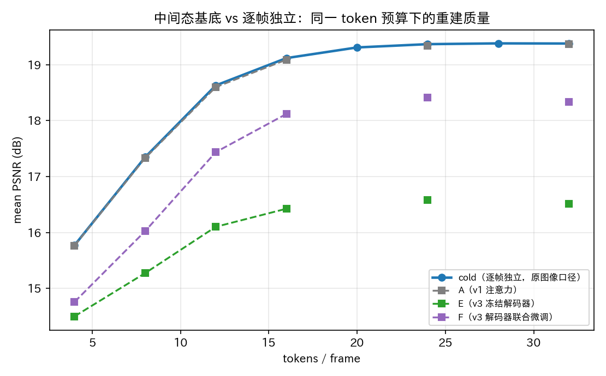
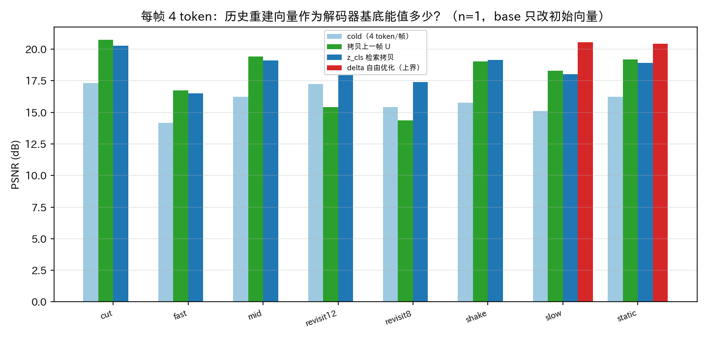
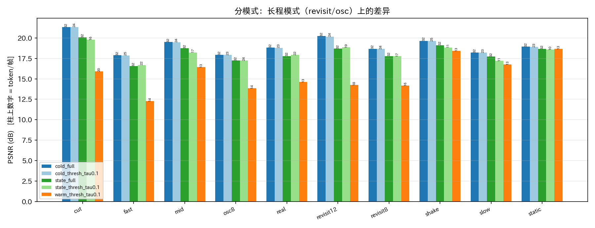
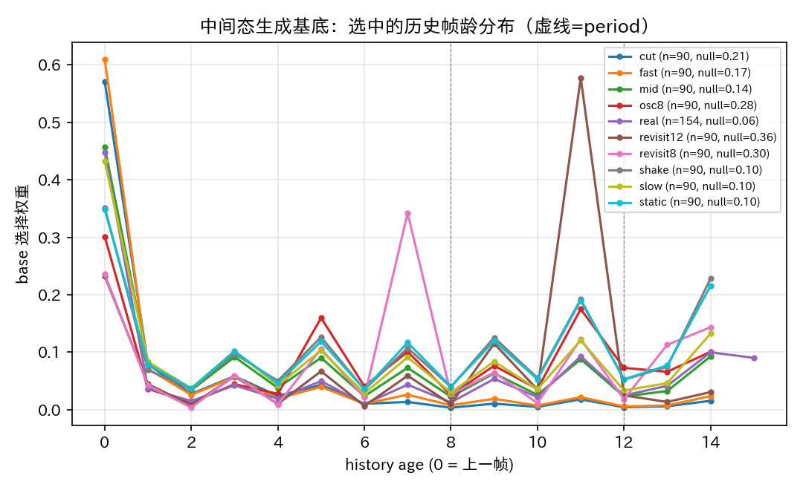

# 中间态（StateGen）生成解码器基底 —— 小规模验证报告

日期：2026-11-10　分支：`feat/vlm8b-v1` 相关 PoC　远程：2×MUSA S4000 48GB

## TL;DR

按"既视感/长程相关"重做了视频侧设想：**编码器/解码器结构完全不变**，新增一个跨帧循环的
**中间态**（`StateGen`），它的交叉注意力 K/V 严格是**历史帧已重建的解码器 token 向量**
（不含本帧），输出当前帧解码器的**初始基底向量**（`Y_0 = query_base + query_pos + Δ_f`），
图像 = 单帧视频（历史为空 ⇒ Δ=0 ⇒ 与原图像逐位一致）。训练时先整段编码、再沿帧串行做
**整段 BPTT**（历史向量不 detach）。

**结论：这个方向"信息值"很大，但当前实现拿不到 Pareto 收益，且有一个被忽视的反馈环。**

1. **信息值确实存在**（n=1，即每帧 4 token 时，只改 Y_0、其余全冻结）：
   - 直接自由优化 Δ（上界）：static+slow 平均 **+4.67 dB**（15.80 → 20.47）；
   - 直接拷贝上一帧的重建向量：pan/shake/cut 类 **+2.6~+3.4 dB**；
   - 拷贝"匹配的那一帧"（revisit 片段里相隔 period 帧的帧）：revisit8 **+3.33 dB**、revisit12 **+3.65 dB**。
2. **但学出来的中间态只拿到很小一部分**（同 bench、同 token 对比 cold）：
   - 解码器冻结（E）：val（历史取全预算解码）n=1 **+1.18 dB**、n=4 **−1.05 dB**、满预算 **−1.24 dB**；
     部署评测（历史取低预算解码）n=1 **−0.98 dB**，全预算 **−0.87~−2.9 dB**；
   - 解码器联合微调（F，lr 1e-4）：val n=1 **+1.73 dB**、n=2 +0.91、n=4 −0.15、满预算 −0.33；
     部署评测 n=1 **−0.98 dB**，n=8 −0.79 dB，全预算 **−0.87 dB**；
   - 只用注意力残差（A，v1）：完全没增益（Δ≈−0.02 dB）。
3. **长程"既视感"这一步没做成**：用编码器 `z_cls` 做历史检索，在 revisit 片段里
   "选到的历史帧龄 = period" 的命中率是 **0/48（period8）、0/24（period12）**——`z_cls`
   没有足够判别性；虽然拷贝匹配帧本身值 +3.3~3.7 dB，但网络选不中。
4. **被忽视的反馈环**：中间态"历史向量"来自低预算解码，低预算解码本身很差（15.7 dB），
   于是"拿差的历史去生成下一次的基底"会自我拖累。val（历史用全预算解码）为正，
   部署评测（历史用实际低预算解码）为负，差值约 2 dB —— 这是当前方案最大的结构性障碍。

**一句话：接口能用（上界 +4.7 dB @4 token），但我们这版"学出来的选择+拷贝"没有把上界转化收益；
继续做必须改三件事中的至少两件：残差读出、更强检索 cue（或传参考帧索引）、历史质量/预算协议。**

---

## 1. 设计（按你的描述落成的版本）

### 1.1 架构

```
原图像模型（不改结构、不改权重路径）:
  编码器: image → [cls; specials(K=32); patches(196)] → z_cls, z_s
  解码器: Y_0 = query_base + query_pos;
          step t: Y_t = Dec(Y_{t-1}, mem[t]); pix_t = PixelHead(norm(Y_t)); Y ← query_base + Y
          mem[t] = z_cls + 前缀 z_s[0:4(t+1)]（prefix 读出，最大 32 token）

新增中间态（3.66M 参数，跨帧循环）:
  S_f = StateLayer(S_{f-1}, {R_0..R_{f-1}})        # 交叉注意历史重建向量 R_j（严格 j<f）
  Δ_f = gain(S_f) · Σ_j w_j R_j + CrossAttn(q(S_f), {R_<f})   # w, q 都由 S_f 生成
  Y_0(f) = query_base + query_pos + Δ_f             # 只改初始向量，解码器每步结构不变
  R_f = norm_out(Y_last(f) − query_base)            # 该帧"已重建向量"，进入历史
```
- 图像口径：历史为空 ⇒ `Δ_f = None` ⇒ 退化回原图像解码路径，**逐位相同**（实测 max|Δ|=0）。
- 场景切换/关键帧：清空历史、状态归零 ⇒ 走单帧路径（自动支持 cut）。
- 循环结构：上一帧的 `S` 是下一帧的输入；`w`（选哪一帧）与 `gain`（拷贝幅度）都由 `S` 预测。
- 训练：冻结编码器，**先把整段 16 帧一次性编码完**，再沿帧串行展开解码器+中间态，
  损失 = 各帧深监督 L1 平均，**历史向量不 detach（整段 BPTT）**。4×400 步、batch 4、
  约 13–20 分钟/次（2×S4000 单卡）。

### 1.2 三代实现（迭代过程，供参考）

| 版本 | 基底生成方式 | 结果 |
|---|---|---|
| v1（A） | 仅 CrossAttn(可学习 patch 查询, 历史) 残差，零初始化 | Δ≈0，无任何增益（−0.02 dB） |
| v2（C，已废弃） | sigmoid 多滞后拷贝门 Σ_l g_l R_{f-l}，未归一化 | 历史一长 delta 范数爆炸（Σg 随帧数增长），val 立刻 −1.8~−4 dB，弃 |
| v3（D→E/F） | softmax 选择：时滞先验(中间态预测) + `z_cls` 内容检索 + null 门；幅度 gain=1+softplus(·) 内容相关 | 得到有限正收益（见下） |

v2 的教训：**"把历史加进初始向量"必须显式控制幅度/归一化**，否则帧数一多就整体失真。

---

## 2. 关键诊断：历史信息到底值多少？

### 2.1 基底能带来什么（n=1，只优化/构造 Δ，其余冻结）

| pattern | cold (4 tok) | 拷贝上一帧 R | z_cls 检索拷贝 | 拷贝匹配帧（period） | Δ 自由优化（上界） |
|---|---|---|---|---|---|
| static | 16.22 | **19.19 (+2.97)** | 18.91 (+2.70) | – | 20.42 (+4.20) |
| slow | 15.11 | **18.30 (+3.20)** | 18.03 (+2.92) | – | **20.56 (+5.45)** |
| mid | 16.24 | **19.42 (+3.18)** | 19.10 (+2.87) | – | – |
| fast | 14.18 | **16.75 (+2.57)** | 16.51 (+2.33) | – | – |
| shake | 15.76 | **19.03 (+3.28)** | 19.14 (+3.38) | – | – |
| cut | 17.32 | **20.73 (+3.41)** | 20.29 (+2.97) | – | – |
| revisit8 | 15.43 | 14.35 (**−1.08**) | 17.40 (+1.97) | **18.75 (+3.33)** | – |
| revisit12 | 17.25 | 15.40 (**−1.85**) | 17.96 (+0.71) | **20.89 (+3.65)** | – |
| real | 16.59 | – | 17.25 (+0.66) | – | – |

- "拷贝上一帧"在相邻帧相似时很值钱，但在 revisit（相邻帧相距 16–24 px）反而**负收益**；
- "拷贝匹配帧"在 revisit 上 +3.3~3.7 dB —— **长程既视感是真金**，前提是能选中它；
- 但 `z_cls` 检索几乎选不中（命中率 0/48、0/24），只能拿到一部分泛化收益；
- 自由优化上界 +4.7 dB 说明"Y_0 这个接口"本身能承载这么多信息，不是接口上限。

### 2.2 训练/部署一致性：历史质量决定一切

同一模型（F）在两种历史来源下的增益（val，8 个片段）：

| 历史来源 | n=1 | n=2 | n=4 | 满预算 |
|---|---|---|---|---|
| 全预算解码（val 口径） | **+1.73** | +0.91 | −0.15 | −0.33 |
| 实际低预算解码（部署口径） | −0.98 | −1.11 | −0.71 | −0.79 |

**低预算历史向量本身只有 15.7 dB，把它当下一帧的基底会反向拖累。**
这是"中间态用历史重建向量"路线的结构性风险：要好的历史，就得先花 token 把历史解好。

---

## 3. 训练与评测结果

### 3.1 训练配置

| run | 中间态 | 解码器 | 训练步数 | 备注 |
|---|---|---|---|---|
| A（v1） | 注意力残差 | 冻结 | 1200 | 无增益 |
| E（v3） | 检索+时滞 softmax+gain | 冻结 | 1500（从 D step400 热启动） | 低预算有收益，中高预算负 |
| F（v3） | 同上 | **联合微调 lr 1e-4** | 1500 | 中高预算明显改善，但仍未超 cold |

数据：ImageNet-100 静帧（17,027 张）合成片段；40% 为"既视感"型运动（revisit/osc，相邻帧 8–24 px），
其余为 pan/shake/zoom/static；评测：原 bench 36 段 × 16 帧（static/slow/mid/fast/shake/cut）+
**新增长程 bench2 18 段 × 16 帧（revisit8/revisit12/osc8）** + 4 段真实 2fps 视频。

### 3.2 同 token 预算对比（全 bench 平均，含 bench2+real）

| n 步 | token/帧 | cold | A(v1) | E(v3, 冻结) | F(v3, 解耦微调) |
|---|---|---|---|---|---|
| 1 | 4 | 15.771 | 15.765 (−0.006) | 14.500 (−1.271) | 14.757 (−0.977) |
| 2 | 8 | 17.347 | 17.331 (−0.015) | 15.273 (−2.074) | 16.024 (−1.114) |
| 3 | 12 | 18.631 | 18.601 (−0.030) | 16.101 (−2.529) | 17.437 (−0.915) |
| 4 | 16 | 19.120 | 19.091 (−0.029) | 16.425 (−2.694) | 18.121 (−0.713) |
| 6 | 24 | 19.369 | 19.342 (−0.027) | 16.578 (−2.791) | 18.416 (−0.692) |
| 8 | 32 | 19.380 | 19.365 (−0.016) | 16.514 (−2.867) | 18.334 (−0.793) |

（A 的 cold 基准 19.380，F 联调后 cold 基准降到 19.127 —— 解码器被片段训练带偏，本身也是代价。）

### 3.3 自适应阈值协议（部署口径：在线提前停止、历史用实际停下的重建向量）

| 协议 | token/帧 | PSNR | vs cold_full |
|---|---|---|---|
| cold_thresh τ=0.1 | 23.33 | 19.364 | −0.016 |
| cold_thresh τ=0.2 | 20.49 | 19.313 | −0.068 |
| E: state_thresh τ=0.1 | 12.46 | 16.382 | −2.998 |
| F: state_thresh τ=0.1 | 16.71 | 18.118 | −1.009 |
| F: state_thresh τ=0.1 + cut18 | 22.63 | 18.688 | −0.439 |
| warm（上一版 carry） | 13.77 | 15.070 | −4.310 |

自适应协议**救不回来**：基底一旦对中高预算有害，阈值规则只能提前停，质量停在低预算水平。

### 3.4 分模式（F，PSNR / token per frame）

| pattern | warm n=1 | state n=2 | state thresh τ0.1 | cold thresh τ0.1 | state n=4 | cold_full | state_full |
|---|---|---|---|---|---|---|---|
| static | 18.74/5.8 | 17.34/8 | **19.16/10** | 19.24/22.7 | 19.16/16 | 19.26/32 | 18.99/32 |
| slow | 16.58/5.8 | 15.39/8 | **16.91/10** | 18.42/23.3 | 16.90/16 | 18.43/32 | 16.95/32 |
| mid | 16.05/5.8 | 15.89/8 | 16.51/10 | 19.78/24.4 | 16.93/16 | 19.79/32 | 16.78/32 |
| fast | 11.75/5.8 | 12.45/8 | 13.25/14.5 | 18.11/23.6 | 13.38/16 | 18.14/32 | 13.22/32 |
| shake | 18.37/5.8 | 16.99/8 | 18.94/9.5 | 19.93/24.2 | 18.77/16 | 19.94/32 | 18.95/32 |
| cut | 13.57/5.8 | 16.05/8 | 17.16/14.5 | 21.68/23.9 | 17.00/16 | 21.69/32 | 17.24/32 |
| revisit8 | 13.16/5.8 | 14.48/8 | 15.48/11.9 | 18.81/22.4 | 15.57/16 | 18.82/32 | 15.71/32 |
| revisit12 | 13.33/5.8 | 15.15/8 | 15.83/13.6 | 20.48/23.8 | 15.95/16 | 20.48/32 | 15.91/32 |
| osc8 | 13.29/5.8 | 13.93/8 | 14.74/14.6 | 18.08/22.6 | 14.89/16 | 18.12/32 | 14.99/32 |
| real | 13.86/4.7 | 14.95/8 | 15.56/19.5 | 18.97/22.1 | 15.72/16 | 19.00/32 | 15.61/32 |

- **只有在 static/slow/shake 这类"相邻内容高度重合"的模式上，低预算点（≈10 token）才与 cold
  的高预算点（≈23 token）接近**（static 19.16@10 vs 19.24@23）；
- 在 fast/cut/revisit 上明显更差——正是"拷贝上一帧"有害的那些模式；
- **图像口径无损**：历史为空时与原图像逐位相同（`max|Δ|=0`，still-val 19.86 dB）；
  单帧耗时 +17~18%（中间态选择/检索开销）。

---

## 4. 为什么没成（原因诊断，按重要性）

1. **训练目标与部署口径打架**：同一个 Δ_f 要同时服务 n=1 和 n=8。n=1 时 Δ 主导输出（受益），
   n≥2 时后续 refinement 与 Δ 相互作用、反而变差（F 已用解码器联调缓和，但没消除）。
   这是"只改初始向量"这一注入点的固有限制；论文主线的 carry/递进读出本来就是为多步细化设计的。
2. **历史质量反馈环**（见 §2.2）：低预算解码出的 R 质量差 → 下一帧基底差 → 自我拖累。
   除非"历史"来自全预算解码（那就没有 token 节省的意义了）。
3. **检索 cue 太弱**：`z_cls` 在重建训练的编码器里判别性不足，长程匹配选不中（0/48）；
   而"拷贝匹配帧"是 +3.3 dB 的大头。要么传一个参考帧索引（几个 bit），要么用像素级/
   编码器专用的检索 token。
4. **规模/数据**：17M 模型、1500 步、合成片段；中间态 3.66M 参数、单层、8 个状态 token，
   表达能力可能也不够在 1–2 小时训练内学出"从历史重建向量到解码器输入空间"的映射。
5. **空间不匹配**：R 是 `norm_out` 输出空间（post-norm），Y_0 是 pre-readout 残差流空间；
   实测需要 gain>1（≈1.4–2）才能让方向靠近"上一帧图像"，说明两者不是简单的线性同空间关系。

---

## 5. 如果继续：最小改动实验清单

1. **残差读出（最可能有效）**：每步输出改成 `pix = f(Y_t) + Δpix_hist`（或状态残差），
   而不是把历史塞进 Y_0；这样多步 refinement 不会被破坏，低预算点也能吃到历史先验。
2. **参考帧索引/检索 token**：编码器额外输出 4–8 bit 的参考帧索引（或专用检索 token），
   用 period 命中率（0/48）验证；这是把"既视感"从 +1.9 提升到 +3.3 的关键。
3. **解码器联合训练 + 更长训练/更大中间态**：F 已经显示满预算损失从 −1.24 收窄到 −0.33，
   方向对，但需要更充分（当前只 1500 步、lr 1e-4）。
4. **训练目标对齐部署**：低 n 加权（部署阈值多数停在 n=1–2）、或直接按"给定 token 预算
   下最小化 L1"来训练。
5. **评测口径**：同时报"同 token 下 PSNR"和"同质量下 token 节省"；当前结果两者都不占优，
   但 static/slow 子集已经接近，值得按 §1–4 修完再评。

---

## 6. 文献位置（子智能体调研，2026-11-10）

雷同度约 **40%**："条件解码 + 长程记忆"是成熟套路，但"**跨帧循环隐状态生成解码器初始基底
查询**"这一接口未找到先例。最接近：

- **TCNeRV**（[2609.16870](https://arxiv.org/abs/2609.16870)）：INR 视频压缩，把历史重建特征
  **门控注入解码器各层**并只编残差——与本想法最接近，但注入中间层、不改初始 query；
- **GVC1D**（[2603.15302](https://arxiv.org/abs/2603.15302)）：token 条件于短期+长期上下文，
  动机（"2D 网格难建模长程相关"）高度重合，但条件在编码端/latent 域；
- **L-STEC**（[2512.12790](https://arxiv.org/abs/2512.12790)）：LSTM 延长参考链 + 像素 warp；
- 其余：CDT 2503.03708（条件扩散 tokenizer + feature cache）、DCVC 2109.15047（条件编码）、
  AdaCodec 2606.02569（P-token/参考帧）、MambaVideo 2507.04559（状态空间 tokenizer）、
  ReCam 2610.27986（历史 latent 进 DiT attention，但用于生成、query 固定）、
  TiTok/FlexTok（固定 learnable 查询解码 —— 本架构的 query_base 来源）。
- 全段 BPTT 的对标：DVC [1812.00101](https://arxiv.org/abs/1812.00101) 端到端训练整条 P 帧链；
  需补"截断 vs 全段梯度"消融。

可辩护表述（如后续做成）："首个把跨帧循环隐状态用于生成解码器初始基底查询的统一重建
tokenizer：以历史帧已重建 decoder token 为 K/V，隐状态改写解码起点而非提供像素/特征条件。"

**审稿人最可能打的三点**：①这不就是 P 帧/参考帧选择吗（→ 必须和"传参考索引"版本对比消融）；
②与 ElasticTok/AdapTok 的因果可变长 tokenizer 区别；③重建平台判据与下游 VLM 能力的关系（未测）。

---

## 7. 复现与文件

- 代码（新增）：`model_state.py`（StateGen/MiniVideoState/ProbeMHA）、`train_state.py`（整段 BPTT 训练）、
  `eval_state.py`（cold/warm/state 协议 + 检索注意力统计 + 图像口径一致性 + 时延）、
  `probe_oracle_base.py`（Δ 自由优化上界）、`probe_copy.py`（拷贝上一帧/匹配帧）、
  `probe_retrieval.py`（z_cls 检索命中率与收益）、`make_report_state.py` / `make_compare_fig.py` /
  `make_diag_fig.py`（表格与图）。
- 数据：`data/bench2`（新增长程 bench：revisit8/revisit12/osc8 各 6 段 × 16 帧，seed 777）。
- 训练脚本：`run_state_e.sh`（冻结解码器）、`run_state_f.sh`（解码器联调）；评测 `run_eval_state.sh`。
- 远程产物：`run_state_{a,d,e,f}/`、`eval_state_{a,e,f}/`、`logs/{train_state_*,run_eval_state_*}`。
- 本地分析：`analysis/eval_state_{a,e,f}/`、`analysis/plots_state_{a,e,f}/`（含 tables.md 与图）。
- 训练/评测命令（远程）：

```bash
# 训练（E：冻结解码器；F：解码器联调）
bash run_state_e.sh   # --clip-frames 16 --batch 4 --state-tokens 8 --state-depth 1 --state-lag 16
bash run_state_f.sh   # 同上 + --train-decoder 1 --lr-dec 1e-4
# 评测（bench + bench2 + real）
bash run_eval_state.sh state_f /root/autodl-tmp/video_recon/data/bench2
```

---

## 8. 局限

- 17M 小模型、合成片段为主；真实视频仅 4 段（2fps，场景变化小）；
- 训练 1500 步、单层 8 状态 token 的中间态，**不能据此断言该架构整体不行**，
  只能断言"当前实现 + 当前训练预算下拿不到 Pareto 收益"；
- 未做"传参考帧索引"的消息量 vs 收益账（几个 bit/帧 vs 省下的 token）；
- 未测与下游 VLM 任务（QA/OCR）的关系；
- 图像口径一致性只验证了数值逐位一致（max|Δ|=0），未重跑图像大 bench。

---

## 附：关键图（`figures/`）

**同一 token 预算下 cold vs 中间态（A/E/F）**



**n=1（4 token/帧）时历史向量作为基底的收益：cold / 拷贝上一帧 / 检索拷贝 / 自由优化上界**



**分模式细节**



**中间态对历史帧的选择权重（长程检索未命中 period）**


