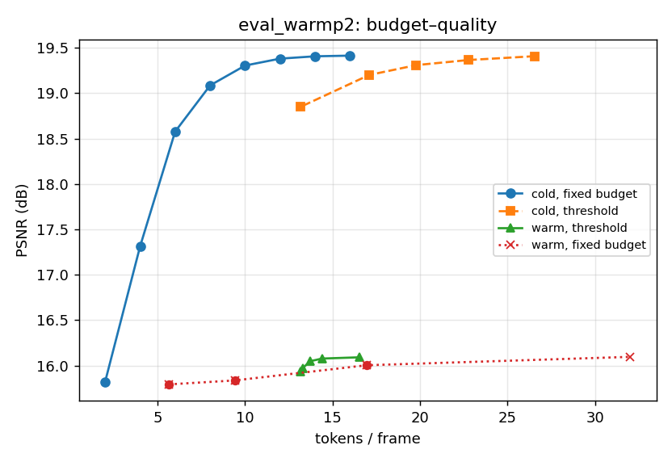
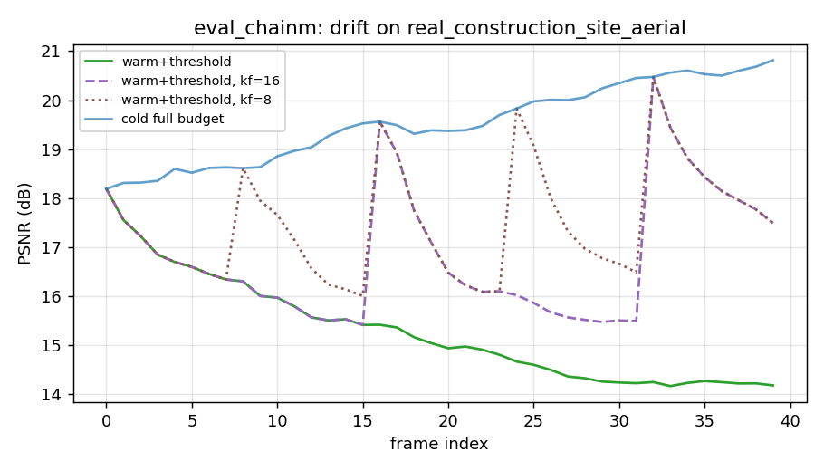
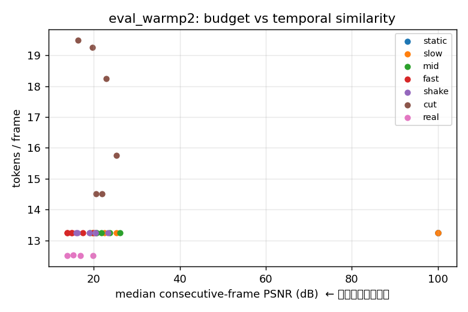

# 视频「循环重建 + 每帧自适应预算」小规模测试报告

> 日期：2026-11-10 ｜ 机器：AutoDL 2×MTT S4000（MUSA，torch_musa 2.11）
> 代码/产物：`/home/linaro/dsh/video_recon_probe/`（本地）＝ `/root/autodl-tmp/video_recon/`（远程）
> 目的：在低成本规模上先检验 pp_zh §5.5「从单帧到视频流」的结构性推断，再决定是否值得投入
> 全尺寸视频实验。**只做机制验证，不追求绝对重建质量。**

---

## 0. TL;DR

1. **「按重建平台截断每帧预算」成立**（单帧、独立读出）：在 −0.10 dB 内可把 32 token/帧压到
   19.8（−38%），−0.21 dB 内压到 17.1（−47%），−0.57 dB 内压到 13.2（−59%）；截断是**精确**的
   （截断输出与全量前若干档逐位相同，max|Δ|=0）。
2. **「后一帧在上一帧解码器状态上少走几档」不成立**（本架构、本规模）：三种训练方式
   （零样本 / 单对微调 / 按链随机截断微调）后，跨帧 carry 复用都**显著差于**逐帧独立读出
   （19.4 → 16.0 dB，同预算下也差 3 dB 以上）；状态沿帧**衰减**：每个 8 帧 GOP 内掉 ~2 dB，
   关键帧刷新只能锯齿状恢复，仍不及独立读出。原因：carry 状态被反复"重预测"，是有损压缩，
   2 层读出栈无法把它纠回来。
3. **时序冗余本身是真实的**（真实视频相邻帧原始 PSNR 中位 15–20 dB，与模型满预算重建 19.3 dB
   同量级），但**利用它的正确机制不是复用解码器 carry**；文献里已被验证的机制是因果 KV cache
   （ElasticTok/PVC）或像素域残差 P 帧（AdaCodec）。§5.5 的写法在实验上暂时站不住，建议改为
   "机制未验证的展望"，或按第 5 节路线补实验后再写。

---

## 1. 被测设想（来自 pp_zh §5.5 与用户 2026-11-10 口述）

- 视频相邻帧相似（机位固定、慢运动）⇒ 后一帧不必从零重建。
- 第 1 帧编码成 n 个向量；重建精度随"再读一个向量"的增益 < 阈值 τ 时截断，取 n*；
- 第 2 帧在第 1 帧**解码器读出状态**基础上重建，同样按 τ 截断；依此循环；
- 镜头切换 / 大运动 ⇒ 退回全量读出；
- 同一套权重，图像 = 单帧视频。

## 2. 小规模实现

| 项 | 取值 |
|---|---|
| 模型 | 17.1M：编码器 6 层 384 宽（`[cls; 32 registers; 196 patches]`，224²/p16）+ 循环读出解码器（2 层 384 宽，共享，逐步 PixelHead）+ 8 档嵌套前缀（每档 4 token） |
| 逐档语义 | 第 t 步读 `z_s[0:4t]`（前缀），输出该档整图预测；t=8 = 32 token 全量 |
| 训练 ① | 单步预训练（一次读全量 memory，30 epoch / 8,010 步 / 17k 静帧）→ 留出集 21.19 dB |
| 训练 ② | 循环读出微调（8 档前缀 + 深监督，线性递增步权重）→ 留出集 19.84 dB |
| 训练 ③（对照） | 三种跨帧训练：零样本；单对热启动微调；按链 + 随机截断微调 |
| 数据 | ImageNet-100 静帧 17,027 张（训练）/ 3,925 张（留出）；合成连续帧（平移 0–4 px/帧、抖动、缩放、静止、场景切换）；4 段真实视频（2 fps 抽帧 158 帧，Mixkit Free License） |
| 评测 | 40 段 × 16 帧合成 + 4 段真实视频；8 档预算；τ∈{0.02,0.05,0.1,0.2,0.5} dB；envelope 停止规则；关键帧 8/16/32；场景切换阈值 10/14/18 dB |
| 成本口径 | token/帧 = 4×档数（送 LLM 的视觉 token）；选档额外代价 = 多算 1 档（执行 n*+1 档） |

---

## 3. 结果

### 3.1 单帧（冷启动）：预算-质量曲线有膝点，按平台截断可行

评测集平均（40 段 = 合成 576 帧 + 真实 158 帧；每档 4 token）：

| 预算（token/帧） | 4 | 8 | 16 | 32 |
|---|---|---|---|---|
| PSNR | 15.82 | 17.31 | 19.09 | 19.41 |

按「边际增益 < τ」截断（冷启动，独立逐帧）：

| τ (dB) | 0.02 | 0.05 | 0.1 | 0.2 | 0.5 |
|---|---|---|---|---|---|
| token/帧 | 26.55 | 22.75 | 19.78 | 17.09 | 13.16 |
| 省 token | 17% | 29% | 38% | 47% | 59% |
| PSNR | 19.41 | 19.37 | 19.31 | 19.20 | 18.85 |
| Δ vs 全量 | −0.01 | −0.05 | −0.10 | −0.21 | −0.57 |

- 每帧选到的档位分布（τ=0.2）：n=1: 3 帧、3: 138、4: 307、5: 248、6: 38（共 734 帧）——
  确实"在不同位置饱和"，平台可辨。
- **截断精确**：`readout(n_steps=4)` 与 `readout(n_steps=8)` 的前 4 档逐位相同（max|Δ|=0，
  冷启动与热启动都验证过）。
- 注意：冷启动的预算差异反映**图像内容难度**，与运动无关；这张表不涉及视频。

### 3.2 跨帧热启动：三种训练方式都救不回来

同一评测集，平均值（模型 = 热启动微调后的 ckpt）：

| 协议 | token/帧 | PSNR | Δ vs 冷全量 |
|---|---|---|---|
| 冷启动全量 | 32.0 | **19.41** | 0 |
| 冷启动+阈值 τ=0.2 | 17.1 | 19.20 | −0.21 |
| 热启动+阈值 τ=0.1 | 13.7 | 16.05 | −3.37 |
| 热启动+阈值 τ=0.1 + 关键帧 8 | 14.5 | 17.65 | −1.76 |
| 热启动+阈值 τ=0.1 + **场景切换阈值 18dB** | 18.3 | 17.97 | −1.44 |
| 热启动固定 1 档（4 token） | 5.7 | 15.79 | −3.62 |
| 热启动固定 8 档（32 token） | 32.0 | 16.10 | −3.32 |

- **同 token 比更差**：16 token 时独立读出 19.09 dB，热启动链只有 16.00 dB；
  8 token 时独立读出 17.31，热启动链 15.84；32 token 时独立读出 19.41，热启动链 16.10。
- 三种训练（零样本 / 单对微调 2,750 步 / 链式+随机截断 1,000 步）结论一致，链式训练只把
  16.0→16.1，没有质变。热启动链在"关键帧"帧上是满预算独立读出（质量 = 冷全量），
  非关键帧掉到 16 dB 左右。
- 分模式看：只有 genuinely 相似的帧才不亏（static 18.9 vs 19.1；shake 18.6 vs 19.8），
  普通 2 fps 真实视频（原始相邻帧 15–20 dB）全部亏（real 14.3 vs 18.9）。

### 3.3 漂移：每个 GOP 内 ~0.25 dB/帧衰减，关键帧刷新只是锯齿

`fig_drift_eval_chainm.png`（真实视频 `construction_site_aerial`，40 帧）：

- 冷启动全量：18.3 → 20.8 dB 单调上升（逐帧独立读出，无累积）。
- 热启动链（kf=8）：每个关键帧 20.5 → 8 帧内掉到 16.3，再刷新，锯齿轮回。
- 不加关键帧：14.2 dB 且仍在下降（误差沿帧累积）。
- 结论：carry 状态每过一次"重预测"就损失一点，8 帧累计 ~2 dB；这是 §5.5 自己预警的
  "误差沿帧累积"，本实验给出量级。

### 3.4 图像 = 单帧视频

同一权重、同一代码路径：静帧留出集 21.2 dB（单步）/ 视频首帧冷启动 19.3 dB —— 没有单独
的图像/视频分支，`F=1` 即图像协议。"无缝切换"这一点成立（不引入新模块、不加分支）。

### 3.5 为什么热启动失败（诊断）

- 训练时热启动分支的 loss（0.072）与冷启动相当，说明"在训练分布下"它能重建；
- 但部署链上，第 2 帧起的状态来自上一帧**已截断/已重预测**的状态，分布漂移；
- 更根本：读出栈只有 2 层 384 宽，把"上一帧内容 + 本帧 4 token"映射回本帧时，只能输出
  上一帧的**模糊重投影**（step1 在 slow 段 18.0 dB，甚至低于直接拷上一帧的 24 dB），
  之后每帧重复重投影 ⇒ 质量单调衰减。要修，需要**残差式预测编码**（学到"只补变化"）
  或更大/更深的解码器，不是本 PoC 能回答的。

---

## 4. 与文献对照（子智能体调研，2026-11-10）

完整报告：`/home/linaro/dsh/视频视觉token编码_雷同调研_20261110.md`

- **雷同度：中高（60–70%）**。最接近：
  - **ElasticTok**（arXiv 2410.08368）：前帧条件 + 每帧变长 token + 推理时按**重建阈值**定长，
    "images are considered as 1 frame videos" —— 逐条命中我们的 1/2/4。
  - **AdapTok**（CVPR 2026，arXiv 2505.17011）：block-causal + tail-drop + 预测质量曲线 + 全局预算
    分配；**已公开批评"固定阈值"无法控制全局预算**（我们的 τ 规则同样中招，必须配"每帧阈值 +
    全片预算上限"两级设计）。
  - **ALIT**（ICLR 2025）：图像侧循环 rollout + 按重建质量选长度，2024-11 已发表。
  - **AdaCodec**（NeurIPS 2026，arXiv 2606.02569）：video MLLM 里 I/P 帧预测编码 + 预测代价阈值切 GOP
    —— "第 3 点进 VLM"已有先例，"首个在 VLM 做预测编码"不能写。
  - **PVC**（CVPR 2025，arXiv 2412.09613）：图像重复成静态视频 + 因果时序注意力，"图像=单帧视频"
    的主张 2024-12 已有。
- **未被别人占的窄缝**：(a) 把重建平台判据接到 VLM **预算档位选择器**上；(b) 用**相对边际增益**
  （ΔdB）而非绝对阈值，且**不为选档多跑前向**（嵌套前缀一次解码得全档误差，vs ElasticTok 二分
  ≈log 次解码、AdapTok 额外 scorer+ILP）；(c) 用上一帧**解码器状态**（而非 KV cache / 像素残差）
  作条件 —— **(c) 正是本实验证伪的部分**，因此只剩 (a)(b) 的工程效率卖点。
- **审稿人最狠的点**：① "这不就是 P 帧/残差量化"（必须承认条件结构同构，强调产物是语义 token、
  无熵编码）；② "ElasticTok/AdapTok 已做阈值+变长+前帧条件"（必须正面比较）；③ **"重建平台与
  下游 VLM 性能有什么关系"**（全案地基，必须补同帧上重建曲线与 QA/OCR 曲线的对应实验）；
  ④ "省 token 但多了解码器，真省算力？"（本 PoC 里选档确实要跑解码器 n*+1 档，必须计入总账）。

---

## 5. 结论与建议

- **可以继续投入的方向**：每帧自适应预算（单帧已成立，−38% token / −0.1 dB；且截断精确、
  与 VLM 的 8 档前缀预算天然同构）。定位应是**"一次解码、按边际增益选档"的系统/效率工作**，
  不是新 video tokenizer。
- **暂时不能写的方向**：§5.5 的"上一帧读出状态直接当下一帧初值、少走几档"。本规模实验显示
  它导致 3 dB 级退化 + 每 GOP ~2 dB 漂移。若要保留这条主张，至少要先做：
  1. **残差/P 帧式读出**：让一步输出 = 上一帧重建 + 残差（学到的 motion/residual），而不是
     重新预测整图；或换更大解码器 + 视频序列预训练。
  2. **下游对应实验**：同一帧上同时测重建平台位置与 VLM 下游（QA/OCR/描述）曲线，证明"重建
     饱和点 ≈ 下游饱和点"；否则"重建平台"不能当预算判据。
  3. **全局预算分配**：每帧 τ + 全片预算上限（贪心边际增益），否则 AdapTok 的批评直接命中。
- 若这些短期做不完，论文里把 §5.5 保持"展望 + 未验证"是更安全的选择（现稿已这么写，但
  "结构性推断"的措辞最好降级，并补一句本实验的负结果）。

---

## 6. 复现

```bash
# 远程（MUSA）
cd /root/autodl-tmp/video_recon/code
bash run_single.sh        # 阶段1 单步预训练（30 epoch，~20 min）
bash run_recp.sh          # 阶段2 循环读出（8档前缀+lin权重，~15 min）
bash run_warmp.sh         # 阶段2b 单对热启动微调（对照，~10 min）
bash run_chain_train.sh   # 阶段2c 链式+随机截断（对照，~6 min）
bash run_eval_one.sh warmp  # 评测（~6 min）
# 本地
python3 make_report.py --dirs analysis/eval_warmp2 --out analysis/plots
```

产物：`analysis/eval_{recp2,warmp2,chainm}/`（results.json、逐帧 json、cold_curves.json）、
`analysis/plots/`（Pareto / 分模式 / 相似度 / 漂移图）。数据 license：ImageNet-100（研究用途）、
imagenette（FastAI，Apache-2.0 数据源）、4 段 Mixkit 视频（Mixkit Free License，不可再分发原素材）。

## 7. 局限（必须写进论文/汇报）

- 17.1M 模型从零训练 ~20 min，绝对重建只有 19–21 dB（论文模型 480M / 更多数据 / 更长训练）；
  结论是**机制级**的，不能外推绝对值。
- 读出解码器只有 2 层 384 宽；热启动失败的根因可能部分来自容量，而非想法本身。
- 评测集 734 帧、4 段真实视频，分布窄；场景切换只测了 3 个阈值。
- "重建 PSNR"与"VLM 下游能力"的关系**没有测**（本 PoC 不接 LLM），这是该方法论最大的缺口。

---

## 附：关键图（`figures/`）

**Pareto：token/帧 vs PSNR（冷启动 / 阈值 / 热启动 / 关键帧 / 场景切换）**



**热启动链路逐帧漂移（每 8 帧 GOP 约掉 2 dB）**



**相邻帧原始相似度分布（场景切换判据标定）**


